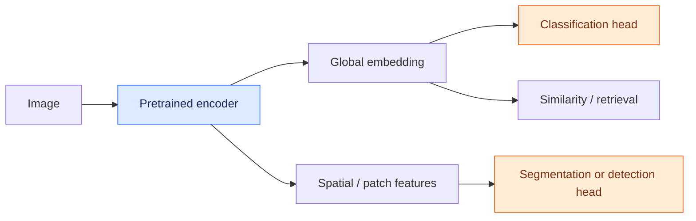
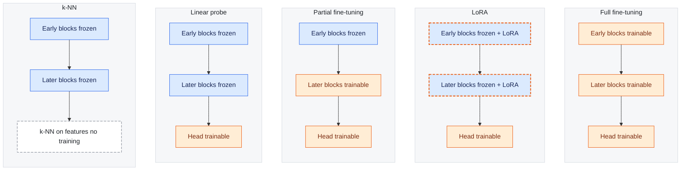

# CAS Deep Learning - Computer Vision — Course Notes

Plain-text version of the lecture notes, generated automatically from the
course website for use with AI assistants (e.g. as a project file in
ChatGPT or Claude). Figures, videos and interactive demos are omitted;
figure captions are kept. The last part contains the quiz and exam
preparation questions with reference answers. Online version: https://marco-willi.github.io/cas-dl-compvis-lectures/

Formulas use the following LaTeX macros:

```latex
\newcommand{\vect}[1]{\mathbf{#1}}
\newcommand{\m}[1]{\mathbf{#1}}
\newcommand{\rand}[1]{\textnormal{#1}}
\newcommand{\vrand}[1]{\mathbf{#1}}
\newcommand{\tensor}[1]{\mathbf{\mathsf{#1}}}
\newcommand{\N}{\mathbb{N}}
\newcommand{\floor}[1]{\lfloor#1\rfloor}
\newcommand{\bmat}{\left[\begin{array}}
\newcommand{\emat}{\end{array}\right]}
```


# 1 - Machine Learning

Source: https://marco-willi.github.io/cas-dl-compvis-lectures/pages/background/machine_learning.html

**Learning Objectives**

After reviewing this material you should be able to:

- Describe the data-driven approach to machine learning and its core workflow (collect, train, evaluate).
- Define what a model is mathematically and distinguish between parameters and hyperparameters.
- Explain the role of optimization in fitting models and identify common cost/loss functions.
- Justify why train/validation/test splits are necessary for unbiased model evaluation.
- Interpret the machine learning pipeline from data acquisition through deployment.
- Apply model selection principles to choose between competing models.

**TLDR Recap**

**The Data-Driven Approach:**
```python
def train(images, labels):
    return model  # Fit model to data

def predict(test_images, model):
    return model(test_images)  # Make predictions
```

**Core Concepts:**

- **Model**: Function $f_{\theta}(\mathbf{x}) = \hat{y}$ mapping inputs to outputs via learned parameters $\theta$
- **Optimization**: Find parameters that minimize loss: $\mathsf{argmin}_{\theta} J(f_{\theta}(\mathbf{X}), \mathbf{y})$
- **Hyperparameters**: Settings that control learning (learning rate, regularization) but aren't learned from data
- **Loss Functions**: Measure prediction error (MSE for regression, cross-entropy for classification)

**The ML Pipeline:**

1. **Data Acquisition** → Collect and prepare labeled dataset
2. **Preprocessing** → Normalize, encode features, reduce dimensionality
3. **Model Training** → Optimize parameters on training set
4. **Model Selection** → Compare models on validation set
5. **Evaluation** → Assess final model on held-out test set
6. **Deployment** → Integrate into production systems

**Train/Validation/Test Splits:**

- **Train set**: Used to optimize model parameters
- **Validation set**: Used to compare models and tune hyperparameters
- **Test set**: Final evaluation to estimate real-world performance (use only once!)
- **Why?** Training metrics are too optimistic; need unbiased performance estimates

**Key Insight:** The test set represents "future unseen data" - touching it during development leads to overfitting and unreliable performance estimates.

**Example Application:** Image super-resolution (shown in the figure):

- **Training data**: Low-res/high-res image pairs
- **Model**: CNN that learns to add high-frequency details
- **Loss**: Pixel-wise difference between predicted and true high-res
- **Evaluation**: PSNR, SSIM, perceptual similarity metrics

## The Data-Driven Approach

We follow a data-driven approach in machine learning to solve various tasks. Typically, the process involves:

- Collecting a dataset of observations (e.g. images) and their labels.
- Using a machine learning algorithm to train a model that learns to associate observations with labels.
- Evaluating/applying the model on new data.

```python

def train(observations, labels):
    """Train a Model"""
    # Fit Model here
    return model

def predict(test_observations, model):
    """Predict"""
    predictions = model(test_observations)
    return predictions
```

Now let's see this data-driven approach applied to a concrete computer vision task: **image super-resolution**. This example demonstrates how the same `train()` and `predict()` framework works for complex image processing problems.

Image super-resolution demonstration: Converting a low-resolution (100×100 pixels) image to high-resolution (400×400 pixels). The middle panel shows why naive upscaling fails—it remains pixelated. Machine learning models learn to add realistic high-frequency details.

**🤔 Think About It**

How would you train a model for image super-resolution? The task is to upscale low-resolution images to high-resolution with the best possible quality.

**Key considerations**

- **Training data**: Pairs of low-res and high-res images (can be created by downsampling high-res images)
- **Loss function**: Measure difference between predicted high-res and actual high-res
- **Architecture**: CNN that learns to add high-frequency details
- **Evaluation**: Visual quality metrics (PSNR, SSIM) and perceptual similarity

## Machine Learning Process

When modeling data, one often follows certain process steps: acquiring data, preparing it, training multiple models, selecting the most suitable model, estimating its future performance, and finally deploying it in production. the figure illustrates this process graphically.

Machine Learning Pipeline (Source: (raschka_python_2020))

At the core of a machine learning application is typically a mathematical model, which is fitted to a dataset so that it can then be used for prediction (in supervised learning). We often refer to 'models', meaning the mathematical description of the dataset.

## Models

A model is typically described as a function of a data point, generating an output $\hat{y}$:

\begin{align*}
f(\mathbf{x}^{(i)}) = \hat{y}^{(i)}
\end{align*}

Most models have parameters or coefficients that describe the model. The entirety of all parameters is denoted by $\theta$.

\begin{align*}
f_{\theta}(\mathbf{x}^{(i)}) \text{ or } f(\theta, \mathbf{x}^{(i)})
\end{align*}

For simplicity, we often omit $\theta$: $f(\mathbf{x}^{(i)})$

**Linear Regression Example**

To make this concrete, consider **linear regression**, one of the simplest models. It learns a straight line through data:

$$f_\theta(x) = \theta_0 + \theta_1 x$$

Where the **parameters** are:

- $\theta_0$ (intercept): Where the line crosses the y-axis
- $\theta_1$ (slope): How steep the line is

```python

import numpy as np
import matplotlib.pyplot as plt
import seaborn as sns
from sklearn.linear_model import LinearRegression
from typing import Callable

def create_linear_model_string(lr, feature_names=None):
    """Create string representation of linear model"""
    intercept = lr.intercept_.flatten()
    coefficients = lr.coef_.flatten()
    params = np.concatenate([intercept, coefficients])

    if not feature_names:
        feature_names = [f"x_{i + 1}^{{(i)}}" for i in range(0, len(coefficients))]
    param_strings = [
        f"{value:.4f} * {name}"
        for name, value in zip(["1"] + list(feature_names), params)
    ]
    formula = " + ".join(param_strings)
    return f"$y^{{(i)}} = {formula} + \\epsilon^{{(i)}}$"

def calculate_grid_1d(X: np.ndarray, model, step_size: float = 0.02):
    """Calculates Model Predictions on a Grid over the Space of X"""
    assert X.ndim == 1
    x_grid = np.arange(X.min(), X.max(), step_size)
    p = model.predict(x_grid.reshape(-1, 1))
    return x_grid, p.ravel()

def add_noise(x: np.ndarray, scale: float = 0.5, seed: int = 123):
    """Add random noise to inputs"""
    rng = np.random.default_rng(seed)
    return x + rng.normal(loc=0.0, scale=scale, size=x.shape)

def create_dataset(
    fun: Callable = lambda x: x,
    n_samples: int = 20,
    x_min: int = 0,
    x_max: int = 10,
    noise_scale: float = 0.3,
    seed: int = 0,
):
    """Sample Data from True Function."""
    x = np.linspace(0, x_max, n_samples).reshape(-1, 1)
    y = fun(x)
    # prevent negative values
    y_noise = np.clip(add_noise(y, scale=noise_scale, seed=seed), 0, np.inf)
    return x, y, y_noise

# Create synthetic dataset (from lecture 2)
X, y, y_noise = create_dataset(n_samples=40, noise_scale=1.0)

# Fit linear regression model
lr = LinearRegression()
lr = lr.fit(X, y_noise)
y_pred = lr.predict(X)
x_grid, y_grid = calculate_grid_1d(X.ravel(), lr)

# Create visualization
fig, ax = plt.subplots(figsize=(8, 5))
form = create_linear_model_string(lr)
title = "Linear Model 1-D\n" + form
_ = sns.scatterplot(x=X.ravel(), y=y_noise.ravel(), ax=ax).set(
    title=title, xlabel="x", ylabel="y"
)
_ = sns.lineplot(x=x_grid, y=y_grid, color="red")
_ = ax.vlines(
    X.ravel(), y_pred, y_noise, color="black", linestyles="dashed", linewidths=0.5
)
plt.show()

print(f"θ₀ (intercept): {lr.intercept_[0]:.3f}")
print(f"θ₁ (slope): {lr.coef_[0][0]:.3f}")
```

**Key insight**: The model $f_\theta(x)$ transforms any input $x$ into a prediction $\hat{y}$ using the learned parameters $\theta_0, \theta_1$.

## Optimization

The coefficients are fitted to a training dataset through an optimization procedure.

The optimization procedure can often be influenced by additional factors, called hyperparameters ($\alpha, \lambda, \dots$). These cannot be directly optimized.

The function/quantity to be optimized is usually called the cost function, i.e., cost function (other terms include objective function, loss function, etc.). We use $J(\cdot)$ to denote the cost function. Often, the cost function is also referred to as the loss function $L(\cdot)$. We use $l(\cdot)$ for the per-sample loss, i.e., the computation of the cost function on a single sample.

Our goal is to find a model (and its parameters) that minimizes the cost function:

\begin{equation*}
\mathsf{argmin}_{\theta, \lambda} J\Big(f_{\theta, \lambda}(\mathbf{X}), \mathbf{y}\Big)
\end{equation*}

**Linear Regression Loss Function**

For linear regression, we measure prediction errors using **Mean Squared Error (MSE)** or the **Least Squares** approach:

$$J(\theta) = \frac{1}{n}\sum_{i=1}^n (y^{(i)} - f_\theta(x^{(i)}))^2$$

Often a factor $\frac{1}{2n}$ is used to make the derivative computation more elegant:

$$J(\theta) = \frac{1}{2n}\sum_{i=1}^n (y^{(i)} - f_\theta(x^{(i)}))^2$$

**Intuition**:

- $(y^{(i)} - f_\theta(x^{(i)}))$ is the **residual** (error) for data point $i$
- Squaring penalizes large errors more than small ones
- We average over all $n$ training points

**Optimization goal**: Find parameters $\theta^* = [\theta_0^*, \theta_1^*]$ that minimize MSE:

$$\theta^* = \mathsf{argmin}_{\theta} J(\theta)$$

```python

from scipy.stats import norm

def calculate_x_y_coordinates_of_normal(x, y, std):
    """Calculate the x and y coordinates of a vertically drawn normal distr
    at location x and y
    """
    width_of_distr = 2.0
    rv_norm = norm(loc=0, scale=std)
    y_values_norm = np.arange(0 + 2 * std, 0 - 2 * std, -0.1)
    x_values_norm = rv_norm.pdf(y_values_norm)
    x_values_norm = (
        np.abs(x_values_norm * width_of_distr)
        - np.min(np.abs(x_values_norm) * width_of_distr)
        + x
    )
    y_values_norm += y
    return x_values_norm, y_values_norm

# Use the same dataset from Models section
std = np.std(y_noise - y_pred)

fig, ax = plt.subplots(figsize=(8, 5))
form = "$p(y|x) = \\mathcal{N}(wx, \\sigma^2) = \\mathcal{N}(\\hat{y}, \\sigma^2)$"
title = "Lineare Regression 1-D\n" + form
_ = sns.scatterplot(x=X.ravel(), y=y_noise.ravel(), ax=ax).set(
    title=title, xlabel="x", ylabel="y"
)
_ = sns.lineplot(x=x_grid, y=y_grid, color="red")

for x_loc in np.arange(1, 9, 2.0):
    y_loc = lr.predict(np.array([x_loc]).reshape(-1, 1))
    x_values_norm, y_values_norm = calculate_x_y_coordinates_of_normal(
        x=x_loc, y=y_loc.ravel(), std=std
    )
    _ = ax.plot(x_values_norm, y_values_norm, color="green", linewidth=1.5)
    _ = ax.vlines(
        x=x_loc,
        ymin=np.min(y_values_norm),
        ymax=np.max(y_values_norm),
        colors="green",
        ls="--",
        lw=1.5,
    )
plt.show()

# Compute and display the MSE
from sklearn.metrics import mean_squared_error

mse = mean_squared_error(y_noise, y_pred)
print(f"Training MSE: {mse:.3f}")
print(f"Standard deviation of residuals: {std:.3f}")
print(f"The optimization found: θ₀*={lr.intercept_[0]:.3f}, θ₁*={lr.coef_[0][0]:.3f}")
```

**Geometric interpretation**: Among all possible lines, we found the one with the smallest average squared distance to the data points.

Usually, preprocessing of variables precedes the learning of the coefficients. Forms of preprocessing include standardizing, normalizing, feature encoding, dimensionality reduction, and more. This preprocessing also affects the optimization procedure and can be considered hyperparameters.

## Model Selection

Model selection is one of the most important and complex components of the machine learning process. This step involves comparing multiple models and selecting the "best" model for the task to be modeled. Which model is the "best" must be defined based on a metric that measures the model's performance.

**Evaluation Metrics** are crucial for quantifying model performance and vary depending on the problem type. For **regression tasks**, common metrics include:

- **Mean Squared Error (MSE)**: $\text{MSE} = \frac{1}{n}\sum_{i=1}^n (y_i - \hat{y}_i)^2$, which penalizes large errors heavily
- **Mean Absolute Error (MAE)**: $\text{MAE} = \frac{1}{n}\sum_{i=1}^n |y_i - \hat{y}_i|$, which treats all errors equally

For **classification tasks**, key metrics include:

- **Accuracy**: How often is the model correct (fraction of correct predictions).
- **Precision**: If it predicts a specific class, how often is it correct (true positives / predicted positives).
- **Recall**: How many of the target class does the model identify correctly (true positives / actual positives).
- **F1-Score**: Precision can be traded against Recall, to balance both we can report F1 (harmonic mean of precision and recall).

The choice of metric depends on the specific application—for example, in medical diagnosis, recall might be more important than precision to avoid missing positive cases. Different ML-frameworks will implement these and many other evaluation metrics.

If we calculate the value of the metric on the training dataset, our model is usually too optimistic about its general performance. This is because the data points in the training dataset were directly used to optimize the cost function, and the model coefficients are thus optimally adjusted to them. New data points, for which predictions are to be made, could not have been used for optimization. Therefore, a dataset is usually divided into a training set and a test set. The model is trained with the training set and its performance is measured on the test set. When comparing many models, it is advisable to compare them on a separate validation set (see the figure) and evaluate only the best model on the test set. This makes the estimate on the test set more accurate.

Train-Test Split to select and evaluate models.


# 2 - Neural Networks

Source: https://marco-willi.github.io/cas-dl-compvis-lectures/pages/background/neural_networks.html

**Learning Objectives**

After this lecture you should be able to:

- Explain the relationship between linear models and multilayer perceptrons.
- Describe why activation functions enable non-linear function approximation.
- Interpret the role of depth vs width (efficiency of representation, hierarchical features).
- Implement and configure simple MLP architectures in PyTorch.

**TLDR Recap**

**From Linear to Non-Linear:**

- Linear models: $f(\mathbf{x}) = \mathbf{W}\mathbf{x} + \mathbf{b}$ (limited to linear decision boundaries)
- Neural networks add **activation functions** (ReLU, sigmoid, tanh) enabling non-linear mappings
- Without activation functions, multiple layers collapse to a single linear transformation

**Key Concepts:**

- **Layers**: Input → Hidden (intermediate computations) → Output
- **Activation Functions**: ReLU most common ($\max(0,x)$), enables modeling complex patterns
- **Universal Approximation**: Shallow networks can approximate any continuous function (theoretically)
- **Depth vs Width**: Deep networks more efficient than wide shallow ones for complex functions

**Why Deep Learning Works:**

- **Hierarchical Features**: Early layers learn simple patterns (edges, colors) → deeper layers learn complex concepts (objects, faces)
- **Efficiency**: Adding depth requires fewer neurons than increasing width
- **Biological Inspiration**: Mimics hierarchical processing in visual cortex

**Architecture Components:**

- **Multilayer Perceptron (MLP)**: Fully connected layers with activation functions
- **Parameters**: Weights $\mathbf{W}$ and biases $\mathbf{b}$ learned via optimization (backpropagation)
- **Example**: 784 → 128 → 10 network has ~102K parameters (784×128 + 128×10 + biases)

**Practical Implementation (PyTorch):**
```python
model = nn.Sequential(
    nn.Flatten(),
    nn.Linear(784, 128),
    nn.ReLU(),
    nn.Linear(128, 10)
)
```

**Key Takeaway:** Neural networks transform inputs through learned hierarchical representations, with activation functions enabling the non-linearity needed to solve complex real-world problems.

## Biological Neural Networks

A biological neural network is a part of the nervous system and consists of interconnected neurons. A neuron is connected to other neurons via dendrites (these are "weighted" input signals) and via the axon (output signal) (see the figure). If the input signals exceed a certain threshold, the neuron "fires" and sends a signal through the axon, which then serves as an input signal for other neurons. Humans have about 86 billion neurons, each connected to about 1000 others on average ([See Wikipedia](https://en.wikipedia.org/wiki/Brain)).

Schematic representation of connected neurons. (phillips_speed_2015)

Optical signals are processed, among other things, in the visual cortex (the figure). Signals are processed hierarchically, with the first layers recognizing simple patterns and later layers recognizing shapes and objects. See also the work of Hubel and Wiesel (hubel_receptive_1959).

Representation of transformations in the visual cortex. (kubilius_ventral_2017)

The question that arises is:

**Can we create artificial neural networks and reproduce the performance of biological neural networks?**

## Artificial Neural Networks

Artificial neural networks are models of biological networks. Such models were created and implemented technically as early as the 1940s.

Neural networks are often represented with a graph. The _nodes_ are individual neurons in the network, and the _edges_ are connections between the neurons (see the figure). The neurons are arranged in _layers_, with each neuron in a layer connected to every neuron in adjacent layers. The _input layer_ represents the data, the _output layer_ the (observable) outputs, and the _hidden layers_ are within the network. The connections between the neurons are weighted.

A neural network with two _hidden layers_. The lines show connections between neurons. Source: (li_cs231n_2022).

## From Linear Models to Neural Networks

In the following, we will describe neural networks mathematically. We start with a linear model. A linear model has the following form (see the equation):

$$
   f(\mathbf{x}^{(i)}) = \mathbf{W} \mathbf{x}^{(i)}  +  \mathbf{b}
$$

With the following elements:

- The $i$-th data point $\vect{x}^{(i)}$ is a $p$-dimensional vector: $\in \mathbb{R}^{p \times 1}$
- Model weights $\m{W} \in \mathbb{R}^{k \times p}$ linearily project the data point to $k$ dimensions.
- A bias term $\vect{b} \in \mathbb{R}^{k \times 1}$ is added to the result.

$f(\mathbf{x}^{(i)})$ is thus $\in  \mathbb{R}^{k \times 1}$.

The following parameters must be learned from training data using an optimization method: $\m{W}$ and $\vect{b}$.

In neural networks, the linear model is extended with additional _layers_. the equation defines a neural network with two layers (one hidden layer $\m{W}^{(1)}, \vect{b}^{(1)}$ and one output layer $\m{W}^{(2)}, \vect{b}^{(2)}$).

$$
   f(\vect{x}^{(i)}) = \m{W}^{(2)} g\big(\m{W}^{(1)} \vect{x}^{(i)}  +  \vect{b}^{(1)} \big)  +  \vect{b}^{(2)}
$$

Where $g()$ is an _activation function_, such as the _ReLU_ function shown in the equation. Only due to _activation functions_ non-linear relationships can be modelled. Without activation functions, the model collapses to a simple linear model with one layer.

$$
\text{ReLU}(x) = \begin{cases}
x, & \text{if } x \geq 0 \\
0, & \text{if } x < 0
\end{cases}
$$

Every layer between the input and output layer is called a _hidden layer_.

Typically, not just one data point is processed but a _mini-batch_ of data, or even the entire dataset. The data points are arranged in a data matrix $\m{X} \in \mathbb{R}^{n \times p}$. The linear model from the equation can be rewritten in matrix notation as shown in the equation.

$$
   f( \m{X}) = \m{X} \m{W}^T  +  \vect{b}^T
$$

The bias term $\vect{b}$ is _broadcast_ ([details here](https://pytorch.org/docs/stable/notes/broadcasting.html)), so it can be added to each projected input.

### Activation Functions

The following code shows how _activation_ functions are important for modeling non-linear relationships. The model has a hidden layer with several neurons but (left) no activation function and (right) with _ReLU_ activation.

```python

from matplotlib import pyplot as plt
import numpy as np
from sklearn.datasets import make_blobs
from sklearn.neural_network import MLPClassifier
from mlxtend.plotting import plot_decision_regions

def plot_non_linear_vs_linear():
    fig, ax = plt.subplots(figsize=(12, 6), ncols=2)

    X, y = make_blobs(
        n_samples=100,
        n_features=2,
        random_state=0,
        cluster_std=0.5,
        centers=[(-1, -1), (1, 1), (-1, 1), (1, -1)],
    )
    y = np.where(y < 2, 1, 0)

    clf = MLPClassifier(
        hidden_layer_sizes=[10],
        activation="identity",
        max_iter=200,
        random_state=123,
        learning_rate_init=1.0,
    ).fit(X, y)
    _ = plot_decision_regions(X, y, clf, ax=ax[0])

    clf = MLPClassifier(
        hidden_layer_sizes=[10],
        activation="relu",
        max_iter=400,
        random_state=123,
        learning_rate_init=0.1,
    ).fit(X, y)
    _ = plot_decision_regions(X, y, clf, ax=ax[1])

    _ = ax[0].set_title("Linear: $g(x) = x$")
    _ = ax[1].set_title("Non-Linear: $g(x) = ReLU(x)$")

    return fig

fig = plot_non_linear_vs_linear()
plt.show()
```

the figure now shows a neural network including _activation functions_ (ReLU). Sometimes the biases are also shown as nodes that feed into the next layer.

A neural network with a _hidden layer_. The lines show connections between neurons and their weights $w_{i,j}$.

**Activation Function Cheat Sheet**

Common choices:

- ReLU: $\max(0, x)$ (sparse activations, mitigates vanishing gradients).
- LeakyReLU / GELU: Smoother or with negative slope; GELU often used in transformers.
- Sigmoid: Saturates; mainly for probabilities/logits output.
- Tanh: Zero-centered but still saturates; rarely preferred over ReLU-family now.
- Softplus / Mish / Swish: Smooth alternatives; sometimes modest gains, higher compute.

Guideline: Start with ReLU (or GELU for transformer-like blocks); change only if you have empirical evidence.

### Universal Approximation Theorem

With a shallow neural network, any continuous function can be modeled with arbitrary accuracy (_Universal Approximation Theorem_). The following graphic illustrates that as the number of linear functions (and thus piecewise linear regions) increases, the approximation of the underlying function becomes more accurate.

Approximation of a 1-D function with piecewise linear regions. The more regions, the more accurate the approximation. Source: (prince_understanding_2023)

**Neural networks are therefore a particularly powerful class of models!**

## Refresh your neural network know-how!

## Deep Learning

Using neural networks with multiple _hidden layers_ is refered to as deep learning. the figure illustrates such a model with 5 hidden layers and ReLU activation functions. Such a neural network is also called a _multilayer perceptron_ (MLP) or a _fully connected neural network_ or a network with _dense layers_. It consists of linear layers and activation functions.

Illustration of a _deep learning_ model with 5 _hidden layers_, from (johnson_eecs_2022)

Although _shallow neural networks_ can theoretically model arbitrarily complex functions, the number of neurons required is often impractical. It can be shown that adding _hidden layers_ (increasing the depth of a network) is much more efficient (requires fewer neurons) for modeling complex functions.

In practice, it has been shown that the first layers in a network learn simple features. These are combined in deeper layers to learn and detect increasingly abstract concepts. This is well illustrated with images. When a neural network is applied to images, the first layers learn to detect simple features, such as edges and colors. Further layers then detect shapes and objects, leading to specific items or people (see the figure).

Hierarchical features, from (lee_unsupervised_2011)

**Train Neural Networks in your Browser!**

To directly observe the functioning of a neural network and try out the influence of various configurations, you can train networks directly in the browser using the following link: [TensorFlow Playground](https://playground.tensorflow.org/).

## Implementation in PyTorch

The following code shows how we can implement a configurable neural network.

```python

import torch
import torch.nn as nn
import torch.nn.functional as F

class MLP(nn.Module):
    def __init__(self, input_size, hidden_layer_sizes, num_outputs):
        super().__init__()

        # Initialize submodules of your module - typically layers
        # that your module needs - these can then be used in the
        # forward pass

        self.flatten = nn.Flatten()

        # a ModuleList allows you to flexibly chain submodules
        # in a list - depending e.g. on configuration parameters

        self.hidden_layers = nn.ModuleList()
        last_size = input_size
        for size in hidden_layer_sizes:
            self.hidden_layers.append(nn.Linear(last_size, size))
            last_size = size

        self.output_layer = nn.Linear(last_size, num_outputs)

    def forward(self, x):
        """The forward pass of your module."""
        x = self.flatten(x)
        for layer in self.hidden_layers:
            x = F.relu(layer(x))
        x = self.output_layer(x)
        return x

# Example usage:
# Initialize the model with input size 784, one hidden layer of size 128, and 10 output units.
model = MLP(784, [128], 10)

# Example input vector (batch size of 32, input size of 784)
x = torch.randn(32, 784)

# Forward pass
output = model(x)
```

We can easily display the architecture details with `torchinfo`

```python

# Display the model architecture
from torchinfo import summary
summary(model, input_size=(32, 784))
```

**Question**

How many parameters does this neural network have, and why?

**Answer**

Based on the `torchinfo` summary output above, the network has:

**Layer 1**: 784 inputs × 128 hidden units + 128 biases = **100,480 parameters**

**Layer 2**: 128 inputs × 10 outputs + 10 biases = **1,290 parameters**

**Total: 101,770 parameters**

Each fully connected layer has:
- Weight matrix of size (input_dim × output_dim)
- Bias vector of size (output_dim)

This is why the number of parameters grows quickly with network size!


# 3 - Software & Hardware

Source: https://marco-willi.github.io/cas-dl-compvis-lectures/pages/background/frameworks.html

**Learning Objectives**

After this lecture you should be able to:

- Explain the role of computational graphs and automatic differentiation in deep learning frameworks.
- Construct and inspect tensors, modules, and optimization loops in PyTorch.
- Distinguish autograd vs manual gradient computation and identify common pitfalls (forgetting zero_grad, device mismatches).
- Describe core hardware considerations (GPU parallelism, data loading bottlenecks, CUDA/cuDNN impact).
- Load and adapt pre-trained models responsibly for downstream tasks.

**TLDR Recap**

**PyTorch Fundamentals:**

- **Tensors**: Multi-dimensional arrays (like NumPy) optimized for GPU computation
- **Autograd**: Automatic differentiation via computational graphs
- **Dynamic Graphs**: Built on-the-fly during forward pass for flexibility
- **Device Management**: Easy CPU ↔ GPU transfer with `.to(device)`

**Training Loop Structure:**
```python
model.train()  # Training mode
for X_batch, y_batch in dataloader:
    optimizer.zero_grad()        # Clear old gradients
    y_pred = model(X_batch)      # Forward pass
    loss = criterion(y_pred, y_batch)  # Compute loss
    loss.backward()              # Backward pass (compute gradients)
    optimizer.step()             # Update parameters
```

**Key Components:**

- **nn.Module**: Base class for all neural network layers and models
- **Loss Functions**: MSE, CrossEntropy, etc. (in `torch.nn`)
- **Optimizers**: SGD, Adam, etc. (in `torch.optim`)
- **DataLoader**: Efficient batching and shuffling of datasets

**Common Patterns:**

- Use `model.eval()` and `torch.no_grad()` for inference/validation
- Move data and model to same device: `X.to(device)`, `model.to(device)`
- Save/load models: `torch.save(model.state_dict(), path)`

**Hardware Considerations:**

- GPUs enable parallel computation essential for deep learning
- CUDA/cuDNN optimize neural network operations on NVIDIA GPUs
- Data loading can be a bottleneck (GPU starvation) - use multi-threaded data loaders
- GPU parallelism: data parallelism (model copies) vs model parallelism (split model)

**Best Practices:**

- Always call `optimizer.zero_grad()` before backward pass
- Use appropriate loss functions for your task
- Monitor training on validation set to detect overfitting
- Leverage GPU when available for significant speedup

## Deep Learning Software

There are a variety of Deep Learning frameworks. These frameworks allow for easy configuration, training, and deploying of neural networks. They are often developed via Python API. the figure shows some frameworks.

Frameworks (from (li_cs231n_2022)).

Key features of such frameworks are:

- Fast development and testing of neural networks
- Automatic differentiation of operations
- Efficient execution on diverse hardware

### Computational Graph & Autograd

At the core of neural networks is the _Computational Graph_. It automatically embeds dependent operations in a _directed acyclic graph (DAG)_. Gradients are tracked as needed, allowing variables to be efficiently updated/trained.

the figure displays a graph, representing the equation. An example with numpy is shown in the listing, using random data to evaluate the function including the derivatives.

$$
    f(\mathbf{A}, \mathbf{B}, \mathbf{C}) =  \sum_{ij} \big((\mathbf{A} \odot \mathbf{B}) + \mathbf{C}\big)_{ij}
$$

Computational Graph.

```python
import numpy as np

np.random.seed(123)

H, W = 2, 3

a = np.random.random(size=(H, W))
b = np.random.random(size=(H, W))
c = np.random.random(size=(H, W))

d = a * b
e = d + c
f = e.sum()

df_de = 1.0               # d f / d e
de_dd = 1.0               # d e / d d   (since e = d + c)
de_dc = np.ones_like(c)   # d e / d c   (derivative of addition w.r.t. c)
dd_da = b                 # d (a*b) / d a
dd_db = a                 # d (a*b) / d b

df_da = df_de * de_dd * dd_da          # chain rule
df_db = df_de * de_dd * dd_db
df_dc = df_de * de_dc                  # equals ones

print("df/da=\n", df_da)
print("df/db=\n", df_db)
print("df/dc=\n", df_dc)

```

the listing shows the same example in PyTorch. Using `x.backward()`, gradients with respect to `x` are computed for variables connected to `x`.

```python
import torch

np.random.seed(123)

H, W = 2, 3

a = torch.tensor(a, requires_grad=True)
b = torch.tensor(b, requires_grad=True)
c = torch.tensor(c, requires_grad=True)

d = a * b
e = d + c
f = e.sum()

f.backward()
print(a.grad)

```

the figure shows the nodes of the computational graph.

```python
from torchviz import make_dot
make_dot(f, params={'a': a, 'b': b, 'c': c, 'f':f , 'd': d, 'e':e })
```

To perform the computation on a GPU, a simple instruction (see the listing).

```python
device = "cuda" if torch.cuda.is_available() else "cpu"
print(f"Using {device} device")

a = a.to(device=device)
b = b.to(device=device)
c = c.to(device=device)
```

## PyTorch

In this class, we use PyTorch. PyTorch has gained enormous popularity in recent years and stands out for its high flexibility, a clean API, and many open-source resources.

**Why PyTorch?**

**Key Advantages:**

- **Pythonic API**: Feels natural to Python developers, easy to debug
- **Dynamic computation graphs**: Build graphs on-the-fly, great for research
- **Strong ecosystem**: torchvision (CV), torchaudio (audio), transformers library integration
- **Industry & research adoption**: Used by Meta, [Tesla](https://youtu.be/oBklltKXtDE?si=arGXjt3JX6NbpStj&t=116), OpenAI, and top ML research labs ([Source](https://pytorch.org/blog/pytorch-the-open-language-of-ai/))
- **Excellent documentation**: Comprehensive tutorials and active community

**When to use PyTorch:**

- Research projects requiring flexibility
- Computer vision and NLP applications
- When you need fine-grained control over training loops
- Prototyping new architectures or training procedures

### Fundamental Concepts

PyTorch is built around three core concepts:

- **Tensor**: N-dimensional array, similar to [`numpy.array`](https://numpy.org/doc/stable/reference/generated/numpy.array.html) but with GPU acceleration
- **Autograd**: Automatic differentiation to create computational graphs and compute gradients
- **Module**: Base class (`nn.Module`) to define components of neural networks with learnable parameters

### Tensors

[`torch.Tensor`](https://pytorch.org/docs/stable/tensors.html) is the central data structure in PyTorch. Essentially very similar to `numpy.array`, it can be easily loaded onto GPUs.

Tensors can be created in various ways. For example, from lists:

```python
data = [[1, 2],[3, 4]]
x_data = torch.tensor(data)
print(x_data)
```

Or from numpy.ndarray:

```python
np_array = np.array(data)
x_np = torch.from_numpy(np_array)
print(x_np)
```

Or from other tensors:

```python
x_ones = torch.ones_like(x_data) # retains the properties of x_data
print(f"Ones Tensor: \n {x_ones} \n")

x_rand = torch.rand_like(x_data, dtype=torch.float) # overrides the datatype of x_data
print(f"Random Tensor: \n {x_rand} \n")
```

Or with randomly generated numbers or constants:

```python
shape = (2,3,)
rand_tensor = torch.rand(shape)
ones_tensor = torch.ones(shape)
zeros_tensor = torch.zeros(shape)

print(f"Random Tensor: \n {rand_tensor} \n")
print(f"Ones Tensor: \n {ones_tensor} \n")
print(f"Zeros Tensor: \n {zeros_tensor}")
```

Tensor attributes:

```python
tensor = torch.rand(3,4)

print(f"Shape of tensor: {tensor.shape}")
print(f"Datatype of tensor: {tensor.dtype}")
print(f"Device tensor is stored on: {tensor.device}")
```

There are over 100 operations that can be performed on a tensor. The full list is available [here](https://pytorch.org/docs/stable/torch.html).

Indexing and Slicing:

```python
tensor = torch.ones(4, 4)
print(f"First row: {tensor[0]}")
print(f"First column: {tensor[:, 0]}")
print(f"Last column: {tensor[:, -1]}")
tensor[:,1] = 0
print(tensor)
```

Joining tensors:

```python
t1 = torch.cat([tensor, tensor, tensor], dim=1)
print(t1)
```

Arithmetic operations:

```python
# This computes the matrix multiplication between two tensors. y1, y2, y3 will have the same value
y1 = tensor @ tensor.T
y2 = tensor.matmul(tensor.T)

y3 = torch.rand_like(y1)
torch.matmul(tensor, tensor.T, out=y3)

# This computes the element-wise product. z1, z2, z3 will have the same value
z1 = tensor * tensor
z2 = tensor.mul(tensor)

z3 = torch.rand_like(tensor)
torch.mul(tensor, tensor, out=z3)
```

### Autograd

To train neural networks, backpropagation is typically used. This calculates the gradient of the loss function with respect to the model parameters. To compute these gradients, PyTorch provides an _auto-diff_ functionality:
[`torch.autograd`](https://pytorch.org/docs/stable/autograd.html). This can automatically compute gradients for a _computational graph_.

**Autograd Key Points**

- Set `requires_grad=True` on tensors you want to track for gradient computation
- Call `.backward()` on a scalar loss to compute all gradients
- Access gradients via `.grad` attribute of tensors
- Use `torch.no_grad()` context for inference to save memory and speed up computation

The following is an example using a 1-layer neural network (see the figure ):

Source: [PyTorch](https://pytorch.org/tutorials/beginner/basics/autogradqs_tutorial.html)

The network from the figure is defined in PyTorch code in the listing.

```python
import torch

x = torch.ones(5)  # input tensor
y = torch.zeros(3)  # expected output
w = torch.randn(5, 3, requires_grad=True)
b = torch.randn(3, requires_grad=True)
z = torch.matmul(x, w)+b
loss = torch.nn.functional.binary_cross_entropy_with_logits(z, y)
```

We can now use Autograd to compute the gradient:

```python
loss.backward()
print(w.grad)
print(b.grad)
```

### torch.nn

PyTorch provides various building blocks for creating neural networks. These are available in [`torch.nn`](https://pytorch.org/docs/stable/nn.html). Additionally, you can define any compositions of such building blocks that inherit from [`torch.nn.Module`](https://pytorch.org/docs/stable/generated/torch.nn.Module.html#torch.nn.Module). A neural network is typically a `torch.nn.Module`. Each module implements the `forward()` method to define how data is processed.

**Building Blocks in torch.nn**

**Common layers:**

- `nn.Linear`: Fully connected layer
- `nn.Conv2d`: 2D convolutional layer
- `nn.MaxPool2d`: Max pooling layer
- `nn.Dropout`: Regularization via random dropout
- `nn.BatchNorm2d`: Batch normalization

**Common activations:**

- `nn.ReLU()`, `nn.LeakyReLU()`, `nn.GELU()`
- `nn.Sigmoid()`, `nn.Softmax()`

**Loss functions:**

- `nn.CrossEntropyLoss()`: Classification
- `nn.BCEWithLogitsLoss()`: Binary classification
- `nn.MSELoss()`: Regression

the listing depicts an example of a class that inherits from `torch.nn.Module`.

```python
from torch import nn

class NeuralNetwork(nn.Module):
    def __init__(self):
        super(NeuralNetwork, self).__init__()
        self.flatten = nn.Flatten()
        self.linear_relu_stack = nn.Sequential(
            nn.Linear(28*28, 512),
            nn.ReLU(),
            nn.Linear(512, 512),
            nn.ReLU(),
            nn.Linear(512, 10),
        )

    def forward(self, x):
        x = self.flatten(x)
        logits = self.linear_relu_stack(x)
        return logits
```

You can also visualize the model:

```python
model = NeuralNetwork()
print(model)
```

To use the model, you can pass input data. This will execute the `forward()` method, along with background operations.

```python
X = torch.rand(1, 28, 28)
logits = model(X)
pred_probab = nn.Softmax(dim=1)(logits)
y_pred = pred_probab.argmax(1)
print(f"Predicted class: {y_pred}")
```

The executed operations will look like this:

```python
from torchviz import make_dot
make_dot(logits)
```

For more in-depth information about the model you can use the external library  [torchinfo](https://github.com/tyleryep/torchinfo) as seen in the listing.

```python
from torchinfo import summary
model = NeuralNetwork()
summary(model, input_size=(128, 1, 28, 28))
```

### torch.optim

To optimize the parameters of a model, you need an optimization algorithm. [`torch.optim`](https://pytorch.org/docs/stable/optim.html) implements various algorithms, such as _Stochastic Gradient Descent_ or the often used _Adam Optimizer_.

**Common Optimizers**

- **SGD**: Basic stochastic gradient descent (with optional momentum)
- **Adam**: Adaptive learning rates, good default choice
- **AdamW**: Adam with weight decay, often better for transformers (see (loshchilov_decoupled_2019))
- **RMSprop**: Adaptive learning rates, good for RNNs
- **Learning rate schedulers**: Adjust learning rate during training (e.g., `torch.optim.lr_scheduler`)

**Rule of thumb**: Start with Adam, then try SGD with momentum if you need better generalization.

```python
from torch import optim
optimizer = optim.SGD(model.parameters(), lr=0.01, momentum=0.9)
```

You can then use the optimizer to adjust the parameters by minimizing a loss function. See the listing for an example.

```python
loss_fn = torch.nn.CrossEntropyLoss()
for i in range(0, 3):
    input, target = torch.rand(1, 28, 28), torch.randint(low=0, high=10, size=(1, ))
    optimizer.zero_grad()
    output = model(input)
    loss = loss_fn(output, target)
    loss.backward()
    optimizer.step()
```

**Common Pitfalls & Solutions**

**Pitfall 1: Forgetting zero_grad()**
```python
# ❌ Wrong - gradients accumulate
for batch in dataloader:
    loss = compute_loss(batch)
    loss.backward()
    optimizer.step()

# ✅ Correct
for batch in dataloader:
    optimizer.zero_grad()  # Clear previous gradients
    loss = compute_loss(batch)
    loss.backward()
    optimizer.step()
```

**Pitfall 2: Device mismatch**
```python
# ❌ Wrong - model on GPU, data on CPU
model = model.cuda()
for batch_x, batch_y in dataloader:
    pred = model(batch_x)  # Error!

# ✅ Correct
model = model.cuda()
for batch_x, batch_y in dataloader:
    batch_x = batch_x.cuda()
    batch_y = batch_y.cuda()
    pred = model(batch_x)
```

**Pitfall 3: Not using eval() mode for inference**
```python
# ❌ Wrong - dropout and batchnorm active during inference
predictions = model(test_data)

# ✅ Correct
model.eval()
with torch.no_grad():
    predictions = model(test_data)
model.train()  # Switch back to training mode
```

### Training Loops

Typically, you put together a training loop to train a model. A training loop iterates over batches of data and optimizes the model parameters with each iteration.

```python
def train_loop(dataloader, model, loss_fn, optimizer):
    size = len(dataloader.dataset)
    model.train()  # <-- important!
    for batch, (X, y) in enumerate(dataloader):
        # Compute prediction and loss
        pred = model(X)
        loss = loss_fn(pred, y)

        # Backpropagation
        optimizer.zero_grad()
        loss.backward()
        optimizer.step()

        if batch % 100 == 0:
            loss, current = loss.item(), batch * len(X)
            print(f"loss: {loss:>7f}  [{current:>5d}/{size:>5d}]")

def test_loop(dataloader, model, loss_fn):
    model.eval()  # <-- important!

    size = len(dataloader.dataset)
    num_batches = len(dataloader)
    test_loss, correct = 0, 0

    with torch.no_grad():  # disables gradient tracking for efficiency
        for X, y in dataloader:
            pred = model(X)
            test_loss += loss_fn(pred, y).item()
            correct += (pred.argmax(1) == y).type(torch.float).sum().item()

    test_loss /= num_batches
    correct /= size
    print(
        f"Test Error:\n Accuracy: {(100 * correct):>0.1f}%, Avg loss: {test_loss:>8f}\n"
    )
```

```python

loss_fn = nn.CrossEntropyLoss()
optimizer = torch.optim.SGD(model.parameters(), lr=learning_rate)

epochs = 10
for t in range(epochs):
    print(f"Epoch {t+1}\n-------------------------------")
    train_loop(train_dataloader, model, loss_fn, optimizer)
    test_loop(test_dataloader, model, loss_fn)
print("Done!")
```

High-level APIs such as [Lightning](https://lightning.ai/) and [Keras](https://keras.io/) provide many functionalities to simplify managing training loops. It is highly recommended to use such libraries to reduce boiler-plate code. However, it depends on the individual complexity of a project to what degree such libraries are useful.

### Pre-trained models

Since training models can be time-consuming and expensive, pre-trained models are often used. They allow models to be adapted to a specific task more quickly and cost-effectively. In many areas, particularly NLP and computer vision, using pre-trained models is standard. PyTorch provides [`torchvision`](https://pytorch.org/vision/stable/index.html) for computer vision applications. `torchvision` provides functionalities useful for modeling image data. Pre-trained models can also be easily integrated, as shown in the listing.

```python

from torchvision.models import resnet50, ResNet50_Weights

weights = ResNet50_Weights.IMAGENET1K_V2
model = resnet50(weights=weights)
```

## Other Frameworks

Other important frameworks are listed below (not exhaustive).

### TensorFlow

For a long time, PyTorch and TensorFlow have been the two dominant deep learning frameworks.
TensorFlow, developed by Google, is known for its production-readiness, ecosystem integration (e.g., [TensorFlow Extended (TFX)](https://www.tensorflow.org/tfx) for MLOps pipelines, [LiteRT](https://ai.google.dev/edge/litert) for mobile, and [TensorFlow.js](https://www.tensorflow.org/js) for web), and its scalability across distributed hardware.

In recent years, however, TensorFlow’s low-level API has become less popular in research compared to PyTorch, which offers more flexibility and Pythonic design. Today, most TensorFlow users rely almost exclusively on Keras, its high-level API, to define and train models, while the TensorFlow backend provides performance, device management, and deployment capabilities.

### Keras
[Keras](https://keras.io/) started as an independent high-level deep learning API designed to simplify model creation with a clean and intuitive syntax.
Since 2017, it has been tightly integrated into TensorFlow as its official front-end (tf.keras), and in 2023, Keras Core was introduced, a framework-agnostic version that can run on multiple backends such as TensorFlow, JAX, and PyTorch.

Keras focuses on ease of use, modularity, and rapid prototyping, making it an excellent choice for teaching, applied machine learning, and fast experimentation, while still being production-ready through TensorFlow’s ecosystem.  See the listing for example code using Keras.

```python
import tensorflow as tf

class NeuralNetwork(tf.keras.Model):
    def __init__(self):
        super(NeuralNetwork, self).__init__()
        self.flatten = tf.keras.layers.Flatten()
        self.linear_relu_stack = tf.keras.Sequential([
            tf.keras.layers.Dense(512, activation='relu'),
            tf.keras.layers.Dense(512, activation='relu'),
            tf.keras.layers.Dense(10)  # No activation for logits
        ])

    def call(self, x):
        x = self.flatten(x)
        logits = self.linear_relu_stack(x)
        return logits
```

### Jax

[Jax](https://jax.readthedocs.io/en/latest/) has gained significant popularity in recent years. Developed by researchers at Google, it is primarily used in research and foundation-model development. Jax provides a NumPy-like API with automatic differentiation (autodiff) and function transformations such as jit (for compilation) and vmap (for vectorization). It enables high-performance, composable numerical computing, and serves as the foundation for frameworks such as [Flax (Neural Networks)](https://flax.readthedocs.io/en/stable/) and [Haiku (ML Research)](https://dm-haiku.readthedocs.io/en/latest/). See the listing for an example using [Flax](https://flax.readthedocs.io/en/latest/).

```python
from flax import linen as nn
import jax.numpy as jnp

class NeuralNetwork(nn.Module):
    @nn.compact
    def __call__(self, x):
        x = x.reshape((x.shape[0], -1))  # Flatten the input
        x = nn.Dense(512)(x)
        x = nn.relu(x)
        x = nn.Dense(512)(x)
        x = nn.relu(x)
        logits = nn.Dense(10)(x)
        return logits

```

### Scikit-Learn

[`Scikit-Learn`](https://scikit-learn.org/stable/) is THE machine learning framework in Python. However, Scikit-Learn never covered the area of neural networks and lacks auto-diff functionality. Therefore, Scikit-Learn is irrelevant when training neural networks. However, Scikit-Learn functionalities are often used to carry out the machine learning process, such as splitting datasets into train, validation, and test sets. Also, visualizations, such as the confusion matrix or calculating metrics, can be done via Scikit-Learn.

### ONNX
y§
[ONNX](https://onnx.ai/) (Open Neural Network Exchange) is an open format to represent machine learning models. It allows models trained in one framework to be transferred to another. Trained models can also be deployed on various platforms.

### Monitoring

When training models, monitoring the training process, debugging, and logging hyperparameters, metrics, etc., is very important. Various tools enable these functionalities. Well-known examples are [`TensorBoard`](https://www.tensorflow.org/tensorboard) and [`Weights & Biases`](https://wandb.ai/site).

## Hardware

### Tensor Operations

In neural networks, there are many tensor operations. Tensors are essentially multi-dimensional arrays, such as a scalar $x$, a vector $\mathbf{x}$, or a matrix $\mathbf{X}$.

the figure illustrates a matrix multiplication, a typical representative of a tensor operation. As you can see, the calculations (entries of the matrix $\mathbf{A}\mathbf{C}$) are independent of each other and can be fully parallelized.

Matrix Multiplication (from (li_cs231n_2022)).

### Graphics Processing Units (GPUs)

GPUs have made deep learning possible in the first place. With their parallel structure, they can efficiently compute parallelizable tasks such as tensor operations.

CPUs have far fewer cores than GPUs, but they are faster and can handle more complex tasks. CPUs are therefore ideal for sequential tasks. GPUs have many more cores, which are less complex and slower. Therefore, GPUs are excellent for parallel tasks. the figure illustrates the differences.

CPU vs GPU example (from (li_cs231n_2022)).

### CUDA & cuDNN

[CUDA](https://developer.nvidia.com/cuda-toolkit) is an API by Nvidia to perform computations on the GPU. It allows parallelizable tasks to be implemented efficiently. [cuDNN](https://developer.nvidia.com/cudnn) is a library that efficiently executes certain operations, such as convolutions, in neural networks on the GPU. cuDNN is based on CUDA and significantly accelerates the training of neural networks. the figure illustrates speed differences when training various neural networks with CPU, GPU, and optimized cuDNN.

Speed comparison (from (li_cs231n_2022), data from [Link](https://github.com/jcjohnson/cnn-benchmarks))

### Data Loading

A crucial bottleneck in practice is the transfer of data (such as images) from the disk to the GPU. If this transfer is not fast enough, it is referred to as _GPU starvation_. There are several approaches to solve this problem:

- Read the data into RAM (not feasible for larger datasets)
- Use fast disks, such as SSDs
- Utilize multiple CPU threads to read data in parallel and keep it in RAM (_pre-fetching_)

the figure shows the various components.

Source: (li_cs231n_2022)

Deep learning frameworks like PyTorch implement special classes that allow data to be prepared in multiple threads. Sometimes a certain number of CPU cores is needed to supply a GPU with enough data. the figure shows a starved GPU: You can clearly see that the utilization repeatedly drops to 0 because the GPU has to wait for data.

The Y-axis shows the GPU utilization in percentage, while the X-axis represents time. [Source](https://stackoverflow.com/questions/44598246/tensorflow-data-starved-gpu)

### GPU Parallelism

Models can also be trained on multiple GPUs. There are two main paradigms: _data parallelism_ and _model parallelism_ (see the figure ). With _data parallelism_, each GPU has a copy of the model, and each GPU is trained on different data batches. With _model parallelism_, the model is split across multiple GPUs. Models can be trained on a server with multiple GPUs or even over the network (_distributed_). ML frameworks provide functionalities to handle these.

Data and Model Parallelism (from (li_cs231n_2022)).


# 1 - Introduction

Source: https://marco-willi.github.io/cas-dl-compvis-lectures/pages/lectures/intro.html

**Learning Objectives**

After this lecture you should be able to:

- Distinguish core computer vision tasks (classification, detection, segmentation).
- Describe key real-world application domains and practical challenges.
- Explain why deep learning reshaped computer vision.

**TLDR Recap**

**Applications (examples):**

- Wildlife monitoring (camera traps), medical imaging, autonomous driving
- Photo editing, image search & retrieval, facial recognition
- On-device inference on mobile chips

**Computer Vision Tasks:**

- **Classification**: Assign images to predefined classes
- **Detection**: Locate and recognize multiple objects with bounding boxes
- **Segmentation**: Assign each pixel to objects (instance) or classes (semantic)
- **Generation**: Transform or create images (translation, synthesis, text-to-image)

There are many more, but these are core tasks.

**Key Challenges:**

- Semantic gap (pixels → meaning)
- Viewpoint, illumination, occlusion
- Intra-class variation and background clutter
- Context dependence

**Classical vs. Deep Learning:**

- **Classical CV**: Hand-crafted features (HOG, SIFT, color histograms) + ML classifiers → limited scalability
- **Deep Learning**: End-to-end learned hierarchical representations → automatic feature extraction, better scaling with data

**The AlexNet Breakthrough (2012):**

- Reduced ImageNet top-5 error from 25.8% to 16.4% — a 9.4 percentage point improvement
- Marked the shift from hand-crafted features to end-to-end deep learning
- Enabled by: large datasets, GPU computing, CNN architectures

## Motivation

_Deep Learning_ models have played a transformative role in _Computer Vision_ over the last decade, significantly enhancing and expanding the capabilities to process and generate visual data.

The integration of deep learning in computer vision has massively improved the accuracy and efficiency of visual recognition, classification, analysis, and generation. This has opened up new possibilities in applications such as autonomous driving, facial recognition, medical image analysis, and content creation. These models are now embedded in a wide variety of products and services.

Let's take a look at several applications of deep learning assisted computer vision applications.

### Applications

To monitor wildlife populations biologists can deploy camera traps to capture images from passing animals (see the figure). These images need to be analysed, for example, biologists need to know which species can be seen in each image. Deep learning can speed up that process significantly, as shown in @Images2018, and more recently in (beery_efficient_2019) and (gadot_crop_2024).

[Figure: Source: (breitenmoser-wursten_projekt_2024)]

Image from a camera trap.

Recent advances in generative deep learning enable anyone to create photorealistic synthetic images (see the figure for examples). While these technologies have many positive applications (art, design, prototyping), they also raise concerns about misinformation and deepfakes, motivating research into synthetic media detection ((mathys_synthetic_2024-1) and (willi_synthetic_2026)).

Examples of synthetic images: left from (mathys_synthetic_2024), right from [Source](https://x.com/TheInfiniteDude/status/1637211568692932608).

Apple's photo library uses deep learning to automatically classify and search through your photos. The system can recognize scenes (beach, mountain), objects (dog, car), and even activities (birthday, wedding). Additionally, sophisticated safety systems scan for problematic content while preserving privacy through on-device processing (the figure).

Apple's on-device safety features detect sensitive content while maintaining user privacy. [Source](https://www.apple.com/child-safety/)

Deep learning can be used to identify objects, to find similar images (image search / retrieval), or to find (near-)duplicates (perceptual hashing), see the figure (left). Models can cross modalities and, for example, process visual data and produce textual outputs. An interesting example is image captioning or the detection and translation of text in images  (optical character recognition - OCR), see the figure (right).

[Figure: Identification & Search]

[Figure: Translation]

[Google Lens](https://search.google/ways-to-search/lens/)

One area with high commercial interest and competition is  self-driving capabilities. the figure shows a demonstration of the perception system required for autonomous driving, including detecting vehicles, pedestrians, cyclists, and understanding lane markings and traffic signs in real-time.

[Example from Waymo](https://waymo.com/waymo-driver/). Observe how the system simultaneously tracks multiple objects.

the figure shows how these vehicles operate in real-world scenarios.

[Example from Waymo](https://waymo.com/waymo-driver/). Waymo self-driving cars use three steps to solve self-driving: sense, solve, and go.

Face recognition technology, such as Apple's Face ID (the figure), has become ubiquitous in consumer devices. The system uses infrared depth sensing to create a 3D map of facial features, making it more secure than 2D image-based recognition and robust to different lighting conditions.

[Example from Apple Face ID](https://support.apple.com/en-us/102381). Watch how the infrared dot projector creates a depth map of the face.

Computer vision has also been very useful in agricultur. the figure shows an application where apples can be counted from image data. Furthermore, drones might be used to estimate crop yield, type and health.

[Figure:  ]

Example from (hani_minneapple_2020)

Deep learning has also been applied extensively in the medical area. In particular, many imaging technologies, such as MRI or CT, can be analysed with computer vision techniques.  the figure illustrates a generic segmentation model which can be used to identify organs and other anatomical structures on pixel-level.

Example from (ma_segment_2024).

Photo-editing has been brought to new levels of sophistication with AI-based capabilities.  the figure shows an impressive example from the Google Magic Editor. Maybe even a bit too good?

[Example from Google Magic Editor](https://www.google.com/intl/en/photos/editing/)

**🤔 Think About It**

What computer vision tasks do you think the model in the figure must perform to enable this editing capability?

**Possible tasks involved**

- Object detection and segmentation (identifying what to remove/move)
- Inpainting (filling in removed areas)
- Style transfer (matching lighting/texture)
- Scene understanding (maintaining realistic perspective)

The increasingly better models and the ability to run them quickly and resource-efficiently on mobile devices have enabled such applications. the figure shows that special chips have been developed to process images with Deep Learning models quickly.

From [Link](https://store.google.com/intl/en/ideas/pixel-camera-features/).

## Computer Vision Tasks

The following sections introduce some fundamental computer vision tasks, which may be combined into more complex tasks and applications.

### Image Classification

In image classification, an image is assigned to a predefined set of classes. In multi-class classification, there are $\gt 2$ classes; in binary classification, there are exactly 2 classes; and in multi-label classification, there are multiple sets of classes. the figure shows an example of multi-class classification.

Multi-Class Image Classification example: a model predicts the most likely class for an image along with confidence scores ((krizhevsky_imagenet_2012)).

### Object Detection

Object detection involves locating and recognizing multiple objects in an image. the figure shows an example @Redmon2016a. Each object is localized with a bounding box and assigned an object class with a confidence score.

Object Detection example (from @Redmon2016a). Bounding boxes localize the objects, showing the predicted class and confidence for each detection.

### Segmentation

In segmentation, individual pixels are assigned to specific objects (instance segmentation) or classes (semantic segmentation). the figure shows an example of instance segmentation from (he_mask_2018), where individual objects are detected and precisely localized at the pixel level.

Instance Segmentation example (from (he_mask_2018)). Each person is individually segmented with pixel-level masks.

The following video shows an example of semantic segmentation:

Semantic segmentation applied to aerial imagery of agricultural fields. Each pixel is classified into crop types, field boundaries, and other land categories.

### Keypoint Detection

In keypoint detection, specific points on objects — typically human body joints — are localized. the figure shows an example from the paper by (he_mask_2018). This can be used to transfer movements from a person to an avatar or to recognize human activities (action recognition).

Keypoint Detection example (from (he_mask_2018)).

### Image Generation

There are various applications where models transform input images into specific output images (image-to-image translation) or generate completely new images from scratch (unconditional generation). Below are example applications.

#### Image Manipulation

Interactive manipulation allows users to modify images by dragging points to reshape objects while maintaining realistic appearance.

[DragGAN](https://vcai.mpi-inf.mpg.de/projects/DragGAN/) by (pan_drag_2023)

#### Image Translation

the figure shows an example of image generation from the paper by @image_to_image_isola2018, where images are generated conditioned on image inputs (translated). This can be used, for example, to convert a sketch of an object into a photorealistic depiction of it.

Image Generation example (from @image_to_image_isola2018).

#### Image Super Resolution

In the gaming industry, Deep Learning is used to upscale low-resolution images to high-resolution in real-time (image super resolution), as shown in the figure. This enables higher frame rates while maintaining visual quality.

Nvidia DLSS (Deep Learning Super Sampling) improves gaming performance. [Source](https://images.nvidia.com/aem-dam/Solutions/geforce/news/control-nvidia-dlss-2-0-update/deliver-us-the-moon-nvidia-dlss-2-0-performance-boost.png)

#### Image Colorization

Image colorization can be learned with Deep Learning. This involves transforming a black-and-white image into an RGB image. the figure shows an example.

Norwegian Bride (est late 1890s) from DeOldify: [Link](https://github.com/jantic/DeOldify)

#### View Synthesis

In view synthesis, new camera viewpoints of a scene are generated from a model. Neural Radiance Fields (NeRFs) are models that can generate novel views from a set of input images taken from known viewpoints. the figure shows training data (input images from different angles) and the synthesized novel views the model can generate.

Neural Radiance Fields - example (from (mildenhall_nerf_2020)).

Modern variants can produce impressive quality, as shown in the figure.

3D Gaussian Splatting for real-time novel view synthesis (kerbl_3d_2023).

#### Unconditional Generation

In unconditional image generation, images are generated that resemble the training data distribution without specific input guidance. While you have no direct control over what specific image is generated, you can often manipulate latent variables to modify generated images or interpolate between samples. the figure shows photorealistic portraits generated by a model trained on human faces.

StyleGan3 (from (karras_alias-free_2021)).

#### Text to Image

the figure shows an example of image generation from the paper by (rombach_high-resolution_2022), where images are generated conditioned on text inputs.

Image Generation example (from (rombach_high-resolution_2022).)

On [civitai](https://civitai.com/), there are numerous examples and models to admire or download.

### Further tasks

There are many more computer vision tasks. The following list is not exhaustive:

- Image Classification
- Object Detection (and Tracking)
- Image Segmentation
  - Semantic Segmentation
  - Instance Segmentation
- Optical Character Recognition (OCR)
- Pose Estimation
- Facial Recognition
- Action Recognition

- Image Generation
  - Style Transfer
  - Image Inpainting
  - Super-Resolution
  - Text-to-Image (and more)
- Image Captioning
- 3D Reconstruction
- Image Retrieval

### What about videos?

Many of the image-level tasks can be extended to videos. After all, videos are nothing but a sequence of images.

The most recent impressive examples are from video generative models:

[OpenAI Sora 2](https://openai.com/index/sora-2/) - Prompt: a man rides a horse which is on another horse

But also object / keypoint tracking:

[CoTracker](https://co-tracker.github.io/) - Tracking points across video frames for motion analysis ((karaev_cotracker_2024))

**Quiz: Which Application belongs to which task?**

Match each application to the most appropriate computer vision task:

**Applications:**

1. **Analyzing camera trap images** - Identifying which animals appear in wildlife monitoring photos
2. **Apple's on-device image categorization and safety filters** - Classifying photos into categories or detecting inappropriate content
3. **Image search** - Finding visually similar images in a large database
4. **Finding tumors in medical images** - Precisely localizing and delineating abnormal tissue in CT or MRI scans
5. **Counting apples in an orchard** - Detecting and tallying individual fruits on trees

**Available Tasks:**

- Image Classification
- Object Detection
- Image Segmentation
- Image Retrieval/Embedding

**Click for result**

1. **Analyzing camera trap images** → **Image Classification or Object Detection**
   - *Image Classification* if you only need to know which species are present (one or more labels per image)
   - *Object Detection* if you need to count individuals or localize where each animal appears in the frame
   - The choice depends on the specific analysis requirements and label availability

2. **Apple's on-device image categorization and safety filters** → **Image Classification**
   - This involves assigning images to predefined categories (e.g., "food", "people", "landscape") or detecting inappropriate content
   - Multi-label classification is used when an image can belong to multiple categories

3. **Image search** → **Tricky - Not directly a standard task**
   - This doesn't fit neatly into classification, detection, or segmentation
   - Closest to *Image Classification* conceptually, as it relies on learned image representations/embeddings
   - In practice, uses feature extraction (embedding) to compute similarity between images
   - Often leverages classification networks trained on large datasets, but applied for retrieval rather than classification

4. **Finding tumors in medical images** → **Image Segmentation**
   - Requires pixel-level precision to delineate tumor boundaries
   - *Semantic Segmentation* if identifying tumor vs. non-tumor tissue
   - *Instance Segmentation* if distinguishing between multiple separate tumors

5. **Counting apples in an orchard** → **Object Detection**
   - Need to localize and count individual apples
   - Each apple gets a bounding box, and counting is straightforward from detection results
   - Could also use instance segmentation for more precise boundaries, but detection is typically sufficient

## Challenges

A number of fundamental challenges must be overcome when analyzing images with machine learning models.

### Semantic Gap

The semantic gap refers to the discrepancy between the low-level pixel information that can be directly extracted from an image and the high-level semantic interpretation understood by humans. An image consists of millions of pixel values, but deriving semantically meaningful concepts like "cat" or "sitting" from these raw numbers is extremely challenging.

Illustration of the semantic gap: computers see numbers, humans see meaning.

### Viewpoint

The semantic meaning of an image remains constant regardless of camera viewpoint, but the pixel values change dramatically. A model must learn to recognize the same object from different angles.

The same cat from different viewpoints looks completely different at the pixel level.

### Deformation

Objects, especially living beings, are often flexible and can appear in vastly different shapes and poses. Models must recognize a cat whether it's curled up sleeping or stretched out running.

Cats exhibit significant shape variation due to pose changes. [Source](http://cs231n.stanford.edu/)

### Illumination

Changes in lighting conditions dramatically affect pixel values and can obscure object features. The same object under different lighting can produce vastly different images.

The same scene under different lighting conditions. [Source](http://cs231n.stanford.edu/)

### Background Clutter

Background pixels can visually resemble the object of interest, making precise object localization and segmentation difficult. The model must learn to distinguish foreground from background.

Cat camouflaged against a similarly-textured background. [Source](http://cs231n.stanford.edu/)

### Occlusion

Objects are often partially hidden by other objects in the scene. Models must learn to recognize objects even when only part of them is visible.

Partially occluded cat - only part of the object is visible. [Source](http://cs231n.stanford.edu/)

### Intra-Class Variation

Objects belonging to the same class can exhibit enormous variability in appearance, color, size, and texture. All cats are cats, but they can look very different from each other.

High intra-class variation: all are cats but with vastly different appearances. [Source](https://www.maxpixel.net/Cat-Kittens-Free-Float-Kitten-Rush-Cat-Puppy-555822)

### Context Dependence

the figure shows that contextual information can be crucial for correct object classification. The surrounding scene provides important cues about what objects are likely to be present.

Is this a tiger? Context clues help determine the answer. [Source](https://www.linkedin.com/posts/ralph-aboujaoude-diaz-40838313_technology-artificialintelligence-computervision-activity-6912446088364875776-h-Iq?utm_source=linkedin_share&utm_medium=member_desktop_web)

the figure represents an interesting example where context is important: Shown are four images with severe quality degradation (blur) and oval objects indicated with dashed black lines. Notably, each marked object is exactly identical on pixel level (apart from a rotation) — yet we can form clear hypotheses what each of the objects represents.

In the presence of image degradation a visual system (e.g. humans) heavily uses context information. Even though the circled blobs are identical, we interpret them as either: plate, bottle, cell phone, car, pedestrian or shoe. Source (torralba_using_2010)

## From Classical Computer Vision to Deep Learning

### The Limitations of Hand-Crafted Features

Images typically have very high dimensionality. For example, an RGB image with a resolution of $800 \times 600$ has a dimensionality of $800 \times 600 \times 3 = 1,440,000$. Classical machine learning algorithms often struggle with such high dimensionalities:

- They are very slow or require a lot of memory.
- They cannot exploit the 2-D structure of images.
- They are very sensitive to slight changes in images (e.g., rotations).
- They can easily overfit, as the number of features is close to the number of observations (training set).

When modeling images with (classical) machine learning algorithms, methods from (classical) computer vision are often used. With the help of such methods, features can be extracted from images, and the algorithms can learn on these features. This avoids modeling high-dimensional raw data. the figure, the figure, and the figure show various feature extraction methods.

the figure shows that, for example, the distribution over the color spectrum can be extracted from an image. This could be an important feature.

Color Histograms as Features (Source: (johnson_eecs_2022))

the figure shows that techniques like Histogram of Oriented Gradients (HOG) (dalal_histograms_2005) can be used to extract structures from images. Such features were successfully used for pedestrian detection (dalal_histograms_2005).

HOG as Features (Source: (johnson_eecs_2022))

the figure shows another feature variant. Visual patches can be extracted from a dataset, clustered, and then used as descriptors.

Bag of (visual) words Features (Source: (johnson_eecs_2022))

Finally, all features can be combined, often more is better, as shown in the figure.

Image Features (Source: (johnson_eecs_2022))

Depending on the parameterization, HOG descriptors, for example, can be very large for images. The resulting feature vector from the figure can still be reduced in dimensionality, e.g., with Principal Component Analysis.

the figure shows the CIFAR10 dataset. A well-known dataset for testing models, consisting of 10 classes with 6,000 images each.

CIFAR10 Dataset [Source](https://www.cs.toronto.edu/~kriz/cifar.html)

### The ImageNet Breakthrough (2012)

To accelerate research in computer vision and make progress more measurable, the PASCAL VOC Challenges were introduced (everingham_pascal_2007). These involved various tasks, such as detecting objects in photographs (the figure).

Images/illustrations from [Link](http://host.robots.ox.ac.uk/pascal/VOC/voc2007/) and (johnson_eecs_2022). On the left, you see object annotations in images, and on the right, you see the development of Mean Average Precision over the years.

The easy availability of images on the internet has made it possible to collect increasingly larger datasets. [ImageNet](https://www.image-net.org/) is such a very large, hierarchically annotated image dataset (deng_imagenet_2009) with over 1.4 million images, categorized into 1,000 object classes. the figure illustrates the dataset.

[ImageNet](https://www.image-net.org/), [Image Source](https://cs.stanford.edu/people/karpathy/cnnembed/cnn_embed_full_1k.jpg), details in (deng_imagenet_2009)

Since 2010, challenges have been regularly conducted on the ImageNet dataset (russakovsky_imagenet_2015), such as image classification and object detection. the figure shows the development of the error rate over time.

Source: (johnson_eecs_2022)

### End-to-End Learning

The key conceptual shift is from hand-designed feature pipelines to **end-to-end learning**. Rather than designing features manually, the model learns to extract relevant features directly from raw pixels. the figure illustrates this paradigm.

Illustration from (johnson_eecs_2022)

Deep learning-based approaches have several key advantages over classical methods:

- **Automatic feature extraction**: No need for hand-crafted features like SIFT or HOG.
- **Hierarchical representations**: Learn features at multiple levels of abstraction (edges → textures → parts → objects).
- **Better scaling**: Performance improves with more training data and compute.
- **End-to-end optimization**: Unified optimization from raw inputs to task outputs.
- **Transfer learning**: Pre-trained models can be adapted to new tasks with limited data.

### Deep Learning History

We will now explore the most important milestones in deep learning for image analysis.

#### Hubel and Wiesel

(hubel_receptive_1959) showed in experiments on cats that there are complex cells/neurons in the visual cortex that only respond to certain patterns. In addition to these complex cells, there are also simple cells that only respond to lines at a certain angle.

Illustration [Source](https://link.springer.com/chapter/10.1007/978-3-030-28954-6_4/figures/1)

#### Neocognitron

(fukushima_neocognitron_1980) defined a model of a neural network that can recognize visual patterns. It already has the hierarchical structure of a modern convolutional neural network and is inspired by biological neural networks, particularly from the insights of (hubel_receptive_1959).

The Neocognitron (fukushima_neocognitron_1980).

#### Backpropagation

(rumelhart_learning_1986) introduced the backpropagation algorithm in the context of neural networks. This algorithm is used to train modern neural networks: it finds the parameters of an artificial neural network (ANN) to solve a specific task. Backpropagation is based on the chain rule from calculus and is also important for other machine learning models.

Backpropagation in neural networks (rumelhart_learning_1986).

A good video on backpropagation: [3Blue1Brown Backpropagation Calculus](https://www.youtube.com/watch?v=tIeHLnjs5U8)

#### Convolutional Neural Networks (CNNs)

(lecun_gradient-based_1998) implemented convolutional neural networks (CNNs) to recognize handwritten digits. The architecture is specialized for the 2-D structure of image data and trained a model very similar to modern CNNs, as shown in the figure.

LeNet-5 architecture (lecun_gradient-based_1998): the first successful CNN for digit recognition.

After AlexNet's breakthrough in 2012 (see previous section), CNNs rapidly evolved and were applied to increasingly complex tasks. Notable developments include:

- **VGGNet (2014)**: Showed that depth matters—16-19 layers with small 3×3 filters
- **ResNet (2015)**: Introduced skip connections, enabling networks with 50-152 layers
- **COCO Challenges**: Expanded beyond ImageNet to multi-task benchmarks (detection, segmentation, keypoints)
- **Mobile architectures**: Efficient CNNs for deployment on phones and embedded devices

#### Other Architectures in Computer Vision

CNNs are still in use today (2025). Meanwhile, there are alternative architectures, such as transformer-based models ((dosovitskiy_image_2020)), which are extremely successful in language modeling, or multilayer perceptron-based architectures ((liu_pay_2021)).

The question of which architecture type will prevail is open. Currently, it seems that both CNNs and transformer-based models have their place, and often perform similarly ((smith_convnets_2023)). Furthermore, hybrid-architectures, combining the strengths of CNNs and transformers have been proposed (vasu_fastvit_2023). Some works use both architecture types, depending on whether parameter efficiency (CNNs) or raw performance (transformers) are prioritized (simeoni_dinov3_2025).


# 2 - Images as Data

Source: https://marco-willi.github.io/cas-dl-compvis-lectures/pages/lectures/images_as_data.html

**Learning Objectives**

After this lecture you should be able to:

- Describe how images are represented as tensors and explain the role of height, width, and channels.
- Distinguish between RGB and grayscale representations and their implications for model input.
- Explain the trade-offs involved in choosing image resolution for a deep learning pipeline.
- Describe the purpose of train, validation, and test splits and identify common sources of data leakage.
- Recognize class imbalance in a dataset and explain its effect on model training.
- Identify label ambiguity, label noise, and hidden biases in image datasets.

**TLDR Recap**

**Images as Tensors:**

- Digital images are 3-dimensional arrays (tensors) with shape Height × Width × Channels
- RGB images have 3 channels; grayscale images have 1 channel
- Pixel values typically range from 0–255 (integers) or 0.0–1.0 (normalized floats)
- PyTorch uses C × H × W ordering; NumPy and PIL use H × W × C

**Resolution:**

- Higher resolution preserves more detail but increases memory and compute requirements
- Models typically require a fixed input size — images must be resized
- Resizing can distort aspect ratios or discard important fine-grained information

**Labels and Dataset Splits:**

- **Labels** map images to class indices (e.g., 0 → "empty", 1 → "deer", 2 → "fox")
- **Train split**: used to optimize model parameters
- **Validation split**: used for hyperparameter tuning and early stopping
- **Test split**: held out for final, unbiased evaluation
- Data leakage occurs when information from validation or test sets influences training
- Leakage can inflate metrics substantially: on Snapshot Kgalagadi, macro-F1 drops from 0.87 (random image split) to 0.76 (capture-level split) and 0.42 (site-level split)

**Dataset Quality:**

- **Class imbalance**: uneven class distributions bias the model toward majority classes
- **Label noise**: incorrect or inconsistent annotations degrade training signal
- **Hidden biases**: spurious correlations (e.g., background, watermarks) can be learned instead of the actual target concept
- Always inspect the data before training

## Motivation

Understanding the data is a critical task, before training any model. In computer vision, this means understanding how images are represented numerically, how datasets are structured, and what pitfalls to watch for. Many classification failures can be traced back not to the model architecture or training procedure, but to problems in the data itself: imbalanced classes, noisy labels, or subtle biases that the model exploits as shortcuts.

Throughout this lecture, we use camera-trap images from [Snapshot Kgalagadi](https://lila.science/datasets/snapshot-kgalagadi) as a running example. The dataset contains 3,611 captures (camera trigger events, usually three frames each) from 20 cameras in the Kalahari, recorded between October 2018 and January 2019 and labelled by citizen-science volunteers on Zooniverse. It is small, but it exhibits every data problem discussed below.

Even a single class hides a lot of visual variety. the figure shows eight images that all carry the same label. A model has to map all of them to *gemsbok*, while mapping visually similar backgrounds without an animal to *empty*.

Eight Snapshot Kgalagadi images, all labelled *gemsbok*: close-up, far away (circled), partly visible, night (flash), unusual pose, group, back view, and half hidden in grass.

## Image Representations

### Images as Tensors

A digital image is a grid of pixels arranged in rows and columns. Each pixel holds one or more numeric values representing color intensity. This grid can be described as a three-dimensional array, a **tensor**, with dimensions for height, width, and channels.

the figure illustrates the tensor structure of an RGB image. The height and width correspond to the spatial dimensions, while the three channels encode red, green, and blue intensity values.

An image is a tensor of shape H × W × C. Top: zooming into a camera-trap image (790 × 1024 × 3) until single pixels become visible. Bottom: the 6 × 6 patch split into its red, green, and blue channels — each an H × W matrix of integers in $[0, 255]$ — and stacked along the channel axis C. The highlighted pixel is described by three numbers, one per channel.

Pixel values are typically stored as 8-bit unsigned integers in the range $[0, 255]$. For model training, these are usually normalized to floats in $[0, 1]$ or standardized to zero mean and unit variance.

#### Shape Conventions

Different libraries use different axis orderings for image tensors. This is a common source of bugs when moving between frameworks:

- **NumPy / PIL**: H × W × C (height, width, channels) -> channels last
- **PyTorch**: C × H × W (channels, height, width) -> channels first

A PyTorch tensor representing an RGB image of size 224 × 224 has shape `(3, 224, 224)`, while the same image in NumPy has shape `(224, 224, 3)`.

**🤔 Think About It**

A batch of 32 RGB images, each 224 × 224 pixels, is loaded into PyTorch. What is the shape of the resulting tensor?

**Answer**

The batch tensor has shape `(32, 3, 224, 224)` — batch size × channels × height × width.

PyTorch always prepends the batch dimension. This convention enables efficient parallel computation on GPUs.

**🤔 Think About It**

How would an MRI scan be represented as a tensor? Does the standard H × W × C representation still apply, and what would the "channels" correspond to?

**Key considerations**

The tensor paradigm generalises naturally to medical imaging — it just adds axes.

- **Single 2-D slice:** A single MRI slice is a grayscale intensity image: shape H × W (or H × W × 1 if an explicit channel axis is kept).
- **Full 3-D volume:** A complete MRI acquisition is a stack of slices — shape D × H × W, where D is the number of slices (the depth axis). Alternatively written H × W × D depending on the library convention.
- **Multi-sequence acquisition:** Clinical MRI is typically acquired in multiple sequences (T1, T2, FLAIR, DWI, …), each sensitive to different tissue properties. The sequences act as additional "channels", yielding shape D × H × W × C — directly analogous to the channel axis in RGB, just with medically meaningful channels instead of colour primaries.
- **4-D time series (fMRI):** Functional MRI adds a time axis, giving shape T × D × H × W.

The key insight is that the H × W × C abstraction is not specific to colour images. Any multi-channel spatial measurement — MRI sequences, satellite spectral bands, depth maps paired with RGB — fits the same tensor structure. The number of spatial axes and their physical meaning change; the framework stays the same.

### Color and Channels

The number of channels depends on the color representation. The most common formats are:

- **RGB**: 3 channels (red, green, blue). Each channel encodes the intensity of one color component. The combination of all three channels produces the perceived color at each pixel.
- **Grayscale**: 1 channel. Each pixel holds a single luminance value.

the figure illustrates the difference. The RGB image stores three separate intensity maps, while the grayscale version compresses all color information into a single channel.

The same image shown as RGB (three channels) and grayscale (one channel), with individual channel visualizations.

**🤔 Think About It**

Are 1 and 3 the only possible numbers of channels? Think of other imaging modalities you might encounter in practice.

**Answer**

No — the number of channels depends entirely on the sensor and task:

- **1 channel:** grayscale photo, depth map, thermal/infrared, most medical scans (X-ray, ultrasound frames)
- **3 channels:** RGB (or HSV, Lab — still 3 channels, different encoding)
- **4 channels:** RGBA (adds an alpha/transparency channel), or RGB + near-infrared
- **N channels (tens to hundreds):** multispectral and hyperspectral imaging (remote sensing, agriculture, astronomy)

The tensor shape H × W × C generalizes to all of these — only C changes.

Beyond standard photography, other imaging modalities produce images with different channel structures:

- **Infrared**: captures thermal radiation, often used in night-vision or satellite imagery
- **Depth maps**: encode distance-to-camera as pixel values
- **Multispectral / hyperspectral**: tens to hundreds of channels capturing narrow wavelength bands, common in remote sensing and agriculture

The key insight is that regardless of the modality, the data structure remains the same: a tensor of shape H × W × C. The number of channels changes, but the processing paradigm does not.

RGB is also not the only way to encode color. Alternative color spaces rearrange the same information along more perceptually meaningful axes — for example, **HSV** (Hue-Saturation-Value) separates color identity (hue) from brightness (value), which can be useful for color-based retrieval, rule-based segmentation, or hue-preserving data augmentation.

Notably, the channels of an image are rarely independent. the figure compares a day image with a night image taken with the camera's white flash. During the day, the R, G, and B channels differ noticeably (median correlation 0.71 across all daytime images). At night, the flash washes out most color, and the three channels become almost copies of each other (median correlation 0.97). Such images are stored with three channels but carry little more information than a grayscale image.

Left: a day and a night (white flash) image from the same camera, shown as RGB and as separate R, G, B channels. Right: distribution of the mean pairwise correlation between the R, G, and B channels per image. Night images (3% of the dataset) have highly redundant channels.

### Resolution and Resizing

Image resolution — the number of pixels along height and width — directly affects both the amount of visual detail and the computational cost. the figure illustrates the same image at different resolutions.

Top: the same image at 224 × 224, 64 × 64, and 16 × 16 pixels — fine details are progressively lost at lower resolutions. Bottom: three ways to turn a non-square image into a 224 × 224 input — center crop (discards the image borders), aspect-preserving resize with letterbox padding (wastes pixels on padding), and stretching (distorts shapes).

Most deep learning models require a fixed input size. Since real-world image datasets contain images of varying dimensions, resizing is an unavoidable preprocessing step. This introduces practical trade-offs:

- **Higher resolution** preserves fine-grained details (e.g., small objects, textures) but requires more memory and compute.
- **Lower resolution** is faster and lighter but may discard information critical for the task.
- **Aspect ratio distortion** occurs when images are resized to a square input without preserving proportions. This can deform objects and change their visual appearance.

How much information is lost depends on how large the objects of interest are. All Snapshot Kgalagadi images have a native resolution of 2592 × 2000 pixels, so resizing is a choice (memory, input size of a pretrained model) rather than a necessity. the figure demonstrates its cost: after resizing to 224 × 224, 12% of all animals cover fewer than 10 × 10 pixels, and 40% fewer than 32 × 32. A distant gemsbok shrinks from 74 × 74 to 6 × 8 pixels — barely more than a few dark pixels.

Left: area of animal bounding boxes (detected with MegaDetector) relative to the image area, on a log scale. Boxes in red are smaller than 10 × 10 pixels after resizing to 224 × 224. Right: a distant gemsbok at native resolution and after resizing the full frame to 224 × 224.

Common strategies include resizing the shorter edge to the target size and center-cropping, or resizing with padding to preserve the aspect ratio.

## Image Datasets

### Labels and Classes

In supervised learning, each image in the dataset is associated with a label(s). For multi-class classification, this is typically an integer index that maps to a class name. For example, in a camera-trap dataset the mapping might be:

| Index | Class Name |
|-------|------------|
| 0     | empty      |
| 1     | deer       |
| 2     | fox        |
| 3     | badger     |
| 4     | bird       |

: Example class mapping for a camera-trap dataset

The choice of classes is itself a design decision. Finer-grained class definitions (e.g., distinguishing between red deer and roe deer) require more training data and may introduce label ambiguity. Coarser definitions (e.g., simply "animal" vs. "empty") are easier to annotate but less informative.

In **single-label classification**, each image belongs to exactly one class. In **multi-label classification**, an image can belong to multiple classes simultaneously, for example, a camera-trap image showing both a deer and a bird.

Whether multi-label classification is necessary is an empirical question. In Snapshot Kgalagadi, only 1.6% of the captures with an animal (15 of 939) contain more than one species, and only three species pairs occur (the figure). A single-label formulation is a reasonable simplification here, but in datasets from areas with dense, mixed herds the situation can be very different.

Multi-species captures in Snapshot Kgalagadi. Left: share of captures with an animal that contain more than one species. Middle: number of captures per species pair — only three pairs occur. Right: one example capture per pair.

### Dataset Splits

A well-designed dataset is divided into three non-overlapping subsets, each serving a distinct purpose:

- **Training set**: used to optimize the model's parameters via gradient descent. The model sees these images repeatedly during training.
- **Validation set**: used to tune hyperparameters (learning rate, architecture choices, augmentation strategies) and to monitor for overfitting. The model never trains on these images, but they influence decisions during development.
- **Test set**: held out entirely until final evaluation. Provides an unbiased estimate of how the model will perform on new, unseen data.

The split strategy matters. Random splitting may not be appropriate for all datasets. Two important considerations:

- **Stratified splits** ensure that each split has roughly the same class distribution as the full dataset. This is especially important when classes are imbalanced.
- **Grouped splits** ensure that related images end up in the same split. For example, if a camera trap captures multiple images of the same animal within seconds, these near-duplicates should all be in the same split — otherwise the model can appear to generalize when it is actually memorizing specific individuals.

the figure shows three frames captured within a few seconds of each other by the same camera trap. Although each frame is technically a distinct image file, they depict the same individual in the same scene. A grouped split keeps all three in the same set (train, validation, or test) so that the model cannot see one frame during training and be evaluated on a near-duplicate.

Three frames from a single camera-trap trigger event. Because the images are near-duplicates, they must all be assigned to the same split.

the figure illustrates the difference on a larger scale, using two weeks of images from four cameras. With a random split per image, the frames of a single capture are scattered across train, validation, and test: in this time window, 66% of the multi-frame captures end up in more than one split. Splitting by camera site keeps not only the frames of a capture together, but also all images that share the same background.

Images from four camera sites over two weeks; each tick is one image, and the three frames of a capture are stacked vertically. Top: random split per image — the three frames of the highlighted capture land in train, test, and validation. Bottom: split by site — each camera is assigned to one split as a whole.

### Data Leakage

Data leakage occurs when information from the validation or test set inadvertently influences the training process. A concrete camera-trap example makes this easy to see: the three frames in the figure come from a single trigger event. If we shuffle all images and split randomly, frame 1 may land in the training set while frames 2 and 3 land in validation. The model never has to generalize — at evaluation time it is effectively being shown images it has already seen. Accuracy on the validation set looks excellent, but performance on a truly new event collapses.

In image datasets, common sources of leakage include:

- **Near-duplicate images** across splits (e.g., consecutive frames from a video or a camera-trap burst)
- **Images from the same location or subject** appearing in both train and test sets
- **Preprocessing statistics** (mean, standard deviation) computed on the entire dataset rather than on the training set alone

Leakage leads to overly optimistic evaluation metrics that do not reflect real-world performance.

How large is the effect in practice? the figure shows the result of a simple experiment: frozen DINOv3 features and a logistic-regression classifier, trained on six Snapshot Kgalagadi classes (1,199 images). The only thing that changes is how the images are split. With a random image-level split, the classifier reaches a macro-F1 of 0.87. Keeping the frames of a capture together drops the score to 0.76 — those 11 points were never real. Interestingly, with the random split, the most similar training image of a validation image is a frame of the same capture in 83% of cases.

Holding out entire cameras drops the score further to 0.42. This gap is not leakage in the strict sense: it measures how well the model generalizes to a new location — which is usually exactly what matters when a model is deployed on new cameras. The split strategy therefore defines *which* generalization is being measured.

Validation macro-F1 of the same model (frozen DINOv3 ViT-S/16 features + logistic regression) under three split strategies, mean ± standard deviation over 5 seeds.

**🤔 Think About It**

A dataset of dermoscopy images (skin lesion photographs) is collected from 500 patients, with some patients having multiple images taken at different visits. The images are randomly shuffled and split 80/10/10 into train/validation/test. What could go wrong?

**Key considerations**

Multiple images from the same patient may end up in different splits. Since images from the same patient often share visual characteristics (skin color, mole patterns, lighting conditions from the same clinic), the model may learn to recognize patients rather than lesions. Evaluation metrics will be inflated because the model has effectively seen "similar" images during training.

The correct approach is to split at the patient level: all images from a given patient go into the same split.

### Class Imbalance

Real-world image datasets are rarely balanced. Some classes naturally occur much more frequently than others. the figure illustrates this for Snapshot Kgalagadi: 74% of all captures are empty, gemsbok accounts for 502 captures, and nine species were recorded exactly once.

Number of captures per class in Snapshot Kgalagadi (log scale). The "empty" class dominates, while many species have only a handful of examples.

Class imbalance has direct consequences for training:

- A model trained on an imbalanced dataset tends to predict the majority class more often, since this minimizes the overall loss.
- Rare classes receive fewer gradient updates, making it harder for the model to learn their distinguishing features.
- Standard accuracy can be misleading — a model that always predicts "empty" achieves 74% accuracy on Snapshot Kgalagadi while being completely useless for the actual task of species identification.

Common mitigation strategies include:

- **Oversampling** minority classes or **undersampling** majority classes
- **Weighted loss functions** that assign higher penalties to errors on underrepresented classes
- Evaluation metrics beyond accuracy, such as per-class precision, recall, and F1 score

### Label Quality and Ambiguity

Labels in real-world datasets are created by human annotators — and humans make mistakes. Label noise refers to incorrect annotations in the training data. Even small rates of label noise can affect model performance, particularly for classes that are visually similar.

the figure illustrates cases where the correct label is genuinely debatable.

Two camera-trap frames that are hard to label. Left: only a horn and a blurred patch of fur are visible — which species is it, and should the frame count as "empty"? Right: a buffalo in the foreground and elephants in the background — a single-label scheme cannot describe this image.

Sources of label noise include:

- **Inter-annotator disagreement**: different annotators assign different labels to the same image, particularly for borderline cases
- **Systematic errors**: an annotator consistently confuses two similar-looking classes
- **Ambiguous category boundaries**: the class definitions themselves are unclear or overlapping

When several annotators label the same image, ambiguity becomes measurable. In Snapshot Kgalagadi, each capture was classified by multiple volunteers, and the share of volunteers who agree with the final label is part of the dataset. the figure shows that most captures are unambiguous (median agreement 100%), but 4.2% of the captures with an animal have less than 60% agreement. Notably, the most disputed images are not hard because two species look alike — they are overexposed night images, animals cut off at the image border, or tiny animals in the distance. Low agreement often signals poor image quality rather than difficult classes.

Left: share of volunteers who chose the final (consensus) species, per capture with an animal (log scale). Right: the six captures with the lowest agreement, with the consensus label and its vote share.

Notably, models trained on noisy labels tend to first learn the "clean" patterns and then gradually memorize the noisy examples (arpit_closer_2017). This means that early stopping can partially mitigate the effects of label noise.

The practical takeaway: always inspect the data before training. Visualize samples from each class, check for obvious mislabels, and examine the boundary cases.

### Hidden Biases in Image Datasets

Perhaps the most subtle data quality issue is hidden bias — systematic patterns in the dataset that correlate with the target labels but are not causally related to the concept being learned. A model that exploits such shortcuts will perform well on the training distribution but fail when deployed in a different context.

A well-known example is illustrated in the figure: a classifier trained to distinguish cows from camels may instead learn to distinguish green backgrounds (grass, pastures) from sandy backgrounds (desert). The model performs well on the test set — which shares the same background correlations — but fails on images of cows on a beach or camels in a zoo.

Top-5 predictions of an ImageNet-trained classifier on three cow images. (A) Cow on a pasture — confidently labelled "cow". (B) The same type of animal on a beach — the model no longer recognises it as a cow and instead predicts *water*, *beach*, *seashore*. (C) A cow in a coastal setting — again labelled "mammal" but not "cow". The background, not the animal, is driving the prediction. Example adapted from @Beery2018.

The same effect can arise within a single dataset. Camera traps are mounted at fixed locations, so each camera records the same background over and over. If a species is seen mostly at one camera, the background becomes a predictive feature. the figure demonstrates this for Snapshot Kgalagadi: 83% of all ostrich captures come from a single camera (A01), which records only 15% of all animal captures. Similarly, 85% of blue wildebeest captures come from camera A06. A model can reach high accuracy by learning "background of A01 → ostrich" — and it will fail as soon as an ostrich walks past a different camera. This contributes to the drop for the site-level split in the figure.

Left: share of each species' captures recorded at each camera site (white: never recorded there). Right: ostriches at four different sites, with the number of ostrich captures per site.

Other forms of dataset bias include:

- **Geographic bias**: datasets collected primarily in certain regions may not represent the visual diversity of other regions (e.g., different building styles, vegetation, clothing)
- **Selection bias**: images sourced from the internet tend to overrepresent certain demographics, settings, and photographic styles
- **Watermark and source artifacts**: images from specific sources may carry consistent visual artifacts that correlate with certain labels

Hidden biases are difficult to detect from aggregate metrics alone. They often only become apparent through careful inspection of model errors and failure patterns.


# 3 - CNNs

Source: https://marco-willi.github.io/cas-dl-compvis-lectures/pages/lectures/cnns.html

**Learning Objectives**

After this lecture you should be able to:

- Explain why MLPs are a poor fit for image data.
- Describe the three key CNN principles: local connectivity, parameter sharing, and translation equivariance.
- Distinguish invariance from equivariance and relate each to specific vision tasks.
- Explain how convolutions operate and how they can be parameterized (kernel size, stride, padding, dilation).
- Compute output shape and the number of parameters for a convolutional layer.
- Describe how stacking convolutions leads to hierarchical feature learning and growing receptive fields.
- On a high-level: know the role of pooling, 1×1 convolutions, and global average pooling.

**TLDR Recap**

**Why CNNs? The Problem with MLPs on Images**

- Images are high-dimensional (e.g., $224 \times 224 \times 3 = 150{,}528$ pixels)
- MLPs flatten images, losing spatial structure
- Fully connected layers require millions of parameters
- MLPs don't exploit natural image properties (locality, translation invariance)

**The CNN Solution: Three Key Principles**

1. **Local Connectivity**: Each neuron only connects to a small spatial region (receptive field)
2. **Parameter Sharing**: Same filter/detector applied across all spatial locations
3. **Translation Equivariance**: If input shifts, output shifts correspondingly

**Invariance vs Equivariance**

- **Invariant**: $f(g(\vect{x})) = f(\vect{x})$ — output unchanged by transformation (needed for *classification*)
- **Equivariant**: $f(g(\vect{x})) = g(f(\vect{x}))$ — output transforms with input (needed for *detection*, *segmentation*)
- CNNs are naturally translation equivariant; add pooling for invariance

**Core Operation: Convolution**

$$S(i, j) = (K * I)(i, j) = \sum_m\sum_n I(i + m, j + n)K(m, n)$$

- **Input** $I$: Activation maps $(C_{in} \times H \times W)$
- **Kernel** $K$: Learnable filter $(C_{out} \times C_{in} \times k \times k)$
- **Output** $S$: Feature maps $(C_{out} \times H' \times W')$

**Key Hyperparameters**

- **Kernel Size** $k$: Spatial extent (usually 3×3 or 5×5)
- **Stride** $s$: Step size (controls downsampling)
- **Padding** $p$: Zero-padding to preserve spatial size
- **Dilation** $d$: Spacing between kernel elements (expands receptive field)

**Output Size Formula**

$$o = \left\lfloor \frac{i + 2p - d\cdot(k-1) - 1}{s} + 1 \right\rfloor$$

**Parameter Count**

$$\text{Total Parameters} = (k \times k \times C_{in} \times C_{out}) + C_{out}$$

**Receptive Field**

$$r_0 = \sum_{l=1}^L \left( (k_l - 1) \prod_{i=1}^{l-1} s_i \right) + 1$$

- Grows with depth: stacking small kernels (3×3) is more efficient than large kernels (5×5)

**Key Insight**: CNNs encode our prior knowledge about images as *inductive biases* — assumptions baked into the architecture that make learning more efficient and effective.

## Why CNNs Work for Images

Images have unique properties that make them challenging for standard neural networks:

- **High-Dimensional**: An RGB image of size $224 \times 224$ has $224 \times 224 \times 3 = 150{,}528$ values
- **Locality**: Nearby pixels are statistically related (edges, textures, objects)
- **Stability under transformations**: Interpretation of an image does not change under many geometric transformations. A cat should be recognized regardless of its position in the image.
- **Hierarchical Structure**: Images contain features at multiple scales (pixels → edges → textures → objects)

[Figure:  ]

A high-resolution photograph (left) with three regions (sky, cow, grass), each marked with boxes of $12 \times 12$, $48 \times 48$ and $192 \times 192$ pixels. The crops (right) show the image content at these three scales: within the small boxes neighboring pixels have almost the same color, at the medium scale pixels form textures and parts (cloud edge, fur, flowers), and only the large boxes contain whole objects. [Image Source](https://unsplash.com/de/fotos/braune-schafe-auf-grunem-grasfeld-tagsuber-olonUwUrmQk)

**Question: How are nearby pixels related?**

Looking at the figure, can you explain how nearby pixels are related?

**Think about it:** What visual patterns or structures do you notice?

**Click for answer**

**Nearby pixels in images are strongly correlated due to:**

1. **Object Coherence**: Objects occupy contiguous regions. Pixels within an object (like a cow's body) share similar colors and textures
2. **Smooth Transitions**: Natural images have gradual changes in color and intensity, not abrupt random variations
3. **Texture Patterns**: Repeating structures (like grass or fur) create local statistical patterns
4. **Edges and Boundaries**: Sharp transitions occur at object boundaries, but even edges span multiple neighboring pixels

Even though Convolutional Neural Networks (CNNs) are much better suited to model images than Multi-Layer Perceptrons (MLPs), we start by investigating the properties and difficulties of modeling images with MLPs. This will help understand how properties embedded in the architecture of CNNs (inductive biases) make them much more suitable for computer vision tasks.

### MLPs and Images

The input to an MLP is a vector $\vect{x}^{(i)}$, which is transformed through multiple hidden layers to the output layer. The fully connected layers can only process 1-D vectors. Therefore, images $\in \mathbb{R}^{H \times W \times C}$ must be flattened into 1-D vectors $\in \mathbb{R}^p$, where $p= H \times W \times C$. This causes MLPs to become very large when applied to high-dimensional inputs such as images. See the figure for an illustration.

[Figure:  ]

Illustration of an MLP applied to an image.

In the CIFAR-10 dataset, which consists of very small images of $\in \mathbb{R}^{3 \times 32 \times 32}$, a single neuron in the first hidden layer already has $3 \times 32 \times 32 = 3{,}072$ weights to learn (see the figure). For larger images, the number of weights is correspondingly much larger.

Source: (johnson_eecs_2019)

Since each neuron in the first hidden layer is connected to each input value and each connection has a specific weight, the weights of individual neurons (columns of $\m{W}$) can be reshaped to the image dimensionality and thus be visualized. This reveals the patterns a specific neuron is reacting to. See the figure for an illustration.

[Figure:  ]

Illustration of weight matrix $\m{W}$ and how the weights of a single neuron can be reshaped into the input image dimensionality.

Often the patterns we want to learn are not stationary. Ideally we want to recognize them under translations of the inputs, e.g., $g(\vect{x})$ where $g()$ is a spatial translation. the figure illustrates the problem, where the same pattern appears at different spatial positions.

Illustration of different inputs with the same pattern but shifted spatially. Illustrated are the weights of the first neuron. Green cells represent high weight values and yellow cells represent low values.

**Question: Patterns at different locations**

Can an MLP learn to detect the same pattern at different spatial locations? If yes, how? See the figure.

**Think about it:** If an MLP learns to detect a cat in the center of an image, what happens when the same cat appears in the corner?

**Click for answer**

MLPs must learn separate detectors for each possible position! This is extremely inefficient because:

1. **Parameter explosion**: Need different weights for each spatial location
2. **Data requirements**: Must see target pattern in every possible position during training
3. **Poor generalization**: Fails on positions not seen during training

This is why MLPs with the same number of parameters perform much worse on image tasks compared to CNNs.

To summarize, MLPs have three fundamental limitations on images:

- **High-Dimensional**: The size of an MLP scales with the input dimensionality, which may exceed memory and compute budgets.
- **No Locality**: MLPs have no notion of locality and thus cannot exploit the inherent spatial structure of natural images.
- **No Stability under Translations**: MLPs need to learn position-dependent patterns, which is very inefficient.

**Try MLPs on images in your browser.**

Try to draw the same digit at different positions and observe what happens!

- [MLP Demo](https://adamharley.com/nn_vis/mlp/2d.html)

The demo at the end of this lecture (the section) compares an MLP and two CNNs on digits that are shifted away from their training position.

### Invariance and Equivariance

For many tasks involving image data, small variations in the input ($\vect{x}$) should either **not** change the model output ($f(\vect{x})$), _invariance_, or should change the output **in tandem** with the input changes, _equivariance_.

A function $f(\vect{x})$ is **invariant** to transformation $g(\vect{x})$ if:
$$f(g(\vect{x})) = f(\vect{x})$$

A function $f(\vect{x})$ is **equivariant** to transformation $g(\vect{x})$ if:
$$f(g(\vect{x})) = g(f(\vect{x}))$$

**Intuition**

- **Invariant** = "I don't care about the transformation"
- **Equivariant** = "I transform my output the same way the input was transformed"

the figure shows an example of image classification. The scene is the same across all four panels, but each one applies a different type of perturbation: a spatial shift, a color change, or a rotation. The classifier should still produce the same label ("cow") in every case — it should be **invariant** to these nuisance transformations.

[Figure: Original]

[Figure: Translated]

[Figure: Color-jittered]

[Figure: Rotated]

The same scene under four different input perturbations. A classifier that is invariant to these transformations produces the same label ("cow") for all four panels. Invariance is not restricted to translation — we usually also want invariance to color/lighting changes and small rotations.

the figure shows the analogous situation for object detection. The bounding boxes translate together with the cows — this is translation equivariance.

[Figure: Original]

[Figure: Shifted right]

[Figure: Shifted left]

[Figure: Shifted up + right]

Each panel shows the detector's output on the same scene under a different translation. The bounding boxes move with the cows — the model $f(\vect{x})$ is equivariant with respect to spatial translations.

We can summarize the required properties for different tasks:

| Task Type | Property Needed | Why? |
|-----------|-----------------|------|
| **Classification** | Translation Invariance | A cat is still a cat regardless of position |
| **Object Detection** | Translation Equivariance | If the object moves right, the bounding box moves right |
| **Semantic Segmentation** | Translation Equivariance | If the input shifts, pixel-wise labels shift |

: {tbl-colwidths="[25,25,50]"}

### The CNN Idea

Now that we have seen the limitations of MLPs for images, let's explore how **Convolutional Neural Networks (CNNs)** address these challenges.

**The Big Idea**

**Instead of connecting every neuron to every input**, CNNs use three key principles:

1. **Local Connectivity**: Each neuron only looks at a small spatial region
2. **Parameter Sharing**: The same filter/detector is used across all spatial locations
3. **Translation Equivariance**: If the input shifts, the output shifts correspondingly

These are not just technical tricks: they encode our **prior knowledge** about how images work!

A single neuron in a CNN is only connected to a small portion of the image (local connectivity), as illustrated in the figure. As a result, CNNs have far fewer parameters than MLPs, preserve the spatial structure of images, and can detect the same feature anywhere in the image.

Source: (johnson_eecs_2019)

### Inductive Bias

The concept of **inductive bias** refers to the assumptions a learning algorithm makes to generalize from training data to unseen data. MLPs have minimal inductive bias, they are very general, but require large amounts of training data. CNNs have strong inductive biases: they assume locality and translation equivariance, which makes learning on images vastly more efficient.

The right inductive bias for the data at hand is key to success. This is why CNNs excel at images (spatial locality matters), Transformers excel at sequences (long-range dependencies matter), and Graph Neural Networks excel at networks (graph structure matters). Choosing an architecture means choosing which assumptions to bake in.

## How CNNs Work

CNNs consist of a sequence of different layers. Each layer transforms activations from the previous layer into new activations through a differentiable operation. the figure shows an example architecture with the activation maps of the various layers.

The activations of a ConvNet architecture. The input image is on the left and the predictions on the right. Source: (li_cs231n_2022).

### Convolution Operation

Convolutional layers are the primary layers in CNNs, responsible for extracting visual features. Each filter is typically small along the spatial dimensions (height, width) relative to the input but extends across the entire input depth. During the forward pass, the filters are convolved along the height and width over the input. At each position, the dot product between the filter and input is calculated, producing a 2-D activation map that represents the filter's response at each position. Intuitively, the CNN learns filters corresponding to typical visual patterns, such as edges and colors, in the first layer.

## Train a CNN for image classification in your browser!
[CNN Explainer](https://poloclub.github.io/cnn-explainer/)

**Filters vs Kernels**

Filter and kernel are sometimes used synonymously. Here, we differentiate by considering a filter as 3-dimensional ($C \times H \times W$) and a kernel as 2-dimensional ($H \times W$). A filter consists of $C$ kernels.

The convolution operation is defined as:

$$
S(i, j) = (K * I)(i, j) =\sum_m\sum_n I(i + m, j + n)K(m, n)
$$

where $I$ is the input, $K$ is the kernel (typically smaller than $I$), and $i$, $j$ index the spatial positions.

Convolution in deep learning is typically implemented as cross-correlation. the equation actually defines cross-correlation.

the figure illustrates convolution on an RGB image. The filter is multiplied element-wise with the corresponding values in the image, and the result is summed to produce one single value in the output.

[Figure: Source: (prince_understanding_2023)]

An RGB image with $C_{in}=3$ channels. A filter with dimensionality $3 \times 3 \times 3$ is multiplied elementwise with the corresponding input volume and then summed to produce one value in the output activation map. Source: (prince_understanding_2023)

the figure illustrates how a single filter is applied: at each spatial position, the filter is placed over the corresponding input patch, the element-wise product is summed, the bias is added, and the result becomes one value in the output activation map. Sliding the filter across all positions fills in the full map.

A $3 \times 3$ filter is applied at three successive positions of a $5 \times 5$ input. Each position yields one value in the output activation map via $\sum (\text{patch} \odot \text{kernel}) + b$.

The following demo illustrates this computation interactively. Draw an input image, choose one of the preset filters or edit the weights directly, and observe how the output activation map changes. Hovering over a cell in the output highlights the corresponding input patch and displays the calculation. Note that the filter weights are specified manually here, whereas a CNN learns them from data.

**🎮 Interactive Demo: Convolution with Manually Specified Filters**

The demo applies a single $3 \times 3$ kernel to a $28 \times 28$ grayscale input with stride 1 and zero-padding (see the equation), without a bias term. [Open the demo in a new tab](https://marco-willi.github.io/cas-dl-compvis-lectures/pages/demos/convolution/index.html) or view the [source code](https://github.com/marco-willi/cas-dl-compvis-lectures-hs2026/blob/main/demos/convolution/index.html).

For RGB inputs (or any input with multiple channels), the filter has a matching depth: a $3 \times 3$ filter on a 3-channel input is actually a $3 \times 3 \times 3$ volume. Each slice is applied to the corresponding input channel, and the per-channel sums are added together with a single bias term, producing one scalar per spatial position. This is shown in the figure.

Multi-channel convolution at a single spatial position. Each channel's $3 \times 3$ filter slice is multiplied element-wise with its input channel; the three per-channel sums plus the bias collapse to one output value.

A convolutional layer typically contains several filters, each with its own weights and bias. Each filter produces one activation map, and stacking these maps along the channel axis yields an output volume with $C_\text{out}$ channels — effectively a multi-channel image. the figure illustrates this for four filters. In practice, data is processed in mini-batches of $N$ images at once, so the convolution operates on a 4-D input tensor of shape $N \times C_\text{in} \times H \times W$ and returns a 4-D output of shape $N \times C_\text{out} \times H' \times W'$.

Four filters, each with its own weights and bias, are applied to the same input volume. The four resulting activation maps are stacked along the channel axis to form the output volume with $C_\text{out}=4$ channels.

### Translation Equivariance

Because the same filter is applied at every spatial position (parameter sharing), convolutions are naturally translation equivariant. The following video illustrates this property:

Illustration of translation equivariance in convolutional layers.

See the section for the distinction between equivariance and invariance. Notably, CNNs need additional components (like pooling or global average pooling) to achieve translation **invariance** for classification tasks.

The demo in the section at the end of this lecture tests this property on trained networks.

But what about other transformations, such as rotation, zoom, or brightness changes? Convolutions provide no guarantee for these: any robustness has to be learned from the training data, typically with data augmentation. The lecture on [Image Classification](https://marco-willi.github.io/cas-dl-compvis-lectures/pages/lectures/classification.html#sec-classification-augmentation) discusses data augmentation and contains an interactive demo that tests how stable a pretrained CNN is under such transformations.

### Padding, Stride, Kernel Size, Dilation

To define a convolution, various hyperparameters need to be set.

**Stride** determines the step size with which filters are moved over the input activations. If the stride is 1, the filter moves one pixel at a time (the figure). If the stride is greater, e.g., 2, it moves two pixels at a time, making the activation maps smaller (the figure).

Convolution with stride (1, 1). Left: input activations with the individual positions of the center pixel (red).

Convolution with stride (2, 2).

**Stride > 1 is commonly used**

Convolutions with stride provide a way to reduce the spatial dimensionality within a CNN. The downsampling is learned, which can be advantageous over fixed operations like pooling.

**Padding** refers to adding values (often zeros) to the border of the input activations before performing the convolution. This can be useful to ensure that the spatial dimensions of the output match those of the input — essential for segmentation tasks. the figure illustrates how padding helps maintain spatial resolution.

Left: Input (yellow) with zero-padding (white border), Middle: Filter, Right: Output.

**Kernel size** determines the spatial extent from which a value in the output activation map aggregates values. the figure and the figure show convolutions with different kernel sizes. Kernels usually have an odd number of pixels to ensure they have a center pixel. The number of parameters increases with kernel size.

[Figure:  ]

Convolution with zero-padding and $3 \times 3$ kernel that produces activation maps with unchanged spatial resolution.

[Figure:  ]

Convolution with zero-padding and $5 \times 5$ kernel that produces activation maps with unchanged spatial resolution.

**Best Practice**

**Modern CNN Design**: Use multiple 3×3 convolutions instead of larger kernels. This yields fewer parameters, more non-linearity (more activation functions between layers), and similar receptive field coverage.

**Dilation** specifies how much the kernel is spread out and thus directly influences the receptive field. the figure illustrates how a dilated kernel is applied.

[Figure:  ]

Illustration of how a kernel with dilation=2 (middle) is applied to the input activations (left) to produce activations (right).

(dumoulin_guide_2016) has created animations for better understanding of convolutions: [https://github.com/vdumoulin/conv_arithmetic](https://github.com/vdumoulin/conv_arithmetic).

[Figure: Convolving a 3x3 kernel over a 5x5 input without padding and with stride 1x1. Source (dumoulin_guide_2016)]

**Why Dilation?**

Why would we use dilation $d > 1$?

**Consider**: What happens to the receptive field? What about computational cost?

**Click for comprehensive answer**

**Dilation increases receptive field without adding parameters or computation!**

**Benefits of dilation**:

1. **Larger receptive field**: See more context without more layers
2. **Same parameter count**: Filter size stays the same
3. **Multi-scale features**: Different dilation rates capture different scales

**Use cases**:

- **Semantic segmentation**: Need large receptive fields while preserving spatial resolution
- **Dense prediction tasks**: Want to see global context for local predictions
- **Efficient architectures**: Alternative to deeper networks

**Trade-offs**:

- ✅ Larger receptive field with same parameters
- ❌ May miss fine-grained spatial relationships
- ❌ Can create "grid artifacts" if not used carefully

**Example**: A 3×3 kernel with dilation=2 has the receptive field of a 5×5 kernel but only 9 parameters instead of 25!

**Atrous/Dilated Convolutions** are especially popular in:

- **DeepLab** (semantic segmentation)
- **WaveNet** (audio generation)
- **Dilated ResNets** (dense prediction)

The key insight: **effectively expand the receptive field**!

The following demo combines all four hyperparameters. Change kernel size, padding, stride, and dilation and observe how the size and the values of the output activation map change. Hovering over a cell in the output highlights the input cells from which it is computed, including the gaps caused by dilation, and displays the calculation.

**🎮 Interactive Demo: Convolution Parameters**

The demo applies a single kernel to a $9 \times 9$ grayscale input (one channel, no bias). The notation follows the formulas below: input size $i$, output size $o$, kernel size $k$, padding $p$, stride $s$, dilation $d$. The kernel weights are editable; changing the kernel size replaces them with the selected preset. The color scale of the output is kept fixed for comparison, press "Rescale" to adapt it to the current output. [Open the demo in a new tab](https://marco-willi.github.io/cas-dl-compvis-lectures/pages/demos/cnns/convolution_parameters/index.html) or view the [source code](https://github.com/marco-willi/cas-dl-compvis-lectures-hs2026/tree/main/demos/cnns/convolution_parameters).

**Exercise: Convolution Parameters**

Open the section "Exercises" below the demo and solve the tasks with the letter T as input. The demo checks your settings after every change and ticks the tasks that are solved.

1. **Keep the size**: use a $5 \times 5$ kernel and get a $9 \times 9$ output.
2. **Reduce the resolution**: use a $3 \times 3$ kernel and get a $5 \times 5$ output.
3. **See the whole T with 9 weights**: use a $3 \times 3$ kernel such that a single output value is computed from an area covering the whole letter T (rows and columns 1 to 7).
4. **Copy the input**: make the output identical to the input.
5. **Detect top edges only**: with ReLU, get a $9 \times 9$ output that is positive exactly at the top edge of the T and zero everywhere else.

**Click for solutions**

1. $p = 2$, $s = 1$, $d = 1$: $o = \lfloor (9 + 4 - 4 - 1)/1 + 1 \rfloor = 9$. In general, $p = (k-1)/2$ preserves the size for $s = d = 1$.
2. $p = 1$, $s = 2$: $o = \lfloor (9 + 2 - 2 - 1)/2 + 1 \rfloor = 5$. Without padding, $s = 2$ gives $o = 4$.
3. Dilation $d = 3$: the effective kernel size is $d \cdot (k-1) + 1 = 7$, while the kernel still has only 9 weights. With $p = 0$ and $s = 1$ the output cell $(1, 1)$ reads rows and columns 1, 4 and 7, which span the whole T. Note that it *reads* only 9 of the 49 cells.
4. Preset "Identity" with $p = (k-1)/2 \cdot d$, e.g. $k = 3$, $p = 1$ (or a $1 \times 1$ kernel with weight 1 and $p = 0$).
5. A kernel that subtracts the cell above from the center cell, with $p = 1$ and ReLU:
$$
K = \begin{pmatrix} 0 & -1 & 0 \\ 0 & 1 & 0 \\ 0 & 0 & 0 \end{pmatrix}
$$
The output is $1$ where a bright cell lies below a dark one and $\le 0$ everywhere else, which the ReLU sets to zero. The preset "Horizontal edges" does not solve the task: it compares the row above with the row below and is therefore positive in two rows: at the top edge of the T and in the dark row above it.

### Calculations: Spatial Dimensionality of Activation Maps

You can calculate the dimensionality of the activation maps with the following formulas:

- $i$: Side length of the input activations (assumption: square inputs)
- $k$: Kernel size (assumption: square kernel)
- $o$: Side length of the output activation maps
- $s$: Stride (assumption: same stride along spatial dimensions)
- $p$: Number of paddings on each side (assumption: same number of paddings along spatial dimensions)
- $d$: Dilation rate.

\begin{equation}
o = \left\lfloor \frac{i + 2p - d\cdot(k-1) - 1}{s} + 1 \right\rfloor
\end{equation}

**🧮 Quiz: Output Shape Calculation**

**Problem**: You're designing a CNN layer with the following parameters:

- Input size: $i = 32$ (height and width)
- Kernel size: $k = 3$
- Padding: $p = 1$
- Stride: $s = 2$
- Dilation: $d = 1$

**Question**: What is the output size $o$?

**Click for step-by-step solution**

**Step-by-step solution**:

1. Apply the formula: $o = \lfloor \frac{i + 2p - d(k-1) - 1}{s} + 1 \rfloor$
2. Substitute: $o = \lfloor \frac{32 + 2(1) - 1(3-1) - 1}{2} + 1 \rfloor$
3. Simplify: $o = \lfloor \frac{32 + 2 - 2 - 1}{2} + 1 \rfloor$
4. Calculate: $o = \lfloor \frac{31}{2} + 1 \rfloor = \lfloor 15.5 + 1 \rfloor = 16$

**Answer**: $o = 16$

**Intuition**: With stride 2, we're roughly halving the spatial dimensions, but padding helps maintain some size.

### Parameter Counting

The total number of parameters in a convolutional layer can be calculated as:

$$
\text{Total Weights} = (k \times k) \times C_{in} \times C_{out}
$$

Each filter has a size of $k \times k \times C_{in}$, and there are $C_{out}$ filters. If each output channel has a bias term, add an additional $C_{out}$:

$$
\text{Total Parameters} = (k \times k \times C_{in} \times C_{out}) + C_{out}
$$

**Quiz: Parameter Counting**

**Scenario**: A convolutional layer with:

- Input: $3 \times 32 \times 32$ (RGB image)
- 64 output channels
- Kernel size: $5 \times 5$
- Include bias terms

**Questions**:

1. How many weights in the filters?
2. How many bias parameters?
3. Total parameters?
4. If we used a fully connected layer instead, how many parameters would that require?

**Click for solutions**

1. **Filter weights**: $(5 \times 5) \times 3 \times 64 = 4{,}800$
2. **Bias parameters**: $64$ (one per output channel)
3. **Total parameters**: $4{,}800 + 64 = 4{,}864$
4. **Fully connected alternative**: $(32 \times 32 \times 3) \times 64 = 196{,}608$

**Insight**: The CNN uses **40× fewer parameters** while being more effective for images!

### Stacking Convolutions and Hierarchical Features

Multiple convolutions can be executed in sequence (stacking). Each convolution is performed on the activation maps of the preceding convolution. the figure illustrates the process.

Source: (johnson_eecs_2019)

**The principle of stacking convolutional layers is important to understand.** While the filters in the first convolutional layer, which directly operate on the input image, typically learn basic features such as lines in different orientations or colors, filters in subsequent layers learn more complex features by combining the features from preceding layers. This is similar to the hierarchical processing in our visual cortex. @Zeiler2014 used a special technique to visualize patterns that filters in deeper layers are reacting to (see the figure).

Non-linear activation functions must be used between the convolutions. Otherwise, the stacked convolutions can be expressed as a single convolution (similar to how an MLP without activation functions reduces to a linear transformation).

Shown are patterns the learned filters are reacting to for several layers (in gray) and the corresponding image patches that achieve maximum activation values for these patterns. Source: @Zeiler2014

### Receptive Field

The receptive field defines which inputs influence the activations of a neuron. If the receptive field with respect to the input image is smaller than the objects of interest, the network is unable to "see" the whole object. the figure and the figure illustrate the concept.

Receptive field with a 5×5 kernel (single layer).

[Figure:  ]

Receptive field with a 5×5 kernel and two layers. The output activation at the center (right) aggregates values over the union of all blue boxes in the left figure and has thus a receptive field of $9 \times 9$ with respect to the input activations.

The receptive field $r_0$ of a CNN can be calculated with the following closed-form solution:

$$
r_0 = \sum_{l=1}^L \left( (k_l - 1) \prod_{i=1}^{l-1} s_i \right) + 1
$$

where $L$ is the total number of layers, $k_l$ is the kernel size at layer $l$, and $s_i$ is the stride at layer $i$. See (araujo_computing_2019) for more details on the notation and derivation.

The following demo illustrates how the receptive field grows through a stack of layers. Choose kernel size and stride of each layer and select an activation in the last layer: the demo marks all activations in the preceding maps, down to the input, on which the selected activation depends.

**🎮 Interactive Demo: Receptive Field**

All maps are drawn with the same size, so that the marked regions line up spatially; maps with fewer activations (after a stride of 2) have larger cells. Each layer uses the padding $p_l = \lfloor k_l / 2 \rfloor$. A dashed frame indicates that the receptive field reaches into the zero-padding. With "Shade by number of paths", activations are shaded by how many paths connect them to the selected activation: central inputs contribute through many more paths than those at the border of the receptive field. [Open the demo in a new tab](https://marco-willi.github.io/cas-dl-compvis-lectures/pages/demos/cnns/receptive_field/index.html) or view the [source code](https://github.com/marco-willi/cas-dl-compvis-lectures-hs2026/tree/main/demos/cnns/receptive_field).

**🤔 Think About It**

Using the demo, compare four layers with $3 \times 3$ kernels and stride 1 against the same network with stride 2 in the first two layers. How does the stride change the receptive field, and what is the price?

**Key considerations**

With stride 1, every layer adds $k - 1 = 2$ to the receptive field: $r_0 = 4 \cdot 2 + 1 = 9$. A stride multiplies the contribution of all subsequent layers: with strides $(2, 2, 1, 1)$ we get $r_0 = 2 \cdot 1 + 2 \cdot 2 + 2 \cdot 4 + 2 \cdot 4 + 1 = 23$. The price is spatial resolution: the activation maps shrink from $32 \times 32$ to $8 \times 8$. Strides (or pooling) are therefore the main tool to obtain large receptive fields in classification networks, while dense prediction tasks often prefer dilation to keep the resolution.

**Quiz: Receptive Field**

**Network Architecture**:

- Layer 1: Conv2d(kernel=3, stride=1)
- Layer 2: Conv2d(kernel=3, stride=2)
- Layer 3: Conv2d(kernel=5, stride=1)

**Question**: What is the receptive field of the final layer with respect to the input?

**Click for solution**

**Solution using the formula**:
$$r_0 = \sum_{l=1}^3 \left( (k_l - 1) \prod_{i=1}^{l-1} s_i \right) + 1$$

- $r_0 = (3-1) \cdot 1 + (3-1) \cdot 1 + (5-1) \cdot (1 \cdot 2) + 1$
- $r_0 = 2 + 2 + 8 + 1 = 13$

**Answer**: $13 \times 13$ receptive field.

**Practical insight**: Each output pixel "sees" a $13 \times 13$ region of the input image.

### Additional Layers and Operations

CNNs often include layers beyond convolutions, each with a specific purpose.

**Pooling** provides spatial downsampling. Common variants include max-pooling (takes the maximum value in each window) and average-pooling (takes the mean). the figure illustrates these operations.

Shown are a) Sub-Sampling, b) Max Pooling, c) Average Pooling. Source: (prince_understanding_2023)

**1×1 Convolutions** have a kernel size of 1×1 and thus no spatial extent. They are used to change the number of channels ($C$) with few parameters. For example, activation maps of dimensionality ($C \times H \times W$) can be changed to ($C_2 \times H \times W$) using only $C_2 \times (C + 1)$ parameters. This is useful to reduce dimensionality before more complex layers or to adjust the number of channels to match the number of classes in a classification head.

$1 \times 1$ convolution. Source: (prince_understanding_2023)

**Global Average Pooling** computes the average of each activation map, reducing the tensor from $(C \times H \times W)$ to $(C \times 1 \times 1)$. This is useful for classification — if $C$ equals the number of classes, the network can produce logits without any fully-connected layers. Global average pooling also provides translation **invariance**: since the spatial information is averaged away, the output does not depend on where features appear in the image. The demo in the section illustrates this: a CNN with global average pooling recognizes digits at positions never seen during training, while the same convolutional layers with a fully connected head fail.

Global average pooling: input (left) and output (right).

## Recap: Translation in MLPs and CNNs

The following demo brings together the main ideas of this lecture: the limitations of MLPs on images, the translation equivariance of convolutions, and translation invariance through global average pooling. Three networks were trained on MNIST digits placed on a $56 \times 56$ canvas: an MLP, a CNN whose activation maps are flattened and passed to fully connected layers (CNN + FC), and a CNN with the same convolutional layers followed by global average pooling (CNN + GAP). Each network was trained on two types of training data, shown at the top of the demo: with "only top-left", all digits are placed in the top-left corner; with "anywhere", digits appear at random positions. Move the digit and observe which networks still recognize it.

**🎮 Interactive Demo: MLP vs CNN on Shifted Digits**

All sections of the demo can be collapsed. The networks run in the browser. The accuracy maps show, for every position of the digit, the accuracy on 2,000 test images; the dashed orange box marks the positions seen during training. "Look inside the CNNs" shows activation maps of the first and the last convolutional layer and the input of the classifier. [Open the demo in a new tab](https://marco-willi.github.io/cas-dl-compvis-lectures/pages/demos/cnns/cnns_vs_mlp_demo/index.html) or view the [source code](https://github.com/marco-willi/cas-dl-compvis-lectures-hs2026/tree/main/demos/cnns/cnns_vs_mlp_demo).

**Exercise: Translation Equivariance and Invariance**

Use the setting "only top-left" for tasks 1–3.

1. **Move the digit**: drag the digit to the bottom-right corner. Which networks fail? Why does the CNN + FC fail, although its convolutions are translation equivariant?
2. **Look inside**: open "Look inside the CNNs" and move the digit a few pixels. How do the activation maps of conv1 and conv3 change? Which property from the section does this illustrate?
3. **Compare the heads**: starting from the top-left position, move the digit by 1 pixel and by 4 pixels (arrow keys, with Shift for 4 pixels). Compare the reported change of the classifier input for CNN + FC and CNN + GAP. Why is the change for CNN + GAP small but not exactly zero?
4. **Train on all positions**: switch to "anywhere". The MLP now recognizes digits everywhere. What is the price?

**Click for solutions**

1. The MLP and the CNN + FC fail: accuracy drops to about 10 %, which is chance level for 10 classes. The activation maps of the CNN + FC move with the digit, but the fully connected layer has separate weights for every position of its $64 \times 14 \times 14$ input. Only the weights for the top-left positions have been trained (see the weight map in "Look inside"); the others still have their random initial values. The MLP has the same problem directly on the pixels.
2. The activation maps shift together with the input: $f(g(\vect{x})) = g(f(\vect{x}))$, i.e. translation equivariance. conv1 shifts by exactly the same number of pixels. conv3 operates after two $2 \times 2$ max-poolings and therefore shifts by a quarter of the distance; for shifts that are not a multiple of 4 it only approximately keeps its pattern.
3. The input of the fully connected layer changes by roughly 40 % after 1 pixel and by more than 100 % after 4 pixels, because the values move to positions with different weights. Global average pooling averages over all positions, so its output changes by only about 5 %: the CNN + GAP is approximately translation invariant. It is not exactly invariant because max-pooling with stride 2 is not equivariant to shifts that are not a multiple of the stride (azulay_why_2019; zhang_making_2019), and because of the zero-padding at the image border.
4. The MLP has to learn every position from data, i.e. the training data must contain the digits at all positions (data augmentation). Even then it reaches only about 90 % accuracy with 402,826 parameters, while the CNN + GAP reaches about 98 % with 32,394 parameters. This is the inductive bias of convolutions at work.


# 4 - Image Classification

Source: https://marco-willi.github.io/cas-dl-compvis-lectures/pages/lectures/classification.html

**Learning Objectives**

After this lecture you should be able to:

- Define classification variants (multi-class, binary, multi-label) and identify which applies to a given task.
- Explain the role of the softmax function in converting logits to class probabilities.
- Describe cross-entropy loss on a high-level and explain why it penalizes confident wrong predictions.
- Apply transfer learning and explain when to freeze layers vs. fine-tune.
- Select appropriate data augmentation strategies for a given dataset.
- Describe a systematic training recipe and interpret training vs. validation curves.

**TLDR Recap**

**Image Classification**

- Assign images to predefined classes: multi-class ($> 2$ classes), binary (2 classes), multi-label (multiple labels from one shared set), or multi-task (multiple separate label sets, one head per task)
- Output: class probabilities via a softmax function applied to raw model outputs (logits)

**Softmax: Logits to Probabilities**

$$P(Y = k \mid X = \vect{x}) = \frac{e^{z_k}}{\sum_{j=1}^K e^{z_j}}$$

- Logits $\vect{z}$: raw, unbounded model outputs
- Softmax: converts logits to a valid probability distribution (sums to 1, all values in $[0, 1]$)

**Cross-Entropy Loss**

$$CE = -\sum_{j=1}^K y_j \log \hat{y}_j$$

- Measures how well predicted probabilities $\hat{\vect{y}}$ match the true distribution $\vect{y}$
- Penalizes confident wrong predictions heavily; loss approaches 0 when the model is correct and confident
- Equivalent to the negative log-likelihood under a maximum likelihood framework

**Architecture: ResNet as Default**

- Residual connections: $\vect{x}_{l+1} = \vect{x}_l + F(\vect{x}_l)$ — learn the change, not the full transformation
- Enable training of very deep networks ($>100$ layers) by smoothing the loss landscape
- Progression: AlexNet (2012) $\rightarrow$ VGG (2014) $\rightarrow$ ResNet (2015) $\rightarrow$ ConvNeXt (2022)
- Practical advice: use proven architectures (ResNet-50, EfficientNet, ConvNeXt) rather than designing custom ones
- More modern backbones (large-scale pretraining, Vision Transformers) follow in later lectures

**Training in Practice**

- Follow a systematic recipe: know the data $\rightarrow$ set baselines $\rightarrow$ overfit $\rightarrow$ regularize $\rightarrow$ tune $\rightarrow$ squeeze
- Data augmentation generates training variety (flips, crops, color jitter) without collecting new data and teaches invariances that the architecture does not provide; augmentations must preserve the label
- Monitor training and validation curves to detect overfitting
- Transfer learning is the practical default: start from a pre-trained backbone, fine-tune for the target task

## The Classification Task

Image classification is one of the foundational tasks in computer vision: given an image, assign it to one of a predefined set of categories. It is the task that sparked the deep learning revolution when (krizhevsky_imagenet_2012) demonstrated that CNNs could dramatically outperform classical methods on ImageNet.

There are several variants of image classification:

- **Multi-class classification**: each image is assigned to exactly one of $K > 2$ classes (e.g., species identification)
- **Binary classification**: a special case with $K = 2$ classes (e.g., "animal present" vs. "empty")
- **Multi-label classification**: each image can carry multiple labels from the *same* label set (e.g., "deer" and "bird" are both present in one image)
- **Multi-task classification**: one image is classified across multiple *separate* label sets with different semantics (e.g., a species label *and* a behavior label *and* a time-of-day label — each is its own independent classification head)

The distinction between multi-label and multi-task matters in practice. In **multi-label** classification there is a single shared label set and the model must decide which subset of labels applies; a single sigmoid output per class is typically used. In **multi-task** classification the label sets are semantically distinct: each task has its own output head and its own loss, and the network shares a common backbone. A camera-trap model that predicts *species*, *behavior*, and *group size* simultaneously is multi-task, not multi-label.

| Property | Multi-label | Multi-task |
|----------|------------|------------|
| Label sets | One shared set | Multiple separate sets |
| Example outputs | deer ✓, bird ✓, fox ✗ | species: deer / behavior: grazing / time: day |
| Output head | Single head, sigmoid per class | One head per task |
| Loss | Binary cross-entropy per class | Sum of per-task losses |

: {tbl-colwidths="[25,37,38]"}

the figure illustrates the four classification task variants side-by-side.

The four classification task variants: multi-class, binary, multi-label, and multi-task.

## Modelling Classification

### Softmax Classifier
In a parametric approach, we seek a model of the following form:

$$
\hat{y}^{(i)} = f(\theta, \vect{x}^{(i)})
$$

We want to find model parameters $\theta$ that output a score/prediction $\hat{y}^{(i)}$ for any data points $\vect{x}^{(i)}$ for each class $k \in K$. We then want to assess how good this score is with the help of a loss function.

Note: The model parameters $\theta$ are all the learnable parameters of a model, e.g. the filters of the convolutional layers.

With a softmax classifier, we interpret model predictions/scores as probabilities of class memberships: $P(Y=\vect{y}^{(i)}| X = \vect{x}^{(i)})$. We interpret the output of a model as the parameters of a [Categorical Distribution](https://en.wikipedia.org/wiki/Categorical_distribution) over all possible classes.

To obtain a valid probability distribution, the untransformed outputs $\vect{z}$, also called **logits**, of a model are transformed with the softmax function $\sigma(\vect{z})$:

$$
P(Y = k| X = \vect{x}^{(i)}) = \sigma(\vect{z})_k = \frac{e^{z_k}}{\sum_i^K e^{z_i}}
$$

the figure shows an example of the effect of the softmax transformation.

```python

from matplotlib import pyplot as plt
import numpy as np
import seaborn as sns

np.random.seed(123)
logits = np.random.normal(size=(10, )) * 2
softmax_output = np.exp(logits) / np.exp(logits).sum()

fig, ax = plt.subplots(ncols=2, figsize=(9, 3))
_ = sns.barplot(x=[i for i in range(0, 10)], y=logits, ax=ax[0]).set(
    title="Logits")
_ = sns.barplot(x=[i for i in range(0, 10)], y=softmax_output, ax=ax[1]).set(
    title="Softmax", ylim=(0, 1))

plt.tight_layout()
plt.show()
```

The following demo makes the softmax tangible. Drag the logit bars (or type values) and observe how the probabilities change. The presets cover typical situations, such as a clear winner, a close competition, or uniform logits.

**🎮 Interactive Demo: From Logits to Probabilities**

**Key observations**:

- Logits can be any real number (negative, zero, or positive); probabilities always lie in $[0, 1]$ and sum to 1.
- Only *differences* between logits matter: "Add 1 to all" leaves the probabilities unchanged.
- Scaling the logits ("All × 2", "All ÷ 2") makes the distribution sharper or flatter.
- **Entropy** measures uncertainty: 0 for a certain prediction, $\ln K$ for uniform probabilities. Compare "Uniform logits" with "Very confident".

[Open the demo in a new tab](https://marco-willi.github.io/cas-dl-compvis-lectures/pages/demos/classification/softmax_explorer/index.html) or view the [source code](https://github.com/marco-willi/cas-dl-compvis-lectures-hs2026/tree/main/demos/classification/softmax_explorer).

### Cross-Entropy Loss

With the softmax function converting model outputs to probabilities, the next question is: how should the quality of these predictions be measured? A loss function is needed that quantifies how far the predicted distribution $\hat{\vect{y}}$ is from the true distribution $\vect{y}$.

#### Intuition

The key idea is straightforward: a good model should assign high probability to the correct class. If the true class is "deer" and the model predicts $P(\text{deer}) = 0.95$, the loss should be low. If the model instead predicts $P(\text{deer}) = 0.02$, the loss should be very high, and it should be especially high because the model is _confidently_ wrong.

#### The Cross-Entropy Formula

Cross-entropy formalizes this intuition. For a single data point with one-hot encoded true label $\vect{y}$ and predicted probabilities $\hat{\vect{y}}$, the cross-entropy is defined as:

$$
CE = -\sum_{j=1}^K y_j \log \hat{y}_j
$$

Since $\vect{y}$ is one-hot (only the true class $c$ has $y_c = 1$, all others are 0), this simplifies to:

$$
CE = -\log \hat{y}_c
$$

The loss is simply the negative logarithm of the predicted probability for the correct class. This has a natural interpretation: the closer $\hat{y}_c$ is to 1, the closer $-\log \hat{y}_c$ is to 0. As $\hat{y}_c$ approaches 0, the loss grows toward infinity.

For the full dataset, the loss is averaged over all $N$ samples:

$$
L(\m{X}, \vect{y}, \theta) = -\frac{1}{N} \sum_{i=1}^N \sum_{j=1}^K y_j^{(i)} \log \hat{y}_j^{(i)}
$$

the figure illustrates the relationship between a true distribution and a predicted distribution, showing how the cross-entropy quantifies the mismatch.

```python

from matplotlib import pyplot as plt
import numpy as np
import seaborn as sns

np.random.seed(123)
k = 5
logits = np.random.normal(size=(5, )) * 2
y_hat = np.exp(logits) / np.exp(logits).sum()
y_true = np.zeros_like(logits)
y_true[1] = 1

fig, ax = plt.subplots(ncols=2, figsize=(9, 3))
_ = sns.barplot(x=[i for i in range(0, k)], y=y_true, ax=ax[0]).set(
    title="True Distribution")
_ = sns.barplot(x=[i for i in range(0, k)], y=y_hat, ax=ax[1]).set(
    title="Predicted Distribution", ylim=(0, 1))

cross_entropy = f"{(- y_true * np.log(y_hat)).sum():.3f}"

plt.tight_layout()
plt.show()
```

The cross-entropy value for this example is: `{python} cross_entropy`.

#### Properties of Cross-Entropy

The asymmetric penalty structure is a critical feature:

- **Confident and correct** ($\hat{y}_c \approx 1$): loss $\rightarrow 0$
- **Uncertain** ($\hat{y}_c = 0.5$): loss $0.69$
- **Confident and wrong** ($\hat{y}_c \approx 0$): loss $\rightarrow \infty$

This asymmetry means the model is punished far more for being confidently wrong than for being merely uncertain. During training, this drives the model to be both accurate and well-calibrated.

**📊 Cross-Entropy Loss Landscape**

**Visualize how cross-entropy penalizes predictions**:

```python

import plotly.graph_objects as go
from IPython.display import HTML

def create_ce_landscape():
    # For true label = 1
    p_pred = np.linspace(0.01, 0.99, 100)
    loss_true_1 = -np.log(p_pred)
    loss_true_0 = -np.log(1 - p_pred)

    fig = go.Figure()

    fig.add_trace(go.Scatter(
        x=p_pred,
        y=loss_true_1,
        mode='lines',
        name='True class = 1',
        line=dict(color='blue', width=3)
    ))

    fig.add_trace(go.Scatter(
        x=p_pred,
        y=loss_true_0,
        mode='lines',
        name='True class = 0',
        line=dict(color='red', width=3)
    ))

    fig.update_layout(
        title="Cross-Entropy Loss: How wrong predictions are penalized",
        xaxis_title="Predicted Probability for Class 1",
        yaxis_title="Cross-Entropy Loss",
        hovermode='x unified',
        height=500
    )

    # Add annotations
    fig.add_annotation(
        x=0.1, y=2.3,
        text="High penalty for confident wrong prediction!",
        showarrow=True,
        arrowhead=2,
        ax=50, ay=-50
    )

    fig.add_annotation(
        x=0.9, y=2.3,
        text="High penalty for confident wrong prediction!",
        showarrow=True,
        arrowhead=2,
        ax=-50, ay=-50
    )

    return fig

fig = create_ce_landscape()
# fig.show() embeds MathJax 3, which breaks the MathJax 4 formulas on the page
HTML(fig.to_html(full_html=False, include_plotlyjs="cdn", include_mathjax=False))
```

**Key Insights**:

- Loss approaches **∞** when model is confidently wrong (p→0 for true class)
- Loss approaches **0** when model is confidently correct (p→1 for true class)
- **Asymmetric penalty**: Being wrong and confident is much worse than being uncertain

**🤔 Think About It**

A model predicts $P(\text{deer}) = 0.4$ for an image that is actually a deer, and $P(\text{deer}) = 0.6$ for an image that is actually a fox. Which prediction incurs a higher cross-entropy loss?

**Answer**

The first image: $-\log(0.4) \approx 0.92$, because the model assigns low probability to the true class. For the second image, the true class is fox, so the relevant probability is $P(\text{fox})$, not $P(\text{deer})$. The key insight: cross-entropy only considers the predicted probability for the correct class. However, we know that $P(\text{fox}) \le 0.4$ because of $1 - P(\text{deer})$, so we can say with certainty that the first image incurs at most the same loss than the second.

**Formal Derivation: From Maximum Likelihood to Cross-Entropy**

Cross-entropy can be derived from a maximum likelihood framework. The key steps are:

**1. Likelihood.** Interpreting the model's softmax outputs as parameters of a categorical distribution, the likelihood of observing the true label $y^{(i)}$ given input $\vect{x}^{(i)}$ is:

$$
P(Y = y^{(i)} \mid X = \vect{x}^{(i)}) = \prod_{j=1}^K P(Y = j \mid X = \vect{x}^{(i)})^{y_j^{(i)}}
$$

For the full dataset (assuming i.i.d. samples):

$$
P(\vect{y} \mid \theta, \m{X}) = \prod_{i=1}^N \prod_{j=1}^K P(Y = j \mid X = \vect{x}^{(i)})^{y_j^{(i)}}
$$

**2. Maximum Likelihood Estimation (MLE).** The goal is to find parameters $\theta$ that maximize this likelihood.

**3. Negative Log-Likelihood.** Taking the logarithm (which preserves the maximum) and negating (to turn maximization into minimization) yields:

$$
L(\m{X}, \vect{y}, \theta) = -\sum_{i=1}^N \sum_{j=1}^K y_j^{(i)} \log P(Y = j \mid X = \vect{x}^{(i)})
$$

This is identical to the cross-entropy formula. Minimizing cross-entropy is therefore equivalent to maximizing the likelihood of the observed data under the model.

## Architecture Overview

With the loss function defined, the remaining question is: what model produces the logits? The previous lectures covered how CNNs extract hierarchical features from images. For classification, a CNN backbone extracts features, and a classification head (such as a fully-connected layer) maps them to $K$ logits, one per class.

### The Architecture Progression

The history of CNN architectures for classification follows a trend toward depth, made possible with a key innovation:

- **AlexNet** (2012, (krizhevsky_imagenet_2012)): 5 convolutional + 3 fully-connected layers. Won the ImageNet competition and demonstrated that CNNs trained on large data with GPUs could dramatically outperform classical methods. See the figure for an illustration.
- **VGG** (2014, (simonyan_very_2015)): 16–19 layers using exclusively small $3 \times 3$ kernels. Demonstrated that depth with simple building blocks is more effective than shallow networks with large kernels. See the figure for an illustration of the architecture.
- **ResNet** (2015, @He2016): 50–152+ layers with residual connections. Solved the degradation problem that prevented training of very deep networks.
- **ConvNeXt** (2022, (liu_convnet_2022)): A modern CNN incorporating design ideas from the Transformer era. Competes with Vision Transformers on standard benchmarks.

### AlexNet

CNNs became extremely popular after winning the [ImageNet](https://www.image-net.org/) Competition. (krizhevsky_imagenet_2012) implemented a CNN with multiple layers, known as the AlexNet architecture, as shown in the figure. AlexNet consists of 5 convolutional layers and 3 fully-connected layers. The last layer is a 1000-way softmax output to model the classes in ImageNet. The model was trained with two GPUs (GTX 580) with 3GB memory each. Since 3GB was insufficient to train the model, the architecture was split across the GPUs. Some layers were split between the GPUs, allowing a larger network to be trained. Since the split across two GPUs is no longer necessary, the architecture is somewhat simplified.

AlexNet (prince_understanding_2023)

We can also easily load AlexNet via torchvision.

```python

import torch
import torchvision.models as models
import torchinfo

alexnet = models.alexnet()
x = torch.zeros(1, 3, 224, 224, dtype=torch.float, requires_grad=False)
yhat = alexnet(x)

print(torchinfo.summary(alexnet, input_size=(1, 3, 224, 224)))
```

### VGG

(simonyan_very_2015) won the ImageNet Challenge in 2014 with their VGG architecture. They showed that smaller 3x3 kernels work significantly better and that deeper networks with 16-19 layers can be trained. VGG introduced a popular design element: A layer has the same number of filters as the previous layer unless the activation map dimensions are halved, in which case the number of filters is doubled. This was done to maintain the time complexity of the layers. VGG does not use normalization layers. the figure shows the architecture.

VGG (prince_understanding_2023)

### ResNet: Residual Connections

ResNet introduced the most influential architectural innovation in deep learning: **residual connections** (skip connections). The key observation by @He2016 was that simply adding more layers to a CNN eventually degrades performance — not because of overfitting, but because optimization becomes difficult.

the figure illustrates this: a 56-layer network performs worse than a 20-layer network on both training and test sets, indicating an optimization problem rather than overfitting.

Deeper networks degrade in performance — not from overfitting but from optimization difficulty. Source: @He2016.

The solution is elegant. Instead of learning the full transformation at each layer, the network learns only the **residual** — the change from the input:

$$
\vect{x}_{l+1} = \vect{x}_l + F(\vect{x}_l)
$$

The identity mapping $\vect{x}_l$ passes through unchanged, and $F(\vect{x}_l)$ represents what the layer adds on top. If a layer has nothing useful to contribute, it can simply learn $F(\vect{x}_l) \approx 0$, effectively becoming an identity mapping. This makes deeper networks at least as good as shallower ones.

A residual connection. The input $\vect{x}$ is added to the output of the learned transformation $F(\vect{x})$. Source: (johnson_eecs_2019).

Recent studies have shown that residual connections smooth the loss landscape, making optimization significantly easier. the figure illustrates this effect — the loss surface without skip connections is rough and hard to navigate, while with skip connections it becomes much smoother.

Loss landscape without (left) and with (right) residual connections. Source: (li_visualizing_2018).

### ConvNext

One of the most modern CNN architectures was described in (liu_convnet_2022). This architecture uses tricks and implementation ideas accumulated over decades from various architectures. the figure shows, starting from a modern version of ResNet, what has been adjusted to define this state-of-the-art architecture. Examples include: larger kernels, different activation functions, layer normalization instead of batch normalization, and depthwise separable convolutions.

Convnext (liu_convnet_2022).

There is already a new version of this architecture (woo_convnext_2023).

### Which Architecture to Choose?

A common and effective principle: **don't be a hero.** Use proven, off-the-shelf architectures rather than designing custom ones. Good defaults include:

- **ResNet-50 or ResNet-101**: reliable baselines that work well across a wide range of tasks (though slightly out-dated)
- **EfficientNet**: when model size or inference speed is a constraint
- **ConvNeXt**: state-of-the-art CNN performance, competitive with Vision Transformers

The choice depends on practical requirements: accuracy needs, inference speed (FLOPs), model size (memory), and available training data. For most tasks, ResNet-50 with transfer learning is a strong starting point.

These CNNs are, however, no longer the full picture. Today, many applications start from backbones that were pretrained on very large datasets, often with little or no human labeling, and that are based on Vision Transformers. The following lectures introduce these more modern backbones step by step:

- [Visual Representations](https://marco-willi.github.io/cas-dl-compvis-lectures/pages/lectures/representation_learning.html): how backbones are pretrained beyond supervised ImageNet classification, e.g. with image-text pairs (CLIP) or self-supervised learning (DINO).
- [Adapting Models](https://marco-willi.github.io/cas-dl-compvis-lectures/pages/lectures/downstream_adaptation.html): how to adapt such pretrained backbones to a classification task, from a linear probe to full fine-tuning.
- [Modern Vision Backbones](https://marco-willi.github.io/cas-dl-compvis-lectures/pages/lectures/vision_transformers.html): Vision Transformers, how they compare to CNNs, and practical guidelines for choosing between the two.

The principle "don't be a hero" applies to these backbones as well: it is usually more effective to start from a strong pretrained model than to train a custom architecture from scratch.

## Data Augmentation

A classifier should produce the same label regardless of many nuisance transformations of the input: the position, size and orientation of the object, the lighting, or a partial occlusion. As discussed in the lecture on [CNNs](https://marco-willi.github.io/cas-dl-compvis-lectures/pages/lectures/cnns.html#sec-cnn-invariance), convolutions are translation equivariant, but they provide no such guarantee for other transformations. Robustness to rotation, zoom or brightness changes therefore has to be learned from the training data.

Data augmentation exploits this: random, label-preserving transformations are applied to the training images on-the-fly, so that the model sees each image in many variants. Common augmentation families include:

- **Geometric**: random crops and rescaling, horizontal flips, small rotations
- **Photometric**: brightness, contrast, saturation, conversion to grayscale
- **Occlusion and mixing**: erasing random patches (Cutout), blending two images (Mixup), or pasting a patch of one image into another (CutMix)

The key requirement is that an augmentation must not change the label. A horizontal flip is harmless for animals but changes the meaning of text or of a traffic sign pointing left. Strong color changes are counterproductive when color is the discriminative feature, for example to distinguish ripe from unripe fruit.

How robust is a pretrained classifier against such transformations? The following demo illustrates this with an ImageNet-pretrained EfficientNet-B0 that runs directly in the browser. Manipulate the image and compare the predictions on the original and the manipulated version.

**🎮 Interactive Demo: Augmentation Stability of a Pretrained CNN**

The demo downloads the model once (about 36 MB including the runtime). The displayed values are the model's softmax probabilities, not guarantees that a prediction is correct. [Open the demo in a new tab](https://marco-willi.github.io/cas-dl-compvis-lectures/pages/demos/cnns/augmentation_stability/index.html) or view the [source code](https://github.com/marco-willi/cas-dl-compvis-lectures-hs2026/tree/main/demos/cnns/augmentation_stability).

**🤔 Think About It**

You train a classifier for camera-trap images with the classes empty, deer, fox, badger and bird. Which augmentations would you use, and which would you avoid?

**Key considerations**

- **Useful**: horizontal flips (animals walk in both directions), moderate crops and rescaling (animals appear at different distances), brightness and contrast changes (day, dusk, shadows), and grayscale conversion (night images from infrared cameras are grayscale).
- **Avoid**: vertical flips and large rotations, since camera traps are mounted upright and such images never occur.
- **Careful**: aggressive random crops can cut the animal out of the image. The image would then show an empty scene, but still carry the label "deer", which contradicts the class "empty".

The [Training Guide](https://marco-willi.github.io/cas-dl-compvis-lectures/pages/lectures/practical.html#data-augmentation) covers augmentation libraries and practical recipes, such as how much augmentation to use when fine-tuning a pretrained model.


# 5 - Visual Representations

Source: https://marco-willi.github.io/cas-dl-compvis-lectures/pages/lectures/representation_learning.html

**Learning Objectives**

After this lecture you should be able to:

- Define a representation and explain why learning compact embeddings from raw pixels enables efficient downstream task performance.
- Distinguish between supervised, weakly supervised, and self-supervised learning paradigms and describe the kind of representation each produces.
- Explain the invariance–selectivity trade-off and select appropriate invariances for a given task.
- Distinguish between global and local representations and identify when each is appropriate.
- Explain how global image embeddings can be used for image retrieval and image search.

**TLDR Recap**

**Core idea:** A representation $\vect{z} = f(\vect{x})$ maps raw pixels to a compact embedding where distances reflect semantic similarity rather than pixel-level appearance.

**Three learning paradigms — same architecture, different objective:**

- **Supervised** (ResNet, ViT on ImageNet): label-aligned features, good for classification
- **Weakly supervised** (CLIP): image–text pairs, enables zero-shot classification
- **Self-supervised** (MAE, SimCLR, DINO): no labels, learns structure from raw data

**Global vs local:** The [CLS] token captures image-level semantics; patch tokens preserve spatial structure. Use global embeddings for retrieval and classification, local tokens for segmentation and detection.

**How representations are used:**

Once an image is mapped to an embedding $\vect{z} = f(\vect{x})$, we can use the embedding directly:

- **Image search / retrieval:** find nearest neighbours in embedding space
- **Classification:** train a small classifier on top of frozen embeddings
- **Clustering:** discover visual groups without labels
- **Dense prediction:** use local patch tokens for segmentation, detection, or correspondence

**For product image retrieval**, global DINOv2/v3 embeddings are often a strong default because they preserve fine-grained visual similarity. CLIP is preferable when text-image alignment or zero-shot search is required.

## Motivation

One of the central challenges in computer vision is the [semantic gap](https://marco-willi.github.io/cas-dl-compvis-lectures/pages/lectures/intro.html#sec-intro-challenges-semantic-gap): raw pixels are a limited representation of what an image actually depicts. Humans, by contrast, infer rich semantic information from images almost effortlessly and thus can describe the essence of what an image shows with ease. A good example is the figure:

Example image. [Source](https://unsplash.com/de/fotos/elefantenwanderung-tagsuber-QJbyG6O0ick).

It is easy for humans to describe the image. For example:

```python
"""
A photograph of an elephant facing the camera.
The elephant has large tusks and ears and is standing in a flat savannah.
It is bright daylight with a cloudy sky.
"""
```

That description is far smaller, in terms of bits required, than the raw image, yet preserves practically relevant information.

**Information Content: Raw vs Natural Language**

Let's quantify the dramatic compression achieved by semantic description:

**Raw Image (Pixel Representation):**

- Resolution: 640 × 360 pixels
- Channels: 3 (RGB)
- Bits per pixel: 8 bits per channel

```python
import pandas as pd
from IPython.display import HTML

# Natural language description
description = """
A photograph of an elephant facing the camera.
The elephant has large tusks and ears and is standing in a flat savannah.
It is bright daylight with a cloudy sky.
"""

# Calculate bits for natural language
char_count = len(description)
bits_utf8 = char_count * 8  # UTF-8 uses 8 bits per character
bits_ascii = char_count * 7  # ASCII uses 7 bits per character

# Raw image stats (from earlier calculation)
width, height, channels = 640, 360, 3
raw_bits = width * height * channels * 8

# Compression ratio
compression_ratio = raw_bits / bits_utf8

# Create comparison table
comparison_data = pd.DataFrame(
    {
        "Representation": [
            "Raw RGB Image",
            "Natural Language (UTF-8)",
            "Natural Language (ASCII)",
        ],
        "Size (bits)": [f"{raw_bits:,}", f"{bits_utf8:,}", f"{bits_ascii:,}"],
        "Size (KB)": [
            f"{raw_bits / 8 / 1024:.1f}",
            f"{bits_utf8 / 8 / 1024:.2f}",
            f"{bits_ascii / 8 / 1024:.2f}",
        ],
        "Compression Factor": [
            "1×",
            f"{compression_ratio:.0f}×",
            f"{raw_bits / bits_ascii:.0f}×",
        ],
    }
)

table_html = comparison_data.to_html(
    index=False,
    border=0,
    classes="table table-sm table-striped align-middle caption-top",
)

HTML(table_html)
```

We can also say: By describing the image we **represent** the image with natural language, instead of the raw pixels. This is exactly what **Representation Learning** is interested in: How can we find compact representations (also _embeddings_) wich are significantly smaller than the raw, original representations while retaining _relevant_ information?

One motivation is the dramatic mismatch between the set of all *possible* images and the set of *natural* images. As illustrated in the figure, natural images occupy only a tiny fraction of the full pixel space. For instance, for RGB images of size $256 \times 256$ pixels with 255 possible intensity values per channel, the total number of possible images is $255^{256 \times 256 \times 3}$, an astronomically large number, effectively infinite from a practical standpoint. A well-chosen embedding space exploits this structure, placing semantically similar images close together regardless of lighting, pose, or viewpoint.

The set of all possible images vastly outnumbers the set of natural images. Representation learning finds coordinates within the natural image manifold.

## What Is a Representation?

A representation is the output $\vect{z} = f(\vect{x})$ of an encoder $f$ applied to input $\vect{x}$. The encoder $f$ is the mapping; $\vect{z} \in \mathbb{R}^d$ is its result. The goal is a semantic coordinate system in which distances $\|\vect{z}_i - \vect{z}_j\|_2$ reflect task-relevant relationships.

Therefore, when we refer to representations we typically mean vector-valued (distributed) representations and not, for example, natural language descriptions.
Let's take a look at the (synthetic) images in the figure:

[Figure: Elephant - Day 1]

[Figure: Elephant - Day 1]

[Figure: Elephant - Day 1]

[Figure: Elephant - Day 2]

[Figure: Giraffe - Day]

[Figure: Rhino - Night]

[Figure: Elephant - Night]

[Figure: Car - Day]

Synthetic images illustrating representation learning challenges.

Imagine you have to represent those in 2-D: $\vect{z} \in \mathbb{R}^2$. How would you proceed from a human point of view?

Empty 2-dimensional representation space for mapping image similarity.

**Question: Representing Images**

How would you represent the images of the figure in 2 dimensions? Why?

**Hint**:
Similar images should be close to each other. Exact positions do not matter, only distances. How similarity is defined? Up to you!

**Click for result**

**Key Considerations:**

The images demonstrate different types of similarity challenges in representation learning:

1. **Same class, same conditions** (Elephant Day 1 & Elephant Day 2): These are most similar - both elephants photographed in daylight. They exhibit **intra-class variation** while maintaining the same semantic category.

2. **Same class, different conditions** (Elephant Day vs. Elephant Night): Moderate similarity - same animal class but dramatically different lighting conditions. This tests **illumination invariance**.

3. **Different classes, same conditions** (Elephants, Giraffe, Rhino by day): Animals share similar contexts (daytime, natural habitat) but different semantics, requiring **inter-class discrimination**.

4. **Different domain** (Animals vs. Car): Least similar - represents a complete **domain shift** from wildlife to manufactured objects.

**Ideal representation learning:** A good model should group the two daytime elephants closely, maintain reasonable similarity between day/night elephants, distinguish between different animal classes, and clearly separate animals from vehicles.

How does a learned representation solve this task? The following two examples use actual embeddings of a pretrained encoder instead of human intuition.

**Example: A Solution with DINOv3 Embeddings**

One potential solution is to let a pretrained encoder decide what is similar. Each image of the figure is mapped to a 768-dimensional embedding with DINOv3 ((simeoni_dinov3_2025)), a self-supervised model introduced later in this lecture. Since we cannot inspect 768 dimensions, the embeddings are reduced to $\vect{z} \in \mathbb{R}^2$ with t-SNE ((maaten_visualizing_2008)), a method that places points with similar embeddings close to each other. The result is illustrated in the figure.

DINOv3 embeddings (ViT-B/16, [CLS] token) of the example images, reduced to two dimensions with t-SNE.

**Key insights:**

- **Nuisance transforms barely matter:** The original, the flipped, and the brighter elephant image lie almost on top of each other. Their cosine similarity in the 768-dimensional space is about 0.96 or higher.
- **Same class, different image:** The second daytime elephant (cosine similarity of about 0.87 to the first one) lies right next to this group.
- **Lighting conditions leave a trace:** The elephant at night is still similar to the daytime elephants (about 0.77), but lies between them and the rhino at night.
- **Different classes are separated:** Giraffe and car lie apart from all other images. The car has a cosine similarity below 0.1 to every animal image.

Notably, this matches the considerations above without a single label: the model was never told what an elephant is.

Keep in mind that t-SNE only preserves which images are neighbours. The axes $z_1$ and $z_2$ have no meaning, and large distances cannot be compared: the car is far less similar to the elephants than the giraffe is (below 0.1 versus about 0.3), which the 2-dimensional map does not convey.

**Example: How Stable Is This Solution?**

t-SNE starts from a random arrangement and optimizes it iteratively. With only eight images the result depends noticeably on this starting point. the figure demonstrates this for six different random seeds, using exactly the same embeddings.

The same DINOv3 embeddings reduced to two dimensions with six different random seeds.

The maps are rotated, mirrored, and stretched differently, but the structure is the same in every run: the daytime elephants form a group, the two night images lie next to each other, and giraffe and car lie apart. This is exactly the hint of the question: exact positions do not matter, only the relative distances.

There is thus not one correct 2-dimensional representation. The reliable source for similarities is the original embedding space, which we compare across models in the figure.

### Invariance and Selectivity

Good representations represent a **semantic coordinate system** where distances $\|\vect{z}_i - \vect{z}_j\|_2$ reflect meaningful relationships.

**Data Space vs Representation Space:** The encoder $f$ transforms high-dimensional input samples $\vect{x}_i$ from data space into compact representations $\vect{z}_i$ in representation space, where semantic relationships become explicit through distances and clustering.

Good representations balance two competing objectives:

- **Invariance:** $\|f(\vect{x}) - f(g(\vect{x}))\|_2 < \epsilon$ for nuisance transforms $g$ such as lighting changes, horizontal flips, or small crops. The representation should not change when irrelevant properties of the image change.
- **Selectivity:** $\|f(\vect{x}_i) - f(\vect{x}_j)\|_2 > \delta$ for semantically distinct inputs. The representation must distinguish images that differ in ways that matter.

The critical point is that "nuisance" is task-dependent. For product retrieval, color is discriminative: a color-invariant embedding would make a red shoe and a white shoe indistinguishable. For medical imaging, orientation is often meaningful: a rotation-invariant embedding could destroy diagnostic information. A good representation discards only what the downstream task truly does not need.

Crucially, the goal of representation learning differs from classification: rather than predicting a fixed label, the aim is to learn a *reusable embedding* that transfers to many tasks without retraining the encoder.

**Desireable Properties of Representations**

Here is an overview of desirable properties:

**Invariance & Selectivity Balance**

- **Invariance:** $\|f(\vect{x}) - f(g(\vect{x}))\|_2 < \epsilon$ for nuisance transform $g$ (lighting, pose)
- **Selectivity:** $\|f(\vect{x}_i) - f(\vect{x}_j)\|_2 > \delta$ for semantically different $\vect{x}_i, \vect{x}_j$
- *Trade-off:* Too much invariance → loss of discriminative details
- *Sweet spot:* Preserve task-relevant variations, discard irrelevant ones

**Geometric Structure Preservation**

- **Smooth manifold:** Similar semantic concepts cluster in representation space
- **Composability:** $f(\vect{x}_1) \oplus f(\vect{x}_2) \approx f(\text{combine}(\vect{x}_1, \vect{x}_2))$ for vector operations
- **Interpolability:** Linear interpolation $\alpha f(\vect{x}_1) + (1-\alpha) f(\vect{x}_2)$ yields meaningful intermediate concepts

**Transfer Efficiency**

- **Low sample complexity:** Few examples needed for downstream adaptation
- **Broad applicability:** Same $f(\cdot)$ works across multiple tasks/domains
- **Graceful degradation:** Performance degrades slowly with domain shift

#### Computational Practicality

- **Compact dimensionality:** $\text{dim}(\vect{z}) \ll \text{dim}(\vect{x})$ while preserving information
- **Fast computation:** Forward pass $f(\vect{x})$ efficient for real-time applications
- **Stable training:** Representation learning converges reliably

## Learning Paradigms

The same neural architecture can produce very different representations depending on what it is trained to do. Three paradigms dominate modern visual representation learning:

1. **Supervised learning** — train on human-provided labels (e.g., ImageNet classes).
2. **Weakly supervised learning** — train on noisy or partial labels at scale (e.g., image–text pairs scraped from the web).
3. **Self-supervised learning** — derive the training signal from the data itself; no labels required.

Each paradigm uses essentially the same encoder architectures (ResNets, ViTs); the embeddings differ because the *objective* differs.

### Supervised Learning

Supervised pretraining learns $f(\cdot)$ by predicting human-assigned labels (e.g., 1000 ImageNet classes) with a cross-entropy loss. Deep networks progressively transform pixels into higher-level semantics, and the penultimate layer embedding often separates classes cleanly in embedding space.

Supervised pre-training: the encoder extracts features and a classification head maps them to class probabilities. The penultimate layer embedding serves as a transferable representation.

### Weakly Supervised: CLIP

Weak supervision uses noisy or partial labels at scale, such as image–caption pairs scraped from the web. **CLIP** ((radford_learning_2021)) trains an image encoder and a text encoder jointly to align matching pairs using contrastive learning, illustrated in the figure. At inference, text prompts ("a photo of a cat") serve as classifiers, enabling zero-shot recognition without any labeled images for the target task.

**(Optional) CLIP Loss**

**Composite objective.** CLIP jointly trains an **image encoder** $f_\theta$ and a **text encoder** $g_\phi$ to align matched image–text pairs using a **symmetric contrastive (InfoNCE) loss** with a learned temperature.

**Setup.** For a batch of $N$ paired samples $\{(x_i, y_i)\}_{i=1}^N$:

- Image features: $\tilde{\mathbf{v}}_i = \frac{f_\theta(x_i)}{\|f_\theta(x_i)\|}$
- Text features: $\tilde{\mathbf{t}}_i = \frac{g_\phi(y_i)}{\|g_\phi(y_i)\|}$
- Learned logit scale: $\alpha = \exp(s)$ with parameter $s$ (equivalently temperature $\tau = 1/\alpha$)
- Similarities (cosine scaled): $s_{ij} = \alpha \, \tilde{\mathbf{v}}_i^\top \tilde{\mathbf{t}}_j$

**Image-to-text loss (with in-batch negatives).**
\begin{equation}
\mathcal{L}_{i \to t}
= \frac{1}{N} \sum_{i=1}^{N}
-\log \frac{\exp\!\big(s_{ii}\big)}
{\sum_{j=1}^{N} \exp\!\big(s_{ij}\big)} \, .
\end{equation}

**Text-to-image loss (symmetric direction).**
\begin{equation}
\mathcal{L}_{t \to i}
= \frac{1}{N} \sum_{j=1}^{N}
-\log \frac{\exp\!\big(s_{jj}\big)}
{\sum_{i=1}^{N} \exp\!\big(s_{ij}\big)} \, .
\end{equation}

**Total objective.**
\begin{equation}
\mathcal{L}_{\text{CLIP}}
= \tfrac{1}{2} \left( \mathcal{L}_{i \to t} + \mathcal{L}_{t \to i} \right) \, .
\end{equation}

*Inference note:* zero-shot classification uses text prompts $y_c =$ "a photo of a $\{class\}$" to form class prototypes $\tilde{\mathbf{t}}_c$ and picks $\arg\max_c \tilde{\mathbf{v}}^\top \tilde{\mathbf{t}}_c$.

CLIP contrastive pre-training: image and text encoders produce normalized embeddings that are aligned via a similarity matrix. Matching pairs (diagonal) are pulled together; non-matching pairs are pushed apart.

### Self-Supervised Learning

Self-supervised learning (SSL) derives training signal from the data itself: no human labels needed. The encoder learns by solving pretext tasks such as reconstructing masked patches or matching different augmented views of the same image.

#### Masked Autoencoding (MAE)

**Masked Autoencoding (MAE)** ((he_masked_2021)) masks a large fraction of image patches (~75%) and trains the encoder to reconstruct them. To fill in missing patches, the model must develop a global understanding of image structure. Post-training, the decoder is discarded; the encoder alone extracts features.

**(Optional) Masked Autoencoding Loss**

**Setup.** Given an image $x$, MAE patchifies it and **masks** a large subset of patches $\mathcal{M}$ (typically $\sim 75\%$), keeping visible patches $\mathcal{V}$.

- Patchify: $X = \mathrm{Patchify}(x) \in \mathbb{R}^{P \times d}$ with $P$ patches and patch-dimension $d$.
- Split: $X = \{X_{\mathcal{V}}, X_{\mathcal{M}}\}$.
- **Encoder** $E_\theta$ processes only visible tokens $X_{\mathcal{V}}$ to produce latents $H = E_\theta(X_{\mathcal{V}})$.
- **Decoder** $D_\phi$ receives $H$ plus learned mask tokens at masked positions and predicts $\hat{X}_{\mathcal{M}} = D_\phi(H, \text{mask tokens})$.

**Reconstruction loss (masked patches only).**
\begin{equation}
\mathcal{L}_{\text{MAE}}
=
\frac{1}{|\mathcal{M}|} \sum_{p \in \mathcal{M}}
\left\| \hat{X}_{p} - \tilde{X}_{p} \right\|_2^2 ,
\end{equation}
where $\tilde{X}$ are **normalized pixel targets** (per-channel mean/variance normalization) in patch space. The high mask ratio combined with an asymmetric encoder/decoder yields efficient pretraining and strong transfer.

MAE pre-training: a large fraction of patches is masked; the encoder processes only visible patches; a lightweight decoder reconstructs the original pixels from encoder latents and mask tokens. Post-training, only the encoder is used.

#### Contrastive Learning (SimCLR)

Contrastive learning trains the model such that different augmented views of the same image are nearby in embedding space, while embeddings from different images are pushed apart. **SimCLR** ((chen_simple_2020)) demonstrated that this can be achieved with an InfoNCE loss over large batches, as illustrated in the figure.

**(Optional) InfoNCE Loss**

**Core Idea:** InfoNCE maximizes mutual information between positive pairs while contrasting against negative samples.

**Mathematical Form:**
$$
\mathcal{L}_{\text{InfoNCE}} = -\mathbb{E}\left[\log \frac{\exp(\text{sim}(z_i, z_i^+)/\tau)}{\exp(\text{sim}(z_i, z_i^+)/\tau) + \sum_{j=1}^{N-1} \exp(\text{sim}(z_i, z_j^-)/\tau)}\right]
$$

**Components:**

- $z_i$: Anchor embedding (encoded from image $x_i$)
- $z_i^+$: Positive embedding (different augmentation of same image)
- $z_j^-$: Negative embeddings (from different images in batch)
- $\text{sim}(\cdot, \cdot)$: Cosine similarity
- $\tau$: Temperature parameter; typical values $\tau \in [0.07, 0.5]$

Large batch sizes (256–4096) are required to provide sufficient negatives.

**Left:** Contrasting similar inputs (different views of same sample) against other inputs. **Right:** Architectural view with encoder and projection head.

#### Self-Distillation (DINO Example)

Self-distillation removes the need for explicit negative pairs. A **student** network is trained to match the output distribution of a **teacher** network, where the teacher is an exponential moving average (EMA) of the student weights. The DINO series — DINO ((caron_emerging_2021)), DINOv2 ((oquab_dinov2_2024)), and DINOv3 ((simeoni_dinov3_2025)) — demonstrates that this principle produces both strong **global descriptors** (the [CLS] token) and high-quality **local patch tokens**.

**(Optional) DINOv3 Loss**

The four components of the DINOv3 composite objective. **A** — Global DINO: the student sees global and local crops, the EMA teacher only global crops; a cross-entropy aligns the student's output distribution with the sharpened teacher distribution (stop-grad). **B** — Local iBOT: the student sees a masked crop, the teacher the full crop; at every masked patch the student predicts the teacher's patch-token distribution. **C** — KoLeo: maximizing the nearest-neighbour distance $d_i$ of each [CLS] embedding spreads the batch over the unit sphere. **D** — Gram anchoring: the matrix of pairwise patch similarities of the student is matched to that of an earlier, frozen checkpoint (Gram teacher), which keeps patch features clean during long training. The global DINO loss works with any backbone, CNNs included; iBOT and Gram anchoring operate on patch tokens and assume a ViT, which is what DINOv2 and DINOv3 use.

**Composite objective.** DINOv3 trains a student ViT against an EMA **teacher** with multi-crop views, combining a **global DINO loss**, a **local iBOT loss**, a **KoLeo uniformity regularizer**, and (in a refinement stage) a **Gram anchoring loss** on patch similarities:

\begin{align}
\mathcal{L}
&= \underbrace{\mathcal{L}_{\text{DINO}}}_{\text{global crops}}
+ \lambda_{\text{iBOT}} \underbrace{\mathcal{L}_{\text{iBOT}}}_{\text{masked local tokens}}
+ \lambda_{\text{KoLeo}} \underbrace{\mathcal{L}_{\text{KoLeo}}}_{\text{uniformity on }[\text{CLS}]}
+ \lambda_{\text{Gram}} \underbrace{\mathcal{L}_{\text{Gram}}}_{\text{refinement}}.
\end{align}

**Global DINO (distribution matching, no negatives).**
Student probabilities $p_s=\mathrm{softmax}(g_s(z_s)/\tau_s)$; teacher targets
$q_t=\mathrm{stopgrad}\!\left[\mathrm{softmax}\!\left((g_t(z_t)-c)/\tau_t\right)\right]$ with centering $c$ and temperatures $\tau_s,\tau_t$.
\begin{equation}
\mathcal{L}_{\text{DINO}} \;=\; - \sum_{k} q_t^{(k)} \log p_s^{(k)}
\quad \text{(summed over pairs of student/teacher crops).}
\end{equation}

**Local iBOT (masked token prediction).**
\begin{equation}
\mathcal{L}_{\text{iBOT}} \;=\; - \frac{1}{|\mathcal{M}|}\sum_{m \in \mathcal{M}}\sum_{k} q_{t,m}^{(k)} \log p_{s,m}^{(k)} .
\end{equation}

**KoLeo (feature uniformity).**
\begin{equation}
\mathcal{L}_{\text{KoLeo}} \;\approx\; -\frac{1}{N}\sum_{i=1}^{N} \log d_i
\quad \text{with } d_i \text{ the nearest-neighbour distance of } z^{[\text{CLS}]}_i .
\end{equation}

**Gram anchoring (refinement step).**
With $\ell_2$-normalized patch features $\tilde{Z}_s, \tilde{Z}_g \in \mathbb{R}^{P \times D}$ of the student and of the Gram teacher (an earlier checkpoint) and Gram matrices $G(\tilde{Z})=\tilde{Z}\tilde{Z}^\top$:
\begin{equation}
\mathcal{L}_{\text{Gram}} \;=\; \big\| G(\tilde{Z}_s) - G(\tilde{Z}_g) \big\|_F^2 .
\end{equation}

Teacher is an EMA of the student; teachers view only **global crops**; iBOT masks a subset of student patches. Gram anchoring is applied in a late refinement phase to restore patch-level consistency.

The student network processes various crops (global and local views) of the same image, attempting to match the output distribution of the EMA teacher. No explicit negatives are required; the model learns by aligning predictions across augmented views.

**DINOv3 Overview Video**

Watch Meta's introduction to DINOv3, explaining the key improvements over DINOv2 and the self-distillation approach:

**Why does DINO-style training work?**: DINO combines two complementary pressures: different views of the same image should produce similar embeddings, while the model must avoid producing identical embeddings for all images. The first encourages the network to ignore nuisance differences introduced by augmentations (such as color or cropping) and focus on stable visual structure. The second, enforced through mechanisms such as centering and sharpening, prevents trivial solutions and encourages informative distinctions between images. Because similar objects and visual patterns recur across many images, learning to recognize these stable distinctions gradually organizes the embeddings around meaningful visual features, even without labels.

## Global vs Local Representations

**Global** representations summarize an entire image into a single embedding — typically the [CLS] token from a ViT or the output of global average pooling. They capture image-level semantics and are the natural choice for classification and retrieval.

**Local** representations are spatially-resolved patch tokens. Each token describes a region of the image and preserves positional information. They are essential for tasks that require understanding *where* something is: segmentation, detection, and dense prediction.

Cosine similarities of DINOv3 patch embeddings at different query points (red crosses). Local tokens capture spatially resolved semantic structure — semantically similar regions cluster together even across different images.

the figure shows a few fixed query points. With the following demo, any point on the example images of the figure can be selected as query, and its patch embedding is compared to every patch of all 8 images.

**🎮 Interactive Demo: DINOv3 Patch Similarity**

The patch embeddings were precomputed with DINOv3 (ViT-B/16, 40 × 28 patches per image). Things to try: select the ear of an elephant and compare the elephant at night, the rhino, and the giraffe; select the sky or the grass; select a wheel of the car. The white rings mark the most similar patch in each image. [Open the demo in a new tab](https://marco-willi.github.io/cas-dl-compvis-lectures/pages/demos/representation_learning/patch_similarity/index.html) or view the [source code](https://github.com/marco-willi/cas-dl-compvis-lectures-hs2026/tree/main/demos/representation_learning/patch_similarity).

**🤔 Think About It**

What kind of embedding, global or local, would you use to find similar products in a web-shop? For example, to display shoes that are similar to the pair a customer is looking at.

**Key considerations**

For product retrieval, a **global embedding** per image is sufficient: the query is "find me something that looks like this shoe overall," not "find the pixel with the heel." A single [CLS] token enables fast approximate nearest-neighbour search over a catalogue of millions.

For tasks requiring spatial understanding — detecting manufacturing defects on a product surface, or identifying a specific region of damage — **local patch tokens** carry the necessary positional detail. Many modern architectures (DINOv2/v3, ViTs) provide both: use the [CLS] token for global retrieval, patch tokens for dense tasks.

## Comparing Representations

The following illustrates how different representation paradigms handle the same set of images (the figure).

Example images used for the representation comparison.

Cosine similarities between normalized representations are shown in the figure, the figure, and the figure, and compared to pixel-space similarity in the figure.

**Metrics Definitions**

**Similarity Metrics:**

For images represented as vectors $\vect{z}_i, \vect{z}_j \in \mathbb{R}^d$:

- **Euclidean Distance (Pixel Space):**
    $$d_{\text{L2}}(\vect{z}_i, \vect{z}_j) = \|\vect{z}_i - \vect{z}_j\|_2 = \sqrt{\sum_{k=1}^d (z_i^{(k)} - z_j^{(k)})^2}$$

- **Cosine Similarity:**
    $$\text{sim}_{\cos}(\vect{z}_i, \vect{z}_j) = \frac{\vect{z}_i^\top \vect{z}_j}{\|\vect{z}_i\|_2 \|\vect{z}_j\|_2} = \frac{\sum_{k=1}^d z_i^{(k)} z_j^{(k)}}{\sqrt{\sum_{k=1}^d (z_i^{(k)})^2} \sqrt{\sum_{k=1}^d (z_j^{(k)})^2}}$$

where $\text{sim}_{\cos} \in [-1, 1]$ with 1 indicating perfect alignment, 0 indicating orthogonality, and -1 indicating opposite directions.

### Pixel Space

Raw pixel-level similarity fails to capture semantic relationships.

### ResNet-50

Supervised CNN representations group semantically similar images.

### CLIP

Language-aligned embeddings from CLIP show text-driven semantic structure.

### DINOv3

Self-distilled DINOv3 features (ViT-B/16, [CLS] token) reveal fine-grained semantic clusters.

At a glance, the four representations differ in what they are good for:

| Model | Strength | Good For |
|-------|----------|----------|
| **Pixel** | Poor semantic similarity | Exact duplicates |
| **ResNet** | Efficient supervised features | Fast baselines |
| **CLIP** | Language-aligned semantics | Text-image search, zero-shot |
| **DINOv3** | Fine-grained visual similarity | Visual search, dense tasks |

: Summary of representation paradigms and their typical use cases. {tbl-colwidths="[18,32,50]"}

**Question: Which Representations Do You Favour? And Why?**

Looking at the similarity matrices, which representation do you prefer and why?

**Click for Discussion**

**Pixel Space (the figure):**

- Not suitable for any semantic task
- Captures low-level appearance variations (lighting, pose, exact pixel alignment)
- Cannot distinguish semantic categories from superficial similarities

**ResNet-50 Supervised (the figure):**

- Much better than pixel space but still limited
- Shows semantic grouping (elephants cluster)
- Trained on ImageNet classes, may not transfer optimally to fine-grained tasks
- Some sensitivity to lightning (elephant night vs day)

**CLIP Multimodal (the figure):**

- Good semantic structure aligned with natural language concepts
- Clear separation between major categories (animals vs. vehicles)
- Limitation: Lower differentiation within categories
- Best for: Broad semantic retrieval and zero-shot open-vocabulary tasks
- Trade-off: Language alignment may sacrifice fine-grained visual distinctions

**DINOv3 Self-Supervised (the figure):**

- Sharp discrimination between semantic classes (Elephant vs Giraffe, Car vs everything else)
- Graded similarity between related categories (Rhino is closer to Elephant than Giraffe is)
- Strong within-category structure (elephant day variants)
- Clear night/day distinctions while preserving identity
- Best for: Few-shot learning, fine-grained classification, dense prediction tasks
- Pure vision objective without language bias preserves visual details

**Recommendation hierarchy:**

1. **DINOv3**: Default choice for vision-centric tasks requiring discriminative power
2. **CLIP**: When zero-shot capabilities or text-image alignment is critical
3. **Supervised CNN**: When computation is limited and broad categories suffice
4. **Pixel space**: Never for semantic tasks (only for exact duplicate detection)

**Task-Relevant Invariance**

**Critical consideration:** Invariance to task-relevant attributes can render representations useless.

- **Color-invariant features for flower classification:** Distinguishing red from yellow tulips becomes impossible.
- **Rotation-invariant features for medical imaging:** Anatomical orientation is often clinically meaningful.
- **Scale-invariant features for size estimation:** Object measurement tasks require preserving size cues.

**Design principle:** Match your representation's invariances to your task requirements. Preserve information and let the downstream model learn to ignore irrelevant variations.

## Using Representations

Once images are mapped to embeddings, many computer vision problems become geometric problems in representation space. Instead of comparing raw pixels, we compare vectors. A handful of recurring use cases cover most of what an image encoder is good for:

- **Image search / retrieval:** find visually similar images by nearest-neighbour search.
- **Classification on frozen embeddings:** train a small linear or shallow classifier on top of $f(\vect{x})$ without fine-tuning the encoder.
- **Clustering:** group images by similarity to discover visual structure when no labels are available.
- **Outlier and duplicate detection:** flag images that are far from any cluster, or pairs that are unusually close.
- **Dense prediction:** use *local* patch tokens for segmentation, detection, or finding correspondences across images.

The first four use a single global embedding per image; the last requires the spatially-resolved patch tokens discussed in the previous section.

### Image search

Image search is the canonical example. Each image in a catalogue is encoded once:

\begin{equation}
\vect{z}_i = f(\vect{x}_i)
\end{equation}

A query image is encoded in the same way:

\begin{equation}
\vect{z}_q = f(\vect{x}_q)
\end{equation}

The most similar images are then retrieved by nearest-neighbour search, commonly using cosine similarity:

\begin{equation}
\text{sim}_{\cos}(\vect{z}_q, \vect{z}_i)
=
\frac{\vect{z}_q^\top \vect{z}_i}
{\|\vect{z}_q\|_2 \|\vect{z}_i\|_2}
\end{equation}

This requires no labels and no classifier. The quality of the search results depends directly on the quality of the representation. If the embedding preserves product shape, style, colour, and texture, nearest neighbours in embedding space correspond to visually similar products.

the figure illustrates this with product photos from the Amazon Berkeley Objects (ABO) dataset, a catalogue of furniture such as beds, chairs, lamps, sofas, storage, and tables. Each image is encoded with DINOv3 and the embeddings are reduced to two dimensions for display.

DINOv3 embeddings (ViT-B/16, [CLS] token) of ABO product images, reduced to two dimensions. The query (black frame) and its nearest neighbours (red circle). [Source](https://amazon-berkeley-objects.s3.amazonaws.com/index.html)

**Key insights:**

- **Neighbours share shape and style:** The nearest neighbours of the hairpin-leg side table are mostly other furniture with hairpin legs and wooden tops, including desks and a bench. The model was never told what a hairpin leg is.
- **Product types form regions:** Chairs and stools, tables, and lamps and shelves occupy different parts of the map, without any category labels.
- **Real catalogues are noisy:** Close-ups of fabric and wood, dimension drawings, and even a product award badge end up in their own region at the top. Such outliers are easy to spot in embedding space.

As with the t-SNE maps earlier, the 2-dimensional map only serves for display. The search itself ranks images by cosine similarity in the full embedding space.

### Classification on frozen embeddings

If labels *are* available — even just a few hundred per class — a small classifier on top of frozen embeddings is often a strong baseline. Concretely, encode every training image once, then fit a linear model (or a shallow MLP) on the resulting feature vectors. Because the encoder is frozen, training the head is fast and requires far fewer labels than training a full network from scratch. This is the standard *linear probe* protocol used to evaluate representation quality.

### Clustering and outlier detection

Without labels, clustering algorithms (k-means, agglomerative clustering, HDBSCAN) operating on embeddings can recover meaningful visual groups: animal species in camera-trap data, product types in a catalogue, or scene types in a photo library. The same geometric view supports outlier detection: images whose nearest neighbour is far away — or whose embedding lies in a sparse region — are candidates for inspection (rare classes, mis-labelled samples, near-duplicates).

### Dense tasks via local tokens

For segmentation, detection, and correspondence, the global embedding is too coarse. Local patch tokens — one vector per spatial location — are the right primitive. A lightweight head on top of frozen patch tokens can produce per-pixel predictions, and matching patch tokens across images yields dense correspondences without any task-specific training.

The common thread across all of these: once images become vectors, downstream problems reduce to geometry — distances, neighbourhoods, and linear separations in a well-shaped embedding space.

## Quiz

**Question 1: Understanding Representation Learning**

**Question:** Why do representations calculated from raw pixels (pixel-space similarity) fail to capture semantic relationships between images?

**Click for Answer**

**Answer:** Pixel-space representations measure low-level appearance differences (exact color values, lighting conditions, spatial alignment) rather than high-level semantic content. Two images of the same object under different lighting or poses will have large pixel-level distances despite being semantically identical. For example, in the figure, pixel distances cannot distinguish between "different elephants in similar lighting" vs "same elephant in different lighting": both create similar pixel-level differences. Good representations compress the enormous space of possible images ($255^{H \times W \times C}$ combinations) into a semantic coordinate system where distances reflect meaning.

**Question 2: Invariance and Selectivity Trade-off**

**Question:** Explain the invariance-selectivity trade-off in representation learning. Provide one concrete example where too much invariance would harm performance on a specific task.

**Click for Answer**

**Answer:**

**The Trade-off:** Good representations must balance two competing goals:

- **Invariance:** $\|f(\vect{x}) - f(g(\vect{x}))\|_2 < \epsilon$ for nuisance transforms $g$ (lighting, pose changes)
- **Selectivity:** $\|f(\vect{x}_i) - f(\vect{x}_j)\|_2 > \delta$ for semantically different inputs

**Concrete Example - Flower Classification:**
If representations are completely **color-invariant** (treating all colors as identical), distinguishing between red roses and yellow roses becomes impossible, even though color is the primary discriminative feature. The model would collapse all flower images to similar embeddings regardless of color, destroying task-critical information.

**Other Examples:**

- **Medical imaging:** Rotation invariance destroys anatomical orientation information needed for diagnosis
- **Object size estimation:** Scale invariance removes absolute/relative size cues
- **Material classification:** Texture invariance prevents distinguishing wood from metal

**Design Principle:** Match invariances to task requirements — preserve information the downstream task needs, discard only true nuisance factors.

**Question 3: Comparing SSL Objectives**

**Question:** What is the key advantage of self-distillation methods (DINO/DINOv2/DINOv3) over contrastive learning methods (SimCLR)?

**Click for Answer**

**Answer:**

**Key Advantage:** Self-distillation does **not require explicit negative samples** or large batch sizes.

**Contrastive Learning (SimCLR):**

- Requires large batches (256-4096) to provide sufficient negative pairs
- InfoNCE loss: $\mathcal{L} = -\log \frac{\exp(\text{sim}(z_i, z_i^+)/\tau)}{\exp(\text{sim}(z_i, z_i^+)/\tau) + \sum_{j=1}^{N-1} \exp(\text{sim}(z_i, z_j^-)/\tau)}$
- Computational cost and memory scale with batch size
- Needs careful negative mining strategies

**Self-Distillation (DINO):**

- Student network matches teacher's probability distribution over crops
- Teacher is EMA of student weights (no separate training)
- Emergent clustering arises from teacher-student dynamics and centering/sharpening
- Works with smaller batches, more memory-efficient
- **Bonus:** Produces both strong global descriptors AND high-quality local (patch) tokens

**Result:** DINO-family models achieve state-of-the-art transfer performance with simpler training dynamics and lower computational requirements.

**Question 4: Global vs Local Representations**

**Question:** When should you use global representations versus local representations? Give one specific task example for each.

**Click for Answer**

**Answer:**

**Global Representations** (single embedding per image, e.g., [CLS] token):

- **Use when:** Task requires image-level understanding without spatial localization
- **Examples:**
  - **Image classification:** "Is this a cat or dog?" — only need overall category
  - **Image retrieval:** "Find similar vacation photos" — semantic similarity at image level
  - **Zero-shot classification (CLIP):** "Does this image contain a beach?" — image-text alignment

**Local Representations** (spatially-resolved patch tokens, e.g., DINOv3 patch features):

- **Use when:** Task requires pixel-level or region-level understanding
- **Examples:**
  - **Semantic segmentation:** "Label every pixel as road/car/pedestrian" — need spatial structure
  - **Object detection:** "Find all bounding boxes containing cars" — need localization
  - **Dense prediction:** "Generate depth map for each pixel" — requires preserved spatial information

**Key Difference:** Global embeddings through pooling (e.g., Global Average Pooling: $\text{GAP}(X) = \frac{1}{H \times W}\sum_{i,j} X_{i,j}$) discard spatial structure for efficiency, while local features maintain the spatial grid of patch embeddings.

**Practical Tip:** Many modern architectures (DINOv3, ViTs) provide **both** — use the [CLS] token for global tasks and patch tokens for dense tasks.


# 6 - Adapting Models

Source: https://marco-willi.github.io/cas-dl-compvis-lectures/pages/lectures/downstream_adaptation.html

**Learning Objectives**

After this lecture you should be able to:

- Explain the difference between **choosing a pretrained encoder**, **training a task-specific head**, and **updating the encoder**.
- Implement k-NN, linear probing, partial and full fine-tuning, and LoRA for image classification.
- Explain how freezing layers, low-rank updates, and trainable parameter counts affect training and inference.
- Select an adaptation strategy based on the task, representation quality, data, domain shift, and compute budget.
- Recognize how adaptation differs for classification, retrieval, anomaly detection, and dense prediction.
- Design a fair experiment to decide whether a more complex adaptation method is worthwhile.

**TLDR Recap**

**The guiding principle:** Start with a strong pretrained representation and an inexpensive baseline. Increase adaptation complexity when a controlled experiment demonstrates a meaningful benefit.

| Strategy | What is learned? | Key property |
|---|---|---|
| k-NN on embeddings | No gradient-based training; uses labeled reference images | Fast test of feature quality; stores a reference set |
| Linear probe | A small prediction head | Frozen encoder; features can be cached |
| Partial fine-tuning | Selected encoder layers + head | Encoder becomes task-specific |
| Full fine-tuning | Entire encoder + head | Maximum flexibility; higher training cost |
| LoRA | Low-rank updates to selected weights + head | Fewer trainable parameters, but backpropagation still passes through the encoder |

**Three questions before fine-tuning:**

1. Are the pretrained features already useful for the target task?
2. Does the target task require an image-level vector, spatial features, or a similarity embedding?
3. Does updating the encoder improve **held-out** performance enough to justify the added cost?

There is **no universal dataset-size threshold** that determines the best strategy.

**Practical example (DINOv3 ViT-S/16, camera traps, unseen sites):** frozen features reach 0.57 macro-F1, any adapted backbone 0.85–0.87. LoRA matches partial fine-tuning with 30× fewer trainable parameters, but trains no faster per epoch than full fine-tuning.

## Motivation

The previous lecture introduced pretrained image encoders: a neural network maps an image to a representation that can be reused for other tasks. But an ImageNet classifier is not automatically a wildlife classifier, a defect detector, or a segmentation model.

Suppose we have a pretrained encoder and 500 labeled camera-trap images. What should we do?

- Use its embeddings and compare images by similarity?
- Freeze the encoder and train a classifier?
- Change some or all of the encoder weights?

The answer depends on **what the representation contains**, **what the downstream task requires**, and **what the target data can support**. A larger training set is helpful, but is not the only deciding factor.

## What Can Be Adapted?

It helps to separate two decisions:

1. **Representation / backbone:** Which pretrained model provides useful features? A supervised ImageNet encoder, a self-supervised model such as DINOv2/DINOv3, a vision-language model such as CLIP/SigLIP, or a domain-specific model?
2. **Adaptation:** Which components should be trained for our task?

The output is not always one feature vector per image. An encoder can also produce a grid of **patch or spatial features**, which is important for localization and segmentation.



Different downstream tasks use different representations and heads (blue: pretrained encoder, orange: task-specific heads that are trained). The encoder can remain frozen or be fine-tuned.

**Example: One backbone, different tasks**

A self-supervised ViT could provide:

- a pooled image embedding for **wildlife species classification**;
- patch features for **land-cover segmentation** in satellite images;
- a similarity representation for **visual product search**.

The head and loss function differ even if the encoder is identical. In practice, some backbones are better suited to a particular task or domain than others.

## Adaptation Strategies

We start with frozen features and then explore ways to update the encoder. These strategies are **options to compare**, not a guaranteed ranking of accuracy, cost, or generalization.



Simplified view of the trainable components of an encoder with a task head (blue: frozen, orange: trainable, dashed orange border: frozen weights with a trainable low-rank update). k-NN keeps the entire encoder frozen and replaces the head with a lookup among labeled reference embeddings (dashed grey: nothing is trained).

### k-NN Baseline (No Gradient-Based Training)

Store the embeddings of **labeled** reference images. For each new image, retrieve the $k$ closest reference embeddings and predict from their labels. This needs no optimizer, but it does need labeled reference data for supervised classification. The neighborhood size, distance metric, and weighting rule are hyperparameters.

**Code: k-NN on frozen embeddings**

```python

import numpy as np
import timm
import torch
from sklearn.neighbors import KNeighborsClassifier
from sklearn.preprocessing import normalize

# x_train / x_val: preprocessed image batches (N, 3, 224, 224)
# y_train: labels for training images
encoder = timm.create_model("vit_base_patch16_224", pretrained=True,
                            num_classes=0).eval()

def extract(x, batch_size=32):
    features = []
    with torch.inference_mode():
        for batch in x.split(batch_size):
            features.append(encoder(batch).cpu())
    return normalize(torch.cat(features).numpy())

Xtr = extract(x_train)
Xval = extract(x_val)
knn = KNeighborsClassifier(n_neighbors=5, metric="cosine")
knn.fit(Xtr, y_train)
pred = knn.predict(Xval)
# Select k on validation data; report test performance only once.
```

For this compact example, `x_train` and `x_val` are already preprocessed tensors. Use the normalization, resolution, and interpolation specified by the pretrained model's configuration. Move model and batches to the same device for GPU execution.

### Linear Probe (Freeze Encoder, Train Head)

Use the pretrained encoder to produce features and train a linear classifier on top. Good performance suggests that the target labels are **linearly accessible** from the existing representation. A poor result does not prove that the encoder contains no useful information: the information may be encoded nonlinearly or an unsuitable feature extraction choice may have been made.

One major benefit: **embeddings can be cached** so the encoder does not need to run in every training epoch.

**Code: linear probe**

```python

import timm
import torch
from torch import nn

encoder = timm.create_model("vit_base_patch16_224", pretrained=True,
                            num_classes=0).eval()
for p in encoder.parameters():
    p.requires_grad_(False)

head = nn.Linear(encoder.num_features, num_classes)
opt = torch.optim.AdamW(head.parameters(), lr=5e-4)

def forward(images):
    with torch.no_grad():
        z = encoder(images)  # pooled pre-classifier features, [B, D]
    return head(z)

# Training step: loss = nn.CrossEntropyLoss()(forward(images), labels)
# loss.backward(); opt.step(); opt.zero_grad()
```

The code uses `num_classes=0` to remove the original classifier and get pooled features via `model(images)`. For unpooled intermediate features, use `forward_features()`; pooling/selection can differ between architectures.

### Partial Fine-Tuning (Unfreeze Selected Layers)

The head alone may not be expressive enough for a new task. We can unfreeze some of the backbone, for example the last two transformer blocks. This allows the representation to change while limiting the number of trainable parameters.

Do not assume that only the later layers contain task-relevant information. The best layers to tune depend on the architecture, pretraining objective, and target task. Treat the number of unfrozen blocks as an experimental choice.

**Code: partial fine-tuning**

```python

import timm
import torch

model = timm.create_model("vit_base_patch16_224", pretrained=True,
                          num_classes=num_classes)
for p in model.parameters():
    p.requires_grad_(False)

# This block structure applies to the selected timm ViT.
for p in model.blocks[-2:].parameters():
    p.requires_grad_(True)
for p in model.head.parameters():
    p.requires_grad_(True)

opt = torch.optim.AdamW(
    [p for p in model.parameters() if p.requires_grad], lr=1e-4
)
# For training, call model.train(), use cross-entropy and validate each epoch.
```

For CNNs with batch normalization, take care with running statistics when freezing layers. The same principle applies, but the modules to unfreeze differ by model architecture.

### Full Fine-Tuning (Update All Weights)

Update the pretrained encoder and the new task head jointly. Full fine-tuning provides the most flexibility, but usually uses more training memory and is more susceptible to overfitting or loss of useful pretrained behavior.

It is **not inherently a last resort**. Fine-tuning a relatively small model can be feasible with modest data and may outperform more restricted adaptation. The outcome must be measured on held-out data.

**Code: full fine-tuning**

```python

import timm
import torch

model = timm.create_model("vit_base_patch16_224", pretrained=True,
                          num_classes=num_classes)
# All model parameters are trainable by default.
opt = torch.optim.AdamW(model.parameters(), lr=5e-5)

# During each epoch:
# model.train()
# logits = model(images)
# loss = torch.nn.functional.cross_entropy(logits, labels)
# loss.backward(); opt.step(); opt.zero_grad()
```

A pretrained encoder typically requires a smaller learning rate than a randomly initialized head. You can use separate optimizer parameter groups (or layer-wise learning-rate decay) rather than the single learning rate shown above.

### LoRA (Parameter-Efficient Fine-Tuning)

LoRA (hu_lora_2021) adapts selected weight matrices without changing the original pretrained weights. For a weight matrix $W \in \mathbb{R}^{d_{out}\times d_{in}}$, the effective weight is

$$
W' = W + \frac{\alpha}{r}BA, \qquad
B \in \mathbb{R}^{d_{out}\times r},\quad
A \in \mathbb{R}^{r\times d_{in}}.
$$

Only $A$ and $B$ are trained (along with the task head). Instead of learning $d_{out}d_{in}$ parameters for an unconstrained update, the update uses $r(d_{in}+d_{out})$ parameters. The **rank** $r$ controls the capacity of the update. LoRA is particularly useful for adapting or maintaining several variants of a large pretrained model.

Unlike an ordinary bottleneck **adapter**, LoRA does not insert a new sequential processing layer. It adds a low-rank change to selected existing weight matrices.

**Code: LoRA for a ViT classifier**

```python

from transformers import AutoModelForImageClassification
from peft import LoraConfig, get_peft_model

model_id = "google/vit-base-patch16-224"
base = AutoModelForImageClassification.from_pretrained(
    model_id, num_labels=num_classes, ignore_mismatched_sizes=True
)
config = LoraConfig(
    r=8,
    lora_alpha=16,
    lora_dropout=0.05,
    target_modules=["query", "value"],  # Hugging Face ViT attention
    modules_to_save=["classifier"],       # keep the new head trainable
    bias="none",
)
model = get_peft_model(base, config)
model.print_trainable_parameters()

# outputs = model(pixel_values=pixel_values, labels=labels)
# loss = outputs.loss
# Train using a standard optimizer over parameters with requires_grad=True.
```

Module names and training wrappers differ between architectures and library versions. Inspect the model's named modules when adapting the example to another backbone.

The saving is not guaranteed: for $r > \frac{d_{in}d_{out}}{d_{in}+d_{out}}$ the factors have more parameters than $W$ itself.

The following demo shows a frozen $64 \times 64$ matrix $W$ and the trainable factors $B$ and $A$ to scale. Change the rank $r$ and compare the parameter counts.

**🎮 Interactive Demo: LoRA Rank Explorer**

The demo counts the parameters of the adapted weight matrices only; the classifier head is excluded. The matrix is kept small so that every rank up to full rank can be selected; the weight matrices of a ViT-B/16 are $768 \times 768$. With "Target matrices" both counts are multiplied, e.g. by 24 for the query and value matrices in 12 transformer blocks. [Open the demo in a new tab](https://marco-willi.github.io/cas-dl-compvis-lectures/pages/demos/downstream_adaptation/lora_rank_explorer/index.html) or view the [source code](https://github.com/marco-willi/cas-dl-compvis-lectures-hs2026/tree/main/demos/downstream_adaptation/lora_rank_explorer).

**🤔 Think About It**

For a $768 \times 768$ matrix, compare the trainable parameters of a full update with those of LoRA at ranks $r=1, 4, 8, 16, 32$. Does a lower number of trainable parameters imply proportional savings in training FLOPs?

**Answer**

A full update has $768 \cdot 768 = 589{,}824$ parameters, a LoRA update $r \cdot (768 + 768)$:

| Rank $r$ | LoRA parameters | Share of full update |
|---:|---:|---:|
| 1 | 1,536 | 0.26% |
| 4 | 6,144 | 1.04% |
| 8 | 12,288 | 2.08% |
| 16 | 24,576 | 4.17% |
| 32 | 49,152 | 8.33% |

**No**, the savings in computation are not proportional. Each training step still computes the activations of the complete frozen network, and the backward pass still propagates gradients through the frozen layers to reach $A$ and $B$. LoRA mainly saves the gradients and optimizer states of the frozen weights and the storage for each adapted variant.

## Choosing an Adaptation Strategy

A useful procedure is not to select a method from an image-count table, but to **establish a reliable baseline and investigate what limits it**.

| Question | What to try or check |
|---|---|
| Are the features already useful? | Compare k-NN and linear probe; check against a simple baseline. |
| Is the encoder appropriate for this domain? | Compare general-purpose, vision-language, and domain-specific pretrained models. |
| Does the task require spatial predictions? | Use patch / feature-map outputs and an appropriate decoder or detection head. |
| Does the probe underfit? | Try a more capable head, partial FT, LoRA, or full FT. |
| Is the model overfitting? | Improve validation design, regularization, augmentations, or reduce adaptation capacity. |
| Is training expensive? | Cache frozen features, use smaller backbones, or use parameter-efficient methods. |
| Is inference expensive? | Change the backbone, input size, precision, or deployment architecture; freezing by itself does not make inference cheaper. |

: Practical investigation guide. The best option is an empirical choice, not a fixed dataset-size rule.

### Dataset Size Is Only One Factor

With a small labeled dataset, cached embeddings and a linear classifier are often strong baselines. But performance also depends on:

- **Pretraining objective:** supervised class labels, self-supervised image learning, or image-text alignment.
- **Target labels:** whether they represent concepts already encoded by the backbone.
- **Domain shift:** changes in appearance, acquisition, resolution, object size, or label semantics.
- **Evaluation protocol:** whether the training and test samples are genuinely independent.

A strong specialized backbone with a linear probe can outperform a fully fine-tuned general-purpose model. Conversely, a small fully fine-tuned network can outperform parameter-efficient adaptation. Neither is guaranteed.

### When Domain Shift Is Large

Medical images, industrial surfaces, and satellite imagery may differ substantially from typical natural-image datasets. Before deciding that the encoder must be updated, ask **what kind of shift** is present:

- Different imaging process (X-ray versus RGB photograph)?
- Different image scale and geometry (satellite versus ground-level)?
- Different decision boundary (normal versus defective, rather than object category)?
- Different source populations, environments, or acquisition devices?

A poor k-NN or linear-probe result may indicate unsuitable features, but it can also reflect class imbalance, insufficient labels, an incorrect preprocessing pipeline, label noise, or a poor validation split. **Check these first.**

**🤔 Think About It**

You have 800 labeled chest X-ray images and two pretrained encoders: a general-purpose DINO encoder and a medical-image encoder. What would you compare before selecting LoRA or full fine-tuning?

**Key considerations**

- Use a **patient-level split** and avoid leakage between training and validation images.
- Apply each model's appropriate preprocessing and compare frozen features with a linear probe (and optionally k-NN).
- Evaluate medically meaningful metrics, such as AUROC and sensitivity at a relevant specificity; consider class imbalance and confidence intervals.
- If both frozen baselines are inadequate, compare controlled fine-tuning experiments using the better starting model.
- Assess whether apparent improvements generalize to images from other devices, hospitals, or patient populations.

The number of images alone cannot determine the best adaptation method.

### Compute: Training Versus Inference

These are different constraints.

| Strategy | Training cost | Inference implication |
|---|---|---|
| k-NN | Encode reference images once; no gradient training | Encode query and search stored reference features |
| Linear probe | Train head; features may be cached | Encoder + small head |
| Partial FT | Backpropagate through unfrozen parts; memory depends on implementation | Usually same backbone and head as before |
| Full FT | Gradients and optimizer states for all trainable weights | Usually same architecture and inference cost |
| LoRA | Fewer trainable weights; activations/backpropagation still cost memory | Often merge updates into original weights; otherwise small added operations |

: Parameter efficiency, wall-clock training time, peak GPU memory, and inference latency are distinct quantities.

For edge deployment, a smaller backbone or lower input resolution may matter much more than whether the model was fine-tuned.

## Downstream Tasks Beyond Classification

Adaptation is not limited to a softmax classifier over image categories.

| Task | Example | Pretrained representation | Trainable component / objective |
|---|---|---|---|
| Classification | Camera-trap animal species | Global image embedding | Linear class head; cross-entropy |
| Retrieval | Visually similar furniture | Image embeddings | Sometimes none; or contrastive / metric-learning objective |
| Anomaly detection | Scratches on manufactured surfaces | Spatial patch embeddings | Often none on the backbone; compare to normal reference patches |
| Semantic segmentation | Land-cover classes in satellite images | Spatial feature map / patch tokens | Segmentation decoder; pixel-level loss |
| Object detection | Small boats or distant vehicles | Multi-scale / spatial features | Detection head and optionally backbone |

: The downstream task determines the required outputs and supervision.

### Example: Defect Detection Without Defect Labels

Consider a factory with many images of **normal** products, but very few examples of rare defects. We can extract spatial features from normal images and store them. A new region can be flagged as anomalous when its feature is far from all normal reference features.

This is the basic idea behind memory-bank approaches such as **PatchCore** (roth_towards_2022). Unlike supervised k-NN classification, the reference set contains normal examples and the output is an anomaly score. The backbone can remain entirely frozen.

### Example: Segmentation With a Frozen Encoder

For land-cover segmentation, the input is an image but the output is a **label for every pixel**. A single global embedding loses spatial detail. Instead, extract patch-level or multi-scale features and train a decoder to predict a segmentation map.

This illustrates an important point: even when the backbone stays frozen, the downstream head may be substantially more complex than a linear classifier. Modern self-supervised encoders such as DINOv3 are relevant examples of strong general-purpose dense representations.

### Example: Visual Search

Suppose users select a chair and want to find visually similar furniture. A pretrained encoder can produce embeddings for a product catalogue. Cosine similarity gives an immediate baseline. If similarity according to customers differs from similarity according to the pretrained representation, learn from positive/negative product pairs using a **contrastive objective**.

Here, the goal is not classification accuracy but a useful **embedding space**. Evaluate with retrieval metrics such as Recall@K or nDCG, not only classification accuracy.

## Experiment: Does Fine-Tuning Help?

Compare methods under the **same split, backbone, input preprocessing, and evaluation protocol**. Consider a camera-trap dataset with animal species labels.

1. Extract frozen embeddings and run k-NN and a linear probe.
2. Train partial FT, LoRA, and full FT using a consistent validation budget.
3. Repeat with a few labeled-data budgets (e.g., 50, 200, 1,000 examples), keeping a fixed, untouched test set.
4. Record predictive performance, trainable parameters, training time, peak GPU memory, and inference cost.
5. Repeat across multiple seeds; compare means and variation.

**🤔 Think About It**

Predict before reading the results below: Will frozen DINOv3 features be good enough for camera-trap images taken from above? How close will LoRA come to full fine-tuning? Will LoRA train faster than full fine-tuning? Should accuracy be the only metric?

### Practical Example: Small Animals in Camera Traps

Let's run a reduced version of this protocol on a real dataset. The **Ohio Small Animals** dataset (balasubramaniam_optimized_2024) contains camera-trap images of snakes, lizards, mice, shrews, and birds. Drift fences guide small animals into a bucket, and a camera looks straight down into it. These images differ considerably from typical web photos: the viewpoint is unusual, many frames are night-time infrared images, and several species look very similar.

The 16 species used in the experiment, one test image each. About 40% of the test images are infrared (grayscale) night frames. Source: Ohio Small Animals, LILA BC (balasubramaniam_optimized_2024).

The data is split **by site**: all cameras of one deployment end up in the same split (the figure). A random image-level split would place near-identical frames of the same camera in training and test, and the test score would overestimate performance at a new site. Camera-trap models are known to generalize poorly to unseen locations @Beery2018, so this is the question the test set should answer.

Train (9,186 images, 43 sites), validation (2,000 images, 11 sites), and test (1,822 images, 8 sites). Each block is one site; no site appears in more than one split.

**Setup.** All methods start from the same backbone: DINOv3 ViT-S/16 (simeoni_dinov3_2025) (21.6M parameters), pretrained without labels on 1.7 billion curated images. The cameras burn a text bar with date, temperature, and camera name into every frame; it is cropped off so that the model cannot read the camera name. the figure illustrates which parts of the network each method trains.

The five methods of the figure applied to DINOv3 ViT-S/16, ordered by how much of the network they adapt. Blue: frozen; orange: trained; blue blocks with small orange boxes: frozen weights with trained LoRA adapters; dashed grey: no trained head.

| Method | What is trained | Configuration |
|---|---|---|
| k-NN | nothing | cosine similarity on the CLS token, $k=20$, similarity-weighted vote |
| Linear probe | one linear layer on the frozen CLS token | logistic regression |
| Partial FT | last 4 of 12 blocks + new head | AdamW, LR $10^{-4}$ (head $10^{-3}$) |
| LoRA | rank-8 adapters on the attention layers of all 12 blocks + new head | AdamW, LR $5 \cdot 10^{-4}$ (head $10^{-3}$) |
| Full FT | everything | AdamW, LR $10^{-4}$ with layer-wise decay 0.75 (head $10^{-3}$) |

: Each method uses one common default configuration, without hyperparameter tuning. The three fine-tuning methods share batch size 64, data augmentation (random crops, flips, colour jitter, random grayscale), at most 20 epochs, and early stopping on validation macro-F1.

Classes are imbalanced (133 to 800 training images per species). The main metric is therefore **macro-F1**, the mean of the per-species F1 scores, which weighs every species equally.

#### Results

| Method | Trainable parameters | Test macro-F1 | Test accuracy | Training time | Peak GPU memory |
|---|---:|---:|---:|---:|---:|
| k-NN | 0 | 0.573 | 0.560 | – | – |
| Linear probe | 6,160 | 0.572 | 0.582 | 26 s | – |
| Partial FT | 7.1M (33%) | 0.850 | 0.846 | 5.8 min | 1.6 GiB |
| LoRA | 227k (1%) | 0.849 | 0.847 | 17.6 min | 3.1 GiB |
| Full FT | 21.6M (100%) | **0.867** | **0.864** | 19.8 min | 4.3 GiB |

: Results on the test set (sites not seen in training). One run per method on a single laptop GPU (RTX 4060, 8 GB). Extracting the frozen features for k-NN and the linear probe takes another 37 s.

The most striking result is the gap between frozen and adapted features (the figure). Frozen DINOv3 features reach only 0.57 macro-F1; any method that adapts the backbone reaches 0.85–0.87. Notably, k-NN and the linear probe are tied: a trained linear layer is no better than looking up neighbours. This suggests that the frozen representation does not separate these species well, regardless of the head on top.

[Figure: Test macro-F1 per method]

[Figure: Test macro-F1 versus trainable parameters (log scale)]

Adapting the backbone adds about 28 points over frozen features. LoRA reaches the performance of partial fine-tuning with 30 times fewer trainable parameters.

Most of the gain comes from adapting **a little**. Partial fine-tuning of the last 4 blocks and LoRA with 1% of the parameters both get within 2 points of full fine-tuning. The frozen-feature methods also lose more from validation to test (5–10 points) than the fine-tuned models (1–2.5 points), so their decision boundaries transfer less well to new sites.

#### Trainable Parameters Are Not Training Cost

the figure illustrates the point made in the LoRA section: few trainable parameters does not mean cheap training. LoRA needs less memory than full fine-tuning (3.1 vs. 4.3 GiB) because no gradients and optimizer states are kept for the frozen weights. But an epoch of LoRA takes as long as an epoch of full fine-tuning (62 s), because gradients still flow back through all 12 blocks to reach the adapters. Partial fine-tuning is faster per epoch (39 s) because backpropagation stops after the last 4 blocks.

Training time until early stopping and peak GPU memory. Total times also differ because early stopping ended the runs at different epochs.

LoRA's advantage in this experiment is therefore memory and **storage**: one 227k-parameter adapter per task instead of a full model copy. Speed is not among its benefits here.

Early stopping evaluates the model on the validation set after every epoch, stops when validation macro-F1 has not improved for 3 epochs, and keeps the best weights. the figure demonstrates why this matters: partial fine-tuning peaked after 6 epochs, LoRA after 14, and full fine-tuning after 16. A fixed epoch count would have under- or over-trained some of the methods.

Validation macro-F1 per epoch. Stars mark the epoch kept by early stopping, dotted lines the epoch at which training stopped.

#### Where Does Fine-Tuning Help?

Aggregate metrics hide which classes benefit. the figure breaks the results down per species. The largest gains are for small mammals that look alike in infrared frames: the recall of the northern short-tailed shrew rises from 0.27 (linear probe) to 0.88 (full fine-tuning), the masked shrew from 0.44 to 0.87. Species with distinctive markings, such as the eastern massasauga, benefit least (0.86 to 0.94).

Test recall per species, with the number of training images in brackets.

Test images that the linear probe gets wrong and full fine-tuning gets right (540 of 1,822).

The remaining errors after full fine-tuning are mostly between look-alike species (the figure): the plains gartersnake is taken for the eastern gartersnake in 23% of its test images. Interestingly, the images that all five methods get wrong often show the animal only partly or not at all (the figure). Labels in the source dataset are assigned per camera sequence, not per frame, so part of the remaining error is **label noise** rather than model failure.

Confusion matrix of full fine-tuning on the test set (rows sum to 1). The remaining errors are mostly between gartersnake species.

Day and night (infrared) frames, and frames that all five methods misclassify, often because the animal is barely visible.

**Limitations of this experiment**

- **One seed per method.** Differences of 1–2 points (partial FT vs. LoRA vs. full FT) are within the expected run-to-run variation. The gap of about 28 points between frozen and adapted features is not.
- **One label budget.** The experiment does not answer how the ranking changes with 50 or 200 labeled images per species.
- **Few test sites.** The test set comes from 8 sites, and most species appear at only 2–3 of them, so per-species numbers for small classes rest on few camera sequences.
- **No tuning.** A tuned k-NN or linear probe would likely gain a few points, but not close the gap.
- **Small backbone.** Frozen features of larger DINOv3 models (ViT-B, ViT-L) are typically stronger, so the gap to fine-tuning would likely be smaller. This was not tested.

**🤔 Think About It**

Full fine-tuning has the highest test macro-F1 (0.867), followed by partial fine-tuning (0.850) and LoRA (0.849). Which method would you deploy, and what would you need to know before deciding?

**Key considerations**

- With one seed per method, the 1–2 point differences between the three fine-tuning methods are not reliable. Repeating each run with a few seeds is necessary before ranking them.
- If the three methods are equivalent, other criteria decide: partial fine-tuning trains fastest and uses the least memory, LoRA stores only a small adapter per task, full fine-tuning needs a complete model copy per task.
- Inference cost is identical for all three if the LoRA update is merged into the weights.
- The frozen-feature result is clear despite the single seed: for this domain, adapting the backbone is worthwhile.

A comparison is only fair if all methods use the same training, validation, and test split and the same preprocessing. Even then, no method is universally best: the ranking can change with the dataset, the backbone, and the number of labeled examples.

One quantity can be determined before any experiment: the number of trainable encoder parameters. the table lists it for the ViT-B/16 configurations of the code examples above. Everything else, as the practical example demonstrated, has to be measured.

| Method | Trainable encoder parameters | Share of encoder |
|---|---:|---:|
| k-NN | 0 | 0% |
| Linear probe | 0 | 0% |
| Partial FT (last 2 blocks) | 14,175,744 | 16.5% |
| Full FT | 85,798,656 | 100% |
| LoRA ($r=8$, query + value) | 294,912 | 0.34% |

: Trainable encoder parameters of a ViT-B/16 (85,798,656 encoder parameters), computed from the architecture and not measured. The linear classification head is excluded: it adds $768 \cdot C + C$ parameters for $C$ classes to every method except k-NN.

**Quiz: Choose What to Adapt**

**Question:** For each task, explain which features you would use and propose a first baseline. When might you update the encoder?

1. Species classification from 500 labeled camera-trap images.
2. Land-cover segmentation with pixel-level annotations.
3. Finding unusual defects with only normal training images.

**Click for Answer**

1. **Classification:** Global embeddings + k-NN or linear probe. Compare fine-tuning if the baseline is insufficient and the evaluation split separates cameras or locations appropriately.
2. **Segmentation:** Spatial features + segmentation decoder. First assess a frozen encoder with a trainable decoder, then evaluate encoder fine-tuning.
3. **Anomaly detection:** Frozen spatial features and a normal-feature memory bank (e.g., PatchCore-style). No defect labels are required for this baseline; evaluate whether anomaly scores identify genuinely new defects.

**General lesson:** First decide which representation and output the task needs. Then ask which weights, if any, must change. Always establish the evaluation protocol before comparing methods.

## Takeaways

- **Choose the representation first.** Backbone pretraining and target domain can matter more than the adaptation algorithm.
- **Start with frozen features.** k-NN and linear probing are inexpensive, useful diagnostics.
- **Match the head to the task.** Classification, retrieval, anomaly detection, and segmentation use different outputs and objectives.
- **Fine-tune when justified.** Partial/full FT and LoRA are alternatives to compare, not fixed stages on a ladder.
- **Measure the right costs.** Trainable parameters, memory, training time, and inference latency are not interchangeable.
- **Use held-out evidence.** Better training accuracy does not establish successful adaptation.


# 7 - Modern Vision Backbones

Source: https://marco-willi.github.io/cas-dl-compvis-lectures/pages/lectures/vision_transformers.html

**Learning Objectives**

After this lecture you should be able to:

- Explain how the transformer architecture is adapted for image data through patch embeddings.
- Describe the role of positional embeddings and the [CLS] token in a Vision Transformer.
- Distinguish between CNNs and Vision Transformers in terms of inductive biases, receptive fields, and data efficiency.
- Justify architecture selection (CNN, ViT, or hybrid) based on dataset size, compute budget, and task requirements.
- Describe on a high-level how hybrid architectures combine convolutional and transformer layers.

**TLDR Recap**

**From Sequences to Patches:**

- Images are split into fixed-size patches (e.g., 16×16 pixels)
- Each patch is flattened and linearly projected into an embedding vector
- Learned positional embeddings encode spatial position
- A [CLS] token is prepended for classification (same idea as in BERT)
- The resulting sequence is processed by a standard transformer encoder

**Self-Attention on Patches:**

- Every patch attends to every other patch — global receptive field from layer 1
- No built-in locality bias: spatial relationships must be learned from data
- Consequence: ViTs require large-scale pretraining to match CNNs

**CNNs vs Vision Transformers:**

| Aspect | CNNs | ViTs |
|--------|------|------|
| **Inductive biases** | Strong (locality, translation equivariance) | Minimal (learned from data) |
| **Receptive field** | Local → global (hierarchical) | Global from layer 1 |
| **Data efficiency** | Good with small datasets | Requires large-scale pretraining |
| **Scalability** | Limited by architecture | Scales well with data and compute |
| **Compute** | Efficient | Quadratic in number of patches |

**Practical Selection:**

- Limited data / limited compute → pretrained CNN (ResNet, EfficientNet)
- Large data / large compute → ViT or hybrid
- Edge deployment / inference speed → CNN or efficient hybrid
- When pretrained on massive data, both architectures perform similarly

**Current State:**

- No clear winner: both CNNs and ViTs are actively used
- Hybrid architectures (FastViT, ConvNeXt) combine strengths of both
- The pretraining data and adaptation strategy often matter more than the backbone architecture itself

## Motivation

Transformers have become the dominant architecture in natural language processing. Their ability to model long-range dependencies through self-attention and to scale effectively with data and compute has made them remarkably successful for language tasks. A natural question arises: can the same architecture work for images?

This is not obvious. As discussed in the [CNNs lecture](https://marco-willi.github.io/cas-dl-compvis-lectures/pages/lectures/cnns.html), convolutional neural networks encode strong prior knowledge about images — local connectivity, parameter sharing, and translation equivariance. These inductive biases make CNNs efficient learners on visual data, especially with limited training data. Transformers, by contrast, make very few assumptions about the structure of their input. They treat data as a generic sequence.

In 2020, (dosovitskiy_image_2020) demonstrated that a standard transformer, applied directly to sequences of image patches, can achieve competitive performance with state-of-the-art CNNs — provided it is pretrained on sufficiently large datasets. This result, known as the **Vision Transformer (ViT)**, opened a new direction in computer vision architecture design.

The question since then has been: when should one use CNNs, when ViTs, and when a combination of both?

## From Sequences to Patches

Transformers process sequences of token embeddings. Images, however, are 2-D grids of pixels — not sequences. The key insight of the Vision Transformer is a simple but effective trick: treat an image as a sequence of patches.

### Patch Embedding

The process works as follows:

1. **Divide** the image into a grid of non-overlapping patches. For a 224×224 image with patch size 16×16, this produces $\frac{224}{16} \times \frac{224}{16} = 196$ patches.
2. **Flatten** each patch into a 1-D vector. A 16×16 RGB patch becomes a vector of length $16 \times 16 \times 3 = 768$.
3. **Project** each flattened patch through a learnable linear layer to produce a patch embedding of dimension $D$ (typically 768).
4. **Add positional embeddings** — learned vectors that encode the spatial position of each patch in the grid.
5. **Prepend a [CLS] token** — a special learnable embedding whose output after the transformer serves as the image-level representation for classification (the same concept as in BERT).

The result is a sequence of $N + 1$ embeddings (196 patches + 1 [CLS] token), each of dimension $D$. This sequence can be processed by a standard transformer encoder — the same architecture used in language models.

the figure illustrates these steps, and the figure illustrates the architecture.

From an image to a sequence of tokens. (a) Input image. (b) The image is split into non-overlapping patches, numbered in reading order. (c) Each patch is flattened and projected with the same linear layer $\m{E}$ into an embedding with $D$ values. A learnable [CLS] token is prepended, and a position embedding is added to each token. For readability, the figure uses a coarse grid of 4×4 patches (64×64 pixels each) and $D = 8$; ViT-B/16 uses 16×16 patches (196 for a 224×224 image) and $D = 768$. The embedding values are illustrative.

An image is split into fixed-size patches. Each patch is flattened and linearly projected into a patch embedding. Positional embeddings are added to retain spatial information. The resulting sequence is processed by a standard transformer encoder. Source: (dosovitskiy_image_2020)

**🤔 Think About It**

A ViT processes a 224×224 image with patch size 16×16, resulting in 196 patches. What happens if the patch size is changed to 32×32?

**Key considerations**

With 32×32 patches, the image is divided into $\frac{224}{32} \times \frac{224}{32} = 49$ patches — four times fewer than with 16×16 patches.

**Consequences:**

- **Faster**: The self-attention computation is quadratic in sequence length, so 49 patches are much cheaper than 196.
- **Less detail**: Each patch covers a larger area, so fine-grained spatial information within a patch is lost during projection.
- **Trade-off**: Larger patches reduce compute cost but may hurt performance on tasks that require fine spatial resolution.

This is analogous to the resolution trade-off in CNNs — coarser input means faster processing but less detail.

**Quiz: Patch Embedding as a Convolution?**

**Question:** Splitting an image into 16×16 patches, flattening them, and projecting each patch with the same linear layer $\m{E}$ to $D = 768$ values — can these steps be implemented with a single convolutional layer?

1. No — convolutions use overlapping windows, while patches do not overlap.
2. Yes — with a kernel size of 16×16, a stride of 16, and 768 output channels.
3. Only approximately — a convolution shares its weights across positions, the linear projection does not.

**Click for result**

**Correct answer:** 2 — a convolution with kernel size and stride equal to the patch size.

With a stride equal to the kernel size, the windows do not overlap: each window covers exactly one patch. Each of the 768 filters has $16 \times 16 \times 3$ weights, so its output at one position is the dot product of one filter with the flattened patch — exactly one entry of the linear projection. All filters together correspond to the projection matrix $\m{E}$, and like $\m{E}$, they are shared across all patches. Both variants have the same number of parameters: $768 \cdot (16 \cdot 16 \cdot 3) + 768 = 590{,}592$ (weights and biases).

The convolution outputs a 768×14×14 activation map for a 224×224 image, which is flattened into a sequence of 196 embeddings. This is how ViTs are typically implemented in practice, for example in [timm](https://github.com/huggingface/pytorch-image-models):

```python
patch_embed = nn.Conv2d(in_channels=3, out_channels=768, kernel_size=16, stride=16)
x = patch_embed(images)  # (B, 768, 14, 14)
x = x.flatten(2).transpose(1, 2)  # (B, 196, 768)
```

### Why Positional Embeddings Matter

Unlike CNNs, transformers do not hard-code spatial structure through local connectivity. If patch embeddings were processed without positional information, the model would largely treat them as an unordered set of tokens rather than as elements of a 2-D image grid. ViTs therefore need positional information to be added explicitly, for example through positional embeddings. The original ViT paper further shows that learned positional embeddings acquire a clear 2-D organization during training: nearby patches tend to have similar embeddings, and row–column structure emerges from the data ((dosovitskiy_image_2020)).

## Self-Attention on Image Patches

With the image converted into a sequence of patch embeddings, the transformer processes it using the same self-attention mechanism familiar from language models. Each patch embedding attends to every other patch embedding, computing attention weights that determine how much information flows between patches.

The critical difference to CNNs lies in the **receptive field**. In a CNN, the receptive field starts small (the kernel size) and grows gradually through stacking layers — as discussed in the [receptive field section of the CNNs lecture](https://marco-willi.github.io/cas-dl-compvis-lectures/pages/lectures/cnns.html#sec-cnn-receptive-field). In a ViT, every patch can attend to every other patch from the very first layer. The receptive field is global from the start.

This global connectivity is both a strength and a weakness:

- **Strength**: The model can capture long-range dependencies between distant image regions without needing deep stacking. A patch showing a wheel can directly attend to a patch showing a road, regardless of their spatial distance.
- **Weakness**: The model has no prior knowledge that nearby patches are more likely to be related. It must learn spatial locality entirely from data — which requires substantially more training examples.

**Quiz: Receptive Fields**

**Question:** A CNN with three 3×3 convolutional layers (stride 1) has a receptive field of 7×7 at the output. A ViT with the same depth has a receptive field that covers...?

1. 7×7 pixels
2. The entire patch
3. The entire image

**Click for result**

**Correct answer:** 3 — The entire image.

In a ViT, self-attention allows every patch to attend to every other patch from the very first layer. After even a single transformer layer, each output embedding has already aggregated information from all patches. The receptive field is therefore the entire image, regardless of depth.

This is in stark contrast to CNNs, where the receptive field grows gradually: $r_0 = \sum_{l=1}^L \left( (k_l - 1) \prod_{i=1}^{l-1} s_i \right) + 1$.

the figure illustrates what the attention mechanism learns in practice. Notably, the model learns to focus on semantically relevant regions — attending to the object of interest even from early layers.

[Figure: Attention weight matrices showing how strongly each patch attends to every other patch.]

[Figure: Spatial attention maps overlaid on the input image, illustrating which image regions a given patch focuses on.]

Attention visualizations from a trained ViT. Left: attention weight matrices showing the distribution of attention across patches. Right: spatial attention maps overlaid on the input image. The model learns to focus on semantically relevant regions even from early layers.

the figure shows a single query patch. With the following demo, any patch can be selected as query, and the attention can be compared across layers and individual heads.

**🎮 Interactive Demo: ViT Attention Explorer**

The attention weights were precomputed with a pretrained ViT (14 layers, 5 heads, 4 register tokens). Things to try: select a patch on a cow and on the sky and compare, step through the layers, and compare the individual heads of the same layer. [Open the demo in a new tab](https://marco-willi.github.io/cas-dl-compvis-lectures/pages/demos/vision_transformers/attention_explorer/index.html) or view the [source code](https://github.com/marco-willi/cas-dl-compvis-lectures-hs2026/tree/main/demos/vision_transformers/attention_explorer).

## CNNs vs Vision Transformers

With an understanding of both architectures, we can now compare them systematically. The following table summarizes the key differences:

| Aspect | CNNs | Vision Transformers |
|--------|------|---------------------|
| **Inductive biases** | Strong: locality, translation equivariance, hierarchical | Minimal: learned from data |
| **Receptive field** | Local → global through depth | Global from layer 1 |
| **Data efficiency** | Effective with small-to-medium datasets | Requires large-scale pretraining (10M+ images) |
| **Scalability** | Performance plateaus with more data | Continues to improve with more data and compute |
| **Compute cost** | Efficient (linear in spatial size) | Expensive (quadratic in number of patches) |

: Comparison of CNNs and Vision Transformers. {tbl-colwidths="[20,40,40]"}

### Inductive Biases: Help or Hindrance?

As discussed in the [CNNs lecture](https://marco-willi.github.io/cas-dl-compvis-lectures/pages/lectures/cnns.html), inductive biases are assumptions baked into the architecture. CNNs assume that nearby pixels are related (locality) and that the same pattern can appear anywhere in the image (translation equivariance). These assumptions are generally correct for natural images and make CNNs efficient learners.

ViTs make almost no such assumptions. The self-attention mechanism treats all patches equally — their relationships must be learned entirely from data. This means that ViTs are more flexible but need substantially more data to reach the same performance level.

With small datasets, CNNs outperform ViTs because their inductive biases provide useful structural priors. With very large datasets, ViTs catch up and eventually surpass CNNs, as the learned representations are not constrained by the architectural biases (dosovitskiy_image_2020).

the figure illustrates the difference. A convolution connects each output to a local neighborhood only and applies the same kernel at every position. Self-attention connects a patch to all patches, and the weights depend on the image content: a patch in the sky attends to other sky patches, a patch on a cow attends to the other cows. Interestingly, a trained ViT learns some locality from data. Already in the first layer, the attention spans a large part of the image — far beyond the receptive field of a convolution. In the following layers, the attention becomes more local, in some layers comparable to a stack of convolutions on the same patch grid, before it becomes more and more global with increasing depth. The average hides differences between heads: (dosovitskiy_image_2020) report that in early layers, some heads attend very locally while others already attend across the whole image.

Inductive biases of CNNs and ViTs. (a) A 3×3 convolution: each output depends on a local 3×3 neighborhood, with the same kernel weights at every position (two positions shown). (b) Self-attention of a pretrained ViT (layer 7, mean over heads) for two query patches (outlined): all patches can contribute, and the weights depend on the content. (c) Mean attention distance per layer: the distance between a query patch and the patches it attends to, weighted by attention, averaged over all heads, all patches, and 12 images (register tokens excluded). For reference, with the same measure: a stack of 3×3 convolutions on the same 16×16 patch grid, i.e. the mean distance within its receptive field if all positions in it had the same weight (after one layer, the receptive field is 3×3 patches = 48 pixels wide, with a mean distance of 17 pixels), and uniform attention over all patches. The patch grid makes the comparison like for like; a CNN on raw pixels grows its receptive field differently.

**🤔 Think About It**

Generally: inductive biases are beneficial because they do not need to be learned from data. However, inductive biases also restrict a model's flexibility since such biases might not always be perfectly aligned with the true data distribution. Can you think of a scenario where the locality assumption of CNNs might be a disadvantage?

**Key considerations**

**Scenarios where locality is limiting:**

- **Global context tasks**: Classifying a scene (e.g., "kitchen" vs "office") requires understanding the spatial arrangement of objects across the entire image, not just local patterns.
- **Long-range dependencies**: Detecting that a person is holding a leash connected to a dog requires relating distant image regions.
- **Non-local textures**: Some textures and patterns are defined by relationships between non-adjacent regions.

In these cases, a ViT's ability to attend globally from the first layer can be an advantage — though the same effect can be achieved in CNNs by stacking many layers to grow the receptive field.

## Practical Architecture Selection

For practitioners, the choice between CNNs and ViTs is often more pragmatic than theoretical. The following guidelines summarize the current consensus:

- **Limited data, limited compute**: Use a pretrained CNN (ResNet, EfficientNet). The inductive biases help generalize with fewer examples, and inference is fast.
- **Large data, large compute**: ViTs or hybrid architectures can provide marginal gains, especially with self-supervised pretraining.
- **Global context needed early**: Tasks that require reasoning about the entire image (scene understanding, long-range spatial relationships) may benefit from a ViT.
- **Edge deployment, inference speed**: CNNs are generally more efficient and easier to deploy on mobile or embedded devices.

### Hybrid Architectures

The boundary between CNNs and ViTs has been blurring. Hybrid architectures combine convolutional layers — typically in the early stages for local feature extraction — with transformer layers in the deeper stages for global reasoning. Examples include FastViT (vasu_fastvit_2023) and EfficientViT.

Conversely, modern CNN designs have borrowed ideas from transformers. ConvNeXt, for example, modernizes the standard ResNet design with larger kernels, fewer normalization layers, and training techniques inspired by ViTs — achieving competitive performance while retaining the efficiency of convolutions.

### In Practice

Both architectures are readily available through libraries such as [timm](https://github.com/huggingface/pytorch-image-models), which provides hundreds of pretrained models.

```python
import timm

# Load a pretrained CNN
cnn_model = timm.create_model('resnet50', pretrained=True)

# Load a pretrained ViT
vit_model = timm.create_model('vit_base_patch16_224', pretrained=True)
```

Research comparing the two architecture families has found no conclusive winner when both are pretrained on massive datasets (smith_convnets_2023). The choice of pretraining data and adaptation strategy often matters more than the backbone architecture itself — an interesting discussion of practical considerations can be found in (van_der_werff_cnn_2024). Hybrid architectures increasingly combine the strengths of both: convolutional layers for efficient local feature extraction and transformer layers for global reasoning. The question of which architecture family will prevail remains open; it remains to be seen where this research leads.

**Beyond Classification: Multimodal ViTs**

The same ViT backbone that powers image classification underpins modern multimodal models. **BLIP-2** ((li_blip-2_2023)) connects a frozen ViT image encoder to a large language model via a lightweight Q-Former, enabling visual question answering (VQA) — answering natural language questions about images. **Flamingo** ((alayrac_flamingo_2022)) extends this pattern to few-shot multimodal learning across interleaved image-text sequences. These models illustrate that the patch-embedding approach generalises far beyond classification, becoming a universal interface between visual and language representations.


# 8 - Generative AI for Computer Vision

Source: https://marco-willi.github.io/cas-dl-compvis-lectures/pages/lectures/genai_intro.html

**Learning Objectives**

After this lecture you should be able to:

- Explain how generative modeling differs from classification: sampling from a distribution of plausible outputs instead of predicting a label (one-to-many vs. many-to-one mapping)
- Describe the role of random inputs and latent variables in enabling diverse outputs from a single condition
- Distinguish unconditional and conditional generation, and recognize common conditional generation tasks
- Describe the common goal of generative models, $p_{\theta}(\vect{x}) \approx p_{\text{data}}(\vect{x})$, and explain maximum likelihood as one principle to reach it
- Define fidelity and coverage, and explain the trade-offs between model properties: sampling efficiency, fidelity and coverage, latent-space structure, and likelihood computation
- Select appropriate evaluation methods for generative models depending on the task and available ground truth, and explain why fidelity and coverage must be assessed separately (precision and recall vs. FID)

**TLDR Recap**

- Generative models sample from a distribution of plausible outputs, $p_{\theta}(\vect{x} \mid \vect{y})$ (one-to-many), instead of predicting a label, $p_{\theta}(\vect{y} \mid \vect{x})$ (many-to-one). Random inputs $\vect{z}$ provide the diversity.
- In conditional generation, $\hat{\vect{x}} = g_{\theta}(\vect{z}, \vect{c})$, the condition $\vect{c}$ (class label, text prompt, image, mask, reference image, ...) provides control. Models create, edit, complete, enhance, translate, or animate visual data.
- The common goal is $p_{\theta}(\vect{x}) \approx p_{\text{data}}(\vect{x})$, for example via maximum likelihood. A good model needs both **fidelity** (realistic samples) and **coverage** (the full variety of the data).
- Model families trade off sampling efficiency, fidelity and coverage, latent-space structure, and likelihood computation; no family excels at all of them.
- Evaluation starts from the question: FID summarizes fidelity and coverage in a single number, **precision** and **recall** measure them separately. Prompt following, faithfulness to the input, and usefulness require human or task-specific evaluation.
- A plausible output is not necessarily a faithful one, which is critical for super-resolution, medical, and scientific images.

## Motivation

Generative AI has had a profound effect on many aspects of our society. Particularly, the release of ChatGPT [see (openai_introducing_2022)] kicked off a new era of AI applications, focused on generating natural language. Recently, the quality of image generative models has made significant leaps: Nowadays, it is difficult to distinguish between real and synthetic images (see the figure).

[Source](https://x.com/deedydas/status/1905909215308447874)

Arguably, the most impressive generative models are multimodal: they understand text and images and allow precise control of the generation process using natural language. Models such as GPT Image 2 ([Source](https://openai.com/index/introducing-chatgpt-images-2-0/)), Nano Banana 2 ([Source](https://blog.google/innovation-and-ai/technology/ai/nano-banana-2/)) and FLUX.2 ([Source](https://bfl.ai/blog/flux-2)) edit existing images by following instructions (see the figure). Notably, the requested aspect is changed while the rest of the scene is preserved.

Instruction-based image editing with Nano Banana 2. Left: original image ([Source](https://unsplash.com/de/fotos/elefantenwanderung-tagsuber-QJbyG6O0ick)). Middle: prompt *"Replace the elephant with a lion, keep background identical, only replace the animal, keep its pose."* Right: prompt *"Keep the scene exactly as is, only change the lighting condition to dawn."*

Modern models can also use one or several reference images as a condition. They generate new scenes while preserving the identity of an object, a person, or a style (see the figure).

Reference-based generation. Left: reference image ([Source](https://www.anamalz.com/products/gorilla)). Right: generated with Nano Banana 2 using the prompt *"The exact same wooden toy monkey from the reference image is dancing joyfully in a lush tropical jungle. It holds a yellow banana in one hand and a shampoo bottle in the other hand. Preserve every detail of the toy: the dark brown wooden body, light beige wooden face and belly, rope arms, and round wooden hands and feet. Photorealistic scene, vibrant jungle background with green leaves and sunlight filtering through the canopy."*

Commercial applications of generative AI include the virtual staging of rooms with objects (furniture). This helps realtors present their properties in a more appealing and "real" way (see the figure).

Virtual staging examples from [Link](https://www.spacely.ai/tools/ai-virtual-staging)

AI-generated images are prevalent in commercials and ads. Restuarants or fast food businesses  increasingly use generative AI to promote their menus ([Lieferando Examples](https://www.spiegel.de/netzwelt/web/lieferando-was-hat-es-mit-diesen-merkwuerdigen-ki-bildern-beim-lieferdienst-auf-sich-a-ab881b6f-f808-4b9a-b8a2-bc2288c660a1)), since it is cheaper and quicker than hiring a food photographer ([Source](https://www.nytimes.com/interactive/2026/10/06/technology/ai-slop-food-images-restaurant-menus.html)). The results often look uncanny (see the figure). Humans are particularly sensitive to food that does not look real, and food images depend on texture, repetition, and the interfaces between materials, which older and free models handle poorly: they may, for example, spread the pattern of sesame seeds over an entire dish. Moreover, even a convincing image does not show the dish that is actually served: it is *plausible*, but not *faithful*. We will return to this distinction in the section. Image editing also works the other way around: the figure shows a real burger that was allegedly edited to look undercooked, presumably to claim a refund from a delivery service. The origin of this example is unconfirmed, but it shows how easily a photo used as evidence can be manipulated.

[Figure: AI-generated food image used in restaurant advertising. [Source]](https://marco-willi.github.io/cas-dl-compvis-lectures/pages/lectures/assets/images/genai/ai_food.webp)

[Figure: Original (left) and allegedly AI-edited, undercooked version (right) of a burger. Unconfirmed. [Source]](https://marco-willi.github.io/cas-dl-compvis-lectures/pages/lectures/assets/images/genai/food_uncercooked.jpg)

AI-generated and AI-edited food images.

Video generation has advanced rapidly as well. Models such as Google's Veo 3.1 generate short clips including audio and can be conditioned on reference images ([Source](https://blog.google/innovation-and-ai/technology/ai/veo-3-1-ingredients-to-video/)).

Not all generative models create images from scratch. Image super resolution is a task where generative models up-sample images spatially and enrich detail (see the figure). Again, the generated details are plausible, but they are not necessarily the details of the true high-resolution image.

From (ledig_photo-realistic_2017)

Similar ideas are used in real-time graphics. NVIDIA DLSS renders a game at a lower resolution and upscales each frame with a neural network, which is cheaper than rendering natively at high resolution (see the figure). Recent versions even synthesize entire additional frames between rendered ones ([Source](https://www.nvidia.com/en-us/geforce/news/dlss4-multi-frame-generation-ai-innovations/)).

NVIDIA DLSS ([Link](https://www.nvidia.com/en-us/geforce/technologies/dlss/)).

Generative AI is used in many domains nowadays. the figure shows an application where MRI images are converted to synthetic CT scans. CT scans expose the body to radiation and should thus be avoided if possible. However, CT scans show bone structure much better than MRIs. This application helps get the best of both worlds.

MRI to CT conversion example, from (scharer_improved_2023)

**More applications**

Creating highly creative and diverse images has been enabled by recent advances of models trained on internet-scale datasets. Different companies, such as Midjourney have built businesses around this capability to make it easy for users to generate images (see the figure).

[Source](https://www.midjourney.com)

Companies such as Canva have integrated generative models into their design tools, making it easy for users to generate images and use them in their designs (see the figure).

[Source](https://www.canva.com/)

Image editing through conversation became widely accessible in 2025. the figure shows two images that were generated in turn with GPT-4o image generation, following user instructions about how to change the first image.

Examples from OpenAI image generation. The two images were generated in turn, following user instructions about how to change the first image. [Source](https://openai.com/index/introducing-4o-image-generation/)

AI-generated content in advertisements seems particularly prevalent. Suspected AI-generated content is shown in the figure.

AI generated? Top: [Source](https://die-marke-machts.at/), Bottom: [Source](https://offroadcommunications.com/pf/boku-university/)

**🤔 What do you think? Are these ads AI-generated?**

Midjourney, a company known for its image generation service, also released a model that animates images into short videos (see the figure).

[Source](https://www.midjourney.com)

NVIDIA DLSS combines several neural networks, each addressing a different part of the rendering pipeline:

- **Super Resolution**: The game renders at a lower resolution, and a network upscales each frame using information from previous frames. Interestingly, up-scaling with a neural network is cheaper than rendering natively at high resolution (see the figure).
- **Frame Generation**: A network synthesizes entire additional frames between rendered ones, using motion vectors and optical flow. Since DLSS 4.5, up to five frames can be generated per rendered frame ([Source](https://www.nvidia.com/en-us/geforce/news/dlss-4-5-dynamic-multi-frame-gen-6x-2nd-gen-transformer-super-res/)).
- **Ray Reconstruction**: Ray tracing is expensive, so only a limited number of rays is computed, resulting in a noisy image. A network replaces hand-tuned denoisers and predicts the missing pixels (see the figure, [Source](https://www.nvidia.com/en-us/geforce/news/nvidia-dlss-3-5-ray-reconstruction/)).

All three produce pixels that were never rendered, but to different degrees: super resolution and ray reconstruction refine a rendered frame, while frame generation synthesizes entire frames for which no rendered counterpart exists.

NVIDIA DLSS Ray Reconstruction for improved graphics  ([Link](https://www.nvidia.com/en-us/geforce/technologies/dlss/)).

Generative models are also used to create synthetic training data for predictive models, such as for solar flare prediction (see the figure).

Synthetic images of solar flares (from (ramunno_solar_2024)).

Generative AI has come a long way. Almost nothing illustrates that better than the quality of generated images of human faces (see the figure).

Evolution of generative AI. From left to right, top to bottom: (goodfellow_generative_2014), (liu_coupled_2016),(radford_unsupervised_2016), (karras_progressive_2018), (karras_style-based_2019), (karras_analyzing_2020), (ho_denoising_2020), (rombach_high-resolution_2022), (saharia_photorealistic_2022), (betker_improving_2023)

Over time, the dominant model families have shifted (see the table). We will discuss these families in more detail later.

| Period | Development | Examples |
|---|---|---|
| 2014–2019 | GANs: from blurry, low-resolution images to photorealistic faces | (goodfellow_generative_2014), (karras_style-based_2019) |
| 2020–2022 | Diffusion models; latent diffusion makes high-resolution text-to-image generation widely accessible | (ho_denoising_2020), (rombach_high-resolution_2022), (saharia_photorealistic_2022) |
| 2023–2024 | Better prompt following; transformer backbones trained with flow-based objectives (rectified flow) | (betker_improving_2023), (esser_scaling_2024) |
| 2025–2026 | Native multimodal models; instruction-based editing with one or several reference images | GPT-4o image generation, FLUX.1 Kontext (labs_flux1_2025), Nano Banana 2, FLUX.2, GPT Image 2 |

: Milestones of image generation.

Notably, no model family has completely replaced another. Image generation in GPT-4o, for example, is autoregressive ([Source](https://cdn.openai.com/11998be9-5319-4302-bfbf-1167e093f1fb/Native_Image_Generation_System_Card.pdf)), and latent diffusion models train their autoencoder with an adversarial loss, a key idea of GANs (rombach_high-resolution_2022).

How do such models work, and what does it mean for a model to *generate* data? In the following, we develop the core ideas step by step, starting from a task we already know well: classification.

## What Is Generative Modelling?

Let's contrast generative modelling with a classification task (see the figure). As a simplified mental picture, let's denote $f(\vect{x}) = \vect{y}$ for a classifier, and $g(\vect{y}) = \vect{x}$ for a generative model.

In classification the model has as input an image $\vect{x}^{(i)}$ and models a probability distribution over all classes $\vect{\hat{y}}^{(i)}$ which ideally assigns a high probability to the true label $\vect{y}^{(i)}$.

Classification.

At first glance, generative modelling seems to reverse this process: The input can be a label $\vect{y}$, such as a class label, and the output is an image $\vect{x}^{(i)}$, see the figure.

Generative modelling.

**What is the problem?**

Looking at the input and the output of the figure. What could be a problem?

**Click for result**

If the input (in this case) to the generative model is a label, such as elephant, how can the model generate not just that one elephant?

An important distinction between a classifier and a generative model is:

- $f(\vect{x})$ is a many-to-one mapping. Many inputs (e.g. images of elephants) should be associated with the same label (e.g the elephant label).
- $g(\vect{y})$ is a one-to-many mapping. One label (e.g. elephant) should be associated with many outputs (e.g. images of elephants).

Generative modelling is therefore not simply the inverse of classification. More precisely, both tasks can be described by conditional probability distributions, but over different variables:

$$
\begin{aligned}
\text{classification:} \quad & p_{\theta}(\vect{y} \mid \vect{x}) \\
\text{generation:} \quad & p_{\theta}(\vect{x} \mid \vect{y})
\end{aligned}
$$

A classifier models a distribution over a handful of classes, and we are usually interested in its most probable class. A conditional generative model has to represent a distribution over all plausible images of an elephant, an extremely high-dimensional space. Moreover, we do not want the single most probable image: we want to **sample** from the distribution, such that each call produces a different, plausible elephant. Notably, simply inverting a trained classifier does not work: optimizing an input image to maximize a classifier's confidence for a class typically yields unrecognizable patterns rather than realistic images (nguyen_deep_2015). the figure illustrates the classification side: one input image is mapped to one distribution over a few classes.

Classification. A classifier maps an image to a distribution over classes. The class probabilities are illustrative. Input photo: [Source](https://unsplash.com/de/fotos/elefantenwanderung-tagsuber-QJbyG6O0ick).

Since neural networks consist of deterministic operations (such as matrix multiplications and additions) we need a way to transform $g()$ to a **stochastic** function. Only then is it possible to generate different elephants and not always the same image (see the figure).

Generative modelling with a diverse set of outputs.

One way to achieve this is to give the generative model an additional random input $\vect{z} \sim p(\vect{z})$ and to generate samples using $g_{\theta}(\vect{z}, \vect{y})$. Typically, $p(\vect{z})$ is a simple distribution that is easy to sample from, such as a standard Gaussian: $\vect{z} \sim \mathcal{N}(\mathbf{0}, \m{I})$. Each new draw of $\vect{z}$ yields a new output.

the figure shows the resulting conditional generator: it combines the same condition $\vect{c}$ with different random inputs $\vect{z}^{(1)}, \vect{z}^{(2)}, \vect{z}^{(3)}$ and produces a different, plausible image for each of them. In contrast to the classifier in the figure, the output is not a distribution over a few classes but a sample from a distribution over images.

Conditional generation. The same condition ("elephant") combined with different random inputs yields different, plausible images.

One way to think about $\vect{z}$ is as a **latent variable**: it is not observed, but it captures variation in the data that is not specified by the input. In our elephant example, the condition $\vect{y}$ specifies that the image should show an elephant, while $\vect{z}$ might define aspects of the animal (pose, size, number of individuals) and of the scene (time of day, surroundings). This is an intuition rather than a guarantee: the model is free to use $\vect{z}$ in whatever way helps it to produce diverse outputs.

**Where does the randomness come from?**

A single random vector that is mapped to an image is only one way to make a generator stochastic. Depending on the model family, randomness enters in different ways:

- **Single latent vector**: GANs and VAE decoders map one sample $\vect{z}$ to an output in a single forward pass.
- **Initial noise image**: Diffusion and flow matching models start from a noise image of the same size as the output (or its compressed representation) and transform it gradually. Many diffusion samplers additionally inject fresh noise at every step.
- **Sequential sampling**: Autoregressive models predict a probability distribution over the next pixel or token, sample from it, and repeat. There is no single explicit latent vector.

We will see these mechanisms in more detail in the next lecture.

**Latent Variables Intuition**

Consider the dataset shown in the figure: What could be latent variables for this dataset?

**Click for result**

Each output is defined by its width and height. Therefore, we have two (unobserved) latent variables.

A dataset of cylinders. Reproduced from (foster_generative_2023).

the figure shows a plausible latent space and the mapping $g$ from a point in that space to a sample.

A 2D latent space for the cylinder dataset: $z_1$ controls the width, $z_2$ the height. Filled cylinders are training examples, dashed ones do not occur in the training data. The generator $g$ maps any latent point $\vect{z}$, also one without a training example, to a cylinder. Reproduced from (foster_generative_2023), with the notation adapted to this lecture.

This example is deliberately simple: the latent space is two-dimensional and each axis has a clear meaning. Latent spaces of real image generators are high-dimensional, and their individual dimensions usually do not correspond to human-interpretable properties such as pose or time of day.

## Controlling Generation

Generative models differ in what information is given to them. Sometimes we want the model to generate freely, for example any plausible face, room, or product image. This is called **unconditional generation**: the random input is the only input of the model, and different samples of $\vect{z}$ produce different plausible outputs.

$$
\hat{\vect{x}} = g_{\theta}(\vect{z})
$$

More often, especially in computer vision applications, we want the model to generate under constraints, such as a class label, a text prompt, an input image, a mask, or a reference image. In **conditional generation**, the model additionally receives this conditioning information $\vect{c}$:

$$
\hat{\vect{x}} = g_{\theta}(\vect{z}, \vect{c})
$$

The class label $\vect{y}$ of our elephant example is one such condition. In general, the condition $\vect{c}$ specifies what should be generated, preserved, completed, enhanced, or changed. In probabilistic terms, an unconditional model learns to sample from $p_{\theta}(\vect{x})$, while a conditional model learns to sample from $p_{\theta}(\vect{x} \mid \vect{c})$.

**Notation**

In the following, we use $\vect{z}$ as a shorthand for all random inputs of the
model, whichever of the mechanisms discussed above is used. We often write $g()$
to simplify notation.

Unconditional vs. conditional generation. The top row shows random samples of
people, while the bottom row shows samples of people conditioned on the prompt
"young person with glasses and curly hair."

**Discussion**

Looking at the figure, what do you notice? The images were generated with ChatGPT's image generation model.

As a result, generative computer vision is much broader than text-to-image generation: models can create, edit, complete, enhance, translate, or animate visual data (see the table).

| Setting | Condition $\vect{c}$ | Typical task | Example |
|---------|----------------------|--------------|---------|
| **Unconditional generation** | none | image generation | generate a random face, room, or product image |
| **Class-conditional generation** | class label | class-guided image generation | generate an elephant |
| **Text-to-image generation** | text prompt | prompt-guided image generation | “a red chair in a modern living room” |
| **Image editing** | image + instruction | modify an existing image | change season, style, material, or lighting (the figure) |
| **Inpainting / outpainting** | image + mask or extended canvas | complete or extend an image | remove an object, fill a missing region, expand the background beyond the image borders |
| **Super-resolution / enhancement** | low-resolution or degraded image | enhance visual detail | upscaling, denoising, sharpening (the figure) |
| **Image translation** | source image | translate to another domain | MRI to CT (the figure), sketch to photo, day to night |
| **Layout-controlled generation** | segmentation map, depth map, pose, or edges | generate with structural control | create an image following a given layout |
| **Reference-based generation** | reference image | preserve identity, product, or style | generate new views of the same product (the figure) |
| **Video generation** | prompt, image, or frame sequence | video | short clips, object motion, scene animation (the figure) |

: Common settings of unconditional and conditional generation.

**Key idea**

The stochastic variable $\vect{z}$ provides **diversity**, while the condition
$\vect{c}$ provides **control**.

**Quiz**

| Task | What is the condition? |
|---|---|
| super-resolution | ? |
| inpainting | ? |
| MRI → CT | ? |
| text-to-image | ? |
| product image generation from reference | ? |

**Click for possible answer**

- low-resolution image
- image + mask
- source MRI image
- text prompt
- reference product image

## How Generative Models Learn

How do we train a model to produce data that looks like real data? We assume that the training images $\vect{x}^{(1)}, \dots, \vect{x}^{(N)}$ are samples from an unknown data distribution $p_{\text{data}}(\vect{x})$. The goal of a generative model is to learn a model distribution $p_{\theta}(\vect{x})$ that approximates it:

$$
p_{\theta}(\vect{x}) \approx p_{\text{data}}(\vect{x})
$$

Some models define $p_{\theta}$ explicitly as a formula that can be evaluated. Others define it only implicitly, through their sampling procedure.

**Probability densities**

Images take (approximately) continuous values, so $p_{\text{data}}$ and $p_{\theta}$ are probability **density** functions over the image space $\mathcal{X}$, for example $\mathcal{X} = \mathbb{R}^{H \times W \times 3}$. A density $p: \mathcal{X} \to [0, \infty)$ must integrate to one:

$$
\int_{\mathcal{X}} p(\vect{x}) \, d\vect{x} = 1
$$

In contrast to a probability mass (e.g. the class probabilities of a classifier), a density value is not a probability: it can be larger than 1, and the probability of observing one exact image is zero. Only regions of $\mathcal{X}$ have a probability. Intuitively, a high density at $\vect{x}$ means that images *in the neighbourhood* of $\vect{x}$ are likely.

What does such a density look like for images? Since images are high-dimensional, we cannot plot $p_{\text{data}}$ directly. the figure illustrates the idea in 1D: the x axis is a path through image space, from a real 0 to a real 7. Near the two modes, the images are plausible digits. Between the modes, they are blends that are neither a 0 nor a 7: such images lie in a region of low density, and a good generative model should rarely produce them.

Illustration of a density along a path through image space. Each position corresponds to a pixel-wise blend of two MNIST digits. Real digits lie at the modes (green), mixtures of both digits between them (red). The density is illustrative and not computed from the images.

What does the equation mean in practice? First, generated samples should be realistic: they should lie in regions where $p_{\text{data}}$ has a high density. the figure illustrates the principle with the path from the figure: Models should aim to synthesize samples which are probable under the true distribution.

Plausible and improbable generated samples. Shown is the true distribution (blue) along the path from the figure. Green dots are plausible samples near the modes. Red crosses are improbable samples in regions of low density: a blend of both digits between the modes, and noisy digits, which do not occur in the training data, in the tails.

Realistic samples alone, however, are not enough. A model that always produces the same, most typical image, generates only realistic samples, but it has not learned the distribution. Generated samples should also cover all regions where real data occurs, in the right proportions. A good generative model represents the full distribution, not merely individual high-density samples.

**Key concepts: fidelity and coverage**

- **Fidelity**: generated samples lie in regions where $p_{\text{data}}$ has a high density, i.e. they look like real data.
- **Coverage**: generated samples occur in all regions where $p_{\text{data}}$ has a high density, in the right proportions, i.e. the model generates the full variety of the real data.

A good generative model needs both. In the section, we measure them with two metrics: *precision* (fidelity) and *recall* (coverage).

the figure illustrates the two aspects with a simple 1D example.

Fidelity vs. coverage for a bimodal target distribution (blue). (a) The model concentrates on one mode: its samples are realistic, but the left mode is never generated. (b) A single Gaussian, fitted by maximum likelihood, covers both modes but generates many samples in between. (c) A model close to the target achieves both.

### Maximum Likelihood

How can we make $p_{\theta}$ similar to $p_{\text{data}}$ if we only have samples from $p_{\text{data}}$? A classic approach is **maximum likelihood estimation**: we choose the parameters $\theta$ such that the training data is as likely as possible under the model:

$$
\theta^{*} = \underset{\theta}{\arg\max} \frac{1}{N} \sum_{i=1}^{N} \log p_{\theta}(\vect{x}^{(i)})
$$

It can be shown that, for a large number of training samples, this is equivalent to minimizing the Kullback-Leibler divergence $D_{\mathrm{KL}}(p_{\text{data}} \,\|\, p_{\theta})$, a measure of the difference between the two distributions. Maximum likelihood strongly penalizes a model that assigns a low density to any real training example, which encourages coverage. It requires, however, that $p_{\theta}(\vect{x})$ can be evaluated (or at least bounded) for a given image.

the figure illustrates how the modelled distribution improves by increasing the likelihood of observing the training data.

Maximum likelihood in 1D. A mixture of two Gaussians (orange) is fitted to training samples (blue). (a) The initial model assigns a low density to many training examples. (b) After fitting by maximum likelihood, the model places its density where the training data lies, and the average log-likelihood increases.

**Note:** Evaluating a density and sampling from it are different capabilities. A model that can evaluate $p_{\theta}(\vect{x})$ is useful on its own, for example to detect outliers, but it still needs a mechanism to generate samples. Conversely, some models can generate samples but cannot evaluate $p_{\theta}(\vect{x})$.

### Interactive Demo: Learning a 1D Distribution

The following demo lets you play the role of a generative model. The target distribution (blue) is fixed. You choose the parameters of a generator, draw samples, and compare them with the target. The button *Fit by maximum likelihood* fits the generator to 1,000 training samples drawn from the target. The displayed fidelity and coverage are simple versions of precision and recall, two metrics we will meet again in the section.

**Explore the demo**

1. Can a single Gaussian reproduce both modes? Try to reach high fidelity *and* high coverage.
2. With a single Gaussian, press *Fit by maximum likelihood*. Where does the fitted Gaussian lie, and why?
3. Choose the preset *Mode collapse*. Every generated sample looks realistic. Is this a good generative model?
4. Increase the number of samples to 10,000. What changes, and what does not?
5. Switch to the mixture of two Gaussians and fit it again. Compare its log-likelihood with that of the target itself.

**Click for possible answers**

1. No. A single Gaussian has only one mode: if it sits on one mode, the other is missing (low coverage); if it is broad enough to cover both, many samples fall between the modes (low fidelity).
2. Between the two modes, with a large standard deviation (mean ≈ 5, standard deviation ≈ 2.6). Maximum likelihood strongly penalizes training samples with a low density, so the fitted Gaussian must cover both modes. Coverage is high, fidelity is low.
3. No. Realistic individual samples do not make a good generative model: the left mode is never generated. The very low log-likelihood shows this, since the model assigns almost no density to a large part of the real data.
4. The histogram approaches the generator's density, and fidelity fluctuates less between seeds. The generator itself does not change: more samples cannot compensate for a model that is too simple to represent the target.
5. The mixture recovers both modes: fidelity and coverage are close to the maximum of about 95%, and its log-likelihood is close to that of the target. Model capacity, not the number of samples, was the limitation.

The demo illustrates two typical failures. A model that is too simple cannot represent the target: it either misses a mode (low coverage) or generates many samples between the modes (low fidelity). A mode-collapsed model generates realistic samples, but only of part of the data (low coverage). In the section, we detect the same failures for images, whose distributions we cannot plot, with precision and recall.

## Properties and Trade-offs

Maximum likelihood is an important principle, but it is not the only one. Generative model families differ in how they are trained and in how they produce samples; we discuss them in the next lecture ([Generative Model Families](https://marco-willi.github.io/cas-dl-compvis-lectures/pages/lectures/genai_models.html)). These families make different trade-offs with respect to the following properties. Unfortunately, **no single model family excels at all of them**, although modern models narrow some of the gaps.

### Efficient Sampling

Applications such as interactive tools, real-time graphics, or large-scale dataset creation require that new samples can be generated quickly. the figure compares how many network evaluations the model families typically need for one sample. GANs and VAEs generate a sample in a single forward pass, diffusion and flow matching models typically need tens of steps, and autoregressive models one step per token. Modern variants reduce diffusion sampling to a few or even a single step through distillation (salimans_progressive_2022; song_consistency_2023).

Typical number of network evaluations per generated sample (log scale). The numbers are orders of magnitude, not benchmarks: the cost of a single evaluation differs between architectures, and autoregressive models need one step per token (here for 16x16 to 64x64 tokens).

### Fidelity and Coverage

A good generative model needs both fidelity and coverage, as introduced in the section. the figure shows the two typical failures on a 2D toy dataset. A model with low fidelity covers all modes, but it also generates many samples between them, i.e. unrealistic samples. VAEs, for example, tend to cover all training data at the cost of sample quality (blurry images). A model with low coverage generates realistic samples, but only of a few modes of the data. This failure is called **mode collapse** and is a well-known problem of GANs. Likelihood-based models, in contrast, are encouraged by their objective to cover all training data. Diffusion models also tend to have good coverage.

Fidelity and coverage on a 2D toy dataset with 8 modes. (a) Training data. (b) A good model generates realistic samples of all modes. (c) A model with low fidelity covers all modes, but generates many samples between them. (d) A model with low coverage (mode collapse) generates realistic samples, but only of 2 modes.

Notably, the two properties are often in tension: techniques that increase fidelity tend to reduce coverage. A prominent example is guidance in diffusion models (ho_classifier-free_2022): it concentrates the samples on the most typical regions of a class. In terms of the figure, a strong guidance moves a model from (c) towards (d): the samples become more realistic, but less diverse.

### Latent-Space Structure and Controllability

For models with an explicit latent space, such as VAEs and GANs, the structure of this space determines how well outputs can be explored and edited. Ideally, the latent space is **smooth**: similar latent vectors produce similar outputs, and interpolating between two latent vectors yields a gradual transition between the outputs^[Smoothness also depends on how one interpolates. For Gaussian latent variables, spherical interpolation is often preferred over linear interpolation (white_sampling_2016).] (see the figure). VAEs explicitly encourage this through their training objective, and GANs such as StyleGAN also exhibit smooth latent spaces (karras_style-based_2019).

Decoded images of a regular grid of latent vectors of a VAE with a 2D latent space, trained on MNIST for this lecture (see `demos/genai/genai_intro_figures.ipynb`), following the visualization in @Kingma2014. Neighboring latent vectors produce similar digits, and moving through the latent space gradually morphs one digit into another.

Beyond smoothness, a latent space can be **disentangled**: each dimension controls one independent factor of variation, such as pose or lighting. the figure illustrates this with the cylinder dataset from the figure. It has been shown, however, that unsupervised disentanglement is fundamentally impossible without inductive biases in the model or the data (locatello_challenging_2019).

Disentangled vs. entangled latent space, illustrated with a synthetic decoder that maps a 2D latent vector to a cylinder. (a) $z_1$ only controls the width, $z_2$ only the height. (b) $z_1$ controls the overall size, $z_2$ the aspect ratio: each latent dimension changes both width and height, the factors of variation are mixed. Both latent spaces can represent all cylinders.

Disentanglement is attractive for interpretability, but it is not required for controllable generation. Modern models achieve control primarily through conditioning, i.e. through text prompts, reference images, masks, or structural inputs such as edge or depth maps (see the section), rather than by manipulating individual latent dimensions.

### Likelihood Computation

Some models can evaluate $p_{\theta}(\vect{x})$ for any given input $\vect{x}$ (see the figure). This enables training by maximum likelihood, the detection of outliers, and the comparison of models on test data. Autoregressive models and normalizing flows compute the likelihood exactly, VAEs, diffusion and flow matching models provide a lower bound or a computationally expensive estimate, and GANs provide none. Note that a high likelihood does not imply high-quality samples (see the section).

(a) A model with an explicit density assigns a log-likelihood to any input: the typical point has a high, the outlier a very low value. (b) An implicit model such as a GAN only generates samples; it cannot tell how likely a given input is.

## Evaluating Generative Models

Evaluating generative models is difficult because there is usually no single correct output. For a given prompt, label, mask, or input image, many different outputs may be valid.

A useful evaluation question is therefore not simply:

> Is the generated image correct?

but rather:

> Are the generated images realistic and varied, do they follow the condition, and are they useful?

Different evaluation methods answer different parts of this question. the table maps typical evaluation questions to suitable methods, which we discuss in the following.

| Evaluation question | Suitable methods |
|---|---|
| Do samples resemble real data? (fidelity) | precision, FID, KID, CMMD, human judgement |
| Does the model cover the variety of real data? (coverage) | recall, class or mode coverage, FID, KID, CMMD |
| Does the model assign a high density to real data? | test-set log-likelihood, if available |
| Does the output follow the prompt? | human judgement, CLIP-based alignment |
| Which model do people prefer? | blind pairwise comparison, preference leaderboards |
| Does an edit preserve the original content? | similarity of unchanged regions, human judgement |
| Are synthetic images useful for training? | downstream performance on real test data |

: Evaluation questions and suitable methods.

### Likelihood

For models with an explicit density, the average log-likelihood of $N$ held-out test images measures how well the model covers real data:

$$
\frac{1}{N} \sum_{i=1}^{N} \log p_{\theta}(\vect{x}^{(i)})
$$

Many models, such as GANs, do not provide it. Moreover, it has been shown that likelihood and sample quality are largely independent: a model can achieve a high likelihood while generating poor samples, and vice versa (theis_note_2016). Likelihood therefore does not tell us whether generated samples look good or follow a prompt.

### Human Evaluation

A direct but expensive approach is to ask humans to compare generated images. Typical questions are:

- Which image looks more realistic?
- Which image better matches the prompt?
- Which image has fewer artifacts?
- Which image would you prefer to use?

Human studies are often the most meaningful evaluation for visual quality, but they are slow, subjective, and difficult to use during model development.

#### Human Preference Benchmarks

An increasingly popular form of human evaluation is **blind pairwise comparison**. Given the same text prompt, two models generate images that are shown side by side without revealing which model produced which. Human evaluators select the image they prefer. Aggregating many such judgements makes it possible to rank models with a statistical preference model, such as the Bradley–Terry model, often reported on an Elo-like scale. Examples of public leaderboards are the [Arena text-to-image leaderboard](https://arena.ai/leaderboard/image/text-to-image) and the [Artificial Analysis image arena](https://artificialanalysis.ai/text-to-image).

In contrast to distribution-level metrics such as FID, these benchmarks directly capture **human preferences**. However, preference is subjective: it can reflect aesthetic appeal rather than faithfulness, coverage, or usefulness for a downstream task.

**Discussion**

If humans consistently prefer images from model A over model B, does this imply that model A is the better generative model? In which applications might this conclusion be misleading?

**Click for possible answer**

Not necessarily. Preference benchmarks rate individual, mostly creative images for a given prompt. They reward aesthetic appeal and prompt following, but they do not measure coverage: a model that always generates the same polished style can win many comparisons. The conclusion can be misleading wherever faithfulness matters more than appeal, for example in super-resolution, medical image translation, or synthetic training data, where a less pleasing but faithful or diverse output is more useful.

### Distribution-Level Metrics

Many automatic metrics compare the distribution of generated images with the distribution of real images. Since distances between raw pixels say little about image content, the images are first mapped to feature vectors with a pretrained network.

#### Fréchet Inception Distance (FID)

The most widely used metric is the **Fréchet Inception Distance (FID)** (heusel_gans_2018). It is computed in three steps (see the figure):

1. Real and generated images are mapped to 2048-dimensional feature vectors with a pretrained Inception network.
2. A Gaussian is fitted to each set of feature vectors: mean $\vect{\mu}_r$ and covariance $\m{\Sigma}_r$ for the real, $\vect{\mu}_g$ and $\m{\Sigma}_g$ for the generated images.
3. The Fréchet distance between the two Gaussians is computed:

$$
\text{FID} = \underbrace{\lVert \vect{\mu}_r - \vect{\mu}_g \rVert^2}_{\text{mean term}} + \underbrace{\operatorname{tr}\big(\m{\Sigma}_r + \m{\Sigma}_g - 2 (\m{\Sigma}_r \m{\Sigma}_g)^{1/2}\big)}_{\text{covariance term}}
$$

The mean term measures how far apart the centres of the two feature clouds are, the covariance term compares their spread and shape. FID is zero for identical Gaussians: the lower, the better.

FID. Top: computation pipeline. Bottom: real (blue) vs. generated (orange) features, shown in 2D instead of 2048-d.

the figure demonstrates that FID reacts to a lack of fidelity (a, shifted features) as well as to a lack of coverage (b, only one cluster is generated). Notably, both failures result in a similar FID: a single number does not reveal which of the two is the problem. Further limitations:

- it assumes that the features follow a Gaussian distribution (in the figure, three clusters are summarized by a single Gaussian)
- its value depends on the number of samples, so FIDs are only comparable for a fixed sample size (binkowski_demystifying_2021)
- the Inception features were trained on ImageNet and may be poorly suited to other domains, such as medical images, or to the rich content of modern text-to-image models (jayasumana_rethinking_2024)

**Additional metrics: KID and CMMD**

**Kernel Inception Distance (KID)** (binkowski_demystifying_2021) compares the same features without the Gaussian assumption, using a kernel-based distance (maximum mean discrepancy, MMD). It is unbiased and thus more reliable for small sample sizes. **CMMD** (jayasumana_rethinking_2024) follows the same idea but replaces the Inception features with CLIP embeddings (radford_learning_2021). Its authors show that it agrees better with human judgement of modern text-to-image models than FID.

**Historical note: Inception Score (IS)**

Before FID, the **Inception Score (IS)** (salimans_improved_2016) was the standard metric. The idea is that good generated images should be classified confidently by a pretrained Inception classifier, while the full set of generated images should cover many classes (see the figure).

Evaluating generative AI models using a classifier-based score.

Its main limitations:

- it does not compare generated images to real images
- it is most meaningful for class-balanced datasets such as ImageNet
- it does not detect a lack of coverage within a class (e.g. always generating the same elephant)

#### Precision and Recall

To measure fidelity and coverage separately, (kynkaanniemi_improved_2019) define **precision and recall** for generative models. Both compare the real and the generated feature vectors. The region covered by each set (its *manifold*) is approximated by placing a ball around every feature vector, with a radius that reaches to its $k$-th nearest neighbour within the same set.

| Concept | Metric | Definition |
|---|---|---|
| fidelity | **precision** | fraction of generated samples that lie within the manifold of the real data |
| coverage | **recall** | fraction of real samples that lie within the manifold of the generated data |

: Precision and recall for generative models.

The fidelity and coverage values in the demo of the section are simple versions of these two metrics. In the figure, model (a) achieves a high precision but a low recall, while model (b) achieves a high recall but a lower precision. Likewise, the mode-collapsed model in the figure (b) achieves a high precision but a low recall, which FID alone cannot distinguish from a lack of fidelity.

The following demo lets you compare FID, precision and recall directly. The real features (blue) are fixed; you change the generator and observe which metric reacts.

**Explore the demo**

1. Compare the presets *Shifted* and *Mode collapse*. Both have a high FID. How do precision and recall tell the two failures apart?
2. Choose *Too narrow*. What happens to FID, and what to recall? Why?
3. With *Good model*, reduce the number of samples to 50 and change the seed a few times. What happens to FID?
4. Show the balls around the real points and choose *Too broad*. Which generated points count against precision?

**Click for possible answers**

1. *Shifted* has a low precision: many generated points lie outside the real manifold (low fidelity). *Mode collapse* has a high precision but a low recall: every generated point is realistic, but two of three clusters are missing (low coverage).
2. FID stays close to zero, but recall drops clearly. FID summarizes each set by a single Gaussian, which is dominated by the distances between the three clusters, so narrower clusters hardly change it. Precision and recall compare the sets locally and detect the missing variation.
3. FID fluctuates and stays above zero, although the generator is perfect. FID is biased for small sample sizes, which is why FIDs are only comparable for a fixed number of samples.
4. The hollow orange points: they lie outside all balls around real points, i.e. in regions without real data.

Like all distribution-level metrics, precision and recall summarize a whole set of images. A model can achieve good average scores while still failing on rare classes, spatial relations, text rendering, or fine-grained details.

### Conditional and Task-Specific Evaluation

For conditional generation, realism alone is not enough: the output also has to follow the condition and serve its purpose.

**Discussion**

Which of the tasks from the section require the model to be creative, and which require the model to be faithful to a given input?

**Click for possible answer**

Unconditional image generation and text-to-image generation often emphasize creative variety, although they still need to produce plausible images.

Tasks such as inpainting, super-resolution, image translation, and image editing require the output to be faithful to the input. The model should generate new visual content, but it should also preserve important information from the condition, such as identity, geometry, anatomy, layout, or product appearance.

The evaluation should therefore match the intended use case (see the table).

| Task | What should be evaluated? | Possible methods |
|------|---------------------------|------------------|
| text-to-image | Does the image match the prompt? | CLIP-based scores, human judgement |
| image editing, inpainting | Was the requested change made plausibly, and is the rest preserved? | similarity of unchanged regions, human judgement |
| super-resolution | Are details realistic and faithful to the input? | perceptual quality, reconstruction metrics (e.g. PSNR, SSIM) |
| medical image translation | Is the target domain reached while preserving anatomy? | expert review, downstream diagnosis |
| reference-based generation | Is the identity of the product or person preserved? | preservation of identity and geometry |
| synthetic training data | Does it improve the downstream model? | performance on real validation/test data |

: Evaluation of conditional and task-specific generation.

For text-to-image models, prompt alignment is often measured using vision-language models such as CLIP, for example with CLIPScore: the cosine similarity between the CLIP embeddings of the image and the prompt (hessel_clipscore_2022). CLIP-based scores capture the overall semantic agreement well, but they are unreliable for compositional details: CLIP often behaves like a bag of words and is largely insensitive to word order, attribute binding ("a red cube and a blue sphere") and relations between objects (yuksekgonul_when_2023).

Evaluation of conditional generation.

Task-specific evaluation is particularly important for scientific, medical, and industrial applications. A generated image can look realistic but still be scientifically or semantically wrong.

**Plausible is not the same as faithful**

In super-resolution, the information lost by downsampling cannot be recovered. A generative model fills in details that are *plausible* given the low-resolution input, but not necessarily the details that were actually there. Notably, there is a fundamental trade-off: beyond a certain point, improving perceptual quality necessarily increases the deviation from the true image (distortion), and vice versa (blau_perception-distortion_2018).

For creative applications, plausible details are often all we need. For medical or scientific images, such as synthetic CT scans generated from MRI (the figure), hallucinated structures can be harmful. Here, faithfulness to the ground truth and validation by domain experts are essential.

In summary, there is no single best metric for generative models. A good evaluation starts from the evaluation question (the table) and combines several perspectives: distribution-level metrics for benchmarking, precision and recall to separate fidelity from coverage, and task-specific checks of whether the output is faithful to the condition.


# 9 - GenAI Model Families

Source: https://marco-willi.github.io/cas-dl-compvis-lectures/pages/lectures/genai_models.html

**Learning Objectives**

After this lecture you should be able to:

- Explain the core mechanisms of the major generative model families: autoregressive models, GANs, VAEs, diffusion models, and flow matching
- Compare the tradeoffs of each family across sampling speed, output quality, coverage, and likelihood computation
- Identify the key strengths and limitations of each family
- Understand how conditional generation can be applied within each model family

**TLDR Recap**

The major generative model families make different tradeoffs. **Autoregressive models** factorize the data distribution sequentially and compute exact likelihood, but generation is slow and cannot be parallelized. **GANs** use an adversarial generator–discriminator game for fast, sharp sampling, but training can be unstable and mode collapse is a risk. **VAEs** learn a structured probabilistic latent space with stable training, but classical VAEs tend to produce blurrier outputs. **Diffusion models** learn to reverse a noising process and currently deliver state-of-the-art image quality and diversity, at the cost of iterative, compute-intensive sampling. **Normalizing flows** use invertible transformations for exact likelihoods, at the cost of restricted architectures. **Flow matching** learns a velocity field that transports noise to data along (nearly) straight paths; it is simple to train and underlies many modern text-to-image models. **Conditional generation** — where models additionally receive a class label, text prompt, image, or mask — can be applied within any of these families.

## Generative Model Families

Over the past decade, several families of generative models have emerged. They differ in how they model the data distribution, how they generate samples, and which tradeoffs they make. We introduce a few of the most important ones in the following sections. Note that this list is not exhaustive.

### Training Objectives and Sampling

Maximum likelihood is an important principle (see [Generative AI for Computer Vision](https://marco-willi.github.io/cas-dl-compvis-lectures/pages/lectures/genai_intro.html#sec-genai-intro-learning)), but it is not the only one. Generative model families differ in **how they are trained** and in **how they produce samples**. the table provides a high-level overview. We discuss the most important families in detail in the following sections.

| Model family | Training principle | Sampling |
|---|---|---|
| **Autoregressive** (oord_pixel_2016) | maximum likelihood (exact) | sequential: one pixel or token at a time |
| **Variational autoencoder (VAE)** (Kingma2014) | maximize a lower bound on the likelihood (ELBO) | sample a latent vector, decode it in one pass |
| **Normalizing flow** (dinh_density_2017) | maximum likelihood (exact, via invertible transformations) | transform a noise sample through the invertible network |
| **GAN** (goodfellow_generative_2014) | adversarial objective: generator vs. discriminator | one generator forward pass |
| **Diffusion** (ho_denoising_2020; song_score-based_2021) | learn to denoise (denoising score matching) | iterative denoising, starting from pure noise |
| **Flow matching** (lipman_flow_2023) | regress a velocity field that transports noise to data | integrate the learned velocity field, starting from noise |

: Generative model families differ in their training principle and sampling mechanism.

All of these families aim at the same goal, $p_{\theta}(\vect{x}) \approx p_{\text{data}}(\vect{x})$, but only some of them directly optimize the log-likelihood. GANs never evaluate a density at all: a discriminator network judges whether samples look real. Diffusion models are related to a likelihood bound, but in practice they are trained with a simplified denoising loss that prioritizes sample quality (ho_denoising_2020).

the figure illustrates how the families produce a sample: in a single network evaluation, token by token, or by gradually transforming noise into an image.

How different model families produce a sample. The images are computed from a real photo (masking, adding noise, interpolating with noise) and only illustrate the sampling process; they are not outputs of trained models. Modern diffusion and flow matching models usually operate in a compressed latent space rather than directly on pixels. The small sketches contrast the stochastic sampling path of many diffusion samplers with the smooth, deterministic path of flow matching.

**Key idea**

Generative models share a common goal: $p_{\theta}(\vect{x}) \approx p_{\text{data}}(\vect{x})$. They differ in **what they optimize** to reach it and in **how they generate samples**.

To compare the families on equal terms, each of the following sections contains an interactive demo (in a collapsed box) built on the same toy problem: generating samples of the one-dimensional distribution from the demo in [Generative AI for Computer Vision](https://marco-willi.github.io/cas-dl-compvis-lectures/pages/lectures/genai_intro.html#sec-genai-intro-learning), a mixture of two Gaussians with modes at 2 and 7. In one dimension, the complete generative process can be plotted: where a sample starts, how it is transformed, and where it ends. All demos share the same layout, with the value $x$ on the vertical axis and the target distribution on the right. Notably, most of the models in the demos are not trained networks but exact formulas derived from the known target, so that any remaining error comes from the sampling procedure itself. Only the GAN and the VAE are small networks, trained on 1,000 samples.

## Autoregressive Models

Autoregressive models generate data sequentially, predicting one element at a time conditioned on all previous elements.

For an image represented as a sequence of pixels, patches, or discrete image tokens $x_1, x_2, \ldots, x_n$, the joint distribution can be factorized as a product of conditionals:

$$
p(x_1, x_2, \ldots, x_n) = p(x_1) \cdot p(x_2|x_1) \cdot p(x_3|x_1,x_2) \cdots p(x_n|x_1,\ldots,x_{n-1})
$$

During generation, the model samples step by step:

1. Sample $x_1 \sim p(x_1)$
2. Sample $x_2 \sim p(x_2|x_1)$
3. Sample $x_3 \sim p(x_3|x_1,x_2)$
4. Continue until all pixels generated

**Key Idea**

Autoregressive models turn image generation into a sequence prediction problem.

Each conditional $p(x_i|x_1,\ldots,x_{i-1})$ is modeled by a neural network (typically a masked CNN or Transformer). This sequential factorization turns the complex problem of modeling high-dimensional distributions into a series of simpler conditional distributions.

Figure the figure illustrates the autoregressive generation process. The model generates pixels one by one, conditioning on all previously generated pixels. This allows for exact likelihood computation, but the sequential nature makes sampling slow and limits parallelization.

Autoregressive generation. Models predict each element sequentially, conditioning on all previously generated elements. Figure from (torralba_foundations_2024).

Autoregressive ideas are still very important. Many modern multimodal systems use LLM-like components, visual tokens, or autoregressive reasoning, even if the final image generation is diffusion-based.

A prominent example of autoregressive models is PixelCNN (oord_conditional_2016), which uses masked convolutions to ensure the autoregressive property. More recently, transformer-based autoregressive models (e.g., Parti (yu_scaling_2022)) have shown strong performance by modeling images as sequences of discrete tokens. Also, OpenAI's GPT Image / 4o image generation is described by OpenAI as an autoregressive, natively multimodal image generation model, in contrast to DALL·E-style diffusion models. The exact image tokenization and decoder architecture are not publicly specified.

**Interactive Demo: Autoregressive Generation**

The following demo applies the factorization above to the toy problem. In the default view, a point $(x_1, x_2)$ is generated in two steps: first $x_1 \sim p(x_1)$, then $x_2 \sim p(x_2 \mid x_1)$. The view *Sequence* generates eight values one after the other, similar to a row of pixels, and *1D: two tokens* writes a single value as two discrete tokens.

**Explore the demo**

1. Drag $x_1$ from the left mode to the right one. How does $p(x_2 \mid x_1)$ change?
2. Switch to *Sequence* and draw several sequences to the end. After how many values is the direction of a sequence decided? Why can the first value not decide it?
3. Switch to *1D: two tokens*, open *Advanced* and set the temperature to 0.5. How do the generated values change?

**Click for possible answers**

1. Near the left mode, $x_2$ is concentrated in a narrow range; near the right mode, it spreads out. Within each mode, the position of $x_2$ also shifts with $x_1$. The second value is drawn from a distribution that depends on the first.
2. Typically after three to five values, when the model is more than 85% sure about the direction. All sequences start near the same value, so $x_1$ carries no information about the direction. Early random choices decide where a sequence goes; later values follow them.
3. Likely tokens become even more likely: each mode gets narrower, and values in the tails and between the modes become rare. The smaller mode does not disappear, since it is also the narrower one.

The demo illustrates the defining property of autoregressive models: every value is drawn from a distribution that depends on all previously generated values. The same principle generates a row of pixels, a sequence of image tokens, or a sentence.

**Pros and Cons of Autoregressive Models**

**Pros**

- Exact likelihood computation
- Natural fit for language models
- Strong for discrete tokens

**Cons**

- Sequential generation is slow
- Pixel-level image generation is expensive
- High-resolution images require long sequences
- Errors can accumulate during sampling

## Generative Adversarial Networks

GANs, see (goodfellow_generative_2014), frame generative modeling as an **adversarial game** between two neural networks: a **generator** $g(\vect{z})$ that creates fake samples, and a **discriminator** $d(\vect{x})$ that tries to distinguish real data from generated fakes (see the figure). This adversarial setup drives both networks to improve: the generator learns to create increasingly realistic samples, while the discriminator becomes better at spotting fakes.

GAN idea: The generator creates fake samples from random noise $z \sim \mathcal{N}(0, I)$, while the discriminator judges whether samples are real or fake. From [Link](https://microsoft.github.io/GenStudio/)

The GAN training objective can be expressed as a minimax game:

$$
\min_{g} \max_{d} \mathbb{E}_{\vect{x} \sim p_{data}}[\log d(\vect{x})] + \mathbb{E}_{\vect{z} \sim p_z}[\log(1 - d(g(\vect{z})))]
$$

The discriminator $d$ maximizes its ability to correctly classify real ($d(\vect{x}) \approx 1$) vs. fake ($d(g(\vect{z})) \approx 0$) samples. The generator $G$ minimizes the discriminator's success, trying to produce samples where $d(g(\vect{z})) \approx 1$ (fooling the discriminator). See the figure for an illustration.

In practice, training alternates between:
1. **Discriminator step**: Update $d$ to better distinguish real from fake
2. **Generator step**: Update $g$ to better fool the current discriminator

GAN learning process: As training progresses, the generator's distribution (green) moves closer to the real data distribution (black dots). The discriminator's decision boundary (blue) adapts accordingly. From (foster_generative_2023)

**Interactive Demo: A GAN in 1D**

In the following demo, a small GAN has been trained on 1,000 samples of the toy distribution. The generator maps a one-dimensional noise value $z$ to a value $x = g(z)$, so the complete generator can be plotted as a curve. The view *Training dynamics* (under *Advanced*) shows how this curve changes during training.

**Explore the demo**

1. Drag $z$ slowly through the steep part of the curve. What happens to $x$? Why do few samples end up between the modes?
2. Open *Advanced*, switch to *Training dynamics* and play the standard run. Does the generator improve steadily?
3. Switch to the unstable run and look at the training steps 25 to 100. Which failure from the Pros and Cons below appears?

**Click for possible answers**

1. $x$ jumps from the left mode to the right one. The steep part maps a small range of $z$ to a wide range of $x$, so few samples land there. Flat parts collect many values of $z$ into a small range of $x$: a mode.
2. No. The distance to the target fluctuates between training steps; it is lower after 3,000 steps than after 6,000. The final generator finds both modes with roughly the right weights, but squeezes each mode into a few narrow spikes.
3. Mode collapse: at steps 25 and 50, the generator only produces the right mode. Shortly after, almost all samples have the same value, and the generator then oscillates.

Notably, a continuous generator can represent this distribution exactly: flow matching below computes such a mapping. The remaining errors are problems of the adversarial training, not limits of the architecture.

**Pros and Cons of GANs**

**Pros**

- Fast sampling: one forward pass
- Can produce sharp images
- Historically very important for image generation

**Cons**

- Training can be unstable
- Mode collapse: generator produces limited variety
- No direct likelihood computation
- Modern text-to-image systems are less commonly pure GANs

## Variational Autoencoders

Variational Autoencoders (VAEs) (Kingma2014) take a different approach to generative modeling, building on the autoencoder architecture (see the figure) but with a crucial probabilistic twist.

VAE architecture: The encoder maps inputs to latent distributions $q(z|x)$, while the decoder reconstructs from latent samples. From [Source](https://lilianweng.github.io/posts/2018-08-12-vae/).

A VAE learns two networks that perform (approximate) inverse operations:

- **Encoder** $q_{\psi}(z|x)$: Maps data $x$ to a distribution over latent codes $z$
- **Decoder** $p_{\theta}(x|z)$: Maps latent codes $z$ back to data $x$

Unlike standard autoencoders, VAEs enforce structure on the latent space through probabilistic modeling (see the figure), ensuring that randomly sampled latent codes produce meaningful outputs.

VAE computational graph: The encoder outputs mean $\mu$ and variance $\sigma^2$ for each latent dimension. The **reparameterization trick** ($z = \mu + \epsilon \cdot \sigma$, where $\epsilon \sim \mathcal{N}(0, 1)$) enables gradient-based optimization. From [Source](https://lilianweng.github.io/posts/2018-08-12-vae/).

VAEs optimize the **Evidence Lower Bound (ELBO)**, which consists of two terms:

$$
\text{ELBO} = \underbrace{\mathbb{E}_{z \sim q_{\psi}(z|x)}[\log p_{\theta}(x|z)]}_{\text{Reconstruction}} - \underbrace{\text{KL}(q_{\psi}(z|x) \| p(z))}_{\text{Regularization}}
$$

The **reconstruction term** ensures the decoder can recover the input from the latent code. The **KL regularization term** (typically with prior $p(z) = \mathcal{N}(0, I)$) prevents the latent space from developing "gaps and tendrils"—ensuring that random samples from $\mathcal{N}(0, I)$ decode to meaningful outputs.

This balance is key to VAE behavior: the reconstruction loss wants to use the latent space flexibly, while KL regularization pushes latent codes toward a standard normal distribution. The result is a **structured, continuous latent space** where interpolation and attribute manipulation work smoothly.

VAE latent space: Traversing the latent space produces smooth interpolations between faces, demonstrating the structured representation learned by the model. From (prince_understanding_2023).

**Interactive Demo: A VAE in 1D**

The following demo shows a small VAE with a one-dimensional latent space, trained on 1,000 samples of the toy distribution. For a selected latent value $z$, the decoder outputs a Gaussian distribution $p_{\theta}(x \mid z) = \mathcal{N}(\mu_{\theta}(z), \sigma_{\theta}(z)^2)$, from which $x$ is drawn.

**Explore the demo**

1. Keep $z$ fixed and press *Sample x again* several times. Where does the variation of $x$ come from?
2. Drag $z$ through the prior. Which values of $z$ produce the left mode?
3. Open *Advanced* and turn off the decoder noise. Does the model still produce both modes?

**Click for possible answers**

1. From the decoder's own distribution: $z$ only determines the mean $\mu_{\theta}(z)$ and the spread $\sigma_{\theta}(z)$, and $x$ is drawn from $\mathcal{N}(\mu_{\theta}(z), \sigma_{\theta}(z)^2)$.
2. Values below about $z = -0.3$, i.e. about 38% of the prior. This is close to the weight of the left mode (40%): the decoder splits the prior between the modes according to their weights.
3. Yes. The decoder mean alone already places the samples in both modes; the decoder noise only adds spread around $\mu_{\theta}(z)$. Blurry VAE images are usually explained by the decoder mean averaging over details it cannot predict, not by this noise.

The demo illustrates the two random steps of VAE generation: drawing $z$ from the prior and drawing $x$ from the decoder. The encoder is only needed for training and inference; the view *Inference* (under *Advanced*) shows how it maps an observed $x$ to a distribution $q_{\psi}(z \mid x)$.

**Pros and Cons of VAEs**

**Pros**

- Principled probabilistic foundation
- Latent space structure: can interpolate in latent space and interpret factors
- Stable training
- Can be used for representation learning

**Cons**

- Blurry outputs (more complex variants can reduce this)

## Diffusion Models

Diffusion models (ho_denoising_2020) (sohl-dickstein_deep_2015) have emerged as the state-of-the-art approach for high-quality image generation, powering systems like Stable Diffusion. The core insight is remarkably simple: learn to reverse a gradual noising process.

the figure shows the **forward diffusion** process, whereby Gaussian noise is gradually added to an image (from left to right).

Forward diffusion process. From (torralba_foundations_2024).

The Gaussian noise is added to data over $T$ steps, following a pre-specified
noise schedule. The forward noising process is fixed and does not involve a
neural network. However, it is stochastic because Gaussian noise is sampled.

The forward process at step $t$ can be written as:

\begin{equation}
\vect{x}_t =
\sqrt{1-\beta_t}\vect{x}_{t-1}
+
\sqrt{\beta_t}\vect{\epsilon}_t,
\quad
\vect{\epsilon}_t \sim \mathcal{N}(\mathbf{0}, \mathbfit{I})
\end{equation}

where $\beta_t$ controls the noise level (**the noise schedule**). This process
gradually degrades the clean image $\vect{x}_0$ into an almost pure-noise image
$\vect{x}_T \approx \mathcal{N}(\mathbf{0}, \mathbfit{I})$.

Common noise schedules, such as linear or cosine schedules, start with small
$\beta_t$ values and gradually increase them. This produces a smooth transition
from data to noise.

A crucial mathematical property is that we can sample $\vect{x}_t$ directly from
$\vect{x}_0$ without iterating through all intermediate steps. This enables
efficient training: we randomly sample timesteps and train the denoiser on many
noise levels simultaneously.

The core idea is to train a neural network to model  the **reverse diffusion** process, thus going in the opposite direction and denoise an image. the figure shows the idea.

Reverse diffusion process visualization. From (torralba_foundations_2024).

A neural network learns to gradually remove noise, step by step. Starting from
pure noise

$$
\vect{x}_T \sim \mathcal{N}(\mathbf{0}, \mathbfit{I}),
$$

the model denoises iteratively to produce a realistic sample
$\vect{x}_0$.

The neural network learns to predict the noise $\vect{\epsilon}$ that was added
at a given timestep. Crucially, the network is conditioned on the timestep $t$,
since the noise level varies dramatically from early timesteps, where the image
is almost clean, to late timesteps, where it is almost pure noise.

A common simplified training objective is:

\begin{equation}
\mathcal{L}
=
\mathbb{E}_{t, \vect{x}_0, \vect{\epsilon}}
\left[
\left\|
\vect{\epsilon}
-
f_\theta(\vect{x}_t, t)
\right\|^2
\right]
\end{equation}

The model is trained to predict the noise $\vect{\epsilon}$ that was used to
create the noised image $\vect{x}_t$ from the clean image $\vect{x}_0$.

Training and sampling algorithms: Training samples random timesteps and noise; sampling iteratively denoises from $T$ to 0. Guidance techniques (not shown) can further improve sample quality.

The denoising network typically uses a **U-Net architecture**—a convolutional encoder-decoder with skip connections. The U-Net processes noisy images at multiple resolutions, with timestep $t$ embedded and injected throughout the network.

U-Net architecture for diffusion models: Downsampling path (left) captures context, upsampling path (right) enables precise localization, and skip connections (horizontal) preserve spatial details. Timestep embeddings condition the network on noise level. From (prince_understanding_2023).

**Interactive Demo: Diffusion in 1D**

The following demo applies the reverse process to the toy problem. Instead of a trained network, it uses the exact denoiser, which can be computed because the target distribution is known. Differences between settings therefore come from the sampling procedure alone.

**Explore the demo**

1. Press *Play* and follow the highlighted sample. When does it decide on a mode?
2. Open *Advanced* and press *Re-run sampler* a few times. The starting noise stays the same. Why does the end point change?
3. Switch to the deterministic sampler (DDIM) and reduce the number of steps to 2. What happens to the samples?

**Click for possible answers**

1. Late: for most of the process, the sample wanders around in the noise. Only in the last third of the process (from about $t = 0.3\,T$) do almost all samples stay on the side of their final mode.
2. The stochastic sampler (DDPM) adds fresh noise in every step. Even for the same starting noise $\vect{x}_T$, the result is random.
3. About 40% of the samples end between the two modes. In the first step, the denoiser can only predict the average of the data, which lies between the modes; with only two steps, the samples cannot recover. Diffusion models need many steps for this reason.

The demo illustrates why diffusion sampling is slow: the reverse process consists of many small steps, and each step requires one evaluation of the denoising network.

**Pros and Cons of Diffusion Models**

**Pros**

- High-quality, diverse outputs
- Stable and reliable training

**Cons**

- Slow inference time
- High compute (training + inference) cost

**Interesting Note on the Noise**

While the standard diffusion framework has proven highly successful, researchers have explored numerous extensions and modifications:

**Cold Diffusion** (bansal_cold_2022) demonstrates that the Gaussian noise assumption is not fundamental to diffusion models. The key insight: any degradation process that can be inverted works. Instead of adding Gaussian noise, Cold Diffusion applies transformations like blurring, pixelation, or masking—yet still learns to reverse them through the same denoising framework.

Cold Diffusion: Various degradation operators (blur, downsampling, masking) can replace Gaussian noise in the diffusion framework. The model learns to reverse these transformations through the same training procedure. From (bansal_cold_2022).

This generalization reveals that diffusion's success stems from the gradual, multi-step inversion strategy rather than the specific choice of Gaussian noise. The framework adapts to diverse degradation operators, opening possibilities for task-specific degradations that may better suit particular domains or applications.

## Flow-Based Models

Flow-based models take yet another perspective: they **transform** a simple distribution, such as a standard Gaussian, into the data distribution. The name refers to the idea that probability mass "flows" from the noise distribution to the data distribution. Two variants are important: **normalizing flows**, which use a sequence of invertible transformations, and **flow matching**, which learns a continuous transformation over time. While normalizing flows are mainly of historical and conceptual interest for image generation, flow matching powers many of today's state-of-the-art text-to-image models.

### Normalizing Flows

A normalizing flow (rezende_variational_2016; dinh_density_2017) is an **invertible** neural network $f_\theta$ that maps a latent vector $\vect{z} \sim p(\vect{z}) = \mathcal{N}(\mathbf{0}, \m{I})$ to an image $\vect{x} = f_\theta(\vect{z})$. Because $f_\theta$ is invertible, every image $\vect{x}$ corresponds to exactly one latent vector $\vect{z} = f_\theta^{-1}(\vect{x})$. In contrast to VAEs and GANs, the latent vector has the same dimensionality as the image.

Invertibility allows computing the exact likelihood with the **change of variables** formula:

$$
\log p_\theta(\vect{x}) = \log p\left(f_\theta^{-1}(\vect{x})\right) + \log \left| \det \frac{\partial f_\theta^{-1}(\vect{x})}{\partial \vect{x}} \right|
$$

The first term measures how likely the corresponding latent vector is under the Gaussian. The second term, the log-determinant of the Jacobian, accounts for how much the transformation stretches or compresses space: a region that is compressed into a small volume must receive a higher density. The model is trained by maximizing the equation on the training data, i.e. by maximum likelihood.

The price is a restricted architecture. For a general neural network, computing the determinant of the $d \times d$ Jacobian is prohibitively expensive (for a $256 \times 256 \times 3$ image, $d \approx 200{,}000$). Normalizing flows therefore only use layers that are invertible and have a cheap determinant, such as the coupling layers of RealNVP (dinh_density_2017) and Glow (kingma_glow_2018). Sampling requires a single pass through the network, but the sample quality of normalizing flows lags behind GANs and diffusion models.

**Key Idea**

Normalizing flows trade architectural flexibility for exact likelihoods: every layer must be invertible and have a cheap Jacobian determinant.

### Flow Matching

Instead of a fixed number of invertible layers, one can describe the transformation from noise to data as a **continuous process** over time $t \in [0, 1]$. A neural network $v_\theta(\vect{x}_t, t)$ predicts a **velocity**: in which direction, and how fast, the point $\vect{x}_t$ should move at time $t$. Starting from noise $\vect{x}_0 \sim \mathcal{N}(\mathbf{0}, \m{I})$, a sample is generated by following the velocity field until $t = 1$, i.e. by solving an ordinary differential equation (ODE):

$$
\frac{d\vect{x}_t}{dt} = v_\theta(\vect{x}_t, t)
$$

Such models are known as continuous normalizing flows (chen_neural_2018). For a long time, they were expensive to train, because the ODE had to be simulated during training. **Flow matching** (lipman_flow_2023; liu_flow_2022) solves this problem with a surprisingly simple training procedure. Note that, in contrast to the diffusion notation above, $t = 0$ denotes noise and $t = 1$ denotes data.

During training, we pair a training image $\vect{x}_1$ with a random noise image $\vect{x}_0 = \vect{\epsilon} \sim \mathcal{N}(\mathbf{0}, \m{I})$ and connect them with a straight line:

$$
\vect{x}_t = (1 - t)\, \vect{\epsilon} + t\, \vect{x}_1
$$

Along this line, the velocity is constant: $\frac{d\vect{x}_t}{dt} = \vect{x}_1 - \vect{\epsilon}$. The network is trained to predict this velocity at randomly sampled times $t$:

$$
\mathcal{L}
=
\mathbb{E}_{t, \vect{x}_1, \vect{\epsilon}}
\left[
\left\|
(\vect{x}_1 - \vect{\epsilon})
-
v_\theta(\vect{x}_t, t)
\right\|^2
\right]
$$

It can be shown that a network minimizing the equation learns a velocity field that transports the noise distribution to the data distribution. Note the similarity to the diffusion objective: both mix an image with noise and train a network with a simple regression loss. Instead of the noise $\vect{\epsilon}$, the network predicts the direction from noise to data.

To generate a sample, we start from noise and take small steps along the predicted velocity (Euler method):

$$
\vect{x}_{t + \Delta t} = \vect{x}_t + \Delta t \, v_\theta(\vect{x}_t, t)
$$

In contrast to many diffusion samplers, no fresh noise is injected: given the initial noise, sampling is deterministic.

the figure contrasts training and sampling for 1D data. During training, noise and data points are paired at random, so the straight lines cross. The network cannot know which data point a given $\vect{x}_t$ belongs to and learns the *average* direction of all lines passing through it. The resulting trajectories never cross, and they split the noise distribution into the two modes of the data distribution.

Flow matching in 1D, with time on the horizontal axis. Left: training targets are straight lines between random pairs of noise samples (orange) and data samples (blue). Right: trajectories obtained by integrating the learned velocity field, on top of the density of $\vect{x}_t$ (gray). Each noise sample is deterministically transported to one data sample.

**🤔 Think About It**

Training uses straight lines between noise and data. Why can flow matching models often generate images with fewer steps than diffusion models?

**Key considerations**

If the path from noise to data were exactly straight, a single Euler step would reach the end point. The learned velocity field averages over all image-noise pairs that pass through a point, so the actual sampling paths are curved, but typically less than those of diffusion models. Rectified flow (liu_flow_2022) straightens the paths further by re-training on noise-image pairs generated by the model itself.

Few-step sampling on 2D data. Top: flow matching. The trajectories are curved, so a single Euler step lands every sample near the mean of the data, which is the average direction at $t = 0$. Bottom: rectified flow, re-trained on (noise, generated sample) pairs of the model above. The trajectories are almost straight, and a single step already produces a reasonable sample.

**Interactive Demo: Flow Matching in 1D**

The following demo extends the figure with the exact velocity field of the toy problem. In the view *Training*, a probe (circle) shows the training lines that pass close to a point $(x, t)$ and the average of their directions. The view *Sampling* integrates the velocity field.

**Explore the demo**

1. In the view *Training*, compare the default probe at $(x, t) = (1.5, 0.3)$ with a point close to the right mode late in time, e.g. $(6, 0.8)$. How do the directions of the training lines differ?
2. Switch to *Sampling*, open *Advanced* and reduce the number of Euler steps to 1. Where do the samples end up? Compare with the figure.

**Click for possible answers**

1. At $(1.5, 0.3)$, the directions split into two groups, towards the left and towards the right mode; their average lies in between, a direction that hardly any single training line has. At $(6, 0.8)$, all lines head towards the right mode, and the average points there as well.
2. All samples end up at the mean of the data ($x \approx 5$), between the modes: at $t = 0$, the average direction of all training lines points to the mean.

Flow matching has become the basis of many modern text-to-image models. Stable Diffusion 3 (esser_scaling_2024) trains a transformer with a rectified flow objective in the latent space of an autoencoder, and FLUX.1 Kontext (labs_flux1_2025) uses flow matching for both image generation and instruction-based editing.

**Pros and Cons of Flow Matching**

**Pros**

- High-quality, diverse outputs
- Simple, stable training (regression loss, no simulation)
- Deterministic sampling, often with fewer steps than diffusion

**Cons**

- Sampling still requires multiple network evaluations
- High compute (training + inference) cost
- Likelihood computation possible, but expensive

## Comparing the Model Families

The model families make different trade-offs with respect to the desirable properties of generative models ([Properties and Trade-offs](https://marco-willi.github.io/cas-dl-compvis-lectures/pages/lectures/genai_intro.html#sec-genai-intro-properties)). the figure summarizes them.

Coarse summary of the desirable properties per model family. Ratings are qualitative and simplify: modern variants narrow many gaps, e.g. distillation for diffusion sampling or large-scale autoregressive models with high fidelity. Disentanglement is omitted, since no family achieves it without additional inductive biases.

**Interactive Demo: Where Do the Errors Come From?**

The following demo compares the final distributions of three settings from the demos above: flow matching with an accurate ODE solver, flow matching with only four Euler steps, and the trained GAN.

The three panels show three sources of error. Flow matching with an accurate solver has none, apart from sampling noise. With four steps, the same velocity field is integrated too coarsely: a numerical error. The GAN has only seen 1,000 training samples and was trained with an adversarial objective that is hard to optimize: a learning error. Note that this is not a ranking of the model families, since the exact models know the true target distribution.

## Conditioning Across Model Families

So far, we have introduced the model families mostly in their unconditional form:
they learn to model or sample from $p(\vect{x})$.

In practice, these model families can often be extended to conditional generation,
where the model learns:

$$
p_\theta(\vect{x} \mid \vect{c})
$$

The condition $\vect{c}$ can be a class label, text prompt, source image, mask,
layout, depth map, or reference image.

For this lecture, the important point is simple: conditioning does not define a
separate model family. It is a way to control models from different families.

| Model family | How conditioning can enter |
|-------------|----------------------------|
| Autoregressive models | condition each prediction step on $\vect{c}$ |
| VAEs | condition encoder and/or decoder on $\vect{c}$ |
| GANs | condition generator and often discriminator on $\vect{c}$ |
| Diffusion models | condition the denoising network on $\vect{c}$ |
| Flow matching | condition the velocity network on $\vect{c}$ |

Modern text-to-image and image-editing systems use these ideas extensively.


# 10 - GenAI: Modern Systems

Source: https://marco-willi.github.io/cas-dl-compvis-lectures/pages/lectures/genai_practical.html

**Learning Objectives**

After this lecture you should be able to:

- Explain why pixel-space diffusion is computationally expensive and how latent diffusion addresses this
- Describe the components of a Stable Diffusion-style system: text encoder, VAE encoder/decoder, and diffusion model
- Understand the architectural shift from U-Net denoisers to Diffusion Transformers and why it matters
- Distinguish the architecture of a generator (U-Net, diffusion transformer) from its generative objective (diffusion, flow matching)
- Explain how multimodal conditioning extends image generation beyond simple text prompts, and compare modular and unified multimodal architectures
- Describe the role of post-training — preference optimization and distillation — in modern image models
- Choose appropriate adaptation strategies — prompting, reference images, LoRA, or fine-tuning — for different use cases
- Compare practical deployment options: hosted APIs, enterprise platforms, and open-weight models
- Recognize responsible use considerations: hallucination, bias, synthetic data risks, provenance, and copyright

**TLDR Recap**

**Latent diffusion** avoids the cost of denoising directly in pixel space. A VAE encoder compresses images into a compact latent space, the diffusion model operates there, and a VAE decoder converts the final latent back to pixels — this is the core of **Stable Diffusion**-style systems. Modern systems increasingly replace the U-Net denoiser with **Diffusion Transformers**, which process images as patch tokens and scale naturally to richer multimodal conditioning. Independently of the architecture, many of them replace the diffusion objective with **flow matching**, which predicts a velocity from noise to data. Beyond text prompts, systems can condition on reference images, masks, editing instructions, and conversational context. Architectures range from a separate text encoder plus generator, over a vision-language encoder coupled with a multimodal diffusion transformer, to **unified models** that understand and generate in one transformer. Much of the quality of current models results from **post-training**: preference and reward optimization improve aesthetics and prompt adherence, and **distillation** reduces sampling to a few steps. **Adaptation** should start with prompting and reference images; **LoRA** is useful when a subject, style, or domain needs to be reused persistently. In practice, teams choose between hosted APIs (fast setup, opaque), enterprise platforms (governance, cloud integration), or open-weight models (control, operational responsibility). Responsible use requires attention to hallucination, bias, synthetic data risks, provenance, and copyright.

## Motivation

Diffusion models learn to reverse a noising process. In the simplest
pixel-space setting, the model starts from random noise and gradually denoises it
into an image:

$$
\vect{x}_T \sim \mathcal{N}(\mathbf{0}, \mathbfit{I})
\quad \rightarrow \quad
\vect{x}_{T-1}
\quad \rightarrow \quad
\cdots
\quad \rightarrow \quad
\vect{x}_0
$$

This gives us the basic generative mechanism. However, a practical image generation system needs more than the abstract denoising idea. Modern image generators are rarely used only once: users generate many candidates, compare results, adjust the prompt, edit specific regions, and create variations. The system must therefore generate high-resolution images, support repeated sampling, and respond quickly enough for interactive use.

The central practical question is therefore:

> How can we make diffusion efficient enough for high-resolution image generation?

### The Pixel-Space Bottleneck

Diffusion models are iterative: they do not produce the final image in a single forward pass, but repeatedly apply a denoising network. If diffusion is performed directly in pixel space, this network operates on a very large representation, and the size grows quickly with the resolution.

| Resolution | Number of RGB values |
|-----------|----------------------|
| 256 × 256 | 196,608 |
| 512 × 512 | 786,432 |
| 1024 × 1024 | 3,145,728 |

A rough intuition for the computational cost is:

$$
\text{cost per denoising step}
\times
\text{number of denoising steps}
$$

The cost per step depends on more than the number of RGB values: it also depends on the width and depth of the network and on its architecture. For transformers, which process an image as a sequence of patch tokens, the cost of self-attention grows quadratically with the number of tokens. Doubling the resolution quadruples the number of tokens and therefore increases the cost of attention by a factor of up to 16.

The number of steps is the second lever. Classical diffusion samplers use tens to hundreds of steps. Flow-based and distilled models can generate good images in a handful of steps (see [How Modern Image Models Are Trained](#sec-genai-modern-training)), but each step still has to process the full representation.

The core bottleneck is therefore that pixel-space diffusion asks the denoising network to operate directly on a large, high-dimensional representation. This creates three practical problems:

- high memory usage
- slow training and sampling
- expensive high-resolution generation

This leads to the idea of **latent diffusion**:

> Do not run diffusion directly on pixels if a smaller learned representation is sufficient.

## Latent Diffusion

The key idea behind **latent diffusion** is to avoid running the diffusion process directly on pixels. Instead, the image is represented in a smaller learned latent space. The diffusion model operates in that latent space, and only the final
latent representation is decoded back into pixels.

**Stable Diffusion** (rombach_high-resolution_2022) is the canonical example of this idea. It made diffusion-based image generation much more practical and helped popularize open-weight text-to-image generation. The following description refers to the original Stable Diffusion. Later versions keep the latent space, but replace the denoising network and the training objective, as we will see in [Modern Architectures and Multimodal Systems](#sec-genai-modern-architectures).

Stable Diffusion 3.5 Large: example generations showing diverse styles, subjects, and legible text from text prompts. Like earlier versions, it generates in a VAE latent space, but it replaces the U-Net with a transformer trained with a flow matching objective (esser_scaling_2024). [Source](https://huggingface.co/stabilityai/stable-diffusion-3.5-large).

At a high level, Stable Diffusion combines a text encoder, a VAE encoder/decoder, a latent denoising model, and a sampler. The prompt is encoded into a text representation. The diffusion process happens in the latent image space. Finally, a decoder maps the generated latent representation back into pixel space.

Stable Diffusion pipeline: text is encoded, diffusion runs in VAE latent space, and the VAE decoder produces the final image. Adapted from GenBook.

This figure captures the main division of labor. The text encoder provides
semantic conditioning from the prompt. The VAE maps between pixel space and
latent space. The diffusion model learns to generate or denoise representations
inside that latent space.

During training, images are first encoded into latent space:

$$
\vect{x}
\quad
\xrightarrow{\text{VAE encoder}}
\quad
\vect{z}
$$

The diffusion model is then trained to denoise noisy versions of these latent
representations.

During text-to-image sampling, we do not start from an input image. We start
from latent noise and denoise in latent space:

$$
\vect{z}_T
\rightarrow
\vect{z}_{T-1}
\rightarrow
\cdots
\rightarrow
\vect{z}_0
\quad
\xrightarrow{\text{VAE decoder}}
\quad
\hat{\vect{x}}
$$

For image-to-image generation, inpainting, or editing, the VAE encoder is also
used at inference time to map the input image into latent space.

The important point is that the diffusion model does not need to model every low-level pixel detail directly. It learns to generate plausible latent representations. The decoder then turns those latent representations into images.

This separation makes the system more efficient:

- the denoising representation is smaller
- memory usage is reduced
- sampling becomes cheaper
- high-resolution generation becomes more practical
- adaptation and experimentation become easier

A useful way to remember the architecture is:

| Component | Role |
|----------|------|
| Text encoder | converts the prompt into semantic conditioning |
| VAE encoder | compresses training images, or input images for image-to-image/editing |
| VAE decoder | converts generated latent representation back to pixels |
| Diffusion model | denoises or generates latent representations |
| Sampler | controls the iterative denoising process |

The main takeaway is:

> Stable Diffusion is not a diffusion model that directly draws pixels. It is a latent diffusion system: diffusion happens in a compressed VAE latent space, and the decoder turns the final latent into an image.

This is why latent diffusion made high-resolution diffusion-based image generation much more practical.

## Modern Architectures and Multimodal Systems

The latent diffusion architecture explains why models such as Stable Diffusion became practical: the expensive denoising process is moved from pixel space into a compressed latent space. This is already a major systems-level improvement. However, modern image generation systems have continued to evolve beyond the original Stable Diffusion-style architecture.

There are three important developments to understand. First, the denoising network itself is changing. Earlier systems commonly used U-Net architectures, while newer systems increasingly use transformer-based denoisers. Second, many modern systems replace the classical diffusion objective with flow matching. Third, image generation is becoming more tightly integrated with multimodal interfaces. Modern systems do not only take a text prompt and return an image. They may accept text, images, masks, reference images, previous outputs, or editing instructions, and they may be embedded inside a conversational assistant.

The purpose of this section is not to describe one specific commercial architecture in detail. Many current systems are not fully disclosed. Instead, the goal is to understand the main architectural ideas that explain the direction of modern generative AI systems.

### From U-Net Denoisers to Diffusion Transformers

Earlier diffusion systems commonly used U-Net denoisers. This is a natural choice for images because convolutions encode locality and the encoder-decoder structure captures both global context and spatial detail.

More recent systems increasingly use transformer-based denoisers (see the figure). The basic idea is to represent the noisy image or noisy latent as a sequence of tokens. These tokens may correspond to patches, latent patches, or learned visual tokens. The transformer then predicts how these tokens should be denoised.

Transformer-based architecture for diffusion models: Tokens (patches or latent representations) interact through self-attention, capturing long-range dependencies. Timestep embeddings condition the network on noise level. From (peebles_scalable_2023).

Conceptually, this is similar to the transition from convolutional networks to vision transformers in discriminative computer vision. Instead of processing the representation primarily as a spatial feature map, the model processes it as a sequence. Attention allows each token to interact with other tokens, which can be useful for modeling long-range relationships and global structure.

The comparison is summarized below.

| Aspect | U-Net diffusion | Diffusion transformer |
|--------|-----------------|-----------------------|
| Representation | spatial feature maps | token sequence |
| Main operation | convolution + attention blocks | self-attention + MLP blocks |
| Inductive bias | strong image locality | more general sequence modeling |
| Conditioning | often cross-attention | cross-attention or joint attention over text and image tokens |
| Scaling behavior | strong, but architecture-specific | often attractive for large-scale training |
| Multimodal extension | possible, via added conditioning layers | architecturally simpler: additional tokens in the sequence |

The important point is not that transformers are always better. U-Nets remain effective and efficient in many settings. The important point is that transformer-based denoisers fit naturally into a broader trend: text, image, video, and other modalities can all be represented as tokens or token-like latent representations. This makes it easier to build models that combine multiple modalities.

### Diffusion or Flow Matching? Objective vs. Architecture

The terms U-Net and diffusion transformer describe the **architecture** of the network. They do not describe **what** the network is trained to predict. This is determined by the generative objective, and it is a separate design choice. Classical diffusion trains the network to reverse a stochastic noising process by predicting the added noise. Many modern systems instead use **flow matching** (see [Flow Matching](https://marco-willi.github.io/cas-dl-compvis-lectures/pages/lectures/genai_models.html#sec-genai-models-flow-matching)), which trains the network to predict a velocity that transports noise to data along a straight path:

$$
\vect{x}_t = (1 - t)\, \vect{\epsilon} + t\, \vect{x}_1,
\qquad
v_\theta(\vect{x}_t, t) \approx \vect{x}_1 - \vect{\epsilon}
$$

where $\vect{\epsilon} \sim \mathcal{N}(\mathbf{0}, \m{I})$ is noise, $\vect{x}_1$ is a training image (or its latent), and $t \in [0, 1]$. In practice, both formulations start from Gaussian noise, apply the network iteratively, and can use either architecture. Flow matching, however, often requires fewer sampling steps, because its trajectories from noise to data are straighter.

Stable Diffusion 3 is a typical example that combines all three ideas: a VAE latent space, a transformer denoiser, and a rectified flow objective (esser_scaling_2024). The widely used FLUX models follow the same recipe and also use flow matching for instruction-based editing (labs_flux1_2025). Modern image generation is therefore not simply "classical denoising implemented with transformers".

| Design choice | Classical Stable Diffusion | Modern systems (e.g. SD3, FLUX) |
|---|---|---|
| Representation | VAE latent | VAE latent |
| Architecture | U-Net | diffusion transformer |
| Objective | diffusion (noise prediction) | flow matching (velocity prediction) |

### Why Token-Based Architectures Are Attractive

A token-based representation gives a more uniform interface between modalities. Text is already represented as a sequence of tokens. Images can be represented as patch tokens, latent tokens, or visual embeddings. Video can be represented as tokens across space and time. Reference images, masks, or editing instructions can also be converted into conditioning representations.

This is one reason diffusion transformers and multimodal transformers are attractive for modern systems. They provide a route toward architectures where text, image, and possibly video information can interact more directly. This does not mean that all modalities become identical. Text tokens and image tokens still have different origins and structure. But a transformer architecture provides a common computational mechanism: attention over sequences of representations.

Notably, tokenization alone does not make a model understand how a prompt relates to an image. Semantic alignment between text and image tokens is learned from large amounts of paired training data, and it depends on how the conditioning information enters the network. Two mechanisms are common (see the figure):

- **Cross-attention**: image tokens attend to the output tokens of a separate text encoder, which is typically frozen. Information flows only from the text into the image. This is the mechanism of the original Stable Diffusion U-Net.
- **Joint attention**: text and image tokens are concatenated into one sequence, and attention runs over both, so that information flows in both directions. The multimodal diffusion transformer (MM-DiT) of Stable Diffusion 3 uses separate weights for each modality, but a joint attention operation (esser_scaling_2024).

Cross-attention vs. joint attention, shown as attention matrices: rows are the tokens that read information (queries), columns the tokens that are read (keys). With cross-attention, only the image tokens read from fixed text tokens. With joint attention, all four blocks exist, and the text tokens are updated as well. The weights are illustrative.

That this alignment is learned can be made visible. With cross-attention, every spatial position of the latent attends to the tokens of the prompt. Averaging these attention weights over the sampling process yields one map per word, which shows where in the image the model has used that word (see the figure). The word "dog" attends to the dog and "cat" to the cat. Interestingly, the adjective "red" attends mainly to the sofa it describes. This binding of words to image regions is not built into the architecture. It emerges from training on image-text pairs, and it is the basis of editing methods that modify an image by manipulating these maps ([Prompt-to-Prompt](https://arxiv.org/abs/2208.01626)).

Cross-attention maps of Stable Diffusion 1.5 for selected words of the prompt, averaged over attention heads, the layers at 16x16 resolution, and 30 sampling steps. Brighter regions attend more strongly to the word.

### Multimodal Diffusion Systems

A multimodal diffusion system extends the basic text-to-image setup by accepting more than one type of input. Instead of conditioning only on a text prompt, the model may also condition on an image, a mask, a reference subject, an editing instruction, or previous generated content.

This enables workflows that are difficult to achieve with text prompts alone. For example, a user may provide an image and ask the model to change only the background. Or the user may provide a reference image of a product and ask the model to generate advertising images while preserving the product identity. Or the user may iteratively refine a generated image in a conversational interface. See the figure for an example of a multimodal interactive generation workflow (done with Nano Banana 2,  (raisinghani_nano_2026)).

[Source](https://unsplash.com/photos/a-living-room-with-a-couch-and-a-table-9KGB4HspwsM)

After: "Remove the book lying on the floor, replace it with clean floor"

After: "Recolor the sofa and ottoman to a vibrant turquoise color"

After: "Change the carpet color to match the turquoise sofa"

How are such systems built? There is more than one architectural answer. the figure illustrates three simplified patterns, which differ mainly in how tightly understanding and generation are integrated.

Three architectural patterns of multimodal image generation. Blue: understanding of the inputs, green: generation. The patterns are deliberately simplified and are not exact diagrams of the named models.

1. **Text-conditioned generator.** A separate text encoder converts the prompt into conditioning, and a latent diffusion or flow model generates the image. This is the classical Stable Diffusion-style pipeline. Editing and reference images require additional conditioning mechanisms.
2. **Multimodal encoder + multimodal diffusion transformer.** A vision-language model encodes the prompt *and* the input images, and a multimodal diffusion transformer processes these conditioning tokens jointly with the image tokens being generated. Qwen-Image 2.0, for example, uses Qwen3-VL as condition encoder and unifies generation and editing in a single model (zhao_qwen-image-20_2026). Seedream 4.0 handles text-to-image synthesis, editing, and multi-image composition within one diffusion transformer (seedream_seedream_2025).
3. **Unified multimodal model.** A single LLM-style transformer processes text and images, and also generates both. HunyuanImage 3.0, for example, predicts text tokens autoregressively, but generates image latents with diffusion inside the same model (team_hunyuanimage_2026).

the figure shows a concrete example of the second pattern for an editing task: the user provides a photo of two palm trees and the instruction "Replace the two coconut trees with two phoenix trees". The frozen vision-language model Qwen3-VL encodes the instruction together with the input image, which captures *what* should change. In addition, the input image is encoded by the VAE, which preserves *how* it looks: its exact layout, colors, and details. The target image enters as noisy VAE latents together with the timestep $t$. All these token types are processed jointly by a stack of transformer blocks, which predict how to denoise the target tokens. For text-to-image generation, the input image is simply omitted.

Architecture of Qwen-Image 2.0 for an editing task. A frozen Qwen3-VL encodes the prompt and the input image (semantic conditioning), a VAE encodes the input image (appearance conditioning), and the noisy latents of the target image are denoised by a multimodal diffusion transformer that processes all tokens jointly. From (zhao_qwen-image-20_2026).

Notably, in all three examples, the image itself is still generated by diffusion or flow matching in a VAE latent space, although fully autoregressive image generation exists as well (see [Autoregressive Models](https://marco-willi.github.io/cas-dl-compvis-lectures/pages/lectures/genai_models.html)). What changes between the patterns is how much of the system's language and image *understanding* is available during generation.

The distinction between the underlying model and the user-facing system becomes important here. A user may experience the system as a single assistant, but internally it may involve several components: a multimodal language model, an image encoder, an image generation model, an editing model, safety filters, retrieval systems, or tool-calling infrastructure.

### How to Explain Systems Like ChatGPT or Gemini

A modern multimodal assistant may combine several capabilities:

- understanding text instructions
- understanding uploaded images
- maintaining conversational context
- planning an edit or generation request
- using a specialized image generation model
- using a specialized image editing model
- checking safety constraints
- returning the result through a unified interface

The user experiences one coherent system. Internally, the system may be modular, unified, or somewhere in between. Two extremes are useful to distinguish:

- **Tool-orchestrated systems**: a language model interprets the request and calls a separate image generation or editing model as a tool, for example by writing a detailed prompt for it.
- **Natively multimodal models**: one model both understands and generates images, as in pattern 3 of the figure. OpenAI, for example, describes image generation in GPT-4o as native and autoregressive ([Source](https://cdn.openai.com/11998be9-5319-4302-bfbf-1167e093f1fb/Native_Image_Generation_System_Card.pdf)).

From the user's perspective, both can look identical. Technically, they differ substantially: a native model can use its full understanding of the conversation and of uploaded images during generation, while a tool-orchestrated system passes only what fits into the interface between the components. For most commercial assistants, the internal architecture is not disclosed, so statements about it should remain hypothetical.

This is the main conceptual takeaway:

> Modern multimodal generation is not just a model that maps one prompt to one image. It is increasingly a system for understanding, planning, generating, editing, and iterating across modalities.

This perspective also helps explain why modern image generation is moving closer to general AI assistants. The image model is no longer only a standalone generator. It becomes one capability inside a broader multimodal system.

### How Modern Image Models Are Trained

Architecture and objective explain *how* a model generates images. They do not fully explain why current models follow complex prompts, render legible text, and produce aesthetically pleasing images. Much of this results from the training pipeline. Recent technical reports describe pipelines with several stages, summarized in the table.

| Stage | Goal | Typical training signal |
|---|---|---|
| Pretraining | learn visual concepts, composition, and text-image alignment | billions of image-text pairs, often with increasing resolution |
| Supervised fine-tuning | improve aesthetics, instruction following, and task-specific behavior | small, carefully curated datasets |
| Preference and reward optimization | improve aesthetics, prompt adherence, and editing quality | human preference pairs, learned reward models |
| Distillation | reduce the number of sampling steps and the cost | outputs of the model itself (teacher) |

: A representative training pipeline of modern image generation models. Individual models deviate from it.

**Pretraining** is where most of the compute goes. To keep it affordable, resolution is typically increased progressively: Qwen-Image 2.0, for example, is first pretrained at 256 and 512 pixels, where training is cheap, and only later continues at 1024 and 2048 pixels (zhao_qwen-image-20_2026).

**Preference and reward optimization** is the image counterpart of reinforcement learning from human feedback (RLHF) for language models. Reward models, often fine-tuned vision-language models, score generated images, for example for prompt alignment, aesthetics, or identity preservation. The generator is then updated to produce images with higher rewards. Qwen-Image 2.0, for example, gains substantially in blind pairwise comparisons after this stage (xu_qwen-image-20-rl_2026). Interestingly, the human preferences we used for evaluation in [Evaluating Generative Models](https://marco-willi.github.io/cas-dl-compvis-lectures/pages/lectures/genai_intro.html#sec-genai-intro-evaluation) here become a training signal. The model therefore also inherits their limitations: it optimizes what the reward measures, which may be aesthetic appeal rather than faithfulness or diversity.

**Distillation** trains a student model to reproduce the outputs of a teacher model with far fewer sampling steps, and often without classifier-free guidance, which otherwise doubles the number of network evaluations per step. This directly addresses the cost problem from the [Motivation](#motivation). The distilled student of Qwen-Image 2.0, for example, generates an image with 4 network evaluations, compared to 40 sampling steps of its undistilled teacher (zhao_qwen-image-20_2026). Seedream 4.0 combines adversarial distillation and distribution matching to generate 2K images in a few seconds (seedream_seedream_2025). Distillation can also serve other purposes: Qwen-Image 2.0 uses it to merge separately optimized text-to-image and editing models into a single model (xu_qwen-image-20-rl_2026).

**🤔 Think About It**

Open model families often publish both an undistilled base model and a fast distilled variant. Why might the distilled model be a poor starting point for fine-tuning or LoRA training?

**Key considerations**

A distilled model is trained to jump from noise to an image in a few large steps. It no longer learns the full velocity field that the standard flow matching objective describes, so fine-tuning it with that objective can destroy the few-step behavior. A common workflow is therefore to adapt the undistilled base model, and to rely on distillation, or on adapters that transfer to the distilled model, for fast inference.

## Adapting and Personalizing Generative Models

Modern image generators are trained as large, general-purpose foundation models.
They can generate many subjects, styles, and visual concepts, but they are not
automatically optimized for one specific project, product, brand, character, or
visual domain.

In practice, the question is not only:

> Can the model generate good images?

but also:

> Can it generate the right images consistently for this use case?

Recent multimodal image systems have made this easier. Many tasks that used to
require fine-tuning can now be handled with better prompts, reference images,
image editing, inpainting, masks, or multi-turn refinement. Therefore,
adaptation should usually start with the smallest intervention that gives enough
control.

### The Adaptation Spectrum

| Method | What changes? | Use when... |
|---|---|---|
| Prompting | only the input text | you need fast exploration or weak control |
| Reference images / image editing | input image context | you need one-off subject, style, or local edits |
| Masks / inpainting / control inputs | generation is constrained | you need spatial or structural control |
| Textual inversion | a learned token embedding | you need a lightweight concept token |
| LoRA / DreamBooth-LoRA | small trainable adapter weights | you need persistent style, subject, or domain adaptation |
| Full fine-tuning | many or all model parameters | you need a strongly specialized model and have enough data/compute |

The practical rule is:

> Do not fine-tune because the model is imperfect. Fine-tune when the same
> failure appears repeatedly and simpler controls are not enough.

### Prompting and Reference Images First

Prompting is the lowest-cost form of adaptation. It can control subject matter,
style, camera angle, lighting, composition, mood, and output format.

~~~text
a studio product photo of a hiking backpack,
white background, softbox lighting,
high detail, commercial photography
~~~

For many applications, this is enough. Modern image models can also use
reference images, masks, and multi-turn edits to preserve a product, character,
or style without any training.

A typical first workflow is:

~~~text
prompt
→ inspect result
→ add reference image or mask
→ edit locally
→ only then consider training
~~~

However, prompting and reference images may still fail when we need strong
repeatability: the same product in hundreds of scenes, a fixed brand style, a
recurring character, or a specialized visual domain.

### When LoRA Still Makes Sense

LoRA is a lightweight fine-tuning method. Instead of updating all model weights,
it freezes the base model and learns a small low-rank update:

$$
\Delta W = BA
$$

The result is a small adapter that can be loaded on top of the base model.

LoRA is useful when the goal is not just one good image, but a reusable image
generator with a persistent bias toward a subject, style, or domain.

Good LoRA use cases include:

- a recurring character or mascot
- a specific product or object
- a consistent brand or illustration style
- a domain such as fashion, architecture, product photography, microscopy, or industrial imagery
- local or private deployment with an open model
- many lightweight variants of one base model

LoRA is less useful for:

- one-off image generation
- general image quality
- factual reasoning
- precise spatial layout
- problems that can be solved with masks, reference images, or editing

In other words:

> LoRA is no longer the default answer to "how do I control the model?" It is
> useful when we need persistent specialization.

### Example Workflows

| Situation | Preferred workflow |
|---|---|
| One-off image | prompt + reference image + editing |
| Product shown in a few scenes | reference image + image-to-image / inpainting |
| Product or character reused across many scenes | DreamBooth-LoRA or LoRA |
| Company-wide visual style | style reference images; style LoRA if consistency must hold across many generations |
| Specialized visual domain | LoRA first, full fine-tuning only if necessary |

Several current tools make this accessible without large budgets. Hugging Face
Diffusers provides LoRA and DreamBooth-LoRA training examples, including
FLUX-based workflows. Replicate provides hosted FLUX fine-tuning via web
interface or API, so users can train a subject or style adapter without managing
GPU infrastructure.

Useful references:

- Hugging Face Diffusers LoRA: <https://huggingface.co/docs/diffusers/en/training/lora>
- Hugging Face FLUX QLoRA example: <https://huggingface.co/blog/flux-qlora>
- Replicate FLUX fine-tuning: <https://replicate.com/docs/get-started/fine-tune-with-flux>
- Replicate FLUX fine-tuning API: <https://replicate.com/blog/fine-tune-flux-with-an-api>

### Full Fine-Tuning

Full fine-tuning updates many or all model parameters. This gives maximum
flexibility, but it is expensive and risky. It requires more data, more compute,
larger model artifacts, and careful evaluation.

It may be appropriate for highly specialized domains such as medical imaging,
satellite imagery, industrial inspection, or proprietary product imagery. For
most projects, it should not be the first choice.

A useful decision rule is:

| Situation | Prefer |
|---|---|
| quick exploration | prompting |
| local edit | inpainting / image editing |
| preserve layout or pose | masks, depth, pose, edges, ControlNet-like conditioning |
| reuse a subject or product many times | DreamBooth-LoRA / LoRA |
| reproduce a visual style consistently | style reference images, then LoRA |
| adapt to a narrow visual domain | LoRA, possibly full fine-tuning later |
| build a fully specialized generator | full fine-tuning or custom training |

### Evaluating Adapted Models

Adaptation is only useful if it is evaluated. A few cherry-picked images are not
enough.

For an adapted model, ask:

- Does it preserve the subject, product, or style?
- Does it still respond to different prompts?
- Does it overfit to the training examples?
- Does it reduce diversity?
- Does it introduce artifacts?
- Is the improvement large enough to justify maintaining the adapter?

A simple evaluation strategy is to define a fixed prompt suite before training
and compare:

~~~text
base model
vs.
prompt/reference-image workflow
vs.
LoRA-adapted model
~~~

Visual inspection should be complemented with simple quantitative measures,
computed over the whole prompt suite and several seeds:

| Question | Possible measure |
|---|---|
| Is the subject or style preserved? | image similarity to the reference images, e.g. cosine similarity of DINO or CLIP embeddings |
| Does it still follow the prompt? | text-image similarity (CLIP score) or a vision-language model as judge |
| Does it reduce diversity? | average pairwise similarity between images generated with different seeds |
| Do people prefer it? | blind pairwise comparison against the base model |

These measures are imperfect, as discussed in [Evaluating Generative Models](https://marco-willi.github.io/cas-dl-compvis-lectures/pages/lectures/genai_intro.html#sec-genai-intro-eval-task), but they make the comparison reproducible and reveal overfitting that a few cherry-picked examples hide.

This keeps the central question clear:

> Did adaptation solve a real, repeated failure mode?

## Case Study: Novel-Domain Image Synthesis

General-purpose image models are strongest on common visual domains. In medical,
scientific, or industrial imagery, visual realism is not enough.

Examples:

| Domain | Typical task | Main risk |
|---|---|---|
| MRI → CT (see (scharer_improved_2023))| image-to-image translation | anatomy or dose-relevant structure is wrong |
| solar flares (see (ramunno_solar_2024)) | conditional / temporal synthesis | physically implausible flare patterns |
| industrial defects | rare-defect generation | synthetic artifacts do not match real defects |

Practical workflow:

1. Define why generation is needed.
2. Start with a supervised domain-specific baseline.
3. Use generative models when uncertainty, diversity, or augmentation matters.
4. Condition on the variables that matter: images, masks, metadata, time, sensors.
5. Evaluate utility, not just realism.

### Example: MRI to CT

MRI-to-CT synthesis is a typical image-to-image translation problem.

The goal is not simply to create a plausible CT-like image. The output should
preserve anatomy and provide meaningful information for the downstream use case.

This suggests a workflow such as:

- collect paired and registered MRI/CT data
- train a supervised translation model
- evaluate structural accuracy and downstream usefulness
- use generative models only if they provide a clear benefit

This is a good example where physical validity matters more than photorealism.

### Example: Solar Activity With and Without Flares

Generating solar images with and without flares is a conditional scientific
generation problem.

The model may be asked to:

- generate images conditioned on flare class
- predict future observations from previous frames
- simulate possible flare-related changes
- generate rare-event examples for augmentation

Here, temporal information, multi-channel sensor data, and event labels may all
be important conditioning signals.

Again, the key question is not just whether the generated image looks realistic,
but whether it is scientifically meaningful and useful for analysis or prediction.

## Practical Use, Deployment Choices, and Responsible Use

After understanding latent diffusion, modern multimodal architectures, and
adaptation methods, the final question is practical:

> How should we actually use these systems in a real project?

For most applied work, we do not train a generative image model from scratch.
Instead, we choose an access pattern. The main options are hosted APIs,
enterprise platforms, and open-weight models.

### Choosing an Access Pattern

| Need | Prefer | Why |
|---|---|---|
| Fastest prototype | Hosted API | minimal setup, no GPU operations |
| Strong current model quality | Hosted API | access to frontier or near-frontier models |
| Internal demo or product experiment | Hosted API or Replicate/fal.ai | quick integration and iteration |
| Governance, IAM, logging, quotas | Enterprise platform | fits organizational cloud and security workflows |
| Regulated or sensitive company workflow | Enterprise platform | integrated auditing and access control |
| Private or sensitive images | Enterprise platform or private deployment | contractual and technical control over data handling |
| Reproducible experiments | Open-weight model | fixed model versions and controllable inference pipeline |
| Customization / LoRA | Open-weight model or hosted fine-tuning | access to weights or adapter workflows |
| Local/offline use | Open-weight model | no dependency on external API availability |
| Maximum control | Open-weight model | inspectable pipeline, custom schedulers, adapters, safety layers |
| Lowest operational burden | Hosted API | provider manages infrastructure |
| Lowest vendor lock-in | Open-weight model | easier to move across infrastructure providers |

The categories are not perfectly separate. For example, Replicate can expose
open-weight models through a hosted API, and enterprise platforms may provide
access to both proprietary and open models. Still, the distinction is useful
because each option makes a different tradeoff between convenience, control,
governance, cost, and reproducibility.

Note that the category alone does not make a deployment secure. Whether sensitive
data is adequately protected depends on the contractual terms, the data retention
and training policies of the provider, the deployment configuration (for example
the region), and the access controls. An enterprise platform makes these aspects
easier to manage, but they still have to be checked and configured.

### Three Access Patterns

| Access pattern | Examples | Strengths | Limitations |
|---|---|---|---|
| Hosted API | OpenAI, Google, Replicate, fal.ai | fastest setup, strong models, no GPU management | opaque model changes, provider dependency, usage-based cost |
| Enterprise platform | Vertex AI, Azure, Bedrock | IAM, logging, monitoring, quotas, compliance integration | more setup, cloud/vendor lock-in, sometimes less flexible |
| Open-weight model | Hugging Face Diffusers, ComfyUI, self-hosted pipelines | control, reproducibility, private deployment, LoRA/fine-tuning | operational burden, GPU cost, licensing and safety responsibility |

A practical rule of thumb:

> Start with a hosted API for exploration, move to an enterprise platform when
> governance matters, and use open-weight models when control, reproducibility,
> privacy, or adaptation becomes central.

Replicate: a hosted API that provides access to both proprietary and open-weight models, allowing users to choose between convenience and control. [Source](https://replicate.com/).

### Hallucination in Image Generation

Hallucination is often discussed for language models, but image models can hallucinate too.

They may invent:

- objects
- text
- logos
- identities
- physical relationships
- medical or technical details
- impossible geometry
- misleading context

The output may look visually convincing while being factually wrong. For example, a generated product image may include plausible but nonexistent features. A generated street scene may show signs or architecture that never existed. A generated scientific illustration may look authoritative while being anatomically or technically incorrect.

This is why visual plausibility should not be confused with correctness.

The new electric Ferrari Luce seen from the rear. This image is visually plausible but given the vehicle is electric, it is unlikely to have a visible exhaust pipe. This is an example of a plausible but factually incorrect generated image.

### Synthetic Data: Useful but Risky

Synthetic data is an important application of generative models. It can be useful when real data is scarce, labels are expensive, rare cases are underrepresented, or privacy concerns limit data collection.

Examples include:

- generating rare object poses
- augmenting defect detection datasets
- simulating unusual lighting conditions
- creating training examples for early prototypes
- generating privacy-preserving examples for demonstrations

However, synthetic data also creates risks. If models are trained on increasing amounts of synthetic data without careful filtering, artifacts can be amplified. Diversity can decrease. The generated distribution may drift away from the real data distribution. Models may start learning the mistakes of previous models.

This problem is sometimes discussed as synthetic data pollution or model collapse. Model collapse is, however, not inevitable. It occurs mainly when synthetic data *replaces* real data over successive model generations. If synthetic data is *accumulated* alongside the original real data, the degradation can be avoided, as shown for language models, diffusion models, and VAEs (gerstgrasser_is_2024). The exact outcome depends on the data mixture, filtering, training setup, and evaluation procedure, but the general warning is simple: synthetic data should be validated, not assumed to be beneficial.

Example: deterioration of generated image quality under pollution or domain shift. From (alemohammad_self-consuming_2023).

The practical question is therefore not whether synthetic data is good or bad. The practical question is whether a specific synthetic dataset improves performance on the real target distribution.

### Bias in Generated Images

Generative models learn from large-scale datasets, and large-scale datasets reflect the biases of the world and the biases of data collection. These biases can appear in generated outputs.

A model may associate certain occupations with certain genders. It may represent beauty, professionalism, wealth, poverty, or danger in stereotyped ways. It may overrepresent some cultures and underrepresent others. It may produce different levels of realism or dignity for different demographic groups.

This is not only a technical issue. It affects how generated images shape expectations, reinforce stereotypes, and influence communication.

AI bias example. Source: Washington Post.

Example outputs illustrating biased visual associations. Source: Washington Post.

For practical work, bias evaluation should be tied to the use case. A creative toy application has different risks than a hiring platform, educational tool, public communication campaign, or medical assistant. But in all cases, generated outputs should be inspected critically rather than treated as neutral.

### Provenance, Watermarking, and Detection

As synthetic images become more realistic, provenance becomes increasingly important. Provenance asks where an image came from, who created it, whether it was edited, and whether the editing history can be verified.

Relevant questions include:

- Was the image captured by a camera or generated by a model?
- Was it edited after capture?
- Which parts were modified?
- Is there metadata describing the origin?
- Is there a watermark or content credential?
- Can the source be cryptographically verified?

"Real or Not?" Example of uncertainty around whether an event image is real or synthetic. Source: Spiegel.

There are several possible approaches:

- visible watermarks
- invisible watermarks
- metadata-based provenance
- cryptographic signatures
- synthetic image detectors
- content credentials

None of these is perfect. Metadata can be removed. Watermarks can sometimes be attacked. Detectors can fail under distribution shift or adversarial manipulation. Provenance is therefore best understood as a system-level problem rather than a single model-level solution.

A recent example illustrates these limits. In July 2026, Google introduced an AI feature in Google Earth that allowed users to generate images and superimpose them onto satellite views of the real world. Within hours, people used it to create realistic fake scenes of real places: a plane crashing into a Manhattan skyscraper, army tanks on the Golden Gate Bridge, or a bomb crater next to the Washington Monument (see the figure). Google paused the feature the next day, "while we work on implementing stronger guardrails".

Fake bomb crater next to the Washington Monument, created by a Washington Post reporter with a short prompt in Google Earth's AI image feature. The map labels and the familiar interface lend the fake credibility. [Source](https://www.washingtonpost.com/technology/2026/07/31/see-how-google-earth-let-people-make-fake-scenes-bombings-riots-destruction/): Washington Post.

Notably, the generated images did carry an invisible SynthID watermark. However, when a Washington Post reporter photographed one of the altered images with an iPhone, Google's detector no longer identified it as AI-generated. Even an intact watermark only helps if someone actually checks it — while images are typically viewed and shared within seconds. The example also shows why the context of a generator matters: the fakes inherit the credibility of a source that journalists, governments, and open-source researchers have relied on for years to assess the impact of wars and disasters.

### Copyright and Licensing

Generated images also raise copyright and licensing questions. These questions can concern the training data, the model weights, the generated outputs, and any adapters or fine-tuned checkpoints used in the workflow.

Important questions include:

- What data was used to train the model?
- Is the model license compatible with the intended use?
- Can outputs be used commercially?
- Could outputs resemble protected training examples?
- Are there restrictions on generated content?
- Are LoRA adapters or fine-tuned models licensed separately?
- Are reference images owned or licensed by the user?

For professional use, these questions should be addressed explicitly. From an engineering perspective, licensing is part of the model selection process, not an afterthought.

### Practical Responsibility Checklist

Before using generated images in a project, it is useful to ask a few basic questions.

First, what is the risk level of the use case? A playful internal prototype is different from a medical, legal, political, or journalistic use case.

Second, could the image mislead people? If so, labeling, provenance, and review become more important.

Third, are there identity, privacy, or consent issues? This matters especially when generating or editing images of people.

Fourth, are there copyright or licensing constraints? This applies to the base model, reference images, generated outputs, and adapters.

Fifth, could the output reinforce stereotypes or biased visual associations? If the output will be public or influence decisions, this needs careful review.

#


# Training Guide

Source: https://marco-willi.github.io/cas-dl-compvis-lectures/pages/lectures/practical.html

**Learning Objectives**

After reading this guide you should be able to:

- Apply a systematic recipe for training deep learning models from data inspection through regularization.
- Identify common issues in image datasets: corrupted images, class imbalance, ambiguous labels, and resolution requirements.
- Set up a debugging pipeline using input-independent baselines, batch overfitting, and input visualization.
- Select appropriate regularization techniques — data augmentation, early stopping, weight decay, transfer learning — for a given scenario.
- Choose a modern pretrained backbone (DINOv2/v3, SigLIP, ConvNeXt-V2, SAM, EVA) and decide on a fine-tuning strategy given dataset size and domain.

**TLDR Recap**

**4-Step Training Recipe**

1. **Know the data** — inspect distributions, corrupted samples, class imbalance, label quality
2. **Build a baseline pipeline** — define metrics, fix random seeds, verify with simple models
3. **Overfit first** — achieve strong training performance before worrying about generalization
4. **Regularize** — augmentation, early stopping, weight decay, transfer learning

**Key Insights**

- ML frameworks are "leaky abstractions" — bad hyperparameters fail silently, not loudly
- An input-independent baseline reveals whether a model is learning from the data at all
- Data augmentation is the most practical form of regularization for image tasks
- Transfer learning is the default starting point — pre-trained features generalize well
- Modern pretrained backbones (DINOv2/v3, SigLIP, ConvNeXt-V2) dramatically outperform ImageNet-only pretraining; choose based on task, domain, and compute budget

**Weight Decay**

$$\theta_{t+1} = \theta_t (1 - \lambda) - \eta \nabla J(\theta)$$

- Penalizes large weights at each update step, encouraging simpler models

## A Recipe for Training Neural Networks

How does one successfully train a deep learning model? Modern ML frameworks make training appear straightforward, but Karpathy observed that these abstractions are **leaky**: without a solid understanding of what happens inside, backpropagation, gradient descent, loss dynamics, mistakes creep in undetected. A model with a learning rate that is too high may converge to a poor solution without raising any error. A data preprocessing bug may silently corrupt every batch. **Training neural networks fails silently.**

```python

your_data = # plug your awesome dataset here
model = SuperCrossValidator(SuperDuper.fit, your_data, ResNet50, SGDOptimizer)
```

The recipe below, based on Karpathy's approach [A Recipe for Training Neural Networks](http://karpathy.github.io/2019/04/25/recipe/), structures the process into four phases and helps avoid the most significant pitfalls. Steps 5 (hyperparameter search) and 6 (final squeezing techniques such as ensembling and Mixup) exist but are beyond the scope of this guide.

## Step 1: Know the Data

Before fitting any model, inspect the dataset thoroughly. For images in particular, one can examine sample data points, their distribution, label quality, and potential anomalies. Corrupted images, skewed class distributions, duplicates, and ambiguous labels can all be found at this stage. Addressing them early is far cheaper than debugging a trained model.

the figure illustrates that even technically usable images may be severely distorted. Detecting these early informs preprocessing decisions.

[Figure:  ]

Examples of images from camera traps distorted by heat. They may still be usable, but their quality must be assessed.

the figure shows typical challenging cases in modeling images from camera traps.  For example, small regions of interest  (e.g. a small or distant animal) suggest that aggressive downscaling (e.g., to 224×224) may removes the relevant patterns entirely.

[Figure:  ]

Examples of challenging cases in camera trap images. Small ROIs suggest that resolution requirements should be assessed carefully. Source: @Beery2018.

the figure shows that class imbalance, for camera trap datasets, is the norm rather than the exception. In this camera trap dataset, a single species ("Deer") comprises approximately 65% of images. A model trained on such a distribution might be biased to predict the majority class.

[Figure:  ]

Species distribution in a typical camera trap dataset. Heavy imbalance toward a few dominant species is common.

Sometimes, one may also encounter certain limitations, such as images that are ambiguous or belong to multiple classes. the figure shows an example with a herd of animals containing multiple species (Thomson's and Grant's Gazelle). Here, image classification does not work well and object detection is a more natural choice.

[Figure:  ]

An image from a camera trap containing multiple species simultaneously. Standard multi-class classification cannot handle this without modification.

**A practical data inspection checklist:**

- Sample and examine images across all classes
- Check class distribution; flag severe imbalances
- Look for corrupted, blurry, or ambiguous images
- Assess whether the default image resolution is sufficient for the task
- Evaluate label quality: Can a domain expert reliably label each image?

## Step 2: Build a Baseline Pipeline

With a clear picture of the dataset, the next step is to establish a training / evaluation pipeline (see the figure) before fitting any serious model. Define the performance metric, create train/validation/test splits, and implement logging. Starting with a simple, well-understood model reduces the chance of undetected bugs.

[Figure:  ]

The components of a typical machine learning process. Source: (raschka_python_2020).

**Debugging tips for the baseline phase:**

1. **Fix the random seed.** Results must be reproducible before any meaningful comparison can be made.
2. **Train an input-independent baseline.** Set all input pixels to zero and train. Since the model receives no signal from the image, it will learn to predict the class distribution of the training set. Any model that performs *worse* than this has a fundamental pipeline error.
3. **Overfit a single batch.** Feed the same small batch repeatedly. If training loss does not reach near-zero, there is a bug in the forward pass or loss computation.
4. **Visualize inputs just before the forward pass.** Inspect what the model actually receives — augmentation bugs and preprocessing errors are often invisible until rendered.
5. **Track fixed validation samples throughout training.** Watching the same examples evolve over epochs reveals how the model's behavior changes.

**Quiz: Input-Independent Baseline**

What output would you expect from a model trained on zeroed-out inputs?

**Click for result**

Since the model receives no information from the image, it cannot distinguish between individual samples. To minimize average cross-entropy loss, the optimal strategy is to output the class distribution of the training set. For example, if 65% of images are deer, the model will predict approximately $P(\text{deer}) \approx 0.65$ for every input.

This serves as a sanity check: if the actual model performs *worse* than this baseline, something is fundamentally wrong with the training pipeline.

A human baseline is also worth establishing where possible. For certain tasks, labels are subjective — annotators may disagree — which implies an upper bound on achievable performance. In the Snapshot Serengeti camera trap dataset, amateur annotators achieved 96.6% agreement with expert labels, setting a concrete ceiling for automated classification.

[Figure:  ]

A challenging image from a camera trap dataset. Establishing how reliably humans can label such images sets a meaningful performance ceiling.

## Step 3: Overfit First

At this point the dataset is understood and the evaluation pipeline is verified. The focus now shifts to achieving strong *training* performance, deliberately setting aside generalization for the moment.

For model selection, follow the principle: **don't be a hero.** Use an established architecture such as ResNet-50 rather than designing a custom one. For the optimizer, Adam is a conservative and generally effective choice — it is less sensitive to the learning rate than SGD, which reduces the chance of a poor hyperparameter choice masking a real problem.

If the model cannot overfit the training set at this stage, the problem is in the architecture or training setup — not in regularization. Only move to Step 4 once training performance is strong.

## Step 4: Regularize

With strong training performance established, the goal is now to improve performance on the validation set. Regularization techniques reduce the gap between training and validation by limiting overfitting.

### More Training Data

The most effective regularizer is simply more labeled data. If collecting additional data is feasible, a learning curve — training models on subsets of increasing size and observing validation performance — estimates how much additional data would help.

[Figure:  ]

Example of a learning curve. As training set size increases, validation performance improves. Source: (raschka_python_2020).

### Data Augmentation

When additional data cannot be collected, augmentation generates new training examples by applying random transformations to existing images on-the-fly. Each epoch the model sees slightly different versions of the same images, which reduces memorization.

Common augmentation families:

- **Geometric**: random horizontal flips, crops, rotations, scaling
- **Photometric**: brightness, contrast, saturation, grayscale
- **Advanced**: Mixup (blending two images), CutMix (swapping patches between images), RandAugment (automated policy search)

Libraries such as [AugLy](https://github.com/facebookresearch/AugLy) (the figure), [Albumentations](https://github.com/albumentations-team/albumentations) (the figure), and [Kornia](https://kornia.readthedocs.io/) (the figure) extend PyTorch's built-in transforms with more complex augmentation pipelines.

[Figure:  ]

AugLy augmentation library.

[Figure:  ]

Albumentations augmentation library.

[Figure:  ]

Kornia augmentation library.

the figure illustrates augmentations applied to a single image: color changes, cropping, and rotations all produce new training examples from the same source.

[Figure:  ]

Data augmentation applied to a single image. Each transformed copy becomes a distinct training example.

A practical guideline: when fine-tuning a pre-trained model, use minimal augmentation (random crops and horizontal flips). When training from scratch, heavier augmentation is typically beneficial.

Synthetic data is another option. the figure shows an example where 3D animal models were composited into real and synthetic backgrounds, effectively expanding the camera trap training set.

[Figure:  ]

Synthetic and semi-synthetic camera trap images generated using 3D animal models. Source: @Beery2020.

### Early Stopping

Early stopping monitors validation performance in regular intervals (e.g. after each epoch) and halts training when no improvement is observed for a set number of cycles. This prevents the model from continuing to memorize training data after the point of best generalization.

[Figure:  ]

Early stopping halts training at the point of best validation performance. [Source](https://www.oreilly.com/library/view/hands-on-transfer-learning/9781788831307/41172567-9482-4cad-ac87-1cfbd46026df.xhtml)

### Weight Decay

Weight decay penalizes large parameter values at each gradient update, encouraging simpler models. The modified update step is:

$$
\theta_{t+1} = \theta_t (1 - \lambda) - \eta \nabla J(\theta)
$$

where $\lambda$ is the decay factor, $\eta$ is the learning rate, and $\theta$ are the model parameters. Implementations are available directly in PyTorch optimizers via the `weight_decay` argument.

### Transfer Learning

Transfer learning is the practical default for image classification: start from a model pre-trained on a large dataset such as ImageNet and adapt it to the target task. Pre-trained features — edges, textures, shapes — generalize broadly across vision domains, making fine-tuning far more data-efficient than training from scratch.

[Figure:  ]

Transfer learning: adapt a pre-trained backbone to a new task by replacing and training the final classification head. Source: (johnson_eecs_2021).

Adaptation strategies range from freezing the backbone entirely (feature extraction) to fine-tuning all layers. The appropriate strategy depends on dataset size and domain similarity. More strategies are covered in the Downstream Adaptation lecture.

## Modern Pretrained Backbones

ImageNet-pretrained ResNets remain solid baselines, but a new generation of foundation-model backbones trained on orders-of-magnitude more data consistently outperforms them, often with less fine-tuning data required. The table below summarizes some practical options:

| Model | Pretraining | Strengths | Good for |
|-------|-------------|-----------|----------|
| **DINOv3** | Self-supervised (images) | Strong general-purpose features; no labels needed | Feature extraction, k-NN, linear probe |
| **CLIP and variants** | Vision–language (image–text) | Zero-shot and few-shot transfer; multilingual | Open-vocabulary classification, retrieval |
| **ConvNeXt-V2** | Self-supervised (FCMAE) | Pure CNN; no attention; fast inference | When ViT overhead is a concern |
| **SAM3**  | Large-scale segmentation | Powerful spatial features; click-based prompting | Segmentation, detection pre-training |

: {tbl-colwidths="[18,25,30,27]"}

**Choosing a backbone:**

- **Default choice**: DINOv3 is a strong all-round starting point for feature extraction and fine-tuning on domain-specific data.

All of these backbones are available via [timm](https://github.com/huggingface/pytorch-image-models) (`pip install timm`) with a consistent API:

```python
import timm

model = timm.create_model("vit_base_patch14_dinov2", pretrained=True, num_classes=0)
features = model(images)  # (B, 768) feature vectors, no head
```

How to *adapt* a chosen backbone to a target task, k-NN, linear probe, LoRA, partial or full fine-tuning, and how to choose between them based on dataset size and domain similarity, is covered in _Adapting Models_.

## Monitoring Training Progress

Beyond loss and accuracy curves, it is valuable to track model behaviour on a **fixed set of validation images** throughout training. For each checkpoint, run inference on the same small set of examples (e.g., 16–32 images spanning all classes) and log the top predictions alongside the images. This reveals qualitative changes, the model gaining confidence on easy examples, reducing confusion between similar classes, that aggregate metrics can obscure.

A complementary view is a **prediction-confidence plot over epochs**: for the same fixed samples, track how the predicted probability for the correct class evolves. An ideal trajectory rises steadily; oscillation or sudden drops signal instability or learning-rate issues.

**Tip: Track fixed samples in Weights & Biases / MLflow**

Both W&B and MLflow support logging images with annotations per step. Log the fixed validation grid at the end of each epoch with predicted class and confidence overlaid. Reviewing this timeline at the end of training is one of the fastest ways to diagnose where the model still fails.


# Quiz & Exam Prep

Source: https://marco-willi.github.io/cas-dl-compvis-lectures/pages/misc/quiz.html

Quiz and exam preparation questions (in German), grouped by topic. Each
question is followed by its reference answer, marked **Antwort**. Questions
that refer to a figure link to the image.

## Allgemeine Informationen

Die folgenden Fragen helfen das gelernte nochmal zu überprüfen und könnten Prüfungsfragen sein.

An der Prüfung sind jedoch viele Fragen im **Multiple-Choice** Format.

An der Prüfung wird nur Wissen abgefragt, welches im Unterricht vorgestellt und/oder diskutiert worden ist.

Beachten Sie auch die Quiz-Fragen in den Unterrichtsunterlagen.

Die gelisteten Operationen sind mit folgenden (default) Parametern definiert:

```python
torch.nn.Conv2d(
	in_channels, out_channels, kernel_size,
	stride=1, padding=0, dilation=1,
	groups=1, bias=True, padding_mode='zeros')

torch.nn.MaxPool2d(kernel_size, stride=None, padding=0, dilation=1)

torch.nn.ConvTranspose2d(
	in_channels, out_channels, kernel_size,
	stride=1, padding=0, output_padding=0,
	groups=1, bias=True, dilation=1,
	padding_mode='zeros')
```
Falls nichts anderes erwähnt, ist als Tensor-Format folgendes anzunehmen: $N \times C \times H \times W$, oder $C \times H \times W$. $N$ ist die Batch-Size, $C$ die Anzahl Channels, $H$ die Höhe und $W$ die Breite.

## Quiz & Prüfungsfragen

### Intro

1. Inwiefern definiert das _Semantic Gap_ eine grundsätzliche Herausforderung in Computer Vision?

**Antwort**

Das Semantic Gap beschreibt die Diskrepanz oder enorme kognitive Leistung um die Pixelrepräsentation von Bildern (2-D Gitter von Pixel-Werte) semantisch zu interpretieren. Also von Pixeln auf Katzen zu schliessen!

Diese fundamentale Herausforderung macht Computer Vision grundsätzlich schwierig. Deep Learning hilft, diese Lücke zu überbrücken, indem es hierarchische Repräsentationen lernt, die schrittweise von lokalen Features (Kanten, Farben) zu hochdimensionalen semantischen Konzepten (Objekte, Szenen) zusammengeführt werden.

---

2. Welche der folgenden Eigenschaften unterscheiden Bilder typischerweise von beliebigen unstrukturierten Vektoren? (z.B. tabellarische Daten)

**Antwort**

- Hohe Dimensionalität
- Lokale statistische Abhängigkeiten
- Hierarchische Strukturen
- Gewünschte Robustheit gegenüber semantikerhaltenden Transformationen

---

3. Sie möchten ein Objekt in einem Bild klassifizieren: Ist es besser das ganze Bild zur Verfügung zu haben oder nur einen Ausschnitt vom Objekt? Begründen Sie.

**Antwort**

Das hängt vom Anwendungsfall ab

**Vorteile ganzes Bild:**

- Kontextinformationen sind verfügbar (z.B. Umgebung hilft bei Klassifikation)
- Räumliche Beziehungen zu anderen Objekten können genutzt werden

**Vorteile eines Ausschnitts:**

- Fokus auf das relevante Objekt, weniger Ablenkung durch Hintergrund
- Objekt nimmt mehr Pixel ein → mehr Details sichtbar (je nach Architektur)

**Empfehlung:** In der Regel ist das ganze Bild vorzuziehen, da Kontext wichtig ist.

### Bilder als Daten

1. Sie laden einen Datensatz mit Röntgenbildern. Jedes Bild hat die Form `(3, 512, 512)`, aber alle drei Kanäle sind identisch. Wie viele informative Kanäle hat das Bild tatsächlich? Was müssen Sie tun, bevor Sie das Bild an ein vortrainiertes RGB-Modell weitergeben?

**Antwort**

Das Bild trägt nur **1 einzigartigen Kanal**. Es handelt sich um ein Graustufenbild, das als RGB gespeichert wurde.

**Vorgehen:** Da das Bild bereits die Form `(3, H, W)` hat, kann es direkt an das vortrainierte Modell übergeben werden. Es ist keine Umwandlung nötig. Der wichtigste Schritt ist die korrekte **Normalisierung**: dieselben Mittelwerte und Standardabweichungen verwenden, mit denen das Modell vortrainiert wurde (typischerweise ImageNet-Werte).

---

2. Ihr Datensatz enthält Bilder mit Auflösungen zwischen $200 \times 150$ und $6000 \times 4000$ Pixeln. Sie möchten einen Bildklassifizierer trainieren. Welche Resize-Strategie wählen Sie, und was verlieren Sie jeweils?

**Antwort**

| Strategie | Vorgehen | Verlust |
|---|---|---|
| **Resize + Center-Crop** (Standard) | Kürzere Seite auf 256 skalieren, dann 224×224 zuschneiden | Bildinhalte an den Rändern |
| **Direktes Resize** auf 224×224 | Bild verzerren | Seitenverhältnis |
| **Resize + Padding** | Bild einpassen, Rest mit 0 auffüllen | Rechenzeit für Nullpixel |

**Empfehlung:** Resize + Center-Crop ist der ImageNet-Standard und ein solider Ausgangspunkt. Aber je nach Anwendungsfall könnte auch Padding sinnvoll sein, um Verzerrungen zu vermeiden oder Objekte am Rand zu behalten.

---

3. Sie möchten Bilder für die Hautkrebsdiagnose verwenden. Von vielen Patientinnen und Patienten existieren mehrere Aufnahmen derselben Läsion aus leicht unterschiedlichen Perspektiven. Sie teilen Ihren Datensatz zufällig 80/20 in Trainings- und Testdaten auf und erzielen 94% Testgenauigkeit und damit deutlich über der menschlichen Baseline von 85%. Sechs Monate später schneidet das Modell auf Daten einer neuen Klinik schlecht ab. Was ist die wahrscheinlichste Ursache?

**Antwort**

**Data Leakage auf Patienten-Ebene.** Mehrere Bilder desselben Patienten sind in Trainings- und Testdaten vorhanden. Das Modell hat patientenspezifische Merkmale (Hautton, Haare, Bildstörungen) auswendig gelernt statt die Läsion zu erkennen.

**Lösung:** Datensplit **nach Patient** (nicht nach Bild). Alle Bilder eines Patienten müssen in derselben Partition liegen.

---

4. Sie trainieren einen Fehlerdetektor für eine Fabrik: 98% der Teile sind einwandfrei, 2% fehlerhaft. Das Modell erzielt 98.0% Accuracy auf dem Testset. Ist das ein gutes Ergebnis? Wie bewerten Sie das Modell korrekt?

**Antwort**

**Nein**.  Ein triviales Modell, das immer "einwandfrei" vorhersagt, erzielt ebenfalls 98% Accuracy.

**Korrekte Metriken bei Klassenungleichgewicht:**

- **Recall für die Fehlerklasse:** Wie viele fehlerhafte Teile werden erkannt? (In der Praxis wichtiger, da übersehene Fehler oft teuer sind)
- **Precision für die Fehlerklasse:** Wie viele der als fehlerhaft klassifizierten Teile sind tatsächlich fehlerhaft?
- **F1-Score** für die Minderheitsklasse
- **AUC-PR** (Area under Precision-Recall Curve)

---

5. Sie entdecken, dass 4% Ihrer Trainingslabels falsch sind. Ihr Testset wurde sorgfältig manuell verifiziert und ist korrekt. Welche maximale Testgenauigkeit erwarten Sie, und was können Sie unternehmen?

**Antwort**

Da die **Testlabels korrekt** sind, gibt es keine theoretische Obergrenze durch den Label-Fehler im Testset. Ein perfektes Modell könnte 100% erreichen. In der Praxis schaden die 4% falschen Trainingslabels jedoch der Generalisierung, weil das Modell widersprüchliche Signale lernt.

**Massnahmen:**: Verdächtige Samples identifizieren und manuell überprüfen.

### Modellierung von Bildern mit Neuronalen Netzwerken

1. Sie möchten ein Multilayer Perceptron (MLP) auf Bilddaten trainieren. Die Bilder haben jedoch unterschiedliche räumliche Auflösungen, die von $64 \times 64$ bis zu $512 \times 512$ reichen. Ist das ein Problem? Wenn ja, was tun Sie?

**Antwort**

Ja, das ist ein Problem.

MLPs erwarten eine fixe Input-Dimensionalität. Ein Bild mit $64 \times 64 \times 3 = 12{,}288$ Pixeln ergibt einen anderen Input-Vektor als ein Bild mit $512 \times 512 \times 3 = 786{,}432$ Pixeln.

Lösungen:

1. **Resizing:** Alle Bilder auf eine einheitliche Auflösung skalieren (z.B. $224 \times 224$)
2. **Cropping:** Zentrale Crops oder Random Crops auf einheitliche Grösse

---

2. Sie möchten ein MLP auf Bildern mit einer Input Dimensionalität von $3 \times 16 \times 16$ (CHW) trainieren. Der erste Hidden Layer hat 4 Neuronen, der Output Layer 2. Wie viele Gewichte hat Ihr Modell? Wie viele, wenn sich die räumliche Auflösung auf $32 \times 32$ verdoppelt?

**Antwort**

Berechnung für $16 \times 16$:

- Input: $3 \times 16 \times 16 = 768$ Input Neuronen
- Hidden Layer: 4 Neuronen
- Output Layer: 2 Neuronen

Gewichte:

- Input → Hidden: $768 \times 4 = 3{,}072$ Gewichte (+ 4 Bias)
- Hidden → Output: $4 \times 2 = 8$ Gewichte (+ 2 Bias)
- **Total: 3,086 Parameter**

Berechnung für $32 \times 32$:

- Input: $3 \times 32 \times 32 = 3{,}072$ Neuronen
- Input → Hidden: $3{,}072 \times 4 = 12{,}288$ Gewichte (+ 4 Bias)
- Hidden → Output: $4 \times 2 = 8$ Gewichte (+ 2 Bias)
- **Total: 12,302 Parameter**

Die Anzahl der Parameter vervierfacht sich! Dies zeigt, warum MLPs nicht gut für Bilder skalieren.

---

3. Sie möchten ein neuronales Netzwerk lernen, das alle Bilder mit einem vertikalen Balken mit vier Pixeln (wobei jeder dieser vier Pixel einen hohe, identischen Wert hat), siehe erste zwei Bilder in the figure. Es muss in der Lage sein, zwischen Bildern zu unterscheiden, die ein anderes Muster haben (z.B. drittes und viertes Bild in the figure). Wie viele Neuronen benötigen Sie mindestens in einem Netzwerk mit einem Hidden Layer?

[Figure](https://marco-willi.github.io/cas-dl-compvis-lectures/assets/images/quiz/neural_network_patterns.png)

**Antwort**

Mindestens 3 Neuronen pro Zeile im Hidden Layer. Also **3x6=18**.

Begründung:

- Mit einem Neuron kann ein Muster erkannt werden, z.B. hohe Gewichte auf Muster-Positionen und negative auf restlichen. Falls Muster -> Aktivierung positiv, sonst negativ oder 0.
- Jede Gruppe von 3 Neuronen kann lernen, eine bestimmte vertikale Position (pro Zeile) zu detektieren (es gibt davon jeweils 3)
- Dies muss dann noch pro Zeile gemacht werden (6 Zeilen).

Alternativ: Mit geschickter Gewichtswahl könnten allenfalls auch weniger Neuronen ausreichen, aber 18 ist eine sichere praktische Antwort.

---

4. Ihr Kollege ist am verzweifeln. Sein MLP funktioniert nicht sehr gut. Das kann natürlich viele Gründe haben. Nachdem Sie jedoch seinen Code angeschaut haben, haben Sie einen Verdacht. Welcher?

```python
class MLP(nn.Module):
    def __init__(self, input_size, hidden_size1, hidden_size2, hidden_size3, output_size):
        super(MLP, self).__init__()
        self.fc1 = nn.Linear(input_size, hidden_size1)
        self.fc2 = nn.Linear(hidden_size1, hidden_size2)
        self.fc3 = nn.Linear(hidden_size2, hidden_size3)
        self.fc4 = nn.Linear(hidden_size3, output_size)

    def forward(self, x):
        x = self.fc1(x)
        x = self.fc2(x)
        x = self.fc3(x)
        x = self.fc4(x)
        return x
```

**Antwort**

Das Problem: Fehlende Aktivierungsfunktionen.

Das Netzwerk besteht nur aus linearen Transformationen. Ohne nichtlineare Aktivierungsfunktionen (wie ReLU, Sigmoid, Tanh) kann das Netzwerk nur lineare Funktionen lernen - egal wie viele Layer es hat.

Mathematisch: Die Komposition mehrerer linearer Funktionen ist wieder eine lineare Funktion:
$$f_4(f_3(f_2(f_1(\vec{x})))) = W_4 W_3 W_2 W_1 x = W_{\text{combined}} \vec{x}$$

Das Netzwerk ist also äquivalent zu einem einzigen linearen Layer!

Lösung:

```python
def forward(self, x):
    x = F.relu(self.fc1(x))
    x = F.relu(self.fc2(x))
    x = F.relu(self.fc3(x))
    x = self.fc4(x)  # Kein ReLU vor dem Output
    return x
```

### Convolutional Neural Networks (CNNs)

1. Ein Convolutional Layer hat 64 Input Activations ($C_{in} = 64$ und $H=16$, $W=16$). Sie möchten die räumliche Dimensionierung um die Hälfte reduzieren, während Sie die Anzahl der Channels verdoppeln. Wie parametrisieren Sie Ihren Convolutional Layer? Geben Sie ein Beispiel an. Wieviele Gewichte müssen gelernt werden?

**Antwort**

**Ziel:** $64 \times 16 \times 16 \rightarrow 128 \times 8 \times 8$

**Parametrisierung:**
```python
nn.Conv2d(in_channels=64, out_channels=128, kernel_size=3, stride=2, padding=1)
```

**Begründung:**

- `out_channels=128`: Verdoppelt die Channels von 64 auf 128
- `stride=2`: Halbiert räumliche Auflösung (16 → 8)
- `kernel_size=3, padding=1`: Erhält kompatible Dimensionen

**Gewichte:**

- Pro Filter: $64 \times 3 \times 3 = 576$ Gewichte
- Anzahl Filter: 128
- **Total: $128 \times 576 = 73{,}728$ Gewichte**
- Plus 128 Bias-Parameter: **73,856 Parameter**

---

2. Sie möchten ein CNN auf Bildern mit einer Input Dimensionalität von $3 \times 16 \times 16$ (CHW) trainieren. Sie verwenden 3 Convolutional Layer mit je 8 Filtern und Kernel-Size 3. Wie viele Gewichte haben ihre Convolutional Layers ingesamt? Wie viele, wenn sich die räumliche Auflösung der Bilder auf $32 \times 32$ verdoppelt?

**Antwort**

**Wichtig:** Die Anzahl der Gewichte in Convolutional Layers hängt NICHT von der räumlichen Auflösung ab!

**Berechnung:**

- **Layer 1:** $3 \times 3 \times 3 \times 8 = 216$ Gewichte (+ 8 Bias)
- **Layer 2:** $8 \times 3 \times 3 \times 8 = 576$ Gewichte (+ 8 Bias)
- **Layer 3:** $8 \times 3 \times 3 \times 8 = 576$ Gewichte (+ 8 Bias)
- **Total: 1,392 Parameter**

**Bei $32 \times 32$:**

- **Immer noch 1,392 Parameter!**

Dies ist ein Hauptvorteil von CNNs: Parameter Sharing macht sie unabhängig von der Bildgrösse (im Gegensatz zu MLPs).

---

3. Sie haben sehr grosse Bilder ($8000 \times 8000$ Pixel). Ihr Modell stürzt ständig mit Out-Of-Memory Fehlern ab. Warum könnte das so sein? Welche Optionen haben Sie bei der Parametrisierung Ihrer Convolutions um die Out-Of-Memory Fehler zu umgehen?

**Antwort**

**Ursache:** Grosse Bilder erzeugen riesige Activation Maps, die viel GPU-Memory benötigen.

**Lösungen:**

1. **Grösserer Stride in frühen Layern:**
   - `stride=2` oder `stride=4` reduziert Auflösung schnell
   - Beispiel: $8000 \times 8000 \xrightarrow{\text{stride=4}} 2000 \times 2000$

2. **Aggressive Pooling:**
   - `nn.MaxPool2d(kernel_size=4, stride=4)` früh einsetzen

3. **Kleinere Batch Size:**
   - Batch size = 1 statt 32 (weniger parallel)

4. **Weniger Filter in frühen Layern:**
   - Statt 64 nur 32 oder 16 Filter verwenden

5. **Image Resizing vor dem Modell:**
   - Bilder auf z.B. $2000 \times 2000$ downsamplen

6. **Kleinere Filter aber mit Dilated Convolutions:**
   - Grösseres receptive field ohne mehr Parameter

---

4. Können CNNs verwendet werden, um Inputs wie z.B. Satellitendaten zu modellieren, die keine RGB-Bilder sind, d.h. mehr als 3 Channels haben? Begründen Sie Ihre Antwort.

**Antwort**

Ja, absolut!. CNNs können beliebig viele Input-Channels verarbeiten.

**Begründung:**

- Der erste Conv-Layer spezifiziert `in_channels` - dies kann jede Zahl sein
- Satellitendaten haben oft 10+ Bänder (multispektral, hyperspektral)
- Medizinische Bilder können mehrere Modalitäten kombinieren (CT + MRI)

**Beispiel:**
```python
# Satellitendaten mit 12 Bändern
nn.Conv2d(in_channels=12, out_channels=64, kernel_size=3, padding=1)
```

**Vorteile:**

- CNNs lernen automatisch relevante Kombinationen der Channels
- Räumliche Struktur bleibt erhalten (2D Convolutions)
- Gleiche Architektur-Prinzipien wie bei RGB

**Hinweis:** Bei Transfer Learning von ImageNet (3 Channels) muss der erste Layer angepasst werden!

---

5. Sie möchten Bilder modellieren, die nicht quadratisch sind. Sie haben eine räumliche Auflösung von 800x400. Was ist bei einem CNN anders wenn es mit nicht quadratischen Bildern trainiert wird (im Vergleich zu quadratischen Bildern)?

**Antwort**

Nichts Fundamentales! CNNs funktionieren auch mit nicht-quadratischen Bildern.

**Unterschiede:**

1. **Activation Maps bleiben nicht-quadratisch:**
   - Input $800 \times 400$ → nach Conv mit stride=1, padding=1 immer noch $800 \times 400$
   - Nach Pooling (2x2): $400 \times 200$

2. **Fully Connected Layer:**
   - FC Layer müssen die genaue Auflösung kennen
   - Bei $128 \times 8 \times 4$: `nn.Linear(128*8*4, num_classes)`

3. **Global Pooling vorteilhaft:**
   - `nn.AdaptiveAvgPool2d((1,1))` funktioniert unabhängig von Auflösung
   - Macht Modell flexibler für verschiedene Grössen

**Kein Unterschied:**

- Convolutions funktionieren identisch
- Receptive fields sind gleich
- Training-Algorithmus ist gleich

---

6. Im obigen Beispiel mit Bildern mit einer räumlichen Auflösung von 800x400. Wenn Sie wirklich quadratische Activation Maps in Ihrem Modell haben wollten, wie könnten Sie dies mit dem ersten Convolutional Layer erreichen? Wie müssten Sie diesen parametrisieren? Konsultieren Sie bei Bedarf die PyTorch Dokumentation [torch.nn.Conv2d](https://pytorch.org/docs/stable/generated/torch.nn.Conv2d.html).

**Antwort**

Asymmetrische Stride-Parameter verwenden:

```python
nn.Conv2d(
    in_channels=3,
    out_channels=64,
    kernel_size=3,
    stride=(2, 1),  # Höhe um Faktor 2 reduzieren, Breite beibehalten
    padding=1
)
```

Berechnung:

- Input: $800 \times 400$
- Nach Conv mit `stride=(2, 1)`: $400 \times 400$

Alternative mit Pooling:
```python
# Asymmetrisches Pooling
pool = nn.MaxPool2d(kernel_size=(2, 1), stride=(2, 1))
```

---

7. Wenn die Pixel Ihrer Input Bilder mit einer fixen Permutationsmatrix zufällig neu sortiert werden (jedes Bild wird identisch neu sortiert), bevorzugen Sie ein CNN oder ein MLP? Begründen Sie Ihre Antwort.

**Antwort**

MLP ist vorzuziehen!

Eine fixe Permutation zerstört keine Informationen. Ein MLP kann im Prinzip damit umgehen, da es keine Annahmen über die räumliche Struktur von Pixeln macht. Ein CNN hingegen nutzt die räumliche Lokalität von Pixeln aus. Nach der Permutation ist diese Struktur zerstört, und die Convolutions würden auf räumlich nicht-zusammenhängende Pixel angewendet, was den Hauptvorteil von CNNs (lokale Feature-Extraktion) zunichte macht.

---

8.  Schauen Sie sich das folgende CNN an. Können Sie die räumliche Auflösung der Bilder ableiten? Wenn ja, berechnen Sie diese. Wenn nein, begründen Sie.

```python
class CNN1(nn.Module):
    def __init__(self):
        super(CNN1, self).__init__()
        self.conv1 = nn.Conv2d(3, 16, kernel_size=3, stride=1, padding=1)
        self.conv2 = nn.Conv2d(16, 32, kernel_size=3, stride=1, padding=1)
        self.relu = nn.ReLU()
        self.pool = nn.MaxPool2d(kernel_size=2, stride=2, padding=0)
        self.fc = nn.Linear(32 * 8 * 8, 10)

    def forward(self, x):
        x = self.relu(self.conv1(x))
        x = self.pool(x)
        x = self.relu(self.conv2(x))
        x = self.pool(x)
        x = x.view(x.size(0), -1)
        x = self.fc(x)
        return x
```

**Antwort**

Ja, die räumliche Auflösung kann berechnet werden

Rückwärts-Rechnung vom FC-Layer:

Der FC-Layer erwartet: `32 * 8 * 8 = 2048` Eingänge

Dies bedeutet nach 2× Pooling: $32 \times 8 \times 8$

Berechnung:

- Nach pool2: $32 \times 8 \times 8$
- Vor pool2 (nach conv2): $32 \times 16 \times 16$ (Pooling halbiert)
- Nach pool1: $16 \times 16 \times 16$
- Vor pool1 (nach conv1): $16 \times 32 \times 32$ (Pooling halbiert)
- **Input:** $3 \times 32 \times 32$

Antwort: Die Input-Bilder haben eine räumliche Auflösung von $32 \times 32$

---

9. Schauen Sie sich die folgenden beiden CNNs an. Was sind die wichtigsten praktischen Unterschiede?

```python
class CNN1(nn.Module):
    def __init__(self):
        super(CNN1, self).__init__()
        self.conv1 = nn.Conv2d(3, 16, kernel_size=3, stride=1, padding=1)
        self.conv2 = nn.Conv2d(16, 32, kernel_size=3, stride=1, padding=1)
        self.relu = nn.ReLU()
        self.pool = nn.MaxPool2d(kernel_size=2, stride=2, padding=0)
        self.fc = nn.Linear(32 * 8 * 8, 10)

    def forward(self, x):
        x = self.relu(self.conv1(x))
        x = self.pool(x)
        x = self.relu(self.conv2(x))
        x = self.pool(x)
        x = x.view(x.size(0), -1)
        x = self.fc(x)
        return x
```

```python
class CNN2(nn.Module):
    def __init__(self):
        super(CNN2, self).__init__()
        self.conv1 = nn.Conv2d(3, 16, kernel_size=3, stride=1, padding=1)
        self.conv2 = nn.Conv2d(16, 32, kernel_size=3, stride=1, padding=1)
        self.relu = nn.ReLU()
        self.pool = nn.MaxPool2d(kernel_size=2, stride=2, padding=0)
        self.global_avg_pool = nn.AdaptiveAvgPool2d((1, 1))
        self.fc = nn.Linear(32, 10)

    def forward(self, x):
        x = self.relu(self.conv1(x))
        x = self.pool(x)
        x = self.relu(self.conv2(x))
        x = self.pool(x)
        x = self.global_avg_pool(x)
        x = x.view(x.size(0), -1)
        x = self.fc(x)
        return x
```

**Antwort**

Hauptunterschied: Global Average Pooling vs Fixed-size FC Layer

**CNN1:**

- Verwendet `nn.Linear(32 * 8 * 8, 10)` - fest an Input-Grösse $32 \times 32$ gebunden
- Kann nur mit Bildern dieser Grösse umgehen
- Mehr Parameter im FC-Layer: $32 \times 8 \times 8 \times 10 = 20{,}480$ Parameter

**CNN2:**

- Verwendet `nn.AdaptiveAvgPool2d((1, 1))` - reduziert jede feature map auf 1×1
- Funktioniert mit **beliebigen** Input-Grössen (mit Einschränkungen bei sehr kleinen Inputs)!
- Weniger Parameter: $32 \times 10 = 320$ Parameter

**Praktische Implikationen:**

1. **Flexibilität:** CNN2 kann $16\times16$, $64\times64$, $128\times256$ verarbeiten
2. **Effizienz:** CNN2 hat drastisch weniger Parameter
3. **Overfitting:** CNN2 ist robuster (weniger Parameter)
4. **Modern Best Practice:** Global Average Pooling wird in modernen Architekturen bevorzugt

Empfehlung: CNN2 (Global Average Pooling) ist besser.

---

10. Zeichnen Sie das Receptive Field vom mittleren Wert der Activation map ganz rechts (grau) in the figure bezüglich der Input Activation ganz links ein. Die Convs sind folgendermasen parametrisiert:

- CONV1: kernel_size = 5, stride = 1, dilation = 1, padding=2
- CONV2: kernel_size = 3, stride = 1, dilation = 1, padding=1

[Figure](https://marco-willi.github.io/cas-dl-compvis-lectures/assets/images/quiz/cnn_receptive_field.png)

**Antwort**

Berechnung des Receptive Fields:

[Link](https://marco-willi.github.io/cas-dl-compvis-lectures/pages/misc/lectures/cnns.html#sec-cnn-receptive-field)

\begin{equation}
r_0 = \sum_{l=1}^L \left( (k_l - 1) \prod_{i=1}^{l-1} s_i \right) + 1
\end{equation}

- $L$: Total number of layers.
- $k_l$: Kernel size at layer $l$.
- $s_i$: Stride at layer $i$, from layer 1 up to $l-1$.

- Layer 1: $l=1,k=5,s=1$: $r_1 = 4$
- Layer 2: $l=2,k=3,s=1$: $r_2 = 2$
- Layer 0 (Input): $r_1 + r_2 + 1 = 7$

Receptive Field = $7 \times 7$ um das zentrale Input-Pixel.

---

11. Ist Global Average Pooling ein guter Ersatz für MaxPooling Layers in CNNs? Begründen Sie Ihre Antwort.

**Antwort**

Nein, nicht direkt - sie haben unterschiedliche Funktionen:

**MaxPooling (z.B. 2×2 mit stride=2):**

- Reduziert räumliche Auflösung schrittweise (z.B. $32×32 → 16×16$)
- Verwendet in den frühen/mittleren Layern für hierarchische Feature-Extraktion
- Behält stärkste Aktivierungen pro Region

**Global Average Pooling:**

- Reduziert gesamte Feature Map auf einen Wert ($H×W → 1×1$)
- Verwendet am Ende des Netzwerks vor dem Classifier
- Ersetzt den Flatten + FC Layer

**Korrekte Verwendung:**
```python
# Moderne CNN-Architektur
conv_layers  # Feature-Extraktion
↓
MaxPool      # Dimensionsreduktion
↓
conv_layers  # Mehr Features
↓
MaxPool      # Weitere Reduktion
↓
conv_layers  # High-level Features
↓
GlobalAvgPool # Vor Classifier
↓
FC Layer     # Klassifikation
```

**Fazit:** Sie sind komplementär, nicht austauschbar!

---

12. Berechnen Sie den fehlenden Wert in der Activation Map von the figure.

Die Convolution ist folgendermassen parametrisiert:

```
stride=1
padding=1
bias=False
```

[Figure](https://marco-willi.github.io/cas-dl-compvis-lectures/assets/images/quiz/conv_calc.png)

**Antwort**

1. Wir ermitteln die Position vom Filter auf dem Input für den fehenden Wert. Bei $s=1$ und $p=1$ ist der Filter zentriert auf der Zweiten Zeile und der dritten Spalte bezüglich dem Input.
2. Wir berechnen für jeden Channel die entsprechenden Werte:
  - R: $0.1$
  - G: $1.9$
  - B: $-0.2$
3. Wir addiern die Werte und erhalten das Resultat: $1.8$

---

13. Können CNNs verwendet werden um Objekte zu zählen? Schauen Sie sich the figure an. Sie möchten zählen in wie vielen Quadranten ein Objekt vorkommt. Begründen Sie Ihre Antwort.

[Figure](https://marco-willi.github.io/cas-dl-compvis-lectures/assets/images/quiz/counting.jpg)

**Antwort**

Ja, CNNs können zum Zählen verwendet werden. Die Aktivation-Maps werden je nach Anzahl Objekten an verschiedenen Orten aktiv. Diese Aktivierung kann mit z.B. einer Regression (Output ist Anzahl Objekte) modelliert werden.

### Image Classification

1. Sie haben folgende logits `[3.0, 1.0, 1.0]`.

- Wieviele Klassen hat ihr Klassifikationsproblem?
- Die Summe über die Logits ist 5.0. Was ist die Summe nach einer Transformation mit der Softmax Funktion? Warum ist das wichtig?

**Antwort**

- 3 Klassen: ein Logit pro Klasse
- Die Summe ist immer 1.0 nach Softmax!

---

2. Beschreiben Sie wie Image pre-processing das Training eines CNNs beeinflusst. Auf was muss man bezüglich Pre-Processing achten, wenn man ein vortrainiertes Modell verwenden möchte (Transfer-Learning)?

**Antwort**

Einfluss von Pre-Processing auf Training:

1. **Normalisierung:** Beschleunigt Konvergenz, stabilisiert Training
2. **Data Augmentation:** Erhöht Generalisierung, reduziert Overfitting
3. **Resizing:** Beeinflusst sichtbare Details, Rechenaufwand

Bei Transfer Learning:

- Gleiche Normalisierung wie Pre-Training verwenden!
  ```python
  # ImageNet Preprocessing
  transforms.Normalize(mean=[0.485, 0.456, 0.406],
                       std=[0.229, 0.224, 0.225])
  ```
- Gleiche Input-Grösse: Meist 224×224 für ImageNet-Modelle

Warum wichtig?

- Vortrainiertes Modell erwartet spezifische Input-Distribution
- Falsche Normalisierung → Features "out of distribution" → schlechte Performance
- Dokumentation des Modells konsultieren!

Tipp: Verwenden Sie die offiziellen Preprocessing-Pipelines des Modells (z.B. von timm oder Hugging Face).

---

3. Sie haben ein Modell trainiert um synthetische (fake) Bilder zu identifizieren. Das Modell ist ziemlich gut aber nicht perfekt. Wenn Sie das Modell deployen haben Sie die Möglichkeit einige der Bilder von einem Experten überprüfen zu lassen. Welche Bilder wählen Sie aus? Begründen Sie die Antwort.

**Antwort**

Strategie: Bilder mit unsicheren Vorhersagen auswählen:

- Wählen Sie Bilder, bei denen die Confidence nahe bei 0.5 liegt
- Beispiel: P(Synthetisch) = 0.45 bis 0.55

1. Maximaler Informationsgewinn:
   - Unsichere Predictions zeigen schwierige Fälle
   - Experten-Labels für diese sind am wertvollsten

2. Effiziente Ressourcennutzung:
   - Sehr sichere Predictions ($P > 0.95$) sind wahrscheinlich korrekt
   - Experte bestätigt nur Bekanntes → wenig Mehrwert

3. Active Learning Prinzip:
   - Modell lernt am meisten an der Entscheidungsgrenze
   - Diese Bilder können fürs Re-Training genutzt werden

Auch extreme Misclassifications (sehr sichere aber falsche) anschauen, um systematische Fehler zu finden.

---

4. Sie möchten ein Modell trainieren um Bilder von Kamerafallen zu klassifizieren. Die Biologen möchten ein Modell, welches für ein Bild aussagt welche Spezies zu sehen ist (immer nur jeweils eine) und was die Tiere machen (jweils eine von 5 Aktivitäten, wie z.B. Essen, Ruhen, etc.) ist möglich. Was ist das für eine Problemstellung? Wie würden Sie diese modellieren?

**Antwort**

Problemstellung: Multi-Task Learning mit zwei Klassifikations-Aufgaben

- **Task 1:** Spezies-Klassifikation (single-label, N Klassen)
- **Task 2:** Aktivitäts-Klassifikation (single-label, 5 Klassen)

Modellierung:

Shared Backbone + Two Heads (empfohlen)
```python
class MultiTaskModel(nn.Module):
    def __init__(self, num_species, num_activities=5):
        super().__init__()
        # Shared feature extractor
        self.backbone = resnet50(pretrained=True)
        self.backbone.fc = nn.Identity()  # Remove final layer

        # Two separate classification heads
        self.species_head = nn.Linear(2048, num_species)
        self.activity_head = nn.Linear(2048, num_activities)

    def forward(self, x):
        features = self.backbone(x)
        species_logits = self.species_head(features)
        activity_logits = self.activity_head(features)
        return species_logits, activity_logits
```

Loss Function:
```python
loss = lambda_species * CE_loss(
    species_logits, species_labels
) + lambda_activity * CE_loss(activity_logits, activity_labels)
```

---

5. Sie möchten Bilder von Kamerafallen klassifizieren. Insbesondere wollen Sie ein Modell, welches die Spezies bestimmt, welche in einem Bild sichtbar ist. Sie haben Bilder, die am Tag aufgenommen worden sind und solche die bei Nacht aufgenommen worden sind. Die Tagbilder sind RGB, die Nachtbilder sind graustufen Bilder. Wie gehen Sie damit um, dass Sie zwei inkompatible Bilder haben (1 Channel vs 3 Channel)? Begründen Sie.

**Antwort**

Graustufen zu RGB konvertieren. Umgekehrt gibt es einen Informationsverlust.

Vortrainierte Modelle erwarten RGB!

---

6. Sind tiefere Netzwerke in der Regel besser als weniger tiefe? Auf was muss man achten? Begründe die Antwort.

**Antwort**

Grundsätzlich schon, siehe @He2016 an ResNet.

Tiefere Netzwerke können komplexere hierarchische Repräsentationen lernen, aber zusätzliche Tiefe verbessert die Leistung nur, wenn Optimierung, Architektur, Datenvolumen und Regularisierung dies unterstützen. Residual Connections mildern Degradationsprobleme, aber ein tieferes Modell kann immer noch overfitten, mehr kosten oder keinen praktischen Gewinn bieten.

---

7. Sie werden beauftragt ein Modell zu entwickeln mit dem man in Echtzeit Bilder von einem Kamerasystem klassifizieren kann. Was für Eigenschaften muss die Architektur haben, welche Sie auswählen?

**Antwort**

Geschwindigkeit ist zentral. Die Architektur muss also wohl eher klein sein um die Anforderung "Echtzeit" zu erfüllen.

Berücksichtigen Sie folgende Faktoren:

- Latenz (Inference Time) auf der Zielhardware
- Durchsatz (Bilder pro Sekunde)
- Speicherbedarf (Memory Footprint)
- Input Resolution
- Operator-Unterstützung (z.B. auf Mobilgeräten)
- Batch-Grösse (meist 1 für Echtzeit)
- Quantisierung (z.B. INT8 statt FP32)
- Preprocessing-Overhead
- Accuracy–Latency Trade-off

### Representation Learning

1. Warum ist die Darstellung von Bildern als Pixel-Werte ineffizient? Wie hilft Representation Learning?

**Antwort**

Pixel-Repräsentation:

- Der Raum aller möglichen Bilder ist astronomisch gross
- Für RGB-Bilder mit $224 \times 224$ Pixeln und 256 Intensitätswerten: $256^{224 \times 224 \times 3} \approx 256^{150{,}528}$ mögliche Bilder
- Natürliche (reale) Bilder machen nur einen winzigen Bruchteil dieses Raums aus
- Pixel-Repräsentation ist daher extrem ineffizient

Representation Learning:

- Findet **kompakte Repräsentationen**, die viel kleiner sind als Raw-Pixel
- Behält dabei **relevante Information** für praktische Aufgaben

**Vorteile:**

- Effizienter für Downstream-Tasks (z.B. Klassifikation)
- Reduziert Dimensionalität drastisch
- Konzentriert sich auf semantisch bedeutsame Merkmale
- Ermöglicht bessere Generalisierung

**Intuition:** Natürliche Bilder haben Struktur und Regularität - Representation Learning nutzt dies aus, um einen besser geeigneten "Koordinatenraum" zu finden.

---

2. Sie möchten eine App entwickeln, welche Bilder in "Screenshots" oder "Fotos" klassifiziert. Allerdings sollte es die Option geben, dass der Anwender zusätzliche Klassen hinzufügen kann. Welches Modell wählen Sie und warum?

**Antwort**

Empfehlung: CLIP oder DINOvx (Foundation Models mit Feature Extraction)

**CLIP (beste Wahl):**

- Zero-shot fähig: Kann neue Klassen ohne Training hinzufügen
- Nutzer kann einfach Text-Labels definieren (z.B. "diagram", "meme")
- Bereits ausgezeichnet für "Screenshot" vs "Photo" Unterscheidung

**DINOv2 (Alternative):**

- Exzellente visuelle Features
- k-NN classifier kann schnell erweitert werden
- Wenige Beispiele pro neuer Klasse nötig

**Warum nicht supervised (ResNet)?**

- Müsste für jede neue Klasse neu trainiert werden
- Benötigt viele Labels pro Klasse
- Nicht flexibel für user-defined Klassen

---

3. Sie haben 500'000 unbeschriftete Satellitenbilder und nur 800 beschriftete. Welches Trainingsparadigma wählen Sie für das Backbone, und warum?

**Antwort**

**Self-Supervised Pre-Training** auf allen 500'000 unbeschrifteten Bildern (z.B. MAE oder SimCLR), gefolgt von einem **Linear Probe oder Fine-Tuning** auf den 800 beschrifteten Samples.

**Begründung:**

- Supervised Training mit nur 800 Bildern führt zu starkem Overfitting
- Self-Supervised Learning extrahiert allgemeine visuelle Strukturen ohne Labels
- Das vortrainierte Backbone liefert reichhaltige Features, die mit wenig Labels angepasst werden können

---

4. Im Contrastive Learning (z.B. SimCLR) werden zwei augmentierte Ansichten desselben Bildes zusammengeführt (Positives) und Ansichten verschiedener Bilder auseinandergedrückt (Negatives). Was passiert, wenn Sie nur Positives ohne Negatives trainieren?

**Antwort**

**Representational Collapse:** Das Modell lernt, alle Bilder auf denselben Punkt (oder Vektor) abzubilden. Das erfüllt trivialerweise die Bedingung "Positives zusammenführen", aber die Repräsentation ist nutzlos.

Negatives verhindern den Kollaps, indem sie das Modell zwingen, verschiedene Bilder im Featureraum zu trennen.

---

5. Sie möchten eine Repräsentation, die gegenüber Bildrotation **invariant**, aber gegenüber der Tierart **selektiv** ist. Welche Augmentierungsstrategie hilft dabei?

**Antwort**

**Zufällige Rotation als Positive-Pair-Augmentierung** einsetzen: Zwei rotierte Versionen desselben Bildes werden als Positives behandelt. Das Modell lernt, für verschiedene Orientierungen identische Embeddings zu produzieren.

**Entscheidend:** Bilder verschiedener Tierarten werden **nie** als Positives betrachtet, so bleibt die Tierart im Embedding kodiert.

---

6. Sie nutzen DINOv3, um eine Referenzbibliothek mit 10'000 Produktbildern zu indexieren. Für ein neues Query-Bild liefern die 5 nächsten Nachbarn visuell unpassende Ergebnisse. Nennen Sie zwei mögliche Fehlerursachen.

**Antwort**

1. **Domain Shift:** Das Query-Bild wurde unter anderen Bedingungen aufgenommen (anderes Licht, anderer Hintergrund) als die Bibliotheksbilder. Die DINOv3-Embeddings reagieren auf Verteilungsverschiebungen.

2. **Global- vs. Lokal-Mismatch:** DINOv3's `[CLS]`-Token kodiert globale Szeneninformation. Wenn das Query-Bild ein eng zugeschnittenes Produkt zeigt, die Bibliotheksbilder aber das Produkt in Umgebungskontext, stimmen die Embeddings möglicherweise nicht überein. **Lösung:** Patch-Level-Features statt CLS-Token verwenden, oder alle Bilder mit identischem Preprocessing einbetten.

### Vision Transformers

1. Ein ViT verarbeitet ein $224 \times 224$ RGB-Bild mit $16 \times 16$ grossen Patches. Wie viele Patch-Tokens sieht die Self-Attention (ohne CLS-Token)?

**Antwort**

$$\left(\frac{224}{16}\right)^2 = 14 \times 14 = 196 \text{ Tokens}$$

Inklusive CLS-Token beträgt die Sequenzlänge **197**.

---

2. Sie trainieren einen ViT-Bildklassifizierer und entfernen beim Inferencing die Positional Embeddings. Welche dieser Aufgaben wäre am stärksten betroffen: (a) globale Szenenklassifikation, (b) Zählen von Objekten, (c) Erkennen der relativen Position von Objekten? Begründen Sie.

**Antwort**

**(c) Erkennen der relativen Position** wäre am stärksten betroffen. Ohne Positional Embeddings ist der ViT permutationsinvariant über Patches — er kann nicht unterscheiden, ob ein Patch oben-links oder unten-rechts liegt.

- **Globale Szenenklassifikation (a):** Teils robust, da viele semantische Signale positionsunabhängig sind (z.B. Textur, Farbe).
- **Objektzählung (b):** Für ungeordnete Zählungen teilweise möglich, aber bei raumabhängigen Zählungen ebenfalls beeinträchtigt.

---

3. Sie haben 2'000 beschriftete Bilder für eine medizinische Klassifikationsaufgabe. Ein Kollege schlägt vor, einen ViT von Grund auf zu trainieren. Stimmen Sie zu? Was empfehlen Sie stattdessen?

**Antwort**

**Nein.** ViTs haben keine eingebauten Inductive Biases (keine lokale Konnektivität, keine Translationsäquivarianz) und benötigen wesentlich mehr Daten, um kompetitive Repräsentationen von Grund auf zu lernen (das originale ViT-Paper trainierte auf JFT-300M).

**Empfehlung:**

- **Vortrainiertes ViT** (z.B. von ImageNet-21k) laden und feinabstimmen
- Alternativ: vortrainiertes CNN (ResNet, EfficientNet) — mit 2'000 Bildern oft verlässlicher
- Bei sehr spezifischem Bereich: Self-Supervised Pre-Training auf domänenspezifischen Daten, dann Fine-Tuning

---

4. Ein CNN und ein ViT werden auf demselben 50'000-Bilder-Datensatz trainiert. Das CNN konvergiert schneller und erzielt nach 10 Epochen höhere Genauigkeit; der ViT holt nach 100 Epochen auf. Erklären Sie dieses Verhalten.

**Antwort**

CNNs haben **eingebaute Inductive Biases** (Lokalität, Translationsäquivarianz), die den Statistiken natürlicher Bilder entsprechen — sie lernen effizient auch mit begrenzten Daten.

ViTs müssen diese Regelmässigkeiten **aus Daten lernen** via Self-Attention, da sie schwächere Inductive Biases haben. Mit ausreichend Daten und Trainingsdauer übertreffen ViTs CNNs oft, weil Self-Attention globale Abhängigkeiten modellieren kann — aber sie brauchen mehr Training dafür.

---

5. Sie entwickeln einen Echtzeit-Verkehrszeichen-Klassifizierer für ein eingebettetes System mit einem Latenz-Budget von 100 ms. Bevorzugen Sie ViT-Large oder ein leichtgewichtiges CNN (z.B. MobileNetV3)? Warum?

**Antwort**

**MobileNetV3.** Self-Attention in ViTs skaliert quadratisch mit der Sequenzlänge und hat erheblichen Speicher-Overhead. MobileNetV3 ist explizit für effiziente Inferenz auf Edge-Hardware ausgelegt (depthwise separable Convolutions, hard-swish Aktivierungen) und würde das Latenz-Budget einhalten.

ViT-Large würde das 100-ms-Budget und die Speichergrenzen eines eingebetteten Systems wahrscheinlich überschreiten.

### Downstream Adaptation

1. Wählen Sie für jedes Szenario die passende Adaptationsstrategie (k-NN / Linear Probe / LoRA / Full Fine-Tuning) und begründen Sie kurz:

- a) 50 gelabelte Bilder, Domäne ähnlich wie ImageNet
- b) 50'000 gelabelte Bilder, Domäne ähnlich wie ImageNet
- c) 200 gelabelte Bilder, stark spezialisierte Domäne (z.B. Elektronenmikroskopie)
- d) Sie benötigen eine Vorhersage in 10 Minuten, kein GPU verfügbar

Achtung, es gibt nicht die "eine richtige Antwort". Es geht darum, die Vor- und Nachteile der Strategien in verschiedenen Kontexten zu verstehen.

**Antwort**

| Szenario | Strategie | Begründung |
|---|---|---|
| a) 50 gelabelte Bilder, ähnliche Domäne | **Linear Probe** | Wenig Labels, vortrainierte Features bereits nützlich; kein Overfitting-Risiko |
| b) 50'000 gelabelte Bilder, ähnliche Domäne | **Partial Fine-Tuning / Full-Fine-Tuning** | Genug Daten um Backbone anzupassen, ohne zu vergessen |
| c) 200 gelabelte Bilder, fremde Domäne |  **Start mit Linear Probe, über LoRA** | Kleines Dataset → Full Fine-Tuning würde overfitten; LoRA passt nur wenige Parameter an |
| d) 10 Minuten, kein GPU | **k-NN** | Kein Training nötig — Bilder einbetten, Nearest-Neighbour-Suche |

---

2. Sie frieren einen vortrainierten ResNet-50 ein und trainieren nur einen linearen Klassifizierer darauf. Die Validation Accuracy stagniert bei 72%. Ihr Kollege trainiert denselben ResNet-50 komplett End-to-End und erreicht 78%. Was sagt diese Lücke aus?

**Antwort**

Die vortrainierten Features sind **nicht perfekt auf diese Aufgabe ausgerichtet** — es ist etwas aufgabenspezifisches Representation Learning nötig. Die Features sind trotzdem gut (72% deutlich über Zufall), aber das Fine-Tuning ermöglicht dem Modell, den Featureraum für diese spezifische Verteilung umzuformen.

**Praktische Konsequenz:** Linear Probe als schnelle Baseline starten — wenn die Lücke zum Fine-Tuning gross ist, lohnt sich der Mehraufwand des Fine-Tunings.

---

3. Erklären Sie in zwei Sätzen, was LoRA macht und warum es die Anzahl trainierbarer Parameter reduziert.

**Antwort**

LoRA fügt neben jeder Gewichtsmatrix $W$ zwei kleine Matrizen $A$ und $B$ mit niedrigem Rang ein und trainiert nur diese ($W$ bleibt eingefroren). Da $\text{Rang} \ll \min(d_{\text{in}}, d_{\text{out}})$, haben $A$ und $B$ zusammen wesentlich weniger Parameter als $W$, was Speicher- und Rechenkosten drastisch senkt.

---

4. Sie feinabstimmen einen auf ImageNet-21k vortrainierten ViT vollständig auf 1'000 Dermatoskopie-Bildern. Danach fällt die Genauigkeit auf einem allgemeinen ImageNet-Validierungsset von 80% auf 45%. Was ist passiert, und wie vermeiden Sie das?

**Antwort**

**Catastrophic Forgetting** — das Fine-Tuning auf dem kleinen spezialisierten Datensatz hat die allgemeinen Repräsentationen überschrieben.

**Gegenmassnahmen:**

1. **Niedrige Lernrate** und wenige Epochen
2. **Frühe Layer einfrieren** — nur die letzten Transformer-Blöcke freigeben
3. **LoRA oder Adapter Layer** — originale Gewichte bleiben erhalten
4. **Layer-wise Learning Rate Decay** — tiefere Layer bekommen kleinere Lernraten

---

5. Sie wenden ein auf Tageslicht-Strassenfotos vortrainiertes Modell auf Nacht-Verkehrsbilder an. Die Performance ist schlecht. Sie haben 200 beschriftete Nachtbilder. Was ist Ihre Strategie?

**Antwort**

1. **Linear Probe** als Ausgangspunkt. Prüfen, ob die eingefrorenen Features überhaupt relevante Nacht-Signale enthalten.
2. Falls ungenügend: **LoRA oder Partial Fine-Tuning** mit den 200 Nacht-Labels.
3. Falls zusätzliche unbeschriftete Nachtbilder verfügbar: **Domain Adaptation** (z.B. self-supervised Pre-Training auf Nachtbildern, dann Fine-Tuning).

200 Bilder sind wenig für Full Fine-Tuning ohne starke Regularisierung. Overfitting-Risiko ist hoch.

### Generative AI: Grundlagen

1. Ein Modehändler möchte Bilder seiner bestehenden Produkte auf verschiedenen Personen und Hintergründen generieren, ohne jeden Kombination manuell zu fotografieren. Handelt es sich um conditional oder unconditional Genereation? Auf was wird konditioniert?

**Antwort**

**conditional Generierung.** Es wird auf das **Produktbild** konditioniert. Das generative Modell muss die Produktidentität (Farbe, Textur, Form) erhalten, während Hintergrund und Person variiert werden.

---

2. Warum scheitert ein rein deterministisches Modell $\hat{x} = g_\theta(y)$ als generatives Modell für Bilder?

**Antwort**

Zu einem einzelnen Prompt $y$ (z.B. "eine Katze auf einem Sofa") sind viele verschiedene, plausible Bilder möglich. Eine deterministische Funktion kann nur **einen** Output produzieren.

Eine stochastische Latent-Variable, z.B. $z \sim \mathcal{N}(0, I)$ gibt dem Modell eine Quelle / Input um Vielfalt zu erzeugen: verschiedene $z$-Werte erzeugen verschiedene plausible Ausgaben für dasselbe $y$.

---

3. Sie generieren 200 Bilder aus einem Text-to-Image-Modell und berechnen einen niedrigen FID-Score (gut). Ihr Auftraggeber prüft die Bilder und stellt fest, dass viele nicht zum Prompt passen. Was zeigt das über FID?

**Antwort**

FID misst die Ähnlichkeit der Verteilungen von echten und generierten Bildern im Feature-Raum eines vortrainierten Netzwerks. Ein niedriger FID bedeutet, dass die generierten Bilder insgesamt realistisch aussehen, aber es garantiert **nicht**, dass sie den Prompt korrekt umsetzen.

---

4. Ein Kollege fragt, warum Diffusionsmodelle dem Training Noise hinzufügen. Erklären Sie die Intuition in zwei Sätzen.

**Antwort**

Diffusionsmodelle lernen, einen schrittweisen **Noise Prozess umzukehren**. Während des Trainings sieht das Modell teilweise noisy Bilder und lernt, den Noise Schritt für Schritt zu entfernen. Bei der Generierung startet es aus Random Noise und wendet das gelernten De-Noising iterativ an, bis ein kohärentes Bild entsteht.

---

### Generative AI: Praktisch

1. Warum arbeiten moderne Bildgenerierungsmodelle wie Stable Diffusion in einem komprimierten **Latent Space** statt direkt im Pixelraum?

**Antwort**

Ein RGB-Bild mit Shape $3 \times 512 \times 512$ enthält 786'432 Werte. Ein typischer Stable-Diffusion-Latent mit Shape $4 \times 64 \times 64$ enthält 16'384 Werte. Das sind etwa 48-mal weniger Werte. Räumlich ist jede Dimension um den Faktor 8 und die Fläche um den Faktor 64 reduziert.

---

2. Sie generieren Produktfotografien und der Hintergrund wird zu dunkel. Ordnen Sie die folgenden Massnahmen von "zuerst versuchen" bis "zuletzt":

- (a) Prompt anpassen: "bright studio lighting, white background" ergänzen
- (b) Modell wechseln
- (c) LoRA Fine-Tuning mit Referenzbildern auf hellem Hintergrund

**Antwort**

**Reihenfolge: (a) → (b) → (c)**

- **(a) Prompt-Anpassung:** Kostenlos, sofort wirksam — immer zuerst
- **(b) Modellwechsel:** Zeitaufwand, aber kein Trainingsaufwand
- **(c) LoRA Fine-Tuning:** Teuerste Option, nur wenn Prompting nicht ausreicht

---

3. Eine Kosmetikmarke möchte Bilder ihres spezifischen Lippenstifts auf verschiedenen Personen generieren. Farbe und Textur des Produkts müssen exakt übereinstimmen. Welcher Ansatz ist am geeignetsten?

**Antwort**

**Referenzbasierte Konditionierung**: Das Produktbild als Bild-Inputan das Modell übergeben (z.B. nano-banana-2). Das Modell erhält die Produktidentität als Konditionierungssignal und bewahrt sie bei der Generierung.

Falls die Referenz-Konditionierung allein nicht ausreichend treu ist: **LoRA Fine-Tuning** auf Produktbildern als stärkere Alternative.

---

4. Ihr Team stellt eine Text-to-Image API für eine Marketingagentur bereit. Nennen Sie drei konkrete Sicherheitsmassnahmen, die Sie vor dem Go-Live implementieren.

**Antwort**

1. **Prompt-Filterung:** Anfragen mit Namen realer Personen, geschützter Marken oder Hassrede blockieren
2. **Output-Wasserzeichen:** Unsichtbares Wasserzeichen in generierte Bilder einbetten, um KI-Herkunft nachweisbar zu machen
3. **Content Moderation:** Safety-Klassifizierer auf Ausgaben anwenden, bevor sie zurückgeliefert werden
4. **Logging und Audit-Trail:** Jeden Prompt und jede Ausgabe protokollieren, um Missbrauch untersuchen zu können
5. **Rate Limiting:** Massengenerierung schädlicher Inhalte verhindern

### Praktische Aspekte

1. Sie untersuchen die Rohdaten und stellen fest, dass die Labels in 5% aller Fälle inkorrekt sind. Welche Performance dürfen Sie maximal erwarten, wenn Sie ihr bestes Modell auf einem Testsplit dieser Rohdaten evaluieren?

**Antwort**

Wenn ungefähr 5% der Testlabels fehlerhaft sind, wird die gemessene Accuracy durch die Labelqualität begrenzt und ist keine unverzerrte Schätzung der tatsächlichen Modellgüte. Eine exakte Obergrenze von 95% folgt daraus jedoch nicht ohne zusätzliche Annahmen über den Fehlerprozess (Fehler könnten z.B. ungleich verteilt sein, oder es könnte systematische Fehler geben). In der Praxis könnte die maximale gemessene Accuracy über 95% liegen, abhängig von der Art der Labelfehler.

---

2. Sie möchten ein Bildklassifikationsproblem modellieren. Welche der folgenden Modelle probieren Sie zuerst aus nachdem Sie ihre Pipeline validiert und eine Baseline etabliert haben? Begründen Sie ihre Antwort.
- A: ResNet50 vortrainiert auf ImageNet bei dem Sie einen linearen Layer hinzufügen
- B: ResNet50 vortrainiert auf ImageNet, welches Sie mit einem Squeeze-and-Excite Block und einem linearen Layer erweitern
- C: ResNet50 ohne Vortraining

**Antwort**

Antwort: A (ResNet50 pretrained + Linear Layer)

Begründung:

**Prinzip: "Don't be a hero"**

- Beginnen Sie mit einfachsten, etablierten Lösungen
- Fügen Sie Komplexität nur hinzu, wenn nötig

Warum A?

1. **Transfer Learning funktioniert:** ImageNet Features sind sehr allgemein
2. **Schnelles Training:** Nur Linear Layer trainieren (Feature Extraction)
3. **Gute Baseline:** Meist ~90% der finalen Performance
4. **Wenige Hyperparameter:** Reduziert Fehlerquellen

Warum nicht B?

- Squeeze-and-Excite Blocks sind fancy, aber erhöhen Komplexität
- Erst hinzufügen, wenn A nicht gut genug ist
- Mehr Hyperparameter zum Tunen

Warum nicht C?

- Training from scratch benötigt viel mehr Daten
- Länger Trainingszeit
- Meist schlechter als pretrained (ausser sehr domain-spezifisch)

---

3. Sie möchten Bilder von Kamerafallen im Wald klassifizieren. Diese Kamerafallen werden durch Bewegung ausgelöst und enthalten viele False Positives (kein Tier im Bild). In einem ersten Schritt möchten Sie leere Bilder (kein Tier) von nicht-leeren Bildern (hat Tier) unterscheiden. Sie stellen fest, dass einige Spezies (Eichhörnchen!) sehr klein sind. Was müssen Sie beachten?

**Antwort**

Hauptherausforderung: Kleine Objekte im grossen Bild

Kritische Aspekte:

1. **Räumliche Auflösung beibehalten:**
  - Nicht zu aggressiv downsampling in frühen Layern
  - Stride=1 oder kleinere Pooling-Operationen verwenden
  - Eichhörnchen könnten nur 20×20 Pixel einnehmen

2. **Input-Auflösung:**
  - Höhere Input-Auflösung verwenden (z.B. 512×512 statt 224×224)
  - Trade-off: Mehr Memory und Rechenzeit

3. **Evaluation:**
  - Recall für "animal"-Klasse ist wichtig (keine Tiere verpassen)
  - Precision für "empty" weniger kritisch (False Positives OK)
